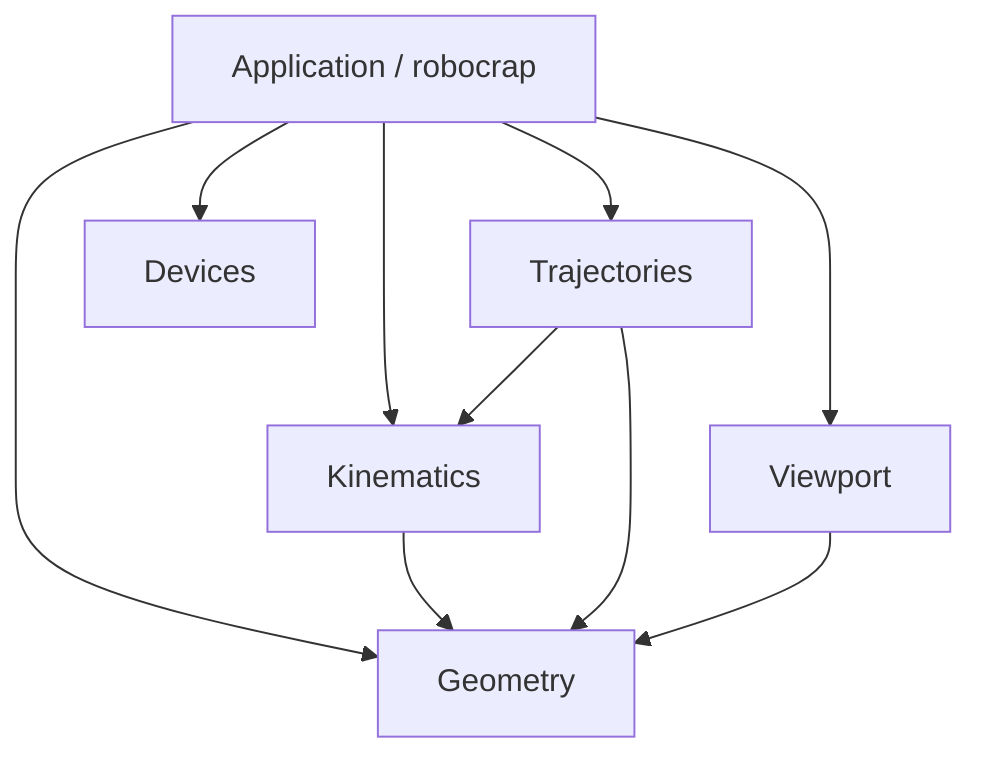

# RoboCrap: contracts, code reduction and architecture review

Revision: 2026-10-14. Evidence: current working tree at HEAD b656812, including existing uncommitted edits. All source references refer to this state. This document replaces the earlier folder-led proposal.

**The earlier plan was insufficient.** It kept broad interfaces, introduced an omnibus Core library, left the viewport dependent on application and planning objects, and relegated repeated calculations to optional cleanup. Its 250 files / 24,112 lines versus 252 files / up to 24,770 lines was not evidence of optimization. The revised plan begins with the operations and representations that disappear. Folder movement is packaging of those decisions.

This remains a review-only task. No source, build configuration, resource, AGENTS.md or docs/ARCHITECTURE.md is changed. Components and Styles are excluded from analysis and migration: their 20 files and 844 text lines remain where they are. No build, runtime, benchmark, test harness, RSI preparation or hardware action was executed. No speedup in milliseconds is claimed.

## 1. Target architecture and exact contracts

### 1.1 Six source owners, not nine broadly connected libraries

A source owner is one authored CMake target. Qt-generated plugin/resource/registration targets are supporting machinery. There is no Core library, no interfaces library, no service bus, and no generic job/strategy framework. Application is the executable which coordinates the use cases; it exports **no C++ API to the other five targets**. Its private classes remain separately responsible for document ownership, robot state, calibration, machining lifecycle and GUI integration. A single executable target does not imply a single application class.

| Folder / target | Purpose stated as an operation | Public contract | What it must not receive or own |
|---|---|---|---|
| `src/geometry` / RoboCrapGeometry | Fit measured surfaces and calculate their intersections. Supply the shared numerical coordinate types and rigid-transform operations used by these calculations. | Validated Plane/BoundedPlane/BoundedCylinder/Circle/EdgeGeometry values, compensated sample factories, intersection result, matrix/vector operations. Inputs are coordinates in mm and explicit probe metadata; results carry optional/error status. | Scene IDs, QObjects, selection, robot state, clocks, sockets, OCCT objects. File selection/reading belongs to Application; the legacy file-factory removal has a deferred RSI dependency (§6). |
| `src/kinematics` / RoboCrapKinematics | Calculate KR10 link transforms from joints, or angles/configuration from a flange target and preceding accepted solution. Supply numerical configuration and flange-comparison operations. | Kr10KinematicModel; separate forward result; IK result containing only joints and Status/Turn. Callers run full FK and check the flange/TCP from that array. Retain checked angle-seed IK for frozen RSI. Six joint values are degrees; transforms are BASE-relative with translations in mm. | CAD file paths, colors, QML lists, scene state, animation timing. It does not own a current robot pose. |
| `src/trajectories` / RoboCrapTrajectories | Prepare a complete robot animation and evaluate its joint coordinates at elapsed time. | Copied preparation request; immutable ChamferMotion/result/error/diagnostics; joint/phase evaluation; immutable display positions and saved preparation settings. Existing offline RSI functions remain a separate compatibility path within this target. | QObjects, scene lookups, renderer calls, GUI timers, devices, file dialogs. Inverse maps, scheduling, candidate search and spline assembly are private implementation stages. |
| `src/devices` / RoboCrapDevices | Exchange commands and measurements with connected devices. | Socket configuration, supported device operations, copied state/results; typed PLC frames/correlation; FTS sample values. Existing queued GUI/I/O boundary remains. | QML registration/property maps, scene objects, robot models or trajectory preparation. The last two dependencies can only be fully removed during explicitly reopened RSI work. |
| `src/viewport` / RoboCrapViewport | Install and update OCCT presentations and report picking/loading outcomes. | Stable display IDs, concrete drawing records, ordered link transforms (count supplied by the graphics description, not a dependency on KR10 LinkCount), CAD requests, visibility/selection changes, native-window/readiness state and operation results. See §1.3. | SceneModel, SceneObject, SceneMachining, SceneEndEffectors, ChamferMotion, ChamferPathParameters, RobotPreviewState or Kr10Model. It neither solves IK nor decides whether Generate/Dry Run is allowed. |
| `src/application` / robocrap | Execute the user's import, calibration, Generate and Dry Run workflow using the five capabilities above. | User-facing commands/properties through the existing application QML module; no exported include directory or library-facing C++ API. | It must not implement numerical fitting/IK/spline algorithms, protocol encoding or OCCT topology construction. Those remain in the capability that owns the calculation. |

Geometry includes basic linear algebra because it is already the shared numerical foundation; a seventh tiny Math library would add a build boundary without removing an application dependency. Conversely, Kinematics and Trajectories have different inputs, results and invariants and are worth separating. The application owns robot **configuration loading**: one JSON contains both numeric and visual configuration, so its loader creates a kinematic model and a neutral graphics description. It does not make Kinematics import a graphics type. Numerical validation remains in Kinematics.

The allowed final project dependencies are nine edges:



An edge means an allowed include/link dependency, not an event or data flow. Application's five outgoing edges are the explicit assembly of five capabilities. None of them calls Application. Viewport uses Geometry only for numerical values/matrices and, where useful, immutable analytic shape values; it cannot inspect preparation or document state. Devices has **no final numerical dependency**. During the animation-only migration it still has explicitly marked legacy RSI edges to Trajectories/Geometry/Kinematics; do not report their removal before the demo, offline audit and prepared-job input have actually changed.

CMake rules: each target owns sources in its folder; only `include/<capability>/...` is exported, never the repository or all of src. Application's headers are private. PUBLIC links are used only when a public value type requires the dependency; runtime implementation links are PRIVATE. Geometry exports Eigen's include requirement. Viewport's OCCT links stay PRIVATE. PRIVATE does not prevent deliberate relative includes; review must reject those too. No new CMake version is required.

QML registration is packaging, not a business capability. Compile current Backend foreign wrappers into robocrap's existing `robocrap_qml_module` in **both** hot-reload modes. Update current Backend imports together; retain names such as Scene, Machining and EndEffectors within that module. Delete the registration-only RoboCrapBackend target and its plugin link. Viewport retains `RoboCrap.Viewport3D`. Components/Styles and their URIs remain untouched. This explicitly changes the former Backend URI; it is not an accidental API loss. The complete affected import list is in §3.

### 1.2 Numerical contracts: inputs, results, acceptance and lifetime

| Boundary | Inputs and producer | Operations and returned result | Ownership, failure and checks |
|---|---|---|---|
| Import → Geometry | Application reads one local/qrc JSON; selects plane/cylinder/circle; decodes coordinates and probe metadata. | Fit the selected surface; plane/cylinder apply the same probe compensation; circle uses raw coordinates. Return the fitted value or failure. | Worker, if later introduced, owns copied input and returns one value. Only Application inserts it into the document. Keep current degeneracy/RMS/rank checks; no implicit unit conversion. |
| Application → Kinematics | Stable immutable model and six joints, or flange transform plus six-joint seed. | Forward computes seven link transforms; IK preserves branch/winding, computes the candidate transforms once, checks the existing flange residual and returns that same result. | Borrowed model must outlive the solver. Workers own their model snapshots. Do not move an owning RobotController while a solver refers to its old member. Result channels are return values. |
| Application → Trajectories | Analytic edge and cylinder frame, chamfer/lead settings, model snapshot, accepted flange-to-TCP transform, timing and simulation limits. | Prepare geometry, central inverse maps/time schedule, candidate-dependent IK, HOME/LIN timing and the three clamped splines; publish only a complete immutable motion with diagnostics or an error. | Geometry, distance and seconds remain distinct. Same candidate order, limits, winding, fixed pre-IK point schedule and rejection rules. No automatic point insertion or retiming. |
| Candidate-independent → candidate-dependent preparation | One Generate job's curve/timing and then each preceding LIN joint seed. | Lazily build three maps and the schedule once; retain analytical target prefixes; each candidate solves/checks its own joints. Return verified TCP+joint samples without repeating FK during assembly. | Cache belongs to this Generate call, not global state. Failed candidates do not publish partial motions. Keep error ordering and per-attempt diagnostics (§4 F2). |
| Trajectories → playback | Immutable motion and absolute elapsed seconds. | Evaluate HOME polynomial or prepared LIN/central spline; return six joints and phase. Application produces one robot pose and checks TCP finiteness using the **saved** calibration. | No IK, integration, map construction or new splines during Dry Run. Nonfinite time fails; finite out-of-range time clamps as now. Preserve TCP-returning evaluation for current RSI consumers. |
| Preparation result → document | Completed motion plus request token captured before dispatch. | Accept only if source/input, model/TCP revision and readiness remain valid; insert replacement before removing old path; preserve name/visibility; then select it. | Current active playback retains its own immutable motion. Source deletion can invalidate pending Generate but must not destroy an already saved motion. Selection changes must not substitute the running motion. |

A result is not “validated” merely because it has a new type name. Input invariants such as a finite calibrated transform may be checked once at entry and carried internally. New arithmetic still needs checks for overflow, nonfinite derivatives, positive time spans/pivots, joint position/speed, TCP reconstruction, central XYZ acceleration and polynomial extrema. The disabled joint-acceleration magnitude rejection remains disabled. Input checking, IK acceptance and spline-extrema checking are different operations and are not interchangeable.

For public motion encapsulation, do not hide a dependency with a forward declaration while continuing to export all internal getters. A completed motion may become a value handle to one immutable private data allocation; remove the outer shared_ptr wrapper at its owners if doing so, rather than adding another ownership layer. Existing central-motion getters needed by RSI remain until that consumer is migrated. No PIMPL conversion is required merely to make the early folder move look complete.

### 1.3 Renderer contract: exactly what crosses it

The application projects document/robot data once when that data changes. Renderer tool identifiers and graphics descriptions are renderer-owned values, not SceneEndEffectors::Tool or RobotVisualModel. It does not forward arbitrary backend QObjects. Keep these concrete records in the existing viewport public header; no standalone interfaces target or general scene-description framework is needed.

| Renderer operation | Required values | Result/use |
|---|---|---|
| Insert/replace object presentation | Stable application ID; analytic plane patch (origin, normal, in-plane axis, width/height), cylinder patch (origin, axis, radius/length), circle/ellipse, or existing phase polylines; display style. | Expected success/error. Renderer maps that ID to its own part IDs. Analytic surfaces remain analytic, not new meshes. |
| Change diagnostics | Existing ID and bounded marker/normal-line positions plus flags. | Reconcile only this object's diagnostic presentation. Preserve 256 marker / 128 normal-position limits, 64 ellipse markers and the single circle normal. |
| Change visibility / selection | ID+visible or the selected IDs. | Reconcile the selected **visible installed parts**, changing only entering/leaving/replaced presentations. Unchanged IDs alone are not sufficient to prove the selection representation is unchanged. |
| Update draft axis | Center, normalized signed direction and display length, or absent. | Update/remove one nonselectable axis. It does not receive chamfer feeds, lead settings or a whole ChamferPathParameters. |
| Install robot/tool graphics | Ordered absolute CAD sources, neutral colors/styles, request generation; selected tool identity. | CAD worker returns ordered shapes/errors; renderer rejects stale generations. No kinematic model is needed to parse or display those files. |
| Apply robot pose | Ordered BASE-relative link transforms and already composed tool/axis transforms. | Synchronous acceptance/error for AIS transformations. No joint-list conversion, FK or IK in Viewport. |
| Pick / native-surface events | Output stable application ID+selection modifier, native surface ready/lost, graphics ready/error. | Application decides selection and command availability. Surface recreation replays renderer-local cached drawing records/transforms. |

Current evidence: occsceneadapter.cpp:34–111 reads shape dimensions and saved TCP positions; :114–220 chooses diagnostic samples; :258–298 installs motion phases; :377–416 only needs the draft axis. occrobotadapter.cpp:19–41,56–121 consumes transforms and visual data. These are the actual fields behind the narrowed interface.

**Corrected acknowledgement contract:** today the pose is committed after AIS transformations are accepted, not after pixels have been drawn. occcontroller.cpp:503–517 commits after the window call; occviewport.cpp:110–114 schedules redraw; :187–200 redraws later and only logs exceptions. Preserve this synchronous acceptance policy initially with an explicit return result to Application. Remove the playback signal/reentrant failPlayback callback and isSignalConnected precondition. Do not invent a frame-presented guarantee.

Application remains responsible for the current policy “Generate/Dry Run requires ready robot graphics.” Model validity, native surface readiness, graphics readiness and hardware readiness are distinct. Moving model ownership does not authorize loosening that policy. Surface loss stops playback; restoration replays the last accepted state without changing the model revision.

### 1.4 Application responsibilities and the state that actually disappears

| Existing class/state | Revised responsibility and concrete change |
|---|---|
| SceneModel / SceneObject | Remain private document ownership and stable IDs. Keep named setters and read-only QML geometry views; QQmlListProperty is not itself a defect. Remove numerical planning imports from general public library interfaces because this is no longer a public Scene library. Add concrete projection operations in existing document implementation, not one wrapper per shape. |
| RobotPreviewState + OccController kinematic methods | Consolidate robot configuration, accepted pose and manual commands in Application's RobotController (reuse the existing state files). Return cohesive pose/error values, eliminating QString& outputs. Renderer receives the computed transforms. No second current robot state owner. |
| SceneEndEffectors | Own accepted calibration/tool choice. Cache the matrix reconstructed from the currently accepted XYZABC values once when they change; retain the existing list/equality semantics first. Supply matrices internally and formatted coordinates only to UI. See F4: blindly making the raw composed matrix canonical changes current numerics. |
| SceneMachining | Own one machining session: generation request/result and playback lifecycle. Keep its existing two distinct identities: selected input and active playback path. Remove the renderer callback cycle; use the application-owned robot operation result. Do not split a 404-line coordinator into several generic services solely to increase “single responsibility.” |
| Main.qml mode/selection handlers | Move their application operations into one private WorkspaceController: select/toggle, remove selected, intersect selected, switch mode. This is the only new application coordinator. It updates Machining/active tool and sends display changes in a defined order. Editor text, focus, dialog and panel visibility stay QML. |
| DeviceHub / DeviceRunner / DeviceProfileModel / Logger | Private Application I/O lifetime and QML adaptation. Keep queued worker commands and GUI-thread property maps. Do not create three repetitive device facades or a new Core library. |
| SceneMachiningPreparation | Separate, existing RSI workflow; retain behavior during animation work. Numerical sampling remains outside receive callbacks. Future changes listed as deferred. |

WorkspaceController has three actual application collaborators (document, machining session and robot controller), with an optional QObject parent only if ownership needs it. This is a justified constructor responsibility, not a parameter bag. Application's main constructs them in lifetime order, connects typed document/selection notifications to the renderer's concrete operations, and connects device shutdown separately. WorkspaceController need not take a fifth constructor argument for the renderer; it publishes the resulting selection/state change, while commands needing presentation acceptance return that result through RobotController.

The revised architecture does not promise that every application class knows only one other class. It requires that each operation has one owner, crosses a small value/command boundary, and cannot reach back into a lower capability's caller.

## 2. File plan and honest size accounting

```text
src/
  geometry/       CMakeLists.txt, numerical implementation, include/geometry/
  kinematics/     CMakeLists.txt, KR10 solver, include/kinematics/
  trajectories/   CMakeLists.txt, private preparation stages, include/trajectories/
  devices/        CMakeLists.txt, workers/codecs, include/devices/
  viewport/       CMakeLists.txt, OCCT/window/CAD implementation, include/viewport/
  application/    CMakeLists.txt, main, private document/robot/machining/device UI code, qml/
qml/Modules/Components/   excluded, unchanged
qml/Modules/Styles/       excluded, unchanged
resources/               existing application inputs, resource URLs retained
cmake/                   deployment orchestration
codex_plans/             review and future implementation plans
```

Resources need not move into a numerical or renderer library merely because the runtime reads them. Fixed robot/tool configuration and CAD source selection belong to Application; the renderer consumes the selected paths. Keep root CMake as project configuration/orchestration; each source folder declares its own one target. Existing public C++ names need not all be cosmetically renamed in the same phase.

Current inventory: **250 files / 24,112 text lines overall; 230 files / 23,268 text lines in this revised scope**. The 20 Components/Styles files are excluded. Binary CAD/font files count as files but contribute zero text LOC. Generated/build/vendor/old/python files and strategy documents are not counted. “Current assigned” below means current files assigned to a proposed owner, not the current compiled-target breakdown.

| Proposed owner | Current assigned files | Current text lines | Target files under explicit mapping | New files included |
|---|---:|---:|---:|---:|
| Build | 4 | 399 | 3 | 0 |
| Application | 54 | 7,114 | 57 | 3 |
| Deleted | 4 | 170 | 0 | 0 |
| Assets | 73 | 1,759 | 73 | 0 |
| Viewport | 32 | 4,228 | 32 | 0 |
| Kinematics | 3 | 443 | 4 | 1 |
| Geometry | 17 | 1,821 | 18 | 1 |
| Devices | 19 | 3,036 | 18 | 1 |
| Trajectories | 24 | 4,298 | 25 | 1 |

The mapping gives **230 retained/new in-scope files**, not a claimed code-reduction score: four unused files disappear, two socket helper files merge, the aggregate src/CMakeLists.txt is distributed into actual owners, and seven files are added (five target declarations plus WorkspaceController.h/.cpp). File count therefore stays flat. That is an explicit consequence, not a target to optimize by concatenating classes.

The old final-LOC forecast is withdrawn. The directly counted whole-file deletion is 170 lines; further method/branch deletions are enumerated in §5.1. Splitting an input/result, moving QML operations into C++, and projecting display values also adds some code. A defensible final LOC total requires those replacements to exist; moving 298 lines into another file never saved 298 lines. The acceptance metrics here are eliminated computations, stored payload, discarded interfaces and dependency edges. No unimplemented net LOC reduction is advertised.

### 2.1 Complete current-to-target mapping for the revised scope

“Move” here does not define phase priority. F/O references identify code changes before or alongside that packaging. Private files have no exported include path. During the explicitly deferred RSI transition, headers required by its current API remain reachable until the consumer changes; the final map is not a claim that those includes are already removable.

| Current path | Target path | Action |
|---|---|---|
| `cmake/DeployOcct.cmake` | `cmake/DeployOcct.cmake` | keep; orchestration/deployment paths updated |
| `CMakeLists.txt` | `CMakeLists.txt` | keep; orchestration/deployment paths updated |
| `hot_reload_config.json` | `hot_reload_config.json` | keep; orchestration/deployment paths updated |
| `qml/config.json` | `src/application/qml/config.json` | move; application imports/commands updated where listed |
| `qml/Main.qml` | `src/application/qml/Main.qml` | move; application imports/commands updated where listed |
| `qml/MenuBar/MainMenuBar.qml` | `src/application/qml/MenuBar/MainMenuBar.qml` | move; application imports/commands updated where listed |
| `qml/NavigationPanel/NavigationPanel.qml` | — | delete verified unused file |
| `qml/Views/Dashboard/DeltaPanel/DeltaModuleAP.qml` | `src/application/qml/Views/Dashboard/DeltaPanel/DeltaModuleAP.qml` | move; application imports/commands updated where listed |
| `qml/Views/Dashboard/DeltaPanel/DeltaModuleInput.qml` | `src/application/qml/Views/Dashboard/DeltaPanel/DeltaModuleInput.qml` | move; application imports/commands updated where listed |
| `qml/Views/Dashboard/DeltaPanel/DeltaModuleOutput.qml` | `src/application/qml/Views/Dashboard/DeltaPanel/DeltaModuleOutput.qml` | move; application imports/commands updated where listed |
| `qml/Views/Dashboard/DeltaPanel/DeltaPanel.qml` | `src/application/qml/Views/Dashboard/DeltaPanel/DeltaPanel.qml` | move; application imports/commands updated where listed |
| `qml/Views/Dashboard/DeltaPanel/LedsPanel.qml` | `src/application/qml/Views/Dashboard/DeltaPanel/LedsPanel.qml` | move; application imports/commands updated where listed |
| `qml/Views/Dashboard/FtsPanel/FtsBars.qml` | `src/application/qml/Views/Dashboard/FtsPanel/FtsBars.qml` | move; application imports/commands updated where listed |
| `qml/Views/Dashboard/FtsPanel/FtsPanel.qml` | `src/application/qml/Views/Dashboard/FtsPanel/FtsPanel.qml` | move; application imports/commands updated where listed |
| `qml/Views/Dashboard/KukaPanel/KukaPanel.qml` | `src/application/qml/Views/Dashboard/KukaPanel/KukaPanel.qml` | move; application imports/commands updated where listed |
| `qml/Views/Network/ConnectionsTable.qml` | `src/application/qml/Views/Network/ConnectionsTable.qml` | move; application imports/commands updated where listed |
| `qml/Views/Network/Network.qml` | `src/application/qml/Views/Network/Network.qml` | move; application imports/commands updated where listed |
| `qml/Views/Network/NetworkPanel.qml` | `src/application/qml/Views/Network/NetworkPanel.qml` | move; application imports/commands updated where listed |
| `qml/Views/Viewport3D/RobotViewport.qml` | `src/application/qml/Views/Viewport3D/RobotViewport.qml` | move; application imports/commands updated where listed |
| `qml/Views/Workspace/EndEffectorPanel.qml` | `src/application/qml/Views/Workspace/EndEffectorPanel.qml` | move; application imports/commands updated where listed |
| `qml/Views/Workspace/MachiningPanel.qml` | `src/application/qml/Views/Workspace/MachiningPanel.qml` | move; application imports/commands updated where listed |
| `qml/Views/Workspace/ModeToolBar.qml` | `src/application/qml/Views/Workspace/ModeToolBar.qml` | move; application imports/commands updated where listed |
| `qml/Views/Workspace/PropertiesPanel.qml` | `src/application/qml/Views/Workspace/PropertiesPanel.qml` | move; application imports/commands updated where listed |
| `qml/Views/Workspace/ScenePanel.qml` | `src/application/qml/Views/Workspace/ScenePanel.qml` | move; application imports/commands updated where listed |
| `qml/Views/Workspace/WorkflowPanel.qml` | `src/application/qml/Views/Workspace/WorkflowPanel.qml` | move; application imports/commands updated where listed |
| `resources/cad/kr10/0_BASE.brep` | `resources/cad/kr10/0_BASE.brep` | keep path/resource URL; application-owned input |
| `resources/cad/kr10/0_BASE.m3d` | `resources/cad/kr10/0_BASE.m3d` | keep original; omit from deployment |
| `resources/cad/kr10/0_BASE.stp` | `resources/cad/kr10/0_BASE.stp` | keep path/resource URL; application-owned input |
| `resources/cad/kr10/1_ROTATING_COLUMN.brep` | `resources/cad/kr10/1_ROTATING_COLUMN.brep` | keep path/resource URL; application-owned input |
| `resources/cad/kr10/1_ROTATING_COLUMN.m3d` | `resources/cad/kr10/1_ROTATING_COLUMN.m3d` | keep original; omit from deployment |
| `resources/cad/kr10/1_ROTATING_COLUMN.stp` | `resources/cad/kr10/1_ROTATING_COLUMN.stp` | keep path/resource URL; application-owned input |
| `resources/cad/kr10/2_LINK_ARM.brep` | `resources/cad/kr10/2_LINK_ARM.brep` | keep path/resource URL; application-owned input |
| `resources/cad/kr10/2_LINK_ARM.m3d` | `resources/cad/kr10/2_LINK_ARM.m3d` | keep original; omit from deployment |
| `resources/cad/kr10/2_LINK_ARM.stp` | `resources/cad/kr10/2_LINK_ARM.stp` | keep path/resource URL; application-owned input |
| `resources/cad/kr10/3_IN-LINE_WRIST.brep` | `resources/cad/kr10/3_IN-LINE_WRIST.brep` | keep path/resource URL; application-owned input |
| `resources/cad/kr10/3_IN-LINE_WRIST.m3d` | `resources/cad/kr10/3_IN-LINE_WRIST.m3d` | keep original; omit from deployment |
| `resources/cad/kr10/3_IN-LINE_WRIST.stp` | `resources/cad/kr10/3_IN-LINE_WRIST.stp` | keep path/resource URL; application-owned input |
| `resources/cad/kr10/4_WRIST1.brep` | `resources/cad/kr10/4_WRIST1.brep` | keep path/resource URL; application-owned input |
| `resources/cad/kr10/4_WRIST1.m3d` | `resources/cad/kr10/4_WRIST1.m3d` | keep original; omit from deployment |
| `resources/cad/kr10/4_WRIST1.stp` | `resources/cad/kr10/4_WRIST1.stp` | keep path/resource URL; application-owned input |
| `resources/cad/kr10/5_WRIST2.brep` | `resources/cad/kr10/5_WRIST2.brep` | keep path/resource URL; application-owned input |
| `resources/cad/kr10/5_WRIST2.m3d` | `resources/cad/kr10/5_WRIST2.m3d` | keep original; omit from deployment |
| `resources/cad/kr10/5_WRIST2.stp` | `resources/cad/kr10/5_WRIST2.stp` | keep path/resource URL; application-owned input |
| `resources/cad/kr10/6_WRIST3.brep` | `resources/cad/kr10/6_WRIST3.brep` | keep path/resource URL; application-owned input |
| `resources/cad/kr10/6_WRIST3.m3d` | `resources/cad/kr10/6_WRIST3.m3d` | keep original; omit from deployment |
| `resources/cad/kr10/6_WRIST3.stp` | `resources/cad/kr10/6_WRIST3.stp` | keep path/resource URL; application-owned input |
| `resources/cad/kr10/MEE.stp` | `resources/cad/kr10/MEE.stp` | keep path/resource URL; application-owned input |
| `resources/cad/kr10/SEE.stp` | `resources/cad/kr10/SEE.stp` | keep path/resource URL; application-owned input |
| `resources/files.qrc` | — | delete verified unused file |
| `resources/files/blade/242.json` | `resources/files/blade/242.json` | keep path/resource URL; application-owned input |
| `resources/files/rsi/RSI_CorrectionLimits.example.json` | `resources/files/rsi/RSI_CorrectionLimits.example.json` | keep path/resource URL; application-owned input |
| `resources/files/rsi/RSI_Hole_CONTRACT.md` | `resources/files/rsi/RSI_Hole_CONTRACT.md` | keep path/resource URL; application-owned input |
| `resources/files/rsi/RSI_Hole_DIAGRAM.md` | `resources/files/rsi/RSI_Hole_DIAGRAM.md` | keep path/resource URL; application-owned input |
| `resources/files/rsi/RSI_Hole_EthernetConfig.xml` | `resources/files/rsi/RSI_Hole_EthernetConfig.xml` | keep path/resource URL; application-owned input |
| `resources/files/rsi/RSI_Hole.dat` | `resources/files/rsi/RSI_Hole.dat` | keep path/resource URL; application-owned input |
| `resources/files/rsi/RSI_Hole.src` | `resources/files/rsi/RSI_Hole.src` | keep path/resource URL; application-owned input |
| `resources/files/rsi/RSI_request_example.xml` | `resources/files/rsi/RSI_request_example.xml` | keep path/resource URL; application-owned input |
| `resources/files/rsi/RSI_responce_example.xml` | `resources/files/rsi/RSI_responce_example.xml` | keep path/resource URL; application-owned input |
| `resources/fonts.qrc` | `resources/fonts.qrc` | keep path/resource URL; application-owned input |
| `resources/fonts/roboto/Roboto-Bold.ttf` | `resources/fonts/roboto/Roboto-Bold.ttf` | keep path/resource URL; application-owned input |
| `resources/fonts/roboto/Roboto-Medium.ttf` | `resources/fonts/roboto/Roboto-Medium.ttf` | keep path/resource URL; application-owned input |
| `resources/fonts/roboto/Roboto-Regular.ttf` | `resources/fonts/roboto/Roboto-Regular.ttf` | keep path/resource URL; application-owned input |
| `resources/json.qrc` | `resources/json.qrc` | keep path/resource URL; application-owned input |
| `resources/json/circ/circle_12_noisy_points.json` | `resources/json/circ/circle_12_noisy_points.json` | keep path/resource URL; application-owned input |
| `resources/json/circ/circle_3_points.json` | `resources/json/circ/circle_3_points.json` | keep path/resource URL; application-owned input |
| `resources/json/db.json` | `resources/json/db.json` | keep path/resource URL; application-owned input |
| `resources/json/edge_2planes/XS.json` | `resources/json/edge_2planes/XS.json` | keep path/resource URL; application-owned input |
| `resources/json/edge_2planes/XT.json` | `resources/json/edge_2planes/XT.json` | keep path/resource URL; application-owned input |
| `resources/json/edge_cyl_plane/XC.json` | `resources/json/edge_cyl_plane/XC.json` | keep path/resource URL; application-owned input |
| `resources/json/edge_cyl_plane/XP.json` | `resources/json/edge_cyl_plane/XP.json` | keep path/resource URL; application-owned input |
| `resources/json/ellipse_sample.json` | `resources/json/ellipse_sample.json` | keep path/resource URL; application-owned input |
| `resources/json/kr10.json` | `resources/json/kr10.json` | keep path/resource URL; application-owned input |
| `resources/pics.qrc` | `resources/pics.qrc` | keep path/resource URL; application-owned input |
| `resources/pics/arrow_dropdown.svg` | `resources/pics/arrow_dropdown.svg` | keep path/resource URL; application-owned input |
| `resources/pics/circ.svg` | `resources/pics/circ.svg` | keep path/resource URL; application-owned input |
| `resources/pics/cone.svg` | `resources/pics/cone.svg` | keep path/resource URL; application-owned input |
| `resources/pics/cylinder.svg` | `resources/pics/cylinder.svg` | keep path/resource URL; application-owned input |
| `resources/pics/dry.svg` | `resources/pics/dry.svg` | keep path/resource URL; application-owned input |
| `resources/pics/edge.svg` | `resources/pics/edge.svg` | keep path/resource URL; application-owned input |
| `resources/pics/eye.svg` | `resources/pics/eye.svg` | keep path/resource URL; application-owned input |
| `resources/pics/folder_full.svg` | `resources/pics/folder_full.svg` | keep path/resource URL; application-owned input |
| `resources/pics/generate_path.svg` | `resources/pics/generate_path.svg` | keep path/resource URL; application-owned input |
| `resources/pics/intersec.svg` | `resources/pics/intersec.svg` | keep path/resource URL; application-owned input |
| `resources/pics/lock.svg` | `resources/pics/lock.svg` | keep path/resource URL; application-owned input |
| `resources/pics/logo.svg` | `resources/pics/logo.svg` | keep path/resource URL; application-owned input |
| `resources/pics/machining.svg` | `resources/pics/machining.svg` | keep path/resource URL; application-owned input |
| `resources/pics/measuring.svg` | `resources/pics/measuring.svg` | keep path/resource URL; application-owned input |
| `resources/pics/open.svg` | `resources/pics/open.svg` | keep path/resource URL; application-owned input |
| `resources/pics/path.svg` | `resources/pics/path.svg` | keep path/resource URL; application-owned input |
| `resources/pics/pause.svg` | `resources/pics/pause.svg` | keep path/resource URL; application-owned input |
| `resources/pics/plane.svg` | `resources/pics/plane.svg` | keep path/resource URL; application-owned input |
| `resources/pics/precise.svg` | `resources/pics/precise.svg` | keep path/resource URL; application-owned input |
| `resources/pics/rough.svg` | `resources/pics/rough.svg` | keep path/resource URL; application-owned input |
| `resources/pics/rsi_sampling.svg` | `resources/pics/rsi_sampling.svg` | keep path/resource URL; application-owned input |
| `resources/pics/run.svg` | `resources/pics/run.svg` | keep path/resource URL; application-owned input |
| `resources/pics/scan.svg` | `resources/pics/scan.svg` | keep path/resource URL; application-owned input |
| `resources/pics/settings.svg` | `resources/pics/settings.svg` | keep path/resource URL; application-owned input |
| `resources/pics/stop.svg` | `resources/pics/stop.svg` | keep path/resource URL; application-owned input |
| `src/3d/adapters/occrobotadapter.cpp` | `src/viewport/adapters/occrobotadapter.cpp` | move; renderer-only contracts and local changes (F5) |
| `src/3d/adapters/occrobotadapter.h` | `src/viewport/adapters/occrobotadapter.h` | move; renderer-only contracts and local changes (F5) |
| `src/3d/adapters/occsceneadapter.cpp` | `src/viewport/adapters/occsceneadapter.cpp` | move; renderer-only contracts and local changes (F5) |
| `src/3d/adapters/occsceneadapter.h` | `src/viewport/adapters/occsceneadapter.h` | move; renderer-only contracts and local changes (F5) |
| `src/3d/chamferprofile.cpp` | `src/application/chamferprofile.cpp` | move; adapt numerical/configuration inputs |
| `src/3d/chamferprofile.h` | `src/application/chamferprofile.h` | move; adapt numerical/configuration inputs |
| `src/3d/CMakeLists.txt` | `src/viewport/CMakeLists.txt` | move; renderer-only contracts and local changes (F5) |
| `src/3d/occcontroller.cpp` | `src/viewport/occcontroller.cpp` | move; renderer-only contracts and local changes (F5) |
| `src/3d/occcontroller.h` | `src/viewport/include/viewport/occcontroller.h` | move; renderer-only contracts and local changes (F5) |
| `src/3d/occt/cachedshapeloader.cpp` | `src/viewport/occt/cachedshapeloader.cpp` | move; renderer-only contracts and local changes (F5) |
| `src/3d/occt/cachedshapeloader.h` | `src/viewport/occt/cachedshapeloader.h` | move; renderer-only contracts and local changes (F5) |
| `src/3d/occt/cadloadresult.h` | `src/viewport/occt/cadloadresult.h` | move; renderer-only contracts and local changes (F5) |
| `src/3d/occt/cadloadworker.cpp` | `src/viewport/occt/cadloadworker.cpp` | move; renderer-only contracts and local changes (F5) |
| `src/3d/occt/cadloadworker.h` | `src/viewport/occt/cadloadworker.h` | move; renderer-only contracts and local changes (F5) |
| `src/3d/occt/occinputcontroller.cpp` | `src/viewport/occt/occinputcontroller.cpp` | move; renderer-only contracts and local changes (F5) |
| `src/3d/occt/occinputcontroller.h` | `src/viewport/occt/occinputcontroller.h` | move; renderer-only contracts and local changes (F5) |
| `src/3d/occt/occpart.cpp` | `src/viewport/occt/occpart.cpp` | move; renderer-only contracts and local changes (F5) |
| `src/3d/occt/occpart.h` | `src/viewport/occt/occpart.h` | move; renderer-only contracts and local changes (F5) |
| `src/3d/occt/occpartprops.h` | `src/viewport/occt/occpartprops.h` | move; renderer-only contracts and local changes (F5) |
| `src/3d/occt/occscene.cpp` | `src/viewport/occt/occscene.cpp` | move; renderer-only contracts and local changes (F5) |
| `src/3d/occt/occscene.h` | `src/viewport/occt/occscene.h` | move; renderer-only contracts and local changes (F5) |
| `src/3d/occt/occviewcube.cpp` | `src/viewport/occt/occviewcube.cpp` | move; renderer-only contracts and local changes (F5) |
| `src/3d/occt/occviewcube.h` | `src/viewport/occt/occviewcube.h` | move; renderer-only contracts and local changes (F5) |
| `src/3d/occt/occviewer.cpp` | `src/viewport/occt/occviewer.cpp` | move; renderer-only contracts and local changes (F5) |
| `src/3d/occt/occviewer.h` | `src/viewport/occt/occviewer.h` | move; renderer-only contracts and local changes (F5) |
| `src/3d/occt/occviewport.cpp` | `src/viewport/occt/occviewport.cpp` | move; renderer-only contracts and local changes (F5) |
| `src/3d/occt/occviewport.h` | `src/viewport/occt/occviewport.h` | move; renderer-only contracts and local changes (F5) |
| `src/3d/occt/occviewwindow.cpp` | `src/viewport/occt/occviewwindow.cpp` | move; renderer-only contracts and local changes (F5) |
| `src/3d/occt/occviewwindow.h` | `src/viewport/occt/occviewwindow.h` | move; renderer-only contracts and local changes (F5) |
| `src/3d/occt/occworldaxes.cpp` | `src/viewport/occt/occworldaxes.cpp` | move; renderer-only contracts and local changes (F5) |
| `src/3d/occt/occworldaxes.h` | `src/viewport/occt/occworldaxes.h` | move; renderer-only contracts and local changes (F5) |
| `src/3d/occt/stepimporter.cpp` | `src/viewport/occt/stepimporter.cpp` | move; renderer-only contracts and local changes (F5) |
| `src/3d/occt/stepimporter.h` | `src/viewport/occt/stepimporter.h` | move; renderer-only contracts and local changes (F5) |
| `src/3d/robot/kinematics/kr10kinematics.cpp` | `src/kinematics/kr10kinematics.cpp` | move; return computed IK transforms (F3) |
| `src/3d/robot/kinematics/kr10kinematics.h` | `src/kinematics/include/kinematics/kr10kinematics.h` | move; return computed IK transforms (F3) |
| `src/3d/robot/model/kr10kinematicmodel.h` | `src/kinematics/include/kinematics/kr10kinematicmodel.h` | move; return computed IK transforms (F3) |
| `src/3d/robot/model/kr10model.cpp` | `src/application/robot/robotdefinition.cpp` | move/rename; numeric model and neutral graphics outputs (F4) |
| `src/3d/robot/model/kr10model.h` | `src/application/robot/robotdefinition.h` | move/rename; numeric model and neutral graphics outputs (F4) |
| `src/3d/robot/robotpreviewstate.cpp` | `src/application/robot/robotcontroller.cpp` | move/rename; absorb robot operations, remove renderer state ownership (F3/F4) |
| `src/3d/robot/robotpreviewstate.h` | `src/application/robot/robotcontroller.h` | move/rename; absorb robot operations, remove renderer state ownership (F3/F4) |
| `src/3d/viewportassets.cpp` | `src/application/assetpaths.cpp` | move/rename; application chooses deployed assets |
| `src/3d/viewportassets.h` | `src/application/assetpaths.h` | move/rename; application chooses deployed assets |
| `src/3d/viewportqmltypes.h` | `src/viewport/viewportqmltypes.h` | move; renderer-only contracts and local changes (F5) |
| `src/backendqmltypes.h` | `src/application/backendqmltypes.h` | move; application private registration/composition |
| `src/CMakeLists.txt` | `CMakeLists.txt + per-target CMakeLists.txt` | merge ownership declarations; remove aggregate file |
| `src/geometry/boundedcylinder.cpp` | `src/geometry/boundedcylinder.cpp` | keep/move; narrow used API and file-I/O boundary |
| `src/geometry/boundedcylinder.h` | `src/geometry/include/geometry/boundedcylinder.h` | keep/move; narrow used API and file-I/O boundary |
| `src/geometry/boundedplane.cpp` | `src/geometry/boundedplane.cpp` | keep/move; narrow used API and file-I/O boundary |
| `src/geometry/boundedplane.h` | `src/geometry/include/geometry/boundedplane.h` | keep/move; narrow used API and file-I/O boundary |
| `src/geometry/circle.cpp` | `src/geometry/circle.cpp` | keep/move; narrow used API and file-I/O boundary |
| `src/geometry/circle.h` | `src/geometry/include/geometry/circle.h` | keep/move; narrow used API and file-I/O boundary |
| `src/geometry/cylinder.cpp` | `src/geometry/cylinder.cpp` | keep/move; narrow used API and file-I/O boundary |
| `src/geometry/cylinder.h` | `src/geometry/include/geometry/cylinder.h` | keep/move; narrow used API and file-I/O boundary |
| `src/geometry/mathtypes.h` | `src/geometry/include/geometry/mathtypes.h` | keep/move; narrow used API and file-I/O boundary |
| `src/geometry/plane.cpp` | `src/geometry/plane.cpp` | keep/move; narrow used API and file-I/O boundary |
| `src/geometry/plane.h` | `src/geometry/include/geometry/plane.h` | keep/move; narrow used API and file-I/O boundary |
| `src/geometry/pose.cpp` | `src/geometry/pose.cpp` | keep/move; narrow used API and file-I/O boundary |
| `src/geometry/pose.h` | `src/geometry/include/geometry/pose.h` | keep/move; narrow used API and file-I/O boundary |
| `src/geometry/surfaceintersection.cpp` | `src/geometry/surfaceintersection.cpp` | keep/move; narrow used API and file-I/O boundary |
| `src/geometry/surfaceintersection.h` | `src/geometry/include/geometry/surfaceintersection.h` | keep/move; narrow used API and file-I/O boundary |
| `src/geometry/utils.cpp` | `src/geometry/utils.cpp` | keep/move; narrow used API and file-I/O boundary |
| `src/geometry/utils.h` | `src/geometry/include/geometry/utils.h` | keep/move; narrow used API and file-I/O boundary |
| `src/logger.cpp` | `src/application/logger.cpp` | move; application private registration/composition |
| `src/logger.h` | `src/application/logger.h` | move; application private registration/composition |
| `src/main.cpp` | `src/application/main.cpp` | move; application private registration/composition |
| `src/network/abstractdevice.cpp` | `src/devices/abstractdevice.cpp` | move; preserve I/O ownership |
| `src/network/abstractdevice.h` | `src/devices/include/devices/abstractdevice.h` | move; preserve I/O ownership |
| `src/network/common/deviceprofilemodel.cpp` | `src/application/devices/deviceprofilemodel.cpp` | move; GUI adaptation/lifetime retained |
| `src/network/common/deviceprofilemodel.h` | `src/application/devices/deviceprofilemodel.h` | move; GUI adaptation/lifetime retained |
| `src/network/common/loggermessage.h` | `src/devices/include/devices/common/loggermessage.h` | move; preserve I/O ownership |
| `src/network/common/socketconfigutils.h` | `src/devices/common/socketconfigutils.h` | move; preserve I/O ownership |
| `src/network/common/socketstateutils.cpp` | `src/devices/abstractdevice.cpp` | merge sole-used helper into unnamed namespace |
| `src/network/common/socketstateutils.h` | `src/devices/abstractdevice.cpp` | merge sole-used helper into unnamed namespace |
| `src/network/devicehub.cpp` | `src/application/devices/devicehub.cpp` | move; GUI adaptation/lifetime retained |
| `src/network/devicehub.h` | `src/application/devices/devicehub.h` | move; GUI adaptation/lifetime retained |
| `src/network/devicerunner.cpp` | `src/application/devices/devicerunner.cpp` | move; GUI adaptation/lifetime retained |
| `src/network/devicerunner.h` | `src/application/devices/devicerunner.h` | move; GUI adaptation/lifetime retained |
| `src/network/fts/ftsdevice.cpp` | `src/devices/fts/ftsdevice.cpp` | move; one pending sample (O5) |
| `src/network/fts/ftsdevice.h` | `src/devices/include/devices/fts/ftsdevice.h` | move; one pending sample (O5) |
| `src/network/fts/rdtmessage.h` | `src/devices/include/devices/fts/rdtmessage.h` | move; one pending sample (O5) |
| `src/network/plc/plcdevice.cpp` | `src/devices/plc/plcdevice.cpp` | move; typed codec/correlation (F6) |
| `src/network/plc/plcdevice.h` | `src/devices/include/devices/plc/plcdevice.h` | move; typed codec/correlation (F6) |
| `src/network/plc/plcmessagemanager.cpp` | `src/devices/plc/plcmessagemanager.cpp` | move; typed codec/correlation (F6) |
| `src/network/plc/plcmessagemanager.h` | `src/devices/plc/plcmessagemanager.h` | move; typed codec/correlation (F6) |
| `src/network/rsi/rsidevice.cpp` | `src/devices/rsi/rsidevice.cpp` | move; numerical dependencies explicitly deferred |
| `src/network/rsi/rsidevice.h` | `src/devices/include/devices/rsi/rsidevice.h` | move; numerical dependencies explicitly deferred |
| `src/network/rsi/rsiholeprotocol.cpp` | `src/devices/rsi/rsiholeprotocol.cpp` | move; numerical dependencies explicitly deferred |
| `src/network/rsi/rsiholeprotocol.h` | `src/devices/rsi/rsiholeprotocol.h` | move; numerical dependencies explicitly deferred |
| `src/network/rsi/rsiprotocol.cpp` | `src/devices/rsi/rsiprotocol.cpp` | move; numerical dependencies explicitly deferred |
| `src/network/rsi/rsiprotocol.h` | `src/devices/rsi/rsiprotocol.h` | move; numerical dependencies explicitly deferred |
| `src/pathgeneration/chamfer/chamferarclength.cpp` | `src/trajectories/chamfer/chamferarclength.cpp` | move; F2/F3/O1–O4 as applicable; internal stages private |
| `src/pathgeneration/chamfer/chamferarclength.h` | `src/trajectories/chamfer/chamferarclength.h` | move; F2/F3/O1–O4 as applicable; internal stages private |
| `src/pathgeneration/chamfer/chamfercartesiansampler.cpp` | `src/trajectories/chamfer/chamfercartesiansampler.cpp` | move; F2/F3/O1–O4 as applicable; internal stages private |
| `src/pathgeneration/chamfer/chamfercartesiansampler.h` | `src/trajectories/chamfer/chamfercartesiansampler.h` | move; F2/F3/O1–O4 as applicable; internal stages private |
| `src/pathgeneration/chamfer/chamfercentralmotion.cpp` | `src/trajectories/chamfer/chamfercentralmotion.cpp` | move; F2/F3/O1–O4 as applicable; internal stages private |
| `src/pathgeneration/chamfer/chamfercentralmotion.h` | `src/trajectories/chamfer/chamfercentralmotion.h` | move; F2/F3/O1–O4 as applicable; internal stages private |
| `src/pathgeneration/chamfer/chamfercentralvalidation.cpp` | `src/trajectories/chamfer/chamfercentralvalidation.cpp` | move; F2/F3/O1–O4 as applicable; internal stages private |
| `src/pathgeneration/chamfer/chamfercentralvalidation.h` | `src/trajectories/chamfer/chamfercentralvalidation.h` | move; F2/F3/O1–O4 as applicable; internal stages private |
| `src/pathgeneration/chamfer/chamferjob.cpp` | `src/trajectories/chamfer/chamferjob.cpp` | move; F2/F3/O1–O4 as applicable; internal stages private |
| `src/pathgeneration/chamfer/chamferjob.h` | `src/trajectories/include/trajectories/chamferjob.h` | move; F2/F3/O1–O4 as applicable; internal stages private |
| `src/pathgeneration/chamfer/chamfermotion.cpp` | `src/trajectories/chamfer/chamfermotion.cpp` | move; F2/F3/O1–O4 as applicable; internal stages private |
| `src/pathgeneration/chamfer/chamfermotion.h` | `src/trajectories/include/trajectories/chamfermotion.h` | move; F2/F3/O1–O4 as applicable; internal stages private |
| `src/pathgeneration/chamfer/chamferpath.cpp` | `src/trajectories/chamfer/chamferpath.cpp` | move; F2/F3/O1–O4 as applicable; internal stages private |
| `src/pathgeneration/chamfer/chamferpath.h` | `src/trajectories/chamfer/chamferpath.h` | move; F2/F3/O1–O4 as applicable; internal stages private |
| `src/pathgeneration/chamfer/chamferpreparationdiagnostics.h` | `src/trajectories/chamfer/chamferpreparationdiagnostics.h` | move; F2/F3/O1–O4 as applicable; internal stages private |
| `src/pathgeneration/chamfer/rsicorrectionlimits.cpp` | `src/trajectories/chamfer/rsicorrectionlimits.cpp` | move; existing RSI behavior retained/deferred |
| `src/pathgeneration/chamfer/rsicorrectionlimits.h` | `src/trajectories/include/trajectories/rsicorrectionlimits.h` | move; existing RSI behavior retained/deferred |
| `src/pathgeneration/chamfer/rsiposeencoder.cpp` | `src/trajectories/chamfer/rsiposeencoder.cpp` | move; existing RSI behavior retained/deferred |
| `src/pathgeneration/chamfer/rsiposeencoder.h` | `src/trajectories/chamfer/rsiposeencoder.h` | move; existing RSI behavior retained/deferred |
| `src/pathgeneration/rsi/motionprofile.h` | `src/trajectories/rsi/motionprofile.h` | move; existing RSI behavior retained/deferred |
| `src/pathgeneration/rsi/offsetjsonwriter.cpp` | `src/trajectories/rsi/offsetjsonwriter.cpp` | move; existing RSI behavior retained/deferred |
| `src/pathgeneration/rsi/offsetjsonwriter.h` | `src/trajectories/rsi/offsetjsonwriter.h` | move; existing RSI behavior retained/deferred |
| `src/pathgeneration/rsi/rsipath.cpp` | `src/trajectories/rsi/rsipath.cpp` | move; existing RSI behavior retained/deferred |
| `src/pathgeneration/rsi/rsipath.h` | `src/trajectories/rsi/rsipath.h` | move; existing RSI behavior retained/deferred |
| `src/qmlchartbridge.cpp` | — | delete verified unused file |
| `src/qmlchartbridge.h` | — | delete verified unused file |
| `src/scene/chamfershareddata.cpp` | `src/application/scene/chamfershareddata.cpp` | move; private document/calibration/machining contracts (F4) |
| `src/scene/chamfershareddata.h` | `src/application/scene/chamfershareddata.h` | move; private document/calibration/machining contracts (F4) |
| `src/scene/sceneendeffectors.cpp` | `src/application/scene/sceneendeffectors.cpp` | move; private document/calibration/machining contracts (F4) |
| `src/scene/sceneendeffectors.h` | `src/application/scene/sceneendeffectors.h` | move; private document/calibration/machining contracts (F4) |
| `src/scene/scenegeometry.h` | `src/application/scene/scenegeometry.h` | move; private document/calibration/machining contracts (F4) |
| `src/scene/scenemachining.cpp` | `src/application/scene/scenemachining.cpp` | move; private document/calibration/machining contracts (F4) |
| `src/scene/scenemachining.h` | `src/application/scene/scenemachining.h` | move; private document/calibration/machining contracts (F4) |
| `src/scene/scenemachiningpreparation.cpp` | `src/application/scene/scenemachiningpreparation.cpp` | move; private document/calibration/machining contracts (F4) |
| `src/scene/scenemachiningpreparation.h` | `src/application/scene/scenemachiningpreparation.h` | move; private document/calibration/machining contracts (F4) |
| `src/scene/scenemodel.cpp` | `src/application/scene/scenemodel.cpp` | move; private document/calibration/machining contracts (F4) |
| `src/scene/scenemodel.h` | `src/application/scene/scenemodel.h` | move; private document/calibration/machining contracts (F4) |
| `src/scene/sceneobject.cpp` | `src/application/scene/sceneobject.cpp` | move; private document/calibration/machining contracts (F4) |
| `src/scene/sceneobject.h` | `src/application/scene/sceneobject.h` | move; private document/calibration/machining contracts (F4) |
| `src/scene/scenesurfaceimporter.cpp` | `src/application/scene/scenesurfaceimporter.cpp` | move; private document/calibration/machining contracts (F4) |
| `src/scene/scenesurfaceimporter.h` | `src/application/scene/scenesurfaceimporter.h` | move; private document/calibration/machining contracts (F4) |

### 2.2 New files, with their current requirement

| New path | Why it exists |
|---|---|
| `src/geometry/CMakeLists.txt` | new target-local ownership declaration; code moved from existing CMake |
| `src/kinematics/CMakeLists.txt` | new target-local ownership declaration; code moved from existing CMake |
| `src/trajectories/CMakeLists.txt` | new target-local ownership declaration; code moved from existing CMake |
| `src/devices/CMakeLists.txt` | new target-local ownership declaration; code moved from existing CMake |
| `src/application/CMakeLists.txt` | new target-local ownership declaration; code moved from existing CMake |
| `src/application/workspacecontroller.h` | new private user-operation coordinator (F4) |
| `src/application/workspacecontroller.cpp` | new; absorbs actual Main application operations (F4) |

No separate generic presenter, job manager, repository, renderer model, interfaces target or trio of device QML facades is added. Concrete display record definitions fit the existing viewport public header. Projection code belongs in existing application document/robot implementation files. Internal numerical preparation values belong beside their current algorithms.

## 3. Actual dependencies, removed edges and API migration

The reviewed C++ files contain **223 quoted project includes**, all resolved to existing files. Under the revised ownership mapping, 70 cross owners; 27 violate the final direction. This count is different from the old 98 cross-directory includes: directories and responsibility owners are not the same thing. Private-header violations are additional to direction violations.

### 3.1 Current build graph

| Current owner | Actual project links / source ownership |
|---|---|
| RoboCrapGeometry | Geometry, KR10 solver/model and all pathgeneration compile together; PUBLIC src/Eigen and QtCore. |
| RoboCrapScene | PUBLIC Geometry and QtQml; all scene coordinators and object wrappers. |
| RoboCrapDevices | PUBLIC Geometry, QtNetwork and QtQml; worker and GUI adapter code mixed. |
| RoboCrapBackend | Registration-only QML module; PUBLIC Scene and Devices. |
| RoboCrap3D | PUBLIC Geometry; PRIVATE Scene and OCCT; broad PUBLIC src; also owns robot configuration/state and profiling CLI. |
| robocrap | Links Backend/plugin, Scene, Devices, 3D/plugin and UI modules; main, Logger, unused chart bridge and QML/resources. |

Evidence: src/CMakeLists.txt:4–140, src/3d/CMakeLists.txt:33–79, CMakeLists.txt:57–167. This graph is already acyclic; claiming an existing CMake cycle would be false. Its defect is that targets expose entire object graphs and shared src include paths, not that every edge is literally bidirectional.

### 3.2 Every direct include crossing the proposed forbidden direction

| Include site | Included current file | Current values to replace / migration |
|---|---|---|
| `src/3d/occcontroller.cpp:2` | `src/scene/scenemachining.h` | Replace application state/model access with concrete renderer values and returned outcomes (F3–F5). |
| `src/3d/occcontroller.cpp:7` | `src/3d/robot/robotpreviewstate.h` | Replace application state/model access with concrete renderer values and returned outcomes (F3–F5). |
| `src/3d/occcontroller.cpp:8` | `src/scene/scenemodel.h` | Replace application state/model access with concrete renderer values and returned outcomes (F3–F5). |
| `src/3d/occcontroller.cpp:9` | `src/scene/sceneobject.h` | Replace application state/model access with concrete renderer values and returned outcomes (F3–F5). |
| `src/3d/occcontroller.cpp:10` | `src/3d/viewportassets.h` | Pass application-resolved absolute asset paths. |
| `src/3d/occcontroller.h:3` | `src/scene/sceneendeffectors.h` | Replace application state/model access with concrete renderer values and returned outcomes (F3–F5). |
| `src/3d/adapters/occrobotadapter.h:4` | `src/3d/robot/model/kr10model.h` | Replace application state/model access with concrete renderer values and returned outcomes (F3–F5). |
| `src/3d/adapters/occrobotadapter.h:6` | `src/scene/sceneendeffectors.h` | Replace application state/model access with concrete renderer values and returned outcomes (F3–F5). |
| `src/3d/adapters/occsceneadapter.cpp:3` | `src/scene/scenemodel.h` | Replace application state/model access with concrete renderer values and returned outcomes (F3–F5). |
| `src/3d/adapters/occsceneadapter.cpp:4` | `src/scene/sceneobject.h` | Replace application state/model access with concrete renderer values and returned outcomes (F3–F5). |
| `src/3d/adapters/occsceneadapter.h:4` | `src/pathgeneration/chamfer/chamferpath.h` | Replace path settings/motion access with projected axis/polylines (F5). |
| `src/3d/occt/occviewport.h:5` | `src/3d/robot/robotpreviewstate.h` | Replace application state/model access with concrete renderer values and returned outcomes (F3–F5). |
| `src/3d/occt/occviewwindow.cpp:4` | `src/scene/scenemodel.h` | Replace application state/model access with concrete renderer values and returned outcomes (F3–F5). |
| `src/3d/occt/occviewwindow.h:3` | `src/3d/robot/robotpreviewstate.h` | Replace application state/model access with concrete renderer values and returned outcomes (F3–F5). |
| `src/3d/occt/occviewwindow.h:5` | `src/scene/sceneendeffectors.h` | Replace application state/model access with concrete renderer values and returned outcomes (F3–F5). |
| `src/3d/occt/occviewwindow.h:6` | `src/pathgeneration/chamfer/chamferpath.h` | Replace path settings/motion access with projected axis/polylines (F5). |
| `src/network/rsi/rsidevice.cpp:6` | `src/geometry/cylinder.h` | Deferred RSI: summary, exact wire values, offline audit/demo separation; see §6 R1. |
| `src/network/rsi/rsidevice.cpp:7` | `src/geometry/plane.h` | Deferred RSI: summary, exact wire values, offline audit/demo separation; see §6 R1. |
| `src/network/rsi/rsidevice.cpp:8` | `src/geometry/pose.h` | Deferred RSI: summary, exact wire values, offline audit/demo separation; see §6 R1. |
| `src/network/rsi/rsidevice.cpp:9` | `src/geometry/utils.h` | Deferred RSI: summary, exact wire values, offline audit/demo separation; see §6 R1. |
| `src/network/rsi/rsidevice.cpp:10` | `src/pathgeneration/rsi/offsetjsonwriter.h` | Deferred RSI: summary, exact wire values, offline audit/demo separation; see §6 R1. |
| `src/network/rsi/rsidevice.cpp:11` | `src/pathgeneration/rsi/rsipath.h` | Deferred RSI: summary, exact wire values, offline audit/demo separation; see §6 R1. |
| `src/network/rsi/rsidevice.h:3` | `src/geometry/mathtypes.h` | Deferred RSI: summary, exact wire values, offline audit/demo separation; see §6 R1. |
| `src/network/rsi/rsidevice.h:7` | `src/pathgeneration/chamfer/chamferjob.h` | Deferred RSI: summary, exact wire values, offline audit/demo separation; see §6 R1. |
| `src/network/rsi/rsiholeprotocol.cpp:3` | `src/geometry/utils.h` | Deferred RSI: summary, exact wire values, offline audit/demo separation; see §6 R1. |
| `src/network/rsi/rsiholeprotocol.cpp:4` | `src/3d/robot/kinematics/kr10kinematics.h` | Deferred RSI: summary, exact wire values, offline audit/demo separation; see §6 R1. |
| `src/network/rsi/rsiholeprotocol.h:4` | `src/pathgeneration/chamfer/chamferjob.h` | Deferred RSI: summary, exact wire values, offline audit/demo separation; see §6 R1. |

Additional visibility violations that a direction-only graph misses:

- kr10model.h:8 imports private OCCT-bearing OccPartProps. Moving the loader to Application makes Application → Viewport legal but **does not** justify importing that private header. Return neutral filename/RGB records and construct OccPartProps inside Viewport.
- Public OccController uses SceneEndEffectors::Tool and exposes application/robot commands. Forward declarations do not remove their semantic coupling. Replace those operations with the §1.3 contract.
- SceneObject/scenegeometry.h import full motion internals; they become private Application headers. Numerical preparation stages still must stop leaking through Trajectories' public getters rather than relying on private CMake links.
- RsiPoseCorrection in rsiposeencoder.h imports the numerical sampler and uses Eigen V6d. Moving only auditNominalJob does not make the wire type independent; its exact attribute strings and six parsed numbers must become a protocol-owned value in deferred R1.
- DeviceRunner's QQmlPropertyMap, DeviceProfileModel and RDTResponse QML macro cause QtQml exposure in Devices. Move only QML registration/adaptation to Application; Qt metatypes for queued worker values may remain.
- A PUBLIC root src include path lets targets reach all of the above even without correct declared public usage requirements. Remove it after the real contracts/callers change, not as a substitute for changing them.

### 3.3 Cross-owner include counts, including allowed edges

| Owner relationship under target mapping | Current direct include occurrences |
|---|---:|
| Application → Devices | 8 |
| Application → Geometry | 13 |
| Application → Kinematics | 2 |
| Application → Trajectories | 3 |
| Application → Viewport | 2 |
| Devices → Geometry | 6 |
| Devices → Kinematics | 1 |
| Devices → Trajectories | 4 |
| Kinematics → Geometry | 3 |
| Trajectories → Geometry | 9 |
| Trajectories → Kinematics | 2 |
| Viewport → Application | 14 |
| Viewport → Geometry | 1 |
| Viewport → Trajectories | 2 |

Application → lower targets remains legitimate when creating/calling those concrete capabilities. Viewport → Geometry is legitimate for matrix/analytic data only. The final forbidden edges are removed by deleting the data/method dependency; a PRIVATE link or forward declaration alone does not satisfy the plan.

### 3.4 All affected registrations, public APIs and callers

| Changed surface | Affected callers / declarations to change together |
|---|---|
| Angle-only IK and separate caller FK/checks (user-revised Step 05) | kr10kinematics.h/.cpp, RobotPreviewState, ChamferProfiledKinematics, chamfermotion, chamfercentralvalidation. Reuse accepted Status/angles, derive initial configuration from existing frames or one FK, and retain checked solveIK for frozen RSI. IkSolution contains no matrices. |
| Joint-only animation evaluation | SceneMachining and Application RobotController; keep TCP-returning evaluation for chamferjob.cpp:59–70. Renderer consumes transforms only. |
| Renderer no longer accepts application objects | main, OccController, OccViewWindow, OccViewport, both adapters, SceneModel/SceneObject projection, RobotViewport and Main's selection/CAD commands. Remove unused reverse diagnostic chain. |
| App registration absorbs RoboCrap.Backend | backendqmltypes.h; root/src/application CMake; remove RoboCrapBackend/plugin links and its metatype-forwarding assumptions. Update imports in Main, ScenePanel, PropertiesPanel, MachiningPanel, Network, ConnectionsTable, DeltaPanel, DeltaModuleAP, FtsPanel, FtsBars and retained KukaPanel. Keep aliases if useful. |
| QML robot operations move to App | RobotViewport's loadRobot/readiness operation and any Main calls through OccController; retain native window and renderer status in Viewport. Manual FK/IK methods stay available through the application robot API even if current QML has no caller. |
| RDTResponse registration | Remove QML-specific macro from the worker value; register the foreign value in Application, keeping the current rdtResponse name. Keep queued metatype registration and HF connection. |
| PlcMessageManager becomes a pure codec | plcdevice and codec, remove manager allocation/member-pointer branches; move optional PlcMessage enum exposure to Application registration. No accidental loss of exported constants. |
| Calibration internal matrix getter | SceneMachining, profile CLI and robot pose/TCP conversion operations. Keep exact accepted-list and notification behavior; no display rounding fed into stored values. |
| Source paths/resources | Owning CMake source lists, include paths, QML_FILES, hot_reload_config/config.json resource path, json/fonts/pics qrc references, DeployOcct. Resource URLs and deployment cache semantics remain unchanged. |

## 4. Findings and concrete code changes

Severity describes impact; execution priority is separately stated. A local optimization can precede a cross-layer refactor. None of the counts below is a runtime benchmark. There are eight fully treated findings; supplementary optimizations in §5 are implementation work, not a dismissal as “minor.”

### F1 — Critical, dormant and deferred: invalid RSI demo input is dereferenced in ControlIO

**Current operation and failure.** src/network/rsi/rsidevice.cpp:153–223 constructs geometry and writes offsets synchronously in the shared device event loop. At :182 it dereferences the optional returned for `://files/blank-plane-bottom.json`; that resource is absent and resources/files.qrc is empty. generateTrajectory remains Q_INVOKABLE and is called by the resource-listed KukaPanel, although Main does not instantiate that panel. If execution passes the earlier calculations and the Moving-state guard, dereferencing that empty result is undefined behavior, not a guaranteed crash. This is a latent callable failure, not a crash observed in the active GUI and not a measured missed 4 ms deadline.

**Replacement.** In separately authorized RSI work, perform demo geometry/file preparation outside Devices, check the failed Plane result before use, and deliver only complete immutable offsets. Separately move auditNominalJob out of the wire codec. The device must not prepare geometry in a receive/event-loop operation.

**Affected code/contracts.** rsidevice, pathgeneration/rsi, Plane file factory, rsiholeprotocol, main/device delivery and KukaPanel; Devices loses numerical preparation. Preserve start/stop/endpoint/force behavior and distinguish this legacy demo from prepared chamfer execution, which is not implemented.

**Risk/rules.** Current hardware/RSI scope restriction is binding. Changing the worker/API is a design change; executing the result is a distinct hardware authorization. No fix, preparation or execution was performed here. This finding does not outrank the animation improvements as an authorized next implementation task.

### F2 — Major: seed-independent numerical preparation is rebuilt for every candidate

**Evidence and cost.** chamfermotion.cpp:731–733 tries candidate starting configurations; :286 calls validateChamferCentral each time a candidate reaches the central stage. chamfercentralvalidation.cpp:452 creates central motion; chamfercentralmotion.cpp:126–140 builds its three arc maps; centralvalidation.cpp:275 constructs the fixed schedule and :345 evaluates analytical targets. Path, central feed, acceleration-distance fraction and curvature do not change between those attempts. The joint seed does.

**Replacement calculation.** Introduce one private per-Generate prepared central value inside the existing compiler. On the first candidate reaching this stage, construct the three inverse maps, prescribed timing and fixed point schedule. Cache analytical targets as their indices are visited. For each seed, run only seed-dependent IK and acceptance against those targets. A cached prefix avoids evaluating a later target before an earlier IK failure that would currently terminate the attempt. No global memoization or additional worker is needed.

For `k` candidates that each reach successful construction of all three maps, map construction changes from `3k` to 3. Attempts failing earlier on LIN do not contribute; partial map-construction failure is counted separately. If all visit the same `n` scheduled points, analytical target evaluation changes from `kn` to `n`. Example: three such candidates build nine maps today and three after this change. `k` is candidate count; `n` is scheduled animation point count, not inverse-map knots or RSI samples.

**Files/API.** chamfermotion, chamfercentralvalidation, chamfercentralmotion and preparation diagnostics. The public three-argument central validator becomes private stage operations: preparation receives curve plus actual central timing; solving receives prepared values plus seed and immutable robot calibration. It no longer returns a redundant copy of the input robot. Application still calls one complete-animation preparation operation.

**Acceptance/risk.** Same candidate order, identical scheduled times/targets, no added points, unchanged winding, speed/position/XYZ-acceleration checks and spline rejection. Preserve first-failure semantics, point/work limits and attempted-stage diagnostics. The target-prefix cache retains extra per-job values: its memory cost must be counted, not advertised as a memory saving. Retain a cached target failure at its original index. Record shared preparation time once and seed attempt work separately; do not count the same elapsed work in every attempt. An early failed candidate can legitimately benefit from only a partial target cache. This is mandatory code work in the migration, not an optional profiler suggestion.

### F3 — Major: kinematic interfaces discard computed transforms and force consumers to repeat FK

FK is forward kinematics; IK is inverse kinematics.

**Preparation chain.** kr10kinematics.cpp:94,270 checks the IK candidate with FK, but :97–101 returns joints/status/turn only. chamfermotion.cpp:355 recomputes candidate FK for the flange residual; :470 calls forward at :372–375, recomputing it again to store TCP. Central validation computes actual TCP at chamfercentralvalidation.cpp:351–356, discards that matrix in its result, and assembly computes it again at chamfermotion.cpp:306.

**Replacement, revised by the user on 2026-10-15.** IK returns only six angles and Status/Turn; the earlier proposal to include FK transforms was rejected to keep IK responsible for solving angles. `calculateIK(target, previousSolution)` uses accepted Status for shoulder/elbow/wrist selection and preceding angles for nearest permitted winding. The caller runs full FK once for the candidate and applies the target-relative flange check and any BASE-coordinate TCP check using that array. `configuration(q, frames)` derives accepted bits from the same frames, preserving the original boundary classification without another FK. Arbitrary search seeds require one FK for initial classification. The checked `solveIK(target, previousAngles)` remains available for frozen RSI without changing its source callers.

Step 05 implements that separation for manual and animation preparation. Central validation already uses one array for flange and TCP checks. LIN still calls forward during point construction to store/check TCP, and central assembly calls forward to store TCP. Step 06 will retain actual FK TCP with each accepted animation point and append it directly, removing those remaining repetitions. Keep the analytical target TCP separately where central XYZ acceleration uses it; substituting the target for reconstructed TCP would change the checks.

**Manual-IK chain.** The reviewed implementation performed six joint steps for seed classification, six for wrist decomposition (using only frame 3), six for candidate acceptance, and six again in RobotPreviewState::forward: 24 steps. The revised implementation keeps configuration with the committed RobotPose, uses three prefix steps for the wrist and six caller FK steps for flange checking and presentation: nine steps for an ordinary successful manual IK. Initial HOME/manual-FK/playback pose construction derives configuration from its existing FK array. These counts follow source calls and are not measured computation times. RobotPoseResult returns an optional candidate and error, and presentation must succeed before commit.

**Playback chain.** chamfermotion.cpp:810 computes TCP, but scenemachining.cpp:359–374 consumes joints/phase only. It copies joints into QList; occcontroller.cpp:568–571 converts back to V6d and calls forward again. Use the joint-only animation evaluator, then one Application robot pose calculation and direct transform delivery. Remove one full FK for each interior sample and the six-value list round trip. At the nominal 16 ms timer interval this is 62.5 avoided traversals per second if callbacks occur at that rate; actual frame rate was not measured. Endpoints already return stored TCP and do not have that extra evaluator FK.

**Checks that stay.** The target-relative flange rotation-entry check and the caller's world-frame TCP check are not equivalent; a tool offset amplifies orientation error into position error. Keep both using the caller's FK array. Preserve 1e-4 mm position, 1e-6 rotation-entry and 1e-9 wrist-singularity thresholds. In the later playback migration, move evaluate's `(flange * savedFlangeToTcp).allFinite()` check to the single pose producer; forward currently checks only link matrices, so simply deleting the TCP check would weaken rejection.

**Files/API/risk.** kr10kinematics, robotpreviewstate/RobotController, chamferpreparationdiagnostics, centralvalidation, motion, SceneMachining and renderer applyPose. Existing RSI job boundary evaluation still needs TCP: retain the old composition or a narrow compatibility wrapper until its separate migration. Borrowed model lifetime remains explicit. Changing result type and caller responsibilities is a design change, not a numerical tolerance change.

### F4 — Major: application operations are distributed across QML and the renderer

**Current chain.** Main.qml:22–41 changes mode and active tool; :92–103 writes machining input; :105–145 coordinates generated selection and picking. OccController keeps pointers to SceneModel, SceneMachining and SceneEndEffectors (occcontroller.h:124–131), loads the full robot model, supplies machining readiness and performs IK. SceneMachining uses a synchronous signal whose receiver may call failPlayback back into its sender (scenemachining.cpp:313,363–366; occcontroller.cpp:563–574). Registration exposes the same state through multiple global singleton wrappers. The problem is ownership of decisions and unrestricted access, not merely singleton syntax.

**Replacement operations.** One private WorkspaceController performs select/toggle, delete, intersect and mode switch. Mode change first stops playback using current HOME semantics, then changes active tool and selected machining input; UI-only editor cancellation/focus remains in QML. RobotController owns the current accepted numerical pose and manual commands. Machining evaluates time, requests a robot pose operation, and advances elapsed/phase only if its explicit result succeeds. A synchronous Viewport method returns AIS-transform acceptance; there is no generic presenter base class or callback back into Machining.

**Calibration conversion.** SceneEndEffectors currently stores TCP as six accepted coordinates, reconstructs its matrix at :98,149,157, and Generate reconstructs it at scenemachining.cpp:175. Cache the transform of that **accepted list** and use it internally. Do not substitute the raw matrix composed at sceneendeffectors.cpp:123: current code converts it to Euler at :124 and consumers reconstruct it, so using the raw matrix changes floating-point results. Keep exact list equality in setSpindleTcp, transform tolerance in applySpindlePoses, coupled commit-before-notification, and the current notification on ER changes even when the flange TCP is equivalent. This eliminates repeated conversion without inventing a new calibration acceptance policy.

**Files and before/after.** Main, MachiningPanel handlers, SceneMachining, SceneEndEffectors, RobotPreviewState/OccController, main and registration. Three application-state pointers and the robot-state pointer disappear from the renderer; QML no longer sequences document, robot and machining state mutations. A single WorkspaceController pair is added; existing robot-state files are reused. Keep distinct pending-generation, selected-input and active-playback identities because they represent different lifetimes.

**Risk/rules.** QObject GUI affinity and native window affinity are hard constraints; assigning ownership to OccController and requiring ready graphics before Generate are historical choices. Preserve current readiness and hot-reload reset-to-Measuring/empty-selection behavior during this refactor. Do not let selection replace the active motion or make changed calibration silently playable. QML module migration is explicit (§3); UI drafts and sizing are outside this architectural change.

### F5 — Major: the renderer observes whole domain objects and performs unnecessary reconstruction

**Current operations.** occsceneadapter reads complete SceneObject/ChamferMotion/ChamferPathParameters despite using the much smaller values in §1.3. Visibility changes call full selection synchronization through OccViewWindow.cpp:67–72; Main.qml:116–118 resends selection a second time. OccScene::selectParts (occscene.cpp:321–348) removes all outlines, clears selection, explores face edges and allocates new AIS shapes for every selected face. Unrelated diagnostic changes can trigger the same work.

**Replacement.** Application supplies a concrete drawing record when geometry changes and explicit visibility/diagnostic/selection operations thereafter. The renderer compares selected installed visible part IDs, removes only departed/hidden/replaced outlines and builds only new ones. Preserve active OCCT selection state and boundary styling. A same-ID-list early return alone is incorrect because visibility and underlying part identity can change.

**Storage issue with the same identity contract.** occscene.h:68–70 uses vector slots as permanently non-reused IDs; addPart appends at occscene.cpp:245–246, removal resets an optional at :312. Repeated draft-axis replacement (occsceneadapter.cpp:384–415) retains dead slots for the viewport lifetime. Use a monotonically increasing PartId counter and a live associative store; erase removed values, never reuse IDs, handle exhaustion. Storage becomes proportional to live parts instead of all parts ever created. Internal PartId zero is valid (unlike SceneObject ID zero); never reset/reuse the counter when clearing. Associative-container overhead can exceed the old vector for a small scene, so no universal memory reduction is claimed. This is container retention, not evidence that deleted AIS objects themselves leak.

**Files/API.** OccController, OccViewWindow, OccViewport, OccSceneAdapter, OccRobotAdapter, OccScene/OccPart and application projection in existing SceneObject/SceneModel implementation. Delete the unused reverse setDiagnosticOverlays chain that mutates SceneModel from the renderer (controller:370, window:87, viewport:71, adapter:339). Keep the UI's actual SceneModel operation. CAD data and accepted drawing records remain in a renderer-local replay cache for surface recreation.

**Risk/rules.** Preserve picking IDs, hidden selection behavior, analytic surfaces, phase polylines from existing points, decorative fit/picking exclusion, deferred redraw and initial camera-fit policy. Preserve worker serialization, stale generations and cleanup on failed presentation. The existing OCCT exception boundary conflicts with the binding no-try/catch rule (§7); renaming methods or returning a status does not resolve it. These edits need an explicit exception-policy resolution before implementation of affected handlers, not a silent deletion of failure cleanup.

### F6 — Major: PLC internal data is repeatedly converted through untyped dictionaries

**Current write chain.** DeltaModuleAP.qml:103 creates module/index/enabled; DeviceRunner queues a named invocation. PlcDevice::setOutput (:122) calls PlcMessageManager::outputRequest (:81), which validates input and returns a second dictionary containing cmd/module/andMask/orMask inside QVariant. buildReqPayload (:137) extracts/checks those fields again. m_pend stores dictionaries; decoded header/response are also returned through a generic QVariant, and matchResponse extracts the correlation fields by string again. The same type-erased result means Header, bytes or a response map depending on the method.

**Replacement.** Keep the existing small QML Runner compatibility boundary. Decode one supported operation into a typed OutputChange. Calculate typed WriteIo masks; pure codec returns bytes/error; pending stores command-specific correlation values; decoder returns an explicit response alternative. Only publication to GUI becomes QVariantHash. Keep distinctions between missing fields, fractional numbers, strings and bool as well as module 1/2, bit 0…7, command, 32-byte frame extraction, pair-byte swap, magic/version and response-field checks. A numeric type alone does not validate its permitted range.

PlcMessageManager is a stateless QObject allocated/deleted solely for these pure methods. Remove its QObject/member-pointer lifecycle and make it the typed codec. Keep an explicit App enum registration if retaining its public PlcMessage QML API; no active QML use was found, but registration is not absence of API. Do not introduce three repetitive QML device facades or remove queued dispatch as part of this cleanup.

**Files/contract.** plcmessagemanager, plcdevice, application registration; DeltaModuleAP command shape can remain compatible initially. Devices receives device operations and returns protocol results, with no internal GUI dictionaries. AbstractDevice reflection already runs on the I/O thread after queued delivery; it is not by itself a race.

**Risk/rules.** Wire bytes and confirmation-driven LED behavior must remain identical. Keep failed/partial-write handling and pending response matching. No live equipment check was performed. Dictionary removal is source simplification; runtime savings remain unmeasured.

### F7 — Major: command failures are formatted into a signal with no consumer

**Evidence.** main.cpp:79–81 connects device logs to Logger; logger.cpp:8 formats text and emits logAdded. Searches find no active logAdded subscriber or QML consumer of logger. Errors emitted only through this chain, such as an FTS save failure or PLC write rejection, have no user-facing sink. This is a contract failure, not just a removable unused context property. It does not mean all device status is invisible: socket state, FTS control state and preparedJobError have separate channels, and DeviceProfileModel uses qWarning.

**Replacement.** Deliver explicit copied operation results from the worker to its GUI adapter, with operation name and error; preserve clear ordering relative to saving/connection state. For PLC distinguish “bytes queued to socket” from “controller acknowledged.” Display the result through an existing status/error surface; send diagnostic logs to an actual selected sink, formatting there. Do not parse HTML log text into state or create a logging framework.

**Files/risk.** DeviceRunner, AbstractDevice/concrete device result emission, Logger, FtsPanel/DeltaPanel/Network status integration and main. This is an explicit user-visible improvement and therefore a separate behavioral phase, not a claim that all behavior remains byte-for-byte unchanged. It requires no hardware action to design. Remove the dead logger context only after replacing the missing result path; keep device logging independent of a singleton.

### F8 — Major, deferred protocol behavior: pending PLC requests have no bounded lifetime

**Evidence/preconditions.** plcdevice.cpp:153–179,206–247 accepts at most 256 distinct 8-bit pending IDs. If socket writes succeed but matching responses never arrive, entries remain until disconnect (:311); all IDs can be exhausted. Failed/partial writes already remove pending, and mismatched responses must not complete requests. No such hardware incident was observed in this review.

**Replacement/design question.** Keep the typed pending records from F6. Define a controller-compatible deadline and late-response policy before recycling IDs. Timestamping alone does not solve a late reply matching a reused ID; choose a documented connection-reset/quarantine rule, not automatic blind retries.

**Affected code/risk.** PLC correlation/lifetime, GUI operation results and offline inputs/simulation. Deadline and retry semantics depend on protocol/controller behavior; they are separate from the application architecture and remain deferred. Current byte order/framing and endpoint rules are binding, not stylistic choices.

## 5. Code and computation reductions that must not disappear into a “Minor” table

These are concrete changes with individual acceptance conditions. Severity alone does not determine their value or phase order.

| ID / execution path | Current work or stored data | Replacement and code-derived effect | Required preservation |
|---|---|---|---|
| O1 / Generate worker | Every ChamferJointPoint stores V6d velocity (motion.h:40); HOME writes it at motion.cpp:611–615 and construction only checks finiteness at :588. No saved consumer reads it. | Check the local derivative while computing it, then omit the field. Removes 48 bytes of payload per saved point; at the 400,000-point cap this is 19.2 MB before alignment/container effects. | Keep derivative finiteness and error context. Do not remove HOME display points: renderer consumes their FK positions. |
| O2 / Generate worker | preparePlaybackSplines allocates final coefficients (:636), then prepareJointSpline allocates another array and copies coefficients back (:692–710). | Write each validated interval directly into the unpublished candidate's allocated final range. Removes a temporary 192-byte payload per interval and its copy pass. | Any failure still discards the candidate; no partial shared publication. Keep all extrema/pivot checks. |
| O3 / arc-map preparation | accurateInverse recomputes both endpoint differentials and the full-interval integral already available (arclength.cpp:216–224,252). | Reuse exact endpoint values and the original integral. For an interval reaching all nine checks, differential evaluations fall from 144 to 127 (17 fewer). | Keep nine fractions, error/tolerance/monotonicity checks and stored-distance rounding check (:263–265). Actual evaluation count drives MaximumEvaluations=800000 (:146–153): to preserve existing rejection, track the prior logical work budget separately. Otherwise this is a deliberately changed work-limit policy, not equivalent optimization. |
| O4 / analytical target evaluation | Lead evaluation calls machining evaluation, builds/checks its rotation, then overwrites rotation (path.cpp:194–238,256–271). Repeated immutable trigonometric quantities are recomputed. | Reuse a private position/radial calculation and immutable path constants; calculate the required final orientation once where equivalent. No public helper class. | The discarded machining frame also enforces signs and isBasis (:219–222). Preserve those rejection conditions or prove them from factory invariants before removal. Keep depth positivity and final lead checks. |
| O5 / ControlIO FTS callback | Every valid sample is appended to m_batch (ftsdevice.cpp:272–307); processBatch (:421–434) consumes only back for LF log and UI; dataBatchReady has no active subscriber. | Keep one optional pending last sample. Preserve the HF signal on every accepted packet and the packet-driven ≥16 ms publication gate. Under a hypothetical uniform 7000/s input this replaces about 112 retained samples with one per gate. 7000/s is the timestamp assumption, not measured traffic. | Preserve every start/bias/timeout/disconnect/log reset and final-sample rule. Keep async copied-input saving and shutdown waits. This changes no force delivery or RSI processing. Remove the unconsumed batch signal only as an explicit API retirement. |
| O6 / geometry import calculation | Cylinder Jacobian uses five perturbed residual passes over all samples per iteration, up to six starting axes (boundedcylinder.cpp:82–100,120–125,208–214). | Candidate numerical redesign: analytical five-column Jacobian in one sample traversal. Keep residual/trial evaluation, seeds and damping first. | This changes finite-difference values, convergence and observability decisions; it is not behavior-equivalent. Separate numerical review against accepted datasets required, including near the 0.01 observability threshold. No promised iteration/time reduction. |
| O7 / GUI import | scenesurfaceimporter.cpp:98–121 reads/parses/fits synchronously before returning. busyChanged can be observed synchronously, but normal painting waits. | If responsiveness warrants it, move the same read/decode/fit operation to a copied-input worker, returning fitted value/name/error for GUI insertion. | New async acceptance/order is a behavior change: define destination destruction, concurrent import and selection policy. No measured pause duration; do not call the bounded ChamferPath::create endpoint work a proven bottleneck. |

O6 calculation, to make the proposal reviewable: for centered sample \(\bar{p}\) in mm, unit axis \(\bar{a}\), transverse center \(\bar{c}\) in mm and radius \(R\) in mm, define
\(z(\bar{p},\bar{a},\bar{c})=(\bar{p}-\bar{c})\cdot\bar{a}\),
\(\bar{r}(\bar{p},\bar{a},\bar{c})=\bar{p}-\bar{c}-z(\bar{p},\bar{a},\bar{c})\bar{a}\),
and \(\rho(\bar{p},\bar{a},\bar{c})=\|\bar{r}(\bar{p},\bar{a},\bar{c})\|\).
The residual is \(f(\bar{p},\bar{a},\bar{c},R)=\rho(\bar{p},\bar{a},\bar{c})-R\).
For each existing transverse unit basis vector \(\bar{b}_j\), \(j=1,2\), the current displacement parametrization gives the axis-direction column
\(-z(\bar{p},\bar{a},\bar{c})(\bar{r}(\bar{p},\bar{a},\bar{c})\cdot\bar{b}_j)/\rho(\bar{p},\bar{a},\bar{c})\),
the transverse-center column
\(-(\bar{r}(\bar{p},\bar{a},\bar{c})\cdot\bar{b}_j)/\rho(\bar{p},\bar{a},\bar{c})\),
and radius column −1. All are evaluated at the current fit; the input sample is fixed during differentiation. Points with near-zero radial distance require the same explicit degeneracy handling, not division by zero. This is a derivation to verify in a separate change, not a tested replacement.

### 5.1 Delete code only after checking its actual consumers

| Current code | Decision and evidence scope |
|---|---|
| QmlChartBridge .h/.cpp (118 lines), NavigationPanel.qml (49), empty files.qrc (3) | Delete four whole files / 170 existing lines. Checked creation/registration, QML strings, CMake and resources. Remove QtCharts and unused QtXml link requirements only after the current source/dependency search remains clean. |
| socketstateutils .h/.cpp | Merge its sole-used conversion into AbstractDevice's unnamed namespace; remove two files. Bodies move; do not count all moved lines as deleted code. |
| ChamferPath::sample and result-only sampler types | Retire unused sampling implementation (path.cpp:348–439) and its unconsumed ChamferCurvePoint, ChamferSampledPath and ChamferSamplingResult types. Keep live ChamferPathSample and ChamferPathResult. Keep ChamferSamplingParameters, used by the RSI sampler. |
| ChamferArcLength::distanceAt | No active caller found (arclength.cpp:329–359). Remove its declaration/definition as an explicit numerical API retirement. |
| Renderer reverse diagnostic setter chain | Delete four levels of forwarding and reverse SceneModel mutation (F5), retaining the actual SceneModel UI command. |
| Per-part trihedron feature | No producer sets OccPartProps::showTrihedron=true. Retire dormant AIS_Trihedron members/factories/branches in OccPart/OccScene with explicit public API changes. **Keep active OccWorldAxes**, TCP/ER axes and selection outlines. |
| warningString, ToolCadState::loadedSource, OccViewer::redraw, OccScene::updateViewer/clearParts, unused OccPart accessors | Remove verified no-consumer members/methods after checking callers again at implementation. Public C++/QML removals are deliberate compatibility changes, not incidental formatting. |
| PLC str2dev/str2cmd; unused DeltaModuleAP refresh helpers | Remove uncalled conversion/helper functions; preserve enum exports if compatibility is chosen. Do not remove stopLogRecording: internal lifecycle uses it. |
| Five small application QML wrappers proposed for merging in the old report | **Withdrawn as a priority.** Their inlining is mostly relocation; it is unnecessary for the contracts or computation reductions here. Components/Styles are entirely excluded. |
| CAD .m3d authoring files | Keep originals. Deployment can omit the seven files (24,223,864 bytes) because the runtime reads STEP/BREP. This reduces package size, not numerical code. |
| KukaPanel, RsiHoleProtocol, legacy RSI demo, force signal, logger pipeline | Not wholesale dead-code deletion. The first three contain dormant/public or separate workflow behavior; force correction is unfinished; logging lacks a consumer. Handle through F1/F7 and deferred RSI contracts. |

No “remove all defensive if statements” proposal is justified. In the inspected branches, invalid optional results, socket ownership, stale results, numerical overflow, rank loss, singularity, spline limits and GUI lifetime checks serve distinct purposes. The simplifications above either eliminate an unused value/operation or move validation to an explicit trusted boundary; they do not assume every checked input stays finite after arithmetic.

### 5.2 Smaller issues retained without distracting from the main changes

| Location | Observation / action |
|---|---|
| Backend singleton wrappers | qFatal/QPointer checks differ from Q_ASSERT/raw-engine checks. Consolidate installation/engine-lifetime checks in Application; do not introduce a singleton framework. SceneModel need not remain QML-creatable if only Scene is supported; list that API retirement explicitly. |
| SceneMachiningSettings::setSettings | Unconditionally assigns/notifies. A value-equality check may remove no-op preview updates, but preserve current error-clearing/editor-cancel behavior. Do not fold settings changes into calibration invalidation. |
| leadInFeed/leadOutFeed and lead interval fields | Legacy forwarding/storage; current fixed-schedule animation does not use them to choose speed/points. Remove from active internal requests, but audit validation/error precedence and retained RSI/public compatibility before removing fields. |
| centralTimeScale | Always 1 for current animation; retained RSI/UI compatibility reads it. Do not confuse unused retiming machinery with permission to change consumer behavior. |
| Worker completion at 30 ms | Adds completion polling latency; no measured preparation bottleneck or unsafe access. A new scheduling framework is not warranted. Preserve joining before destruction. |
| Geometry file factories | Active profile and legacy demo callers exist. Move parsing into actual application preparation operations when those callers migrate; do not label those methods dead or leave hidden file I/O in an allegedly pure final contract. |
| Existing exceptions / std::bind | std::bind is not prohibited by current rules. Existing OCCT handlers need a policy decision; do not remove exception cleanup under the label of style compliance. |

## 6. Migration ordered by code improvement, then packaging

The user's follow-up replaces the earlier folder-first emphasis. Do not implement the former nine-layer file-moving plan as an architecture improvement. Pure relocations can be combined with an already reviewed ownership change, but the first useful milestones below change computations or interfaces in the existing layout.

Every implementation step gets one focused ExecPlan under codex_plans; no source changes or ExecPlan execution occur in this review. Preserve unrelated working-tree edits. Builds/configure/QML lint run **only when explicitly requested**; do not ask to build by default. No new test harness/target is proposed. The comparison column describes required evidence for later implementation, not checks already run.

### 6.1 Required animation and interface phases

| Phase | Concrete deliverable / addressed items | Files and API scope | Evidence that the phase did what it claims | Documentation to update with implementation |
|---|---|---|---|---|
| P0 | Record current behavior and accepted input cases. | Current CLI/profile input, settings/model/TCP snapshots, existing imports and scene commands. | The AGENTS-named preview input is missing: do not restore deleted user files or claim an executable baseline. Establish an accepted previewOnly input when implementation verification is requested. Record points, times, joints, TCP, phase boundaries, error cases and stage counters. | ARCHITECTURE snapshot/numerical behavior; AGENTS only replace invalid verification reference if a new one is actually supplied. |
| P1 | Delete four verified unused files and sole-used socket helper files; retire explicitly approved-by-task no-consumer methods without changing supported UI behavior. | §5.1 list, owning CMake/qrc; preserve all named live sampler types and active world axes. Public API removals listed in diff. | Search creation, string/invoke names, QML/CMake/qrc/deploy references again. Remove dangling registration/dependencies, not just implementation bodies. Do not bundle renderer exception cleanup. | ARCHITECTURE dead-code/dependency notes; AGENTS build ownership only if changed. |
| P2a | Angle-only IK reuses preceding Status/angles; caller runs FK/checks; wrist prefix uses three steps. User-revised Step 05. | kr10kinematics, profiled wrapper, manual/animation callers; retain checked IK for frozen RSI. F3. | Same initial classification and winding rule, singularity and flange/TCP tolerances; ordinary manual success uses 3 + 6 = 9 joint steps instead of 24. Classify accepted bits from the same FK array at boundaries. Preserve model-reference lifetime. Counts are source-derived; executable equivalence remains unverified. | ARCHITECTURE FK/IK result contract; AGENTS numerical result/tolerance constraints. |
| P2b | Reuse accepted TCP during central/LIN assembly. | centralvalidation and motion, result structs. F3. | No extra solver call when appending an already validated point; actual FK TCP stays distinct from analytical target TCP. Same sample schedule and acceptance checks. | ARCHITECTURE preparation stages/counters; AGENTS producer/consumer contract. |
| P3 | One lazy central preparation per Generate. | centralmotion, centralvalidation, motion and diagnostics. F2. | Count three maps per successful shared preparation, retain target prefixes including failures; preserve attempt order and failure precedence. Include cache payload in memory accounting. | ARCHITECTURE central preparation; AGENTS diagnostic timing distinction. |
| P4a | Remove construction-only velocity and duplicate coefficient storage. | motion.h/.cpp. O1/O2. | No consumer of removed field; local derivative finiteness remains; unpublished partial candidate discarded on failure. Same polynomial coefficients/extrema checks. | ARCHITECTURE saved motion fields/splines; AGENTS immutable publication unchanged. |
| P4b | Reuse arc endpoint/full-integral values with preserved work-budget semantics. | arclength only. O3. | Identical knots/inverse coefficients, original rounding/error checks, same logical 800000 limit; actual evaluation counter separately reflects reduced calls. | ARCHITECTURE arc-map algorithm/counters; AGENTS any changed diagnostic definition. |
| P4c | Remove discarded analytical rotation work only where its guards remain proved/evaluated. | path and private constant/helper definitions. O4. | Compare machining/lead poses and failure cases; retain signs/basis/depth checks. If equivalence is not established, defer this optimization rather than weakening acceptance. | ARCHITECTURE analytic path implementation; AGENTS frame/tolerance rules unchanged. |
| P5a | Introduce concrete renderer inputs; move model loading/robot state operations into Application-owned classes. | Existing RobotPreviewState/model files, main, controller/window/adapters, scene projection. F4/F5. | No SceneModel/Machining/EndEffectors/state pointers below the application boundary; replay cache restores current graphics/selection/pose. Graphics readiness still gates current workflow. Resolve OCCT exception policy for touched handlers first. | ARCHITECTURE robot/model/rendering ownership; replace corresponding AGENTS build/scene/viewport rules. |
| P5b | Joint-only playback plus one pose calculation and returned AIS acceptance. | motion evaluator, SceneMachining, RobotController, renderer applyPose. F3/F4. | One interior FK; TCP finiteness uses saved tool; failed apply does not advance time; pause/resume/Stop at HOME/end/readiness loss and deletion preserved. RSI TCP evaluator remains. | ARCHITECTURE playback and deferred redraw guarantee; AGENTS playback lifecycle. |
| P5c | Reconcile selection changes and store only live OCCT parts. | OccScene, adapters/window and Main visibility route. F5. | Hide/show with same selected IDs, unrelated overlays, replacement/removal and repeated draft updates retain correct picking/outlines; no tombstone growth. Counter never reused/reset; internal PartId zero remains valid. | ARCHITECTURE renderer cache/ID contracts; AGENTS decorations/selection rules. |
| P6a | Cache accepted calibration transforms and relocate conversions. | SceneEndEffectors, RobotController, SceneMachining, profiler. F4. | Same accepted XYZABC values, matrix reconstruction, tolerance and notification behavior. No-op Apply does not spuriously invalidate; coupled ER/TCP updates are atomic before signals. | ARCHITECTURE calibration flow; AGENTS calibration contract clarified. |
| P6b | One owner for application mode/selection commands. | New WorkspaceController pair, Main handlers, MachiningPanel use, existing document/machining/robot methods. F4. | Selection toggling/intersection/deletion, mode switch Stop, editor cancel and hot-reload reset behave as before. Active motion never replaced by selection. | ARCHITECTURE application-state operations; AGENTS QML/application ownership. |
| P7 | Typed PLC codec/correlation, retain queued GUI compatibility. | plcdevice/plcmessagemanager, App enum registration. F6. | Same valid/invalid command acceptance, byte frames, pair-byte swap, exact pending match and confirmed LED update. Codecs no longer allocate QObject or round-trip maps internally. Offline comparison only. | ARCHITECTURE device contract; AGENTS command/registration rules if API changes. |
| P8 | One pending FTS sample. | ftsdevice and retired batch signal registration/comments. O5. | Same HF sequence and LF/log selected samples, all flush/reset/Stop/timeout/save cases; sensor timestamp assumption unchanged. | ARCHITECTURE FTS publication/recording; AGENTS HF/async-save rules retained. |
| P9 | Move files and enforce target/public header ownership already justified above. | §2 mapping, six target declarations, root CMake, registration/import migration, resource/deployment references. | No broad src export; no forbidden App pointers in Viewport; no stale paths/imports; both hot-reload branches retain registration. Explicit temporary RSI include/link exceptions remain visible. | ARCHITECTURE full graph/tree; AGENTS Build facts, CMake and registration sections rewritten to implemented state. |

These are bounded change units, not permission to execute all phases now. Each phase must leave a coherent compilable source tree; that property is to be verified by requested build checks when implementing, not claimed from this read-only plan. Do not raise C++17, Qt 6.8 or CMake 3.16 requirements.

### 6.2 Explicit behavior or numerical changes, separated from equivalent reductions

| Phase | Change | Acceptance and limits |
|---|---|---|
| B1 | Explicit GUI device operation results and a real diagnostic sink (F7). | Show previously lost errors without optimistically reporting controller success; status/notification ordering and text checked in a disconnected runtime when available. Changes user-visible feedback intentionally. |
| B2 | Analytical cylinder Jacobian (O6). | Separate numerical comparison across existing accepted sample datasets, degenerate/rank-border cases and all six seeds. Preserve physical units/compensation. Do not mix changed fit results into a folder/API migration. |
| B3 | Asynchronous import (O7), only if responsiveness justifies it. | Define in-flight request ownership, source ordering and destroyed destination behavior; same fitted geometry/error interpretation. This is scheduling behavior, not faster fitting by itself. |
| R1 — deferred | Remove Devices' numerical dependencies. | Three independent pieces: replace full PreparedChamferJob with the actually consumed summary; move auditNominalJob/demo preparation outside Devices; define protocol-owned correction values and replace V6d demo storage. Preserve exact preformatted strings and parsed six values, queued invalidation, current demo commands and stop semantics. Read RSI contract/diagram before any implementation. |
| R2 — deferred | PLC deadlines/late responses (F8). | Controller-compatible ID reuse/late response rule before expiry or retries; hardware validation requires separate authorization. |

R1 does **not** install prepared chamfer execution. Today setPreparedJob only retains the pointer and publishes metadata (rsidevice.cpp:264–298). Its current minimal replacement is optional PreparedJobSummary: job ID, duration, controller duration, four phase times, correction count, time scale, cycle period, sample count, encoding readiness/reason. Prepared availability derives from presence; device acceptance error remains separate. No QML reader of these preparedJob* keys was found. Sending a prepared correction stream is a future execution requirement, not a current dependency to invent.

The final protocol-owned correction record must contain six exact attribute strings plus six parsed doubles; ordinary RsiHoleProtocol encoding compares them (rsiholeprotocol.cpp:50–55). Leaving RsiPoseCorrection as V6d behind sampler headers or leaving m_offsets as QVector<V6d> would retain numerical coupling. This is why the final zero-dependency Devices box is explicitly conditional on R1.

### 6.3 Success criteria

The review's implementation succeeds when repeated work and broad interfaces are actually removed: central preparation shared per job; accepted FK reused; one playback FK; no unused derivative/temporary coefficient payload; selection not rebuilt twice; dead part slots not retained; typed PLC internal data; one pending LF FTS sample; rendering independent of document/motion/robot state. A clean folder tree alone meets none of these criteria.

Later performance comparisons must distinguish computation duration from movement duration, saved animation points from inverse-map knots and RSI samples, stage totals from nested timers, logical work budgets from actual calls, and raw payload from measured resident memory.

## 7. Decisions, hard constraints and unresolved behavior

1. **OCCT exceptions:** current code has 13 try blocks in eight files, including Standard_Failure, std::exception and catch-all/rethrow, while the binding C++ rule prohibits try/catch/throw. Existing fallback/cleanup relies on some handlers. This review proposes no new exception syntax and no removal of cleanup to satisfy style. Before editing those failure paths, choose an explicit policy for retaining the existing boundary or supply a verified nonthrowing OCCT approach. An optional/status wrapper alone cannot catch an exception. The former plan's assumption that byte-for-byte relocation settles the policy is withdrawn.
2. **Optimization equivalence:** O3 must retain the old logical work-limit rejection if behavior preservation is required. O4 must preserve the discarded machining-frame checks. O6 is a changed numerical method. These distinctions are now implementation acceptance conditions, not generic caveats.
3. **Public API retirements:** no active in-repository consumer is evidence for removal, not proof that no external consumer exists. This task explicitly permits API/URI redesign. All listed removals/migrations are intentional and must appear in implementation descriptions. Manual robot FK/IK stays; active axes and live sampler result types stay.
4. **Fixed tool intent versus current Browse/Retry:** preserve current user-visible Browse/Retry until a separate decision removes it. Moving configured source paths into Application is not permission to remove that UI.
5. **Numerical readiness versus hardware readiness:** valid model, prepared animation, ready native surface/robot graphics and controller execution readiness remain separate facts. Neither the proposed graph nor numerical success establishes controller compatibility.
6. **RSI and PLC behavior:** R1/R2 remain deferred. Force correction and prepared-job execution are not connected today. No automatic arming, sending hardware outputs, Bias, live connection or motion is authorized by this review.
7. **Import/fit/benchmark evidence:** no measured GUI pause, wall-clock speedup, actual 7 kHz arrival rate or process memory reduction was obtained. The AGENTS preview-only input is missing. Existing numerical tolerances, point schedule and acceleration exception are binding.
8. **Retained caches/guards:** shape parsing serialization, CAD generation checks, immutable snapshots, presentation replay cache, QQmlPropertyMap affinity, queued commands, stop-before-thread-quit and worker joins are necessary lifetime/behavior contracts. They do not disappear merely to reduce line count.

These are decisions/limits recorded for future implementation; no additional permission is needed to complete this review.

## 8. Coverage, independent challenge and checks

This revision reread implementation paths rather than relying on the earlier architecture table.

- Viewport/robot analysis read all 41 non-profile src/3d files (5,248 lines), including model parser, complete solver, controllers/adapters, native surface lifetime, OCCT parts/selection, CAD workers/cache and build/registration; affected application callers were traced.
- Device analysis read all 25 src/network files, Logger, main/registration and actual device QML calls; codec, endpoint, pending-ID, FTS flush/reset/log/save and RSI demo/job branches were inspected.
- Numerical analysis read full curve, arc-length, central timing/validation, whole motion/splines, diagnostics, shared geometry/fitting and kinematics; it traced motion/point consumers and read the RSI job interfaces. Some deferred RSI implementation files were examined only at their consumer/contract paths in this revision; they are not claimed exhaustively re-reviewed.
- Parent analysis read application document, SceneObject/geometry wrappers, calibration, importer, Generate/playback, RSI coordination/shared-file producer, main/registration, Main and MachiningPanel handlers, root/module CMake and the existing architecture map. Components/Styles were excluded.
- The active C++ inventory has 129 .h/.cpp files and 17,584 lines. This is a scope count, **not a claim that every possible execution path or floating-point case has been proven**. Per-file placement is complete for 230 in-scope files. The review does not certify “every if is correct”; it states which guards must remain and where a proposed elimination still requires proof.

A separate refuter was given the proposed claims without the authors' reasoning or old report as authority. Its checks changed the report: preserve the 800000 logical arc budget, retain lead-frame sign/basis guards, cache the accepted XYZABC reconstruction rather than raw calibration composition, preserve the saved-tool TCP finiteness check, distinguish analytical targets from FK TCP, keep internal PartId zero valid and never reset the ID counter, retain the exact-string correction wire contract, and mark public no-caller APIs as intentional retirements. It confirmed the main repeated computations, FTS last-sample use, selection rebuild/tombstones, code-retirement candidates and feasibility of the six-owner direction subject to those conditions.

Coverage limits remain explicit: no build/lint, runtime, timing, hardware or exhaustive numerical proof. The current Default collaboration mode was retained; a document cannot switch the app into Plan mode. Review/delegation followed the supplied prompt's requested method.

Completed checks: all 230 current mapping rows are unique and match the scoped inventory; seven new target files are explicitly listed; all 223 quoted project includes resolve. The written report matches the reviewed draft, has no trailing whitespace/placeholders, and its code fences are paired. Fully spelled-out current file/line references were checked against file lengths. SHA256 checksums of all 230 scoped inputs match the pre-revision snapshot. git diff --check passed; Git reported only its pre-existing LF/CRLF warning for CHAMFER_ANIMATION_LITERATURE_REVIEW_RU.md. Only this review was replaced; pre-existing user edits were not reverted or staged. Build/lint/runtime checks were not requested and were not run.
