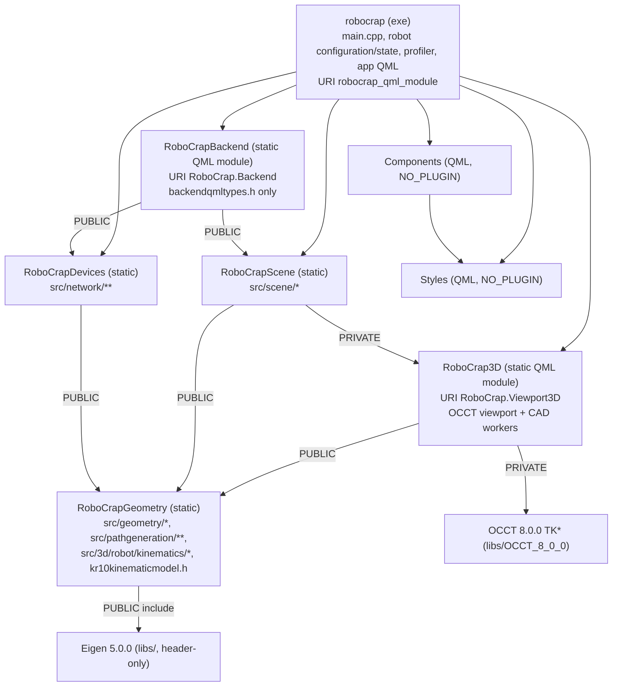

# RoboCrap architecture

A verified map of the current code for future sessions. File references are relative to the
repository root. "Verified" means the claim was checked against constructors, `connect` calls
or call sites; anything else is listed under [Open questions](#7-open-questions).
Snapshot date: 2026-10-14 (working tree at HEAD `3709a12`, including uncommitted edits to
`CMakeLists.txt`, `CMakeLists.txt.user` and `resources/cad/kr10/SEE.stp`). No numerical or QML
files are uncommitted in this snapshot. Current source was checked again for the corrections
in `codex_plans/ARCHITECTURE_REVIEW.md` §7. Section 3.3 reflects Step 04's central-preparation
sharing implemented on 2026-10-15. Sections 3.1 and 3.3 also reflect Step 05's angle-only IK,
accepted configuration reuse and caller-owned FK; later migrations remain planned. These source
changes have not been built or run. Step 08 moves RobotDefinition, RobotController and profiling
into robocrap; their physical robot filenames remain unchanged until Step 15. Step 08a separates
one-time installation/failed-install cleanup from in-place restoration of accepted matrices.
Historical "user confirmed" notes record context, not permission to override
current task instructions or `AGENTS.md`.

## 1. Scope and hardware context

Hardware (supplied by the user; not derivable from code):

| Device | Model | Code entry point | Transport (from code) |
|---|---|---|---|
| Robot | KUKA KR10 R1420, KR C4, KSS 8.3.31, RSI 3.3 | `RsiDevice` key `rsi` | XML over UDP, local port 5555 (`resources/json/db.json`) |
| PLC | Delta AS332T with AS16AP11P-A / AS16AP11T-A (8 DI + 8 DO each) | `PlcDevice` key `plc` | Custom binary over TCP to 192.168.1.2:5051, fixed source port 1234 |
| Force/torque sensor | Schunk Delta IP68 SI-660-60 (ATI Net F/T electronics) | `FtsDevice` key `fts` | ATI RDT over UDP, peer port 49152 |
| Touch probe | WP-500 V6 | none | No device code. Probe data enters only as JSON point files (§5.1) |

`db.json` also lists a VFD (`driver: "vfd"`) that has no device class. The Beckhoff manuals in
`D:\Qt\QtProjects\manuals` have no counterpart in `src/`, `qml/` or `resources/json/`.

Two parts of the code base are outside the active build: `old_imp/` is not built, and `python/`
holds analysis scripts.

## 2. Layers and module dependency graph

Verified from `CMakeLists.txt`, `src/CMakeLists.txt`, `src/3d/CMakeLists.txt` and
`qml/Modules/*/CMakeLists.txt`.

Library notes:

- **Qt dependencies.**
  - `RoboCrapGeometry` links only `Qt6::Core`.
  - `RoboCrapScene` adds `Qt6::Qml` and publishes `Qt6::Gui`, required by the drawing-notification header; the viewport implementation link is private.
  - `RoboCrapDevices` adds `Qt6::Network` and `Qt6::Qml`.
  - The executable links Core, Gui, Quick, Qml, Network, Charts, Xml and Widgets. Felgo is linked when `USE_HOT_RELOAD=ON`. Charts is used only by the never-instantiated `QmlChartBridge`; Xml is unused (`QXmlStream*` is part of QtCore).
- **Physical vs. logical location.** Directory layout does not match target ownership. `src/3d/robot/kinematics/kr10kinematics.*`, `src/3d/robot/model/kr10kinematicmodel.h` and all of `src/pathgeneration/**` compile into `RoboCrapGeometry`, not `RoboCrap3D` (`src/CMakeLists.txt:4-49`). Scene and pathgeneration code that includes `3d/robot/...` headers therefore does **not** depend on `RoboCrap3D`. There is no target cycle. Geometry, Scene, Devices and 3D nevertheless export the whole `src` include directory (`src/CMakeLists.txt:50,70,101`; `src/3d/CMakeLists.txt:76`), so header access is broader than the target graph suggests.
- **Header include direction.** Scene implementation projects document geometry/diagnostics and machining-axis values through occcontroller.h; Scene privately links RoboCrap3D. Renderer headers/implementations import no SceneModel, SceneObject, SceneMachining, SceneEndEffectors or motion types. Robot interfaces use neutral graphics, DrawingPose and CAD results, with no numerical model/state or KR10 LinkCount. RobotDefinition and RobotController belong to robocrap and have no OCCT includes. Broad PUBLIC src exports remain until Step 15.
- **QML module imports.** With `USE_HOT_RELOAD=OFF` the app module declares `IMPORTS Styles Components RoboCrap.Viewport3D` (`CMakeLists.txt:113-123`). `RoboCrap.Backend` is not in that list; it loads only because `RoboCrapBackend` and `RoboCrapBackendplugin` are linked.
- **Foreign registration.** `qt_generate_foreign_qml_types(RoboCrapDevices robocrap)` keeps `RDTResponse` in the application QML module (`CMakeLists.txt:127`).

## 3. Subsystems

### 3.1 Geometry and kinematics (`RoboCrapGeometry`, non-path part)

Plain value types with `std::optional` factories. There are no QObjects, signals or mutable statics.

- **`geometry/mathtypes.h`**:
  - Eigen aliases: `V3d`, `V6d`, `M3d`, `M4d`, `VXd`.
  - `GeomConst::Eps = 1e-9`.
- **`geometry/utils.*`**:
  - `euler2rot(A,B,C)` = Rz(A)·Ry(B)·Rx(C), angles in degrees.
  - `rot2euler` returns two solutions.
  - `makeTransform`, `makeRotation` (principal-axis and arbitrary-axis overloads), `inverseRigidTransform`.
  - `decodeProbeSamples` decodes and validates probe JSON. Object form requires `points`, a finite nonnegative `radius` and numeric `dir` equal to ±1; every point has three finite coordinates. Legacy point arrays use radius 0 and dir 1 (`utils.cpp:67-98`, `utils.h:17-24`). It does not apply compensation.
- **`Pose`**: a validated frame with X/Y/Z/A/B/C order.
- **Fitting factories**:
  - `Plane` and `BoundedPlane`: SVD plane fit.
  - `BoundedCylinder`: Levenberg–Marquardt (LM) fit from 6 seed axes; RMS acceptance threshold max(0.1 mm, 2 % R).
  - `Circle`: circumcircle for 3 points, otherwise an algebraic start refined by LM.
  - `Cylinder::fromAxis`: analytic, not a fit.
- **Probe compensation**: `BoundedPlane::fromSamples` and `BoundedCylinder::fromSamples` fit the original coordinates, then call `applyProbe`. The plane moves by `dir·radius` along its fitted unit normal; the cylinder radius becomes `fittedRadius + dir·radius` and must remain greater than `GeomConst::Eps` (`boundedplane.cpp:72-101`, `boundedcylinder.cpp:246-264`). `Plane::fromJsonFile` applies its plane-offset correction directly (`plane.cpp:54-64`). Circle import reads raw coordinates without decoding or applying probe metadata.
- **`surfaceintersection`**: `intersectSurfaces(BoundedPlane, BoundedCylinder)` returns an analytic ellipse (`EdgeGeometry`), or the status `ParallelCylinderAxis` or `InvalidGeometry`.
- **`Kr10Kinematics`** (`src/3d/robot/kinematics/`) is a closed-form solver for forward kinematics (FK) and inverse kinematics (IK).
  - `solveFK(q)` returns 7 link transforms; the last is the flange.
  - `calculateIK(T06, previous)` returns only six joint angles in degrees and Status/Turn. T06 is the requested BASE-relative flange transform; previous contains the preceding accepted angles and bits. Status chooses shoulder/elbow/wrist; the six angles choose the nearest permitted ±360° equivalents. Turn records angle signs and does not count revolutions. This operation does not enumerate solutions or run full FK.
  - Wrist decomposition multiplies only the first three joint transforms, in the same order as FK. The caller runs full FK for the resulting six angles and checks the flange/TCP using that array.
  - `configuration(q, transforms)` derives Status and Turn from those already computed frames and angles. Initial arbitrary seeds require an FK once; accepted sequence points reuse their bits. Refreshing bits from the existing array retains the preceding-angle branch classification at boundaries.
  - It rejects a wrist singularity (|sin q5| ≤ Eps), a target out of reach, and joints outside their limits.
  - `matchesFlange(target, actual)` checks the target-relative flange residual against `Kr10PosEps = 1e-4` mm and `Kr10RotEps = 1e-6` rotation entries without FK. Animation/manual callers use it; the checked compatibility `solveIK(T06, previousAngles)` still derives seed configuration and performs candidate FK internally for separate RSI callers.
  - It stores `const Kr10KinematicModel&`, so the model must outlive the solver. `RobotController` disables copy/move and destroys its solver before its model.
- **`Kr10KinematicModel`** (`kr10kinematicmodel.h`) holds the joints (axis, limits, rated payload speed in °/s), the IK parameters, `qHome` and `pHome`.
  - `IgnorePreviewJointPositionLimits = false` is a compile-time diagnostic switch that turns off joint-limit checks. It is read in the kinematics, in `RobotController` and in `chamfermotion.cpp`.

### 3.2 Scene (`RoboCrapScene`)

All classes live on the GUI thread. They reach QML through singletons in `src/backendqmltypes.h`.

| Class | Responsibility |
|---|---|
| `SceneModel` | Owns `SceneObject`s (QObject parent) and their geometry views. IDs come from `m_nextId`, which starts at 1 and is never reused; 0 means no object. `objects` is a read-only `QQmlListProperty`; the class is not an item model. Signals: `objectAdded`, `objectRemoved(id)`, `objectVisibilityChanged`, `objectDiagnosticOverlaysChanged`, `objectsChanged`, `intersectionFailed`. `intersect()` creates an Edge from one plane and one cylinder. `addMachiningPath()` stores a `SceneMachiningData`. main attaches the empty document to the concrete viewport; appendObject requests drawing acceptance before publishing a renderable object and deletes an unpublished rejected candidate. Visibility/diagnostic changes send explicit drawing updates. |
| `SceneObject` | Holds id, kind (Plane, Cylinder, Cone, Edge, ScanPath, MachiningPath, Circle), classification, name, visibility, overlays and one geometry QObject. Setters are private; `SceneModel` is a friend and calls named setters. Geometry member assignment occurs inside its named setters. drawing() supplies analytic dimensions/styles or saved TCP phase polylines; drawingDiagnostics() supplies bounded markers and normal-line endpoints. |
| `scenegeometry.h` | QObject views: `ScenePlaneGeometry`, `SceneCylinderGeometry`, `SceneCircleGeometry`, `SceneEdgeGeometry` and `SceneMachiningPath`. `SceneMachiningPath` wraps `SceneMachiningData{shared_ptr<const ChamferMotion>, sourceEdgeId, calibrationRevision}`. `SceneMachiningSettings` is a Q_GADGET value type. The views are read-only except `SceneMachiningPath`, whose incompatibility text `SceneMachining::updateCompatibility` sets through `SceneObject::geometry()` (`scenemachining.cpp:272-278`). |
| `SceneSurfaceImporter` | Synchronous, GUI-thread JSON point import. Plane and cylinder files are compensated for the probe; circle files are not. It sets `busy` true and emits `busyChanged` before reading/fitting, then clears it before returning. Synchronous signal handlers can observe true; normal event-loop painting waits for this read/fit call to return (`scenesurfaceimporter.cpp:96-125`). |
| `SceneEndEffectors` | Stores CAD sources (`MEE.stp`, `SEE.stp`), measuring stylus data, the collet frame `FLANGE_ER` (initially a provisional constant), and accepted spindle XYZABC with its optional reconstructed transform, exposed by `spindleTcpFrame`. `applySpindlePoses` preserves `FLANGE_ER * ER_TCP`; the stored TCP matrix is reconstructed from the accepted coordinates. Both commit paths update list/frame before notifications. A collet change emits `spindleColletChanged` then `spindleTcpChanged`, even when TCP is equivalent; a TCP-only change emits the latter. Unchanged values emit neither. Generate, profiling, pose conversions and presentation reuse the matrix; workers copy its value. |
| `SceneMachining` | Coordinates Generate and Dry Run (§5.2). It holds the `Kr10KinematicModel` copy received once from `RobotController` after initial graphics acceptance, a calibration revision counter, and the playback state. It derives the signed unit draft-axis direction and 5–40 mm display length from the selected source/settings and emits the drawing value. |
| `SceneMachiningPreparation` | Builds the RSI job ("RSI Sampling"; outside the current animation scope). An `std::async` worker produces a `PreparedChamferJob`. On the GUI thread it then writes `C:/RoboCrapJobs/shared_data.txt` with `QSaveFile` and emits `preparedJobReady`. It watches `<appDir>/rsi-correction-limits.json`. |
| `chamfershareddata` | Free functions. `prepareChamferSharedData` (worker side) and `writeChamferSharedData` (GUI side). |

QML singletons (`backendqmltypes.h`):

- `Backend.Scene`, `Backend.Hub`, `Backend.Machining`, `Backend.MachiningPreparation` and `Backend.EndEffectors` each return a stack object from `main()` through `s_inst`, with `CppOwnership`.
- The Machining, Preparation and EndEffectors wrappers call `qFatal` on a wrong thread or a second engine. Scene and Hub use only `Q_ASSERT`.
- Creatable types: `PlaneImporter` (`SceneSurfaceImporter`), `DeviceProfileModel`, and `SceneModel` (named element without `QML_UNCREATABLE`).

### 3.3 Path generation (`src/pathgeneration`, compiled in `RoboCrapGeometry`)

Numerical code on copied inputs. It calls no scene or device API and has no mutable statics.
IK and FK call counters live in a per-worker `ChamferProfiledKinematics`. The `RoboCrapGeometry`
target still does file I/O in `rsicorrectionlimits.cpp:141`, `offsetjsonwriter.cpp:55`,
`utils.cpp:46-66`, `plane.cpp:54`, `boundedplane.cpp:66-69` and `boundedcylinder.cpp:240-243`.
The last two file factories have live consumers in the profile CLI (`chamferprofile.cpp:73-75`).
TCP means tool center point; LIN denotes a prescribed straight Cartesian transfer, and PTP
denotes a synchronized joint movement.

| Stage | File | Product |
|---|---|---|
| Analytical curve | `chamferpath` | `ChamferPath::evaluate(angleRad)` evaluates the machining curve at an ellipse parameter in radians. `evaluatePhase(phase, progress)` evaluates LeadIn, Machining or LeadOut at dimensionless phase-local progress in [0,1]. Neither parameter is traveled distance or physical seconds. The path also supplies staging point P_s; `create(parameters)` validates the input (`chamferpath.h:83-93`). |
| Arc length | `chamferarclength` | Per-phase map from progress to distance in mm. Uses adaptive Gauss–Kronrod (G7/K15) integration and a quintic inverse per knot interval (the "inverse-map knots"). |
| Central timing | `chamfercentralmotion` | For elapsed seconds, calculate traveled distance in mm, recover phase-local progress through the inverse arc-length map, then evaluate the analytical TCP pose. All three phases use `machiningFeed`; there is an acceleration ramp over `accelerationDistanceFraction` of each lead. `leadInFeed`/`leadOutFeed` are carried through the settings but do not define central timing. |
| Point schedule + IK | `chamfercentralvalidation` | `ChamferCentralPreparation` builds the central maps/timing and curvature/acceleration point schedule (0.01 mm) once per Generate, on the first reached central attempt. Scheduled analytical targets and target failures are cached as reached. Each candidate solves its own seeded IK sequence and checks joint limits, speed and Cartesian XYZ acceleration. Joint-acceleration magnitude rejection is commented out (temporary exception, see `AGENTS.md`). |
| Whole motion | `chamfermotion` | `ChamferMotion::create(path, robot)` prepares HOME to P_s (PTP), P_s to lead-in start (LIN), the central three phases, lead-out end to P_s (LIN), and P_s to HOME (PTP). It prepares three clamped cubic joint splines: one per LIN and one shared across LeadIn/Machining/LeadOut, each with zero endpoint joint velocities. `evaluate(seconds)` uses quintic smoothstep for PTP and the prepared splines for LIN/central, then FK; it performs no IK. Times 0 and `duration()` return `qHome`. The outer motion stores `ChamferPathParameters`; the complete `ChamferPath` is inside `ChamferCentralMotion`, so parameters are repeated, not two full path objects (`chamfermotion.h:75-81`, `chamfercentralmotion.h:65`). |
| RSI preparation | `chamferjob`, `chamfercartesiansampler`, `rsiposeencoder`, `rsicorrectionlimits` | `PreparedChamferJob` with 4 ms samples of the central part. Each sample runs IK and checks limits, **including per-joint acceleration**. Correction is encoded as an absolute first sample plus per-cycle increments, then checked against the limits file. |
| Legacy RSI demo | `pathgeneration/rsi/*` | `RsiPath::fromSurfPose`, `RsiPath::lin` and `writeOffsetsToJson` are used by `RsiDevice::generateTrajectory` (`rsidevice.cpp:206-220`). The demo remains a callable invokable; its only QML caller is the uninstantiated `KukaPanel`. |

**Fixed animation points and spline checks.** Each straight LIN is split at its acceleration,
cruise and deceleration boundaries. Before IK, each nonzero constant-acceleration span gets
`N = max(1, ceil(T * sqrt(a / (8 * epsilon))))` equal-time intervals: `T` is that span's duration
in seconds, `a` its acceleration magnitude in mm/s², and `epsilon = 0.01 mm`. Cruise uses one
interval. For a hypothetical 0.2 s ramp at the default `a = 20 mm/s²`, this gives
`ceil(0.2 * sqrt(20 / 0.08)) = 4` intervals and five endpoint-inclusive points; the preceding
endpoint is shared, so four points are appended. Central spans use their curvature and timing
bounds to fix their point counts before IK (`chamfercentralvalidation.cpp:145-181`);
LIN uses `chamfermotion.cpp:445-483`. Neither stage inserts extra IK points or stretches time
after an IK/rate failure.

After IK, spline checks evaluate each joint polynomial at interval endpoints and interior
position/speed extrema, checking finite angles/derivatives, joint position and rated speed
(`chamfermotion.cpp:61-95,639-715`). Joint-acceleration magnitude rejection remains disabled
in central validation, LIN checks (including terminal stops) and spline checks; acceleration
finiteness and central XYZ acceleration checks remain. HOME timing still uses configured
joint acceleration. The 0.01 mm point criterion does not bound orientation or the actual TCP
error between saved points after joint interpolation. Dry Run only evaluates the prepared
motion; it constructs no inverse maps or splines and adds no points.

**Shared central preparation.** One `ChamferCentralPreparation` belongs to `MotionCompiler`
for the whole `ChamferMotion::create` call. Its constructor only borrows the worker-owned path
and timing. After a candidate's incoming LIN succeeds, `validate(robot, seed)` checks the robot
and seed, then lazily builds three arc-length maps, timing and fixed schedule. The preparation
result, including a map/timing/schedule error, remains available to subsequent candidates.
`CentralValidator` borrows that preparation and the immutable robot setup, returning only its
own accepted joint samples. The completed motion retains the central motion through a value
copy with implicitly shared Qt map arrays; no maps are rebuilt when retaining it.

At each scheduled index, `evaluateTarget(index, seconds)` returns an already cached analytical
TCP pose or evaluates and appends the next pose. A failed evaluation is retained as an empty
optional at that index. Every candidate still solves/checks its own joint sequence and stops
at its first error; a later target is never evaluated before the preceding point passes.
For example, three candidates reaching successful map construction now build three maps in
total, versus nine previously. This is a source-derived operation count, not an executed timing
comparison. The target cache adds worker-local storage and is destroyed after Generate;
inverse-map knots, saved animation points and separately prepared RSI samples remain distinct.

Job diagnostics contain `centralPreparation` once: map attempts/completions, schedule construction,
shared computation milliseconds, target evaluations/cache hits, zero-based failed target index,
and target-cache payload/capacity bytes (`sizeof(optional<ChamferCentralPose>)` per entry, excluding
allocator/container overhead). Candidate `totalMs`, central `samplingAndValidationMs` and central
segment `computationMs` exclude newly performed shared work. Top-level `totalMs` includes all
elapsed Generate work; shared construction/map/schedule/target timings and attempt substage
timings are nested measurements, not additional disjoint totals. Failed candidates retain their
errors and attempted-stage/IK diagnostics. Movement durations remain seconds.

Animation preparation carries one accepted angle/configuration value through incoming LIN,
central samples and outgoing LIN. Each angle-only IK call uses its predecessor's Status and
angles. The caller runs FK once for flange verification and derives accepted configuration from
that array. Central validation retains its checked actual TCP separately from the analytical target
used by XYZ acceleration. LIN nodal-point construction and the later central copying loop reuse
FK-derived TCP without another FK; stored nodal points already contain that matrix. Playback FK
for interpolated angles is separate. Dry Run calls the joint-only evaluator and RobotController runs one FK; the TCP-returning compatibility evaluator shares interpolation and retains its existing endpoint behavior.

Manual `RobotController::inverse` uses the committed pose's configuration, calls angle-only IK,
and calls `forward` once. That FK array supplies the flange check and read-only RobotPose. A
successful call therefore evaluates three wrist-prefix joints and six FK joints, versus 24 joint
steps previously; these are source-derived counts, not measured speed. `initialize`, `forward`
and `inverse` return RobotPoseResult with an optional pose and error text. RobotController consumes
the candidate and commits only after OccController returns transform acceptance. Forward/manual and playback pose
construction derive configuration from the same FK array, so later manual IK has a current seed.

ChamferProfiledKinematics times angle-only IK (including its three-joint prefix) separately from
explicit full FK. Initial search-seed FK is now explicit and counted; accepted preceding angles
need no such call. Checked compatibility IK still includes its internal FK in IK time. No measured
before/after runtime or accepted-motion equivalence is claimed.

`src/3d/chamferprofile.*` is a CLI profiler: `robocrap --profile-chamfer in.json out.json`, checked at
`main.cpp:47-55`. It runs before any device or QML object, and before the application's scene objects, are
created. It constructs its own `SceneEndEffectors` (`chamferprofile.cpp:106`). With `previewOnly=true` it
skips RSI preparation; with `previewOnly=false` it runs RSI preparation with default limits.
`in.json` and `out.json` above are argument placeholders, not supplied files. The preview input
named in `AGENTS.md`, `codex_plans/chamfer_profile_spatial_leads_input.json`, is absent in this
snapshot; there is no verified executable baseline using that path. No profiling or RSI
preparation was run for this documentation update.

### 3.4 Devices and network (`RoboCrapDevices`)

| Class | Responsibility |
|---|---|
| `DeviceHub` | Owns the two `QThread`s `ControlIO` and `GeneralIO`, started in the constructor. `startAll`/`stopAll` are public slots, so QML can call them on the `Hub` singleton. `add()` asserts a parentless device, moves it to its thread, connects `QThread::finished` to `deleteLater`, and creates a `DeviceRunner` parented to the hub. `startAll()` asks every runner to start. `stopAll()` is shown in §5.4. |
| `DeviceRunner` | GUI-thread proxy for QML. Properties: `data` (`QQmlPropertyMap`, pre-filled with `connectionConfig`), `socketState`, `isConnected` (Connected or Bound), `isDisconnected`. Every link to the device uses `Qt::QueuedConnection` (`devicerunner.cpp:13-17`). |
| `AbstractDevice` | Public slots `start`, `stop`, `invoke` with an `m_started` guard. `buildApi()` indexes public `Q_INVOKABLE` methods that return `void` and take no arguments or one `QVariantMap`; slots are excluded. Signals: `stateReady`, `socketStateReady`. `attachSocket()` forwards socket state and logs socket errors directly through Qt. |
| `PlcDevice` (GeneralIO) | `QTcpSocket` bound to a local port, then `connectToHost`. Invokables: `connect`, `disconnect`, `setOutput`, `writeMessage`. `PlcMessageManager` builds frames: a 6-byte big-endian header (0xAA55, version, type, transaction id (tid), length) plus a command, and the whole frame is swapped in 16-bit words. Responses are fixed 32-byte frames. Sends SNAPSHOT on connect. State keys: `x1`, `y1`, `x2`, `y2` (8 bools each) and `cellState`. `writeMessage` accepts raw WRITE_RAW/WRITE_REG/SET_VAR frames and is reachable from QML through `invoke()`, although no QML calls it. Pending requests have no deadline and can exhaust all 256 IDs (§7). The framing is defined by the PLC program (not in the repository); the user confirmed on 2026-10-13 that the protocol works. That historical statement does not establish behavior under response loss. |
| `FtsDevice` (ControlIO) | `QUdpSocket`. Invokables: `connect`, `disconnect`, `startStreaming`, `stopStreaming`, `bias`, `startLogRecording`, `stopLogRecording`, `saveLogToDefaultFile`. RDT request: 0x1234, then command, then count = 0. Parses one 36-byte record per datagram; timestamps use the sequence difference divided by the assumed 7000 Hz, and force/torque scaling uses 1e6 counts per unit. Each accepted packet emits `dataSampleHFReady`. While processing packets, elapsed time ≥16 ms triggers `processBatch`, which uses the last sample for recording and GUI publication; this is not a fixed publication timer. First publication includes all six axes; later publications include changes of at least the 0.05 deadband (`FtsDevice::onReadyRead`, `publishState`, `processBatch`, and the local `acceptAxis` helper in `ftsdevice.cpp`). Stream/log control flags are published separately. Recording is saved by `std::async` + `QSaveFile` to `<appDir>/records/`. The 7000 Hz value is not a measured arrival rate or verified sensor setting. |
| `RsiDevice` (ControlIO) | `QUdpSocket`. Answers every received `<Rob>` datagram synchronously in `readyRead`, echoing IPOC and sending `<RKorr>` (`RsiProtocol`). Invokables: `connect`, `disconnect`, `generateTrajectory` (hard-coded demo line; if reached, it dereferences an empty optional from the absent `://files/blank-plane-bottom.json`, causing undefined behavior, `rsidevice.cpp:156`), `startStreaming`, `stopStreaming`. The demo is dormant in the current UI but callable through `DeviceRunner::invoke`. Slots outside the invoke API: `setForce` (stores Fz, never read) and `setPreparedJob` (stores and publishes the `preparedJob*` keys; never arms motion). |
| `RsiHoleProtocol` | Compiled but has no callers. `RSI_Hole_CONTRACT.md` describes its State schema as out of date. |
| `DeviceProfileModel` | Read-only table loaded from `:/json/db.json`. Provides the default endpoints shown in the Network view. |
| Console diagnostics | Device call sites use `qInfo().noquote()` on their owning threads; viewport messages are formatted by `logViewportMessage` in main. Output retains the used `[ERROR]`/`[OK]`/`[INFO]`/`[WRITE]` labels, source names and message text. Qt's message pattern supplies timestamps. Diagnostics have no QML context property, custom message type, or queued GUI logging relay. |
| `QmlChartBridge` | Compiled into `robocrap` but never instantiated (`main.cpp:89-91` is commented out). |

Cross-device wiring in `main.cpp`:

- `FtsDevice::dataSampleHFReady` → `RsiDevice::setForce` (`:85`). This uses AutoConnection, so it is a direct call because both devices are on ControlIO.
- `SceneMachiningPreparation::preparedJobReady` → `RsiDevice::setPreparedJob`, queued (`:107`).

### 3.5 3D viewport (`RoboCrap3D`, namespace `RoboCrap3D`)

| Class | Responsibility |
|---|---|
| `OccController` | Viewport3D singleton; owns the native window, robot/tool CAD workers, neutral ordered graphics, accepted drawing matrices and tool display state. Receives absolute CAD sources from Application, returns transform acceptance/error and restores drawings from renderer-local values. Owns one accepted DrawingDocument cache with stable-ID-order replay; its window borrows that cache read-only. No application QObject, numerical robot state/solver or motion internals are retained. |
| `OccViewWindow` | QWindow hosted by RobotViewport's WindowContainer. First expose builds the viewport. Missing robot data waits; successful or failed installation is not repeated in a surviving scene. A pose failure reapplies the saved accepted matrices once; failure of that restoration sets the existing presentation-failure flag and disables robot readiness while keeping the viewer. Actual surface destruction releases the scene; genuine recreation installs cached accepted drawing values in a new scene. |
| `OccViewport`, `OccViewer`, `OccScene`, `OccPart`, `OccInputController`, `OccViewCube`, `OccWorldAxes` | OCCT stack: `OpenGl_GraphicDriver` → `V3d_Viewer`/`V3d_View` on a `WNT_Window`, plus `AIS_InteractiveContext`. Rendering is coalesced with a 0 ms single-shot `QTimer` on the GUI thread. There is no render thread and no `QOpenGLContext`. |
| `OccRobotAdapter` | Converts supplied Eigen matrices to gp_Trsf for existing links, tools and axes. Installation records each created part ID before its OCCT display call. Failed insertion/HOME application cleans only that installation, retaining IDs whose removal fails and returning stage/exception/cleanup errors. Ordinary updates/restoration never remove or recreate links. |
| `OccSceneAdapter` | Turns supplied analytic patches/curves, polylines and diagnostic/axis drawing values into OCCT parts. It creates a candidate presentation before replacing accepted part mappings, returns errors and reports cleanup failures. Visibility/diagnostics/selection use stable application IDs; picking returns the same ID. |
| `CadLoadWorker` / `CachedShapeLoader` / `StepImporter` | `CadLoadWorker` is the `QThread` subclass; a function-local static mutex serializes parsing/cache access. The cache is `<appDir>/resources/cad/kr10/<completeBaseName>.brep`; a readable, valid BREP takes priority without opening or hashing the STEP. Missing, unreadable or invalid BREPs fall back to STEP import and atomic `QSaveFile` storage (`cachedshapeloader.cpp:24-82`). |
| `RobotDefinition` / `RobotController` / `RobotPose` (application target) | Existing kr10model.* and robotpreviewstate.* implement application ownership. Definition parses the same JSON into numerical data and neutral filename/RGB records. Controller owns the stable solver/model, a temporary checked initial HOME candidate and one optional accepted pose. Pose stores angles/configuration, flange coordinates and a shared immutable matrix list. App.RobotController exposes loading, manual FK/flange IK/TCP IK and pose properties; command results contain accepted, values and error. |
| `ViewportAssets` | Asset paths. `initializeOcct` sets the `CSF_*` environment variables from `<appDir>/resources/occt`. |

OccScene stores live OccPart values by non-reused PartId, with a separate optional counter that
preserves zero and detects exhaustion without resetting on clear. Selection records cover curves
and surface outlines; unchanged visible parts retain their outlines, while hidden/removed/replaced
parts are deselected. Outline completion is recorded after styling/display succeeds, retaining
unfinished handles through OCCT failures. Part entries are erased only after removal succeeds.

SceneModel sends explicit object drawing changes; main connects SceneMachining's draftAxisChanged
value to OccController. The renderer never observes either application owner.
Application RobotController observes end-effector/tool/source changes and sends explicit drawing
values/CAD requests, composing tool-axis matrices in Application. SceneMachining calls its playback operation directly with angles and the motion's saved tool matrix. It calculates one pose and commits
only after returned drawing acceptance. Readiness accepts pending HOME and publishes the numerical
model once; later restoration changes availability without resetting model/revision. main requests
the robot load once after console wiring; QML tool Retry still uses App.RobotController. Window,
drawing flags and CAD status remain in Viewport3D. Pose failures return
through OccController's console path; manual commands do not report the same drawing failure again,
and numerical playback errors pass through the robot console path before SceneMachining handles the returned failure. SceneMachining keeps a guarded RobotController pointer attached in main after construction, and a local immutable motion handle protects saved inputs through synchronous callbacks.

### 3.6 QML UI (`qml/`)

- **Main window.** `Main.qml` is a single `ApplicationWindow` with no page navigation (no Loader, StackLayout or StackView).
  - It contains a fixed 3-column `SplitView`:
    - Left: `WorkflowPanel`, `ScenePanel`.
    - Centre: `ModeToolBar`, an RSI status label, `RobotViewport`.
    - Right: `PropertiesPanel`, `EndEffectorPanel` ×2 and `MachiningPanel`, switched by `visible`.
  - Tool windows hold the device panels: PLC `DeltaPanel`, FTS `FtsPanel`, Settings/`Network`.
  - A modal calculation window is bound to `Backend.Machining.calculating`.
- **Application decisions in C++.** WorkspaceController in `src/application/workspacecontroller.*` owns mode (Measuring/Machining), submode (Rough/Precise) and selected IDs. It reuses SceneModel removal/intersection, SceneMachining input/Stop and RobotController's active-tool command. main constructs this application QML singleton after its three collaborators and connects viewport picks/Delete and selection drawing through typed signals. Main exposes read-only bindings; its creation calls reset to Measuring/Rough/empty selection. Leaving Machining stops at HOME before the tool/input changes. The UI-only dryScanActive/dryScanRunning flags remain in Main.
- **Local UI state.** `chamferEditorOpen` and `toolSetupOpen` choose the right panel. `MachiningPanel` owns draft text, `draftFlipAxis` and captured original settings; `EndEffectorPanel` owns pose draft strings. Focus and `ScenePanel` group expansion are UI state, separate from document/robot state (`MachiningPanel.qml:17-19,42-84`, `EndEffectorPanel.qml:27-69`, `ScenePanel.qml:25-29,138`).
- **Unused files.** `NavigationPanel.qml` and `KukaPanel.qml` are listed in CMake but never instantiated.
- **Device panels.** They use `Backend.Hub.device(key)`, `isConnected`, `data.<key>` and `invoke(name, map)`. Every `invoke` name used in QML exists as a `Q_INVOKABLE` on the target device; `generateTrajectory`'s only caller, `KukaPanel.qml`, is never instantiated.
- **Selection and machining input.** WorkspaceController::synchronizeMachiningInput chooses the sole selected Edge/MachiningPath in Machining mode, otherwise zero. setSelection notifies QML's selected-object binding before applying input settings, preserving editor Cancel order; successful Generate first closes the editor, then requests selection. Import and scene-list requests use the same selectObject operation; document changes prune removed IDs. SceneMachining still captures the pending Generate source and retains active playback independently. Window visibility/native recreation already reapply cached selection, so Main has no selection replay handlers.
- **Tools and placeholders.** Dry Scan only toggles `Main.qml` flags; no scan motion is prepared or played. Scan and Start Machining use the toolbar action's default `available: false` and remain disabled (`Main.qml:450-459`, `ModeToolBar.qml:62,197-219,239-244`). Measuring name/ball diameter/stylus length are displayed read-only; spindle ER coordinates are disabled read-only fields, while TCP relative to ER has Apply. Apply passes the original ER coordinates, not their four-decimal display values (`EndEffectorPanel.qml:121-178,261-267`). This UI does not implement measuring calibration or scan execution.
- **Reusable modules.** `Components` contains the `Qx*` wrappers around Qt Quick Controls. `Styles` contains the singletons `Colors`, `Fonts` and `Metrics`. Both are NO_PLUGIN static modules with maintained `qmldir` files.
- **Resources.**
  - `pics.qrc`: SVG icons.
  - `fonts.qrc`: Roboto.
  - `json.qrc`: `kr10.json`, `db.json`.
  - `files.qrc` is empty, so the RSI files under `resources/files/rsi` are not embedded.
  - CAD files are deployed beside the executable by `cmake/DeployOcct.cmake`.

## 4. Threading and ownership model

| Thread | Objects / work | Created by |
|---|---|---|
| GUI (main) | `QApplication`, `DeviceHub`, all `DeviceRunner`s, `SceneModel`, `SceneEndEffectors`, `SceneMachining`, `SceneMachiningPreparation`, `OccController`, `OccViewWindow` and its OCCT viewer/rendering, QML engine; also synchronous JSON import, `ChamferPath::create`, `shared_data.txt` write, Dry Run timer (16 ms) | `main()` stack |
| `ControlIO` (`QThread`) | `FtsDevice`, `RsiDevice` and their sockets/timers | `DeviceHub` |
| `GeneralIO` (`QThread`) | `PlcDevice` and its socket | `DeviceHub` |
| Generate worker (`std::async`) | `ChamferMotion::create` on a copied `ChamferPath` + `ChamferRobotSetup`; polled by a 30 ms GUI timer | `SceneMachining::generate` |
| RSI preparation worker (`std::async`) | `prepareChamferSharedData` on a copied source + limit configuration; polled by a 30 ms timer | `SceneMachiningPreparation::prepare` |
| FTS save worker (`std::async`) | JSON write of a copied sample buffer | `FtsDevice` |
| CAD workers (`QThread` subclass) | STEP/BREP loading, serialized by a static mutex | `OccController` |

Ownership and lifetime rules:

- **Stack objects in `main()`.** The application singletons are stack objects without a QObject parent. The QML engine is declared last, so it is destroyed first. QML gets these objects through `s_inst` with `CppOwnership`.
- **Devices.** Each device is created parentless, then moved to its I/O thread. It is deleted on that thread by `deleteLater` when the thread finishes. Runners are children of the hub.
- **Scene objects.** Each `SceneObject` is a child of `SceneModel`, and each geometry view is a child of its object. Removal emits `objectRemoved`, then calls `deleteLater`.
- **Immutable shared data.** These are shared across threads as `shared_ptr<const ...>`:
  - `ChamferMotion` (scene path, playback, RSI job);
  - `PreparedChamferJob` (GUI thread to ControlIO);
  - `CadLoadResult` (controller, window and adapter).
- **Worker result acceptance.** Results are accepted only on the GUI thread, and stale ones are rejected:
  - Generate compares the input id, the calibration revision, robot availability and the source;
  - preparation compares a generation counter, the source, the motion pointer and the revision;
  - CAD loading compares per-slot generation counters.
- **Thread affinity checks.** `Q_ASSERT` checks thread affinity in `AbstractDevice::start/stop/invoke`, `DeviceRunner::invoke`, `RsiDevice::setPreparedJob`, `OccController::loadRobot`, application RobotController commands and `SceneMachiningPreparation`.

## 5. Traced workflows

### 5.1 Geometry and CAD import

**Probe point JSON into `SceneModel`.** This is the only path that adds imported geometry to the scene. There is no STEP import into `SceneModel`.

1. `ModeToolBar` emits a plane, circle or cylinder import request. `Main.qml:475-477` opens a `FileDialog` filtered to `*.json` (`:158-180`).
2. `onAccepted` calls `surfaceImporter.load`, `loadCircle` or `loadCylinder(url, Backend.Scene)` (`Main.qml:163,171,179`).
3. `SceneSurfaceImporter::importSurface` (`scenesurfaceimporter.cpp:89`) runs synchronously:
   - `readSamples` reads/parses JSON; for plane/cylinder it calls `decodeProbeSamples` to validate coordinates and probe metadata, without compensating them;
   - `BoundedPlane::fromSamples` or `BoundedCylinder::fromSamples` fits the coordinates and applies probe compensation once; circle import instead reads raw coordinates and calls `Circle::fromPoints`;
   - then `SceneModel::addBoundedPlane`, `addBoundedCylinder` or `addCircle` (`:105-114`).
4. `SceneModel::appendObject` obtains SceneObject::drawing() and asks OccController to install/cache that value. OccSceneAdapter constructs the trimmed OCCT face/edge and returns acceptance/error. Only accepted insertion publishes objectAdded/objectsChanged; failure deletes the unpublished candidate and the importer reports failure.
5. The importer emits `loaded(object)`; Main requests `WorkspaceController::selectObject(objectId, false)` to select the inserted object.
6. Optional: "Intersect Selected" calls `SceneModel::intersect`, which uses `intersectSurfaces` to add an Edge object. That Edge is the Generate input.

**STEP CAD for robot and end effectors.** This goes to the viewport only.

1. main.cpp calls RobotController.loadRobot once after connecting viewport/robot console messages.
   Recreating RobotViewport does not submit another loading request.
2. RobotController parses the definition, runs the existing HOME FK/model comparison once and
   retains its successful initial candidate while supplying absolute CAD sources, RGB and matrices.
3. OccController starts the serialized CAD worker, rejects stale results and installs shapes with
   those matrices. On graphics readiness, RobotController accepts HOME, supplies the model to
   SceneMachining once and enables robot commands. Later surface/window restoration replays
   renderer drawing values without FK or replacement of the application model. Repeated attach/load
   notifications keep existing links. Failed insertion or initial HOME application reports its stage,
   removes only that attempted installation and leaves HOME/model unpublished. Failed cleanup keeps
   unresolved part IDs, reports the error and does not retry automatically.
4. End effectors:
   - `main.cpp:98-99` sets `MEE.stp` and `SEE.stp`; both panels offer Browse and Retry (`Main.qml:212-228,551-555,578-582`). Choosing the same source requests a reload; another source updates its setting. A valid basename-matching BREP still takes priority (§7).
   - That calls `SceneEndEffectors::set*CadSource`, which emits `*CadSourceChanged`.
   - `RobotController::reloadEndEffector` supplies the selected source to OccController, which runs a `CadLoadWorker` for one file; `finishEndEffectorLoad` then calls `synchronizeEndEffectors` → `OccRobotAdapter`.

### 5.2 Generate → Dry Run

**Generate.**

1. Toolbar "Generate Path" opens/focuses `MachiningPanel` and captures the current settings; it does not generate (`Main.qml:466-472`). The panel's "Generate" commits draft settings through `Backend.Machining.settings` / `SceneMachining::setSettings`, then emits `generateRequested`; `Main.qml:592` calls `Backend.Machining.generate()`. Cancel restores the captured settings and closes the editor (`MachiningPanel.qml:42-79,183-187`).
2. `SceneMachining::generate` (`scenemachining.cpp:159-184`):
   - checks `unavailableReason()`: robot ready, 6-value spindle TCP, an Edge with both source objects still present (one plane and one cylinder), or a saved path. The raw-edge numerical parameters use the edge ellipse plus cylinder origin/axis, but the plane-presence check still gates acceptance (`scenemachining.cpp:116-138`);
   - builds `ChamferPath::create(settings.applyTo(source))` **on the GUI thread**;
   - copies `Kr10KinematicModel`, `flangeToTcp` and the timing into `ChamferRobotSetup`;
   - records the input id and revision;
   - starts `std::async(ChamferMotion::create, path, robot)` and a 30 ms poll timer.
3. `finishCalculation` (`:194-236`), once the future is ready:
   - logs the diagnostics;
   - rejects the result if the input, revision, robot availability or source changed;
   - otherwise calls `SceneModel::addMachiningPath` with `make_shared<const ChamferMotion>`;
   - when regenerating a saved path, copies its name and visibility, then removes the old object;
   - calls `setInputId(newId)` and emits `generated`.
4. The new object reaches the viewport through `objectAdded` (§5.1 step 4).
   Saved motions own geometry/model/TCP/settings snapshots. Their sources may subsequently be
   removed without destroying the motion; regeneration from a saved path uses its parameters.
   Pending Generate from a raw edge is rejected if its required sources disappear before
   acceptance (`scenemachining.cpp:203-220`). Model/TCP changes invalidate playback until regeneration.

**Dry Run.**

1. `ModeToolBar` "Dry Run" calls `Backend.Machining.dryRun()` (`Main.qml:461`).
2. `SceneMachining::dryRun` requires `canPlay()` (compatible path, robot available) and the guarded RobotController attached by main. It retains the immutable motion, presents time zero, then starts a QElapsedTimer and a 16 ms PreciseTimer.
3. Each tick calls `SceneMachining::advancePlayback`, which calculates elapsed seconds and calls `presentPlayback(seconds)`:
   - `ChamferMotion::evaluateJoints(seconds)` returns six joint angles and phase using the saved HOME progress or prepared joint spline. It performs no FK, IK or integration.
   - SceneMachining keeps a local motion handle through synchronous notifications and calls `RobotController::applyPlayback(joints, savedFlangeToTcp)` directly.
   - RobotController's `forward(joints)` runs FK once and checks every link matrix. applyPlayback composes the saved-tool TCP, checks finiteness even when its axes are hidden, and passes that checked matrix to drawingPose/applyPose.
   - `OccController::applyRobotTransforms` returns full link/tool/axis transform acceptance. Only then does RobotController commit the pose; only returned success with playback still active advances SceneMachining's elapsed time/phase.
   - Failure returns to SceneMachining::failPlayback. A failed drawing update restores saved matrices once on the same objects; the candidate remains rejected. Failed restoration disables readiness without deletion/recreation, FK/IK, model reset or recursive Stop-to-HOME. Redraw remains deferred; acceptance does not report a completed frame.
4. `pause()` stops the timer. Calling `dryRun()` again resumes from `m_elapsed`.
5. `stop()` presents time zero while the robot preview is available, then ends playback (`SceneMachining::stop`). Time zero returns the saved `qHome` (`ChamferMotion::evaluateJoints`), so Stop returns immediately to HOME without an animated return.
6. Playback also ends when t reaches the duration (the last point is `qHome`), and on any of: `aboutToQuit`, robot unavailable, calibration change (`spindleTcpChanged` or `setRobotModel` increments the revision and invalidates saved paths), removal of the active path. Leaving Machining mode calls `SceneMachining::stop()` from WorkspaceController before changing tool/input, so the robot jumps to HOME.
7. While playback is active, `RobotController::solve` refuses manual FK/IK, and `generate()` is unavailable.

### 5.3 Device request from QML and state back

Example: the PLC panel toggles an output.

1. `DeltaModuleAP.qml` calls `plc.invoke("setOutput", {module, index, enabled})`, where `plc` is `Backend.Hub.device("plc")`.
2. `DeviceRunner::invoke` (GUI thread) asserts the thread and emits `invokeReq` (`devicerunner.cpp:31-36`).
3. The queued connection (`:15`) posts the request to GeneralIO. There `AbstractDevice::invoke` checks `m_started`, looks up the name in `m_api`, and calls `QMetaMethod::invoke(..., DirectConnection)` (in `abstractdevice.cpp`).
4. `PlcDevice::setOutput` builds a WRITE_IO frame with `PlcMessageManager`, swaps 16-bit words, and writes it to the TCP socket.
5. `readyRead` collects 32-byte responses. They are matched by transaction id (tid) and command, then decoded into `x1/y1/x2/y2` and `cellState`. The device emits `stateReady(QVariantHash)`.
6. The queued connection (`devicerunner.cpp:16`) calls `DeviceRunner::onStateReady` on the GUI thread. `m_data->insert(vals)` updates the `QQmlPropertyMap`, and QML bindings on `data.x1` and the others update.
7. Socket state follows the same pattern: `QAbstractSocket::stateChanged` → `AbstractDevice::onSocketStateChanged` → `socketStateReady` (queued) → `onSockState` → `socketStateChanged` → `isConnected`/`isDisconnected`.
8. Diagnostics are independent of queued GUI state delivery. Devices write directly through `qInfo().noquote()` on their owning I/O threads, including command rejection and completed FTS save results. Main's viewport-message connection uses the application as its lifetime context and writes through the same Qt output. No device logging signal or custom logging object remains.

Startup:

- `hub.startAll()` (`main.cpp:87`) runs `DeviceRunner::start` → `startReq` (queued) → `AbstractDevice::start` on the I/O thread → `buildApi()` + `startDevice()`.
- `startDevice()` creates the socket. The network connection itself waits for an explicit `invoke("connect", config)` from `Network.qml`.

### 5.4 Application shutdown

1. **`aboutToQuit`.** Slots run in connection order:
   1. `SceneMachining::endPlayback` (connected in its constructor, `scenemachining.cpp:88`).
   2. `SceneMachiningPreparation::shutdown` (`main.cpp:109`). It invalidates its generation, clears any prepared job (emitting `preparedJobReady(nullptr)` to ControlIO if a job existed), and **blocks** on an in-flight preparation future.
   3. `DeviceHub::stopAll` (`main.cpp:110`).
2. **`stopAll`** (`devicehub.cpp:60-79`). It returns at once if both threads are already stopped. Otherwise:
   - for each device: `invokeMethod(dev, &AbstractDevice::stop, BlockingQueuedConnection)`. When a prepared job exists, shutdown posts its null-job invalidation from the GUI thread to `rsiDev` before this same GUI thread posts that device's blocking stop (`main.cpp:107-110`, `scenemachiningpreparation.cpp:173-201`). This orders those queued calls to the same receiver; it is not a universal FIFO claim across unrelated senders, receivers or Qt event kinds. If no job exists, `setPreparedJob({})` emits no redundant invalidation. `FtsDevice::stopDevice` waits for an outstanding save.
   - `quit()` and `wait()` both I/O threads. `QThread::finished` triggers `deleteLater`, which deletes each device on its own thread.
   - `stopAll()` asserts that the caller is outside both I/O threads (`devicehub.cpp:65-66`): a blocking queued stop from its receiving thread would deadlock. The current shutdown caller is the GUI thread; sharing ControlIO does not by itself establish a race or deadlock.
3. **`app.exec()` returns.** Stack objects are destroyed in reverse declaration order:
   1. `QQmlApplicationEngine`. QML is destroyed; `RobotViewport` `onDestruction` calls `detachViewWindow`.
   2. RobotController marks machining unavailable; OccController then interrupts and **waits** for the CAD workers (a STEP parse cannot be interrupted mid-file), then deletes the window.
   3. `SceneMachiningPreparation`. Its destructor calls `shutdown()` again, which is a no-op.
   4. `SceneMachining`. There is no explicit wait, but destroying a `std::future` returned by `std::async` blocks until an in-flight `ChamferMotion::create` finishes.
   5. `SceneEndEffectors`, then `SceneModel`.
   6. `DeviceHub`. Its destructor calls `stopAll()`, a no-op because the threads are stopped.
   7. `QApplication`.

## 6. External-library boundaries

- **Qt 6.8 / QML.**
  - Backend and viewport registration uses `QML_FOREIGN` wrappers: `backendqmltypes.h` for `RoboCrap.Backend` and `viewportqmltypes.h` for `RoboCrap.Viewport3D`. `RDTResponse` instead directly declares `QML_VALUE_TYPE(rdtResponse)` (`network/fts/rdtmessage.h:11`); `qt_generate_foreign_qml_types(RoboCrapDevices robocrap)` forwards its metadata into the application module (`CMakeLists.txt:127`). Diagnostics use Qt console output without a QML context property. Registration changes must preserve the existing `rdtResponse` API.
  - Hot reload:
    - `USE_HOT_RELOAD=ON`: app QML is not compiled in; `FelgoHotReload` loads it using `hot_reload_config.json`. CMake requires Felgo/FelgoHotReload and configures the executable with their helpers; the C++ branch uses `USE_FELGO_HOT_RELOAD`.
    - `OFF` (current source default, `CMakeLists.txt:29-33`): QML is embedded and loaded with `engine.loadFromModule("robocrap_qml_module", "Main")`. An existing build cache can choose a different option value.
  - `FAST_QML_BUILD=ON` (default) adds `NO_CACHEGEN`.
  - Devices publicly link QtCore through Geometry, plus QtNetwork and QtQml (`src/CMakeLists.txt:102`). `DeviceRunner` exposes `QQmlPropertyMap`, `RDTResponse` declares its QML value type, and `PlcMessageManager` includes `QQmlEngine`; QML dependencies are present in the current Devices target, not confined to the registration target.
  - Numerical code uses only QtCore: containers, JSON, `QElapsedTimer`.
- **OCCT 8.0.0.**
  - Used by `src/3d/occt`, `src/3d/adapters`, `viewportassets` and `occcontroller.cpp`; robot configuration/state code now has no OCCT include. `Kr10KinematicModel` and `Kr10Kinematics` remain independent of OCCT.
  - The public `OccController` header exposes no OCCT types.
  - Eigen → OCCT conversion is only in `OccRobotAdapter::toOccTransform` and the scene adapter.
  - CMake enforces OCCT 8.0.0 + Windows 64-bit MinGW/GCC; only Release OCCT libraries are mapped.
  - `cmake/DeployOcct.cmake` stages the TK DLLs and their dependencies, the OCCT resources and `resources/cad/kr10` at POST_BUILD and install time.
  - External-library calls retain exception handling: OCCT Standard_Failure, worker std::exception and scene cleanup/rethrow. AGENTS.md permits these external exceptions and requires expected failures through returned values; project exception types/new throws are prohibited.
  - Scene drawing insertion catches OCCT failures, cleans candidate part IDs and returns the original error plus any cleanup errors; previously accepted mappings/cache are retained when candidate construction fails.
  - `ready` requires the robot CAD to be presented, so Generate depends on OCCT initialization and on the STEP/BREP load. While the native surface is destroyed and not yet rebuilt (on exit or during Felgo hot reload), availability is false; a Generate result arriving then is rejected. The user confirmed this behaviour stays.
- **Eigen 5.0.0.** Header-only, vendored in `libs/`, exported PUBLIC by `RoboCrapGeometry` because `mathtypes.h`, `Pose`, the kinematics and the path types expose Eigen in their headers.
- **Felgo.** Only in hot-reload builds (`FelgoApplication`, `FelgoHotReload` in `main.cpp`).
- **Standard library concurrency.** `std::async` / `std::future` is used for the Generate, RSI preparation and FTS save workers. `QtConcurrent` is not used.

## 7. Open questions

Source-level facts, unresolved decisions and runtime/hardware checks not performed:

**Protocols and controller side**
- **Net F/T.** The ATI Net F/T manual confirms:
  - header 0x1234;
  - commands 0x0000 stop, 0x0002 real-time streaming, 0x0042 software bias;
  - UDP port 49152;
  - an internal rate of 7000 Hz with an RDT output rate configurable from 1 to 7000 Hz;
  - counts per force and counts per torque set by the calibration.

  Unverified in code: the configured RDT rate (the code assumes 7000 Hz for timestamps) and the counts per force/torque (hard-coded to 1e6 for both). With command 0x0002 each datagram carries one record, so parsing 36 bytes is consistent with the manual.
- **RSI.** The RSI 3.3 manual confirms IPO_FAST = 4 ms (12 ms in IPO mode), that a packet is valid only with the echoed IPOC, that late packets are counted and stop the robot, and that `HOLDON` controls output behaviour on late packets. `resources/files/rsi/RSI_Hole.src:77` uses `RSI_ON(#RELATIVE, #IPO_FAST)`.
  - Not available: the `RSI_Hole.rsi` context, which sets the POSCORR correction frame (BASE/TOOL) and limits.
  - Not verified on the controller: `RsiProtocol`'s omission of `<Stop>`, the late-packet count limit, and the stale-datagram behaviour (every queued datagram is answered).
  - `RsiHoleProtocol` is documented as out of date and is unused.
- **RSI execution.** Not connected. `RsiDevice` stores the prepared job but executes only the demo `m_offsets` path. `setForce` stores Fz but nothing reads it.
- **RSI preparation vs. Dry Run.** RSI preparation enforces per-joint acceleration (60 °/s² default), but Dry Run validation does not (temporary exception). A path accepted for Dry Run may therefore fail RSI Sampling. This is inferred from code, not observed.
- **PLC pending lifetime.** `availableTid()` scans all 256 8-bit IDs. If complete socket writes keep succeeding, matching replies never arrive and the connection stays open, pending entries accumulate until every ID is occupied; another write is rejected with "All PLC transaction ids are pending" (`plcdevice.cpp:153-179,206-247`). Matching responses, including matched error replies, remove their entry; a failed/partial write removes its entry, and partial writes also abort the socket. Explicit disconnect, socket transition to UnconnectedState and device stop clear pending requests (`plcdevice.cpp:33-45,113-116,311`). No timeout/retry policy exists. This response-loss condition is derived from code, not an observed hardware incident or a contradiction of the historical working-protocol report.

**Runtime behaviour not exercised**
- Whether `QQmlPropertyMap::insert(QVariantHash)` notifies bindings for every key in practice. Assumed from Qt documentation; not run.
- ControlIO latency. The 4 ms RSI reply loop shares an event loop with FTS datagram handling (timestamps assume 7000 Hz; actual arrival rate is unmeasured), the `setForce` direct calls, the dormant synchronous demo `generateTrajectory` and `FtsDevice::stopDevice` waiting for a save. Latency is unmeasured; the shared thread alone does not prove a race or deadlock.
- Shutdown can block on an in-flight Generate (future destructor), an RSI preparation or a STEP parse. Durations not measured.
- Felgo hot reload with the `qFatal` "one engine" singleton checks. Not run.
- Differential selection and live PartId storage are implemented in OccScene. Outline reuse, picking, hide/show/replacement, partial OCCT failures and drawing replay have not been observed in a rebuilt runtime; source inspection establishes the intended operations only.

**Data and units**
- `resources/json/README.md:3-4` states millimeters for the supplied probe datasets. Arbitrary imported files contain no unit tag that the importer validates or converts; point coordinates and probe radius must already use scene units. The README's sample-radius claim also differs from the current `edge_cyl_plane/XP.json` (0) and `XC.json` (1.5); the actual JSON supplies the calculation inputs, not that sentence.
- `SceneEndEffectors` uses a hard-coded collet frame `FLANGE_ER` with a roll explicitly marked provisional (`sceneendeffectors.cpp:11-20`). Source inspection does not establish physical calibration.
- The BREP cache is keyed only by `completeBaseName`, not directory, content hash or OCCT version. A user-chosen `X/MEE.stp` reuses a valid `kr10/MEE.brep`; STEP/content/version changes require removing that BREP to regenerate it (`cachedshapeloader.cpp:36-62`). `applicationDirPath()` may be read-only when installed.
- Both end-effector panels currently allow Browse/Retry (§5.1). The review records a future fixed-configuration intent; whether to remove this existing user choice is unresolved, and that intent is not current behavior.
- `IkSolution::status` now selects the next animation/manual IK branch. `turn` remains angle-sign metadata; nearest winding uses the preceding six angles. Exact compatibility of the project's bit mapping with installed KUKA controller semantics remains unverified.

**Code hygiene observed (not changed)**
- `SceneModel` is QML-creatable. The Scene and Hub singleton checks are `Q_ASSERT` only.
- Unused compiled/listed files: `QmlChartBridge` is compiled but never constructed; `NavigationPanel.qml` is listed but never instantiated. The listed `files.qrc` contains no resources. These findings do not authorize deletion of public APIs or assets.
- Dormant callable/separate-workflow code: `KukaPanel.qml` is listed but not instantiated, yet contains the `generateTrajectory` invoke. The demo remains callable; `RsiHoleProtocol` is compiled with no active caller, and its controller schema is separately unresolved. Neither is equivalent to an empty file.
- Unused individual APIs/members: no active caller was found for `ChamferPath::sample` or its `ChamferCurvePoint`/`ChamferSampledPath`/`ChamferSamplingResult` output types. `ChamferSamplingParameters` is still used by the RSI Cartesian sampler (`chamfercartesiansampler.cpp:396`); `ChamferPathSample`/`ChamferPathResult` remain live. `FtsDevice::dataBatchReady` and `streamReset` have no active connections; `OccController::warningString` is never set; the obsolete ToolCadState::loadedSource member was removed during Step 08. A repository search finding no consumer cannot rule out external API consumers.
- Device/viewport diagnostics use Qt console output. Additional operation-status/error properties and QML error displays are deferred at the user's request; existing socket/control state channels remain live.
- Retained assets: `.m3d` files are CAD authoring inputs, deployed by `cmake/DeployOcct.cmake:70` but not read by the STEP/BREP runtime. RSI contract/controller/example files are separate workflow assets, despite the empty `files.qrc`; lack of embedding does not make them disposable.
- Robot pose and OCCT initialization failures return values; their former QString& output channels were removed. External-library exception handlers preserve the recovery described in §6 under the current AGENTS.md allowance.
- `std::bind` connections are not prohibited by the current mandatory C++ rules; those rules prohibit lambdas. Captured object lifetimes still depend on each connection's context and owner lifetime, not on this style distinction.
- The `devicehub.h:12-17` comment still mentions a single shared I/O thread.
