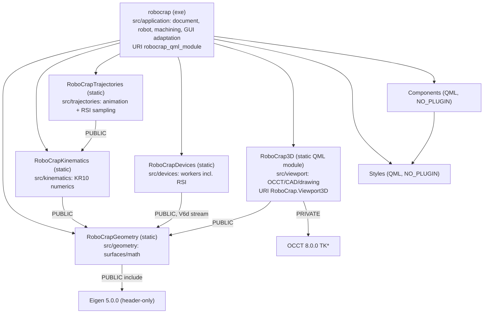

# RoboCrap architecture

A verified map of the current code for future sessions. File references are relative to the
repository root. "Verified" means the claim was checked against constructors, `connect` calls
or call sites; anything else is listed under [Open questions](#7-open-questions).
Source map checked on 2026-10-17 against the working tree, including uncommitted changes.
Some `file:line` references in unchanged paragraphs predate the 2026-10-17 code reduction and may
have shifted; the named function or file is authoritative.
Compilation and runtime behavior remain unverified. Application owns robot configuration/state,
document/machining code, device GUI adaptation and asset-path selection; numerical and renderer
libraries publish their selected value/operation headers. Historical user-confirmed notes record
context, not permission to override current task instructions or AGENTS.md.

## 1. Scope and hardware context

Hardware (supplied by the user; not derivable from code):

| Device | Model | Code entry point | Transport (from code) |
|---|---|---|---|
| Robot | KUKA KR10 R1420, KR C4, KSS 8.3.31, RSI 3.3 | `RsiDevice` key `rsi` | XML over UDP, local port 5555 (`resources/json/db.json`) |
| PLC | Delta AS332T with AS16AP11P-A / AS16AP11T-A (8 DI + 8 DO each) | `PlcDevice` key `plc` | Custom binary over TCP to 192.168.1.2:5051, fixed source port 1234 |
| Force/torque sensor | Schunk Delta IP68 SI-660-60 (ATI Net F/T electronics) | `FtsDevice` key `fts` | ATI RDT over UDP, peer port 49152 |
| Touch probe | WP-500 V6 | none | No device code. Probe data enters only as JSON point files (§5.1) |

`db.json` also lists a VFD (`driver: "vfd"`) that has no device class. The Beckhoff manuals in
`D:\Qt\QtProjects\manuals` have no counterpart in `src/`, `qml/` or `resources/json/`.

Two parts of the code base are outside the active build: `old_imp/` is not built, and `python/`
holds analysis scripts.

## 2. Layers and module dependency graph

Root CMake orchestrates the five library folders and private Application. Each source folder
declares its own target; src/application/CMakeLists.txt declares robocrap and its QML/resources.

Library notes:

- **Qt dependencies.** Geometry links QtCore; Kinematics/Trajectories inherit QtCore/Eigen.
  Devices adds QtNetwork and publicly links Geometry for the `V6d` RSI correction stream. Viewport adds
  QtGui/Qml and private OCCT. Application keeps Core/Gui/Quick/Qml/Network/Charts/Widgets
  and conditional Felgo. QmlChartBridge lives in src/application and retains QtCharts; RSI
  XML parsing/writing uses QtCore, without a QtXml requirement.
- **Published headers.** Libraries export only include/<capability>, plus Eigen from Geometry.
  Viewport publishes drawing/graphics values, OccController and its existing QML singleton wrapper
  needed by C++ startup. Devices publishes workers/values and the retained PlcMessageManager API.
  Application exports no C++ include directory. No whole-src directory is PUBLIC.
- **Module layout.** RSI code follows the canonical layout: numerics in src/trajectories, the device in
  src/devices/rsi and RSI Sampling coordination in src/application/scene. No target uses the legacy
  src include directory. Saved motions still publicly expose central/arc/path values.
- **Drawing and assets.** Viewport includes no Application/Trajectories objects. Application
  supplies numerical drawings/transforms, absolute BREP paths for the seven links and two tools, and
  the OCCT resource directory. OccController retains that directory for OCCT initialization retries;
  its initialization operation owns OCCT calls and returns a QString error. Application assetpaths.*
  selects directories and has no OCCT includes. The viewport links no STEP translator (TKDESTEP).
- **QML registration.** Scene/Backend targets are removed. Existing foreign wrappers compile
  directly into robocrap in both hot-reload modes, including the rdtResponse wrapper for the
  unchanged queued RDTResponse value. Backend's element names now belong to robocrap_qml_module;
  RoboCrap.Backend is retired. Main uses App; other files retain Backend as an application-module
  alias. Viewport, Components and Styles URIs are unchanged.
- **Resources/deployment.** Application declares local qml/... inputs under src/application/qml
  and project-root qrc inputs. Relative QML paths preserve embedded URLs; ON retains /qml/config.json,
  and OFF loads Main from robocrap_qml_module. Root hot_reload_config.json selects the new Main path
  and mirrors Application QML plus the existing reusable modules. The executable stays at the build root. Root declares deployment setup
  and installation; Application attaches the existing POST_BUILD helper in the executable's directory.

## 3. Subsystems

### 3.1 Geometry and kinematics (`RoboCrapGeometry`, `RoboCrapKinematics`)

Plain value types with `std::optional` factories. There are no QObjects, signals or mutable statics.

- **`geometry/mathtypes.h`**:
  - Eigen aliases: `V3d`, `V6d`, `M3d`, `M4d`, `VXd`.
  - `GeomConst::Eps = 1e-9`.
- **`geometry/utils.*`**:
  - `euler2rot(A,B,C)` = Rz(A)·Ry(B)·Rx(C), angles in degrees.
  - `rot2euler` returns two solutions.
  - `makeTransform`, `makeRotation` (principal-axis and arbitrary-axis overloads), `inverseRigidTransform`.
  - `decodeProbeSamples` decodes and validates probe JSON. Object form requires `points`, a finite nonnegative `radius` and numeric `dir` equal to ±1; every point has three finite coordinates. Legacy point arrays use radius 0 and dir 1 (`utils.cpp:67-98`, `utils.h:17-24`). It does not apply compensation.
- **Fitting factories**:
  - `Plane` and `BoundedPlane`: SVD plane fit.
  - `BoundedCylinder`: Levenberg–Marquardt (LM) fit from 6 seed axes; RMS acceptance threshold max(0.1 mm, 2 % R).
- **Probe compensation**: `BoundedPlane::fromSamples` and `BoundedCylinder::fromSamples` fit the original coordinates, then call `applyProbe`. The plane moves by `dir·radius` along its fitted unit normal; the cylinder radius becomes `fittedRadius + dir·radius` and must remain greater than `GeomConst::Eps`. Their file factories are removed; SceneSurfaceImporter supplies decoded samples. There is no circle fitting or import.
- **`surfaceintersection`**: `intersectSurfaces(BoundedPlane, BoundedCylinder)` returns an analytic ellipse (`EdgeGeometry`), or the status `ParallelCylinderAxis` or `InvalidGeometry`.
- **`Kr10Kinematics`** (`src/kinematics/`, published headers in `include/kinematics/`) is a closed-form solver for forward kinematics (FK) and inverse kinematics (IK).
  - `solveFK(q)` returns 7 link transforms; the last is the flange.
  - `calculateIK(T06, previous)` returns only six joint angles in degrees and Status/Turn. T06 is the requested BASE-relative flange transform; previous contains the preceding accepted angles and bits. Status chooses shoulder/elbow/wrist; the six angles choose the nearest permitted ±360° equivalents. Turn records angle signs and does not count revolutions. This operation does not enumerate solutions or run full FK.
  - Wrist decomposition multiplies only the first three joint transforms, in the same order as FK. The caller runs full FK for the resulting six angles and checks the flange/TCP using that array.
  - `configuration(q, transforms)` derives Status and Turn from those already computed frames and angles. Initial arbitrary seeds require an FK once; accepted sequence points reuse their bits. Refreshing bits from the existing array retains the preceding-angle branch classification at boundaries.
  - It rejects a wrist singularity (|sin q5| ≤ Eps), a target out of reach, and joints outside their limits.
  - `matchesFlange(target, actual)` checks the target-relative flange residual against `Kr10PosEps = 1e-4` mm and `Kr10RotEps = 1e-6` rotation entries without FK. Motion generation, central validation and RSI sampling (`ChamferTcpSolver`) use it after their own FK.
  - It stores `const Kr10KinematicModel&`, so the model must outlive the solver. `RobotController` disables copy/move and destroys its solver before its model.
- **`Kr10KinematicModel`** (`kr10kinematicmodel.h`) holds the joints (axis, limits, rated payload speed in °/s), the IK parameters, `qHome` and `pHome`. The application fills it from the constant table in `RobotDefinition::kr10()` (`src/application/robot/robotdefinition.cpp`); there is no robot JSON file.
  - `IgnorePreviewJointPositionLimits = false` is a compile-time diagnostic switch that turns off joint-limit checks. It is read in the kinematics, in `RobotController` and in `chamfermotion.cpp`.

### 3.2 Scene (private Application code)

Classes live under src/application/scene on the GUI thread. They reach QML through src/application/backendqmltypes.h in the application module.

| Class | Responsibility |
|---|---|
| `SceneModel` | Owns `SceneObject`s (QObject parent). IDs come from `m_nextId`, which starts at 1 and is never reused; 0 means no object. `objects` is a read-only `QQmlListProperty`; the class is not an item model. Signals: `objectAdded`, `objectRemoved(id)`, `objectVisibilityChanged`, `objectDiagnosticOverlaysChanged`, `objectsChanged`, `intersectionFailed`. `intersect()` creates an Edge from one plane and one cylinder. `addMachiningPath()` stores a `SceneMachiningData`. main attaches the empty document to the concrete viewport; appendObject requests drawing acceptance before publishing a renderable object and deletes an unpublished rejected candidate. Visibility/diagnostic changes send explicit drawing updates. |
| `SceneObject` | Holds id, kind (Plane, Cylinder, Cone, Edge, ScanPath, MachiningPath), classification, name, visibility and overlays. A fitted `BoundedPlane`, `BoundedCylinder` or `SceneEdge` (ellipse plus its two source IDs) is stored by value in `std::variant` `Shape`; `plane()`/`cylinder()`/`edge()` are `std::get_if` lookups. Only a machining path has a child QObject (`SceneMachiningPath`), exposed as the QML `geometry` property. Setters are private; `SceneModel` is a friend and calls `setShape`/`setMachiningPath`. drawing() supplies analytic dimensions/styles or saved TCP phase polylines; drawingDiagnostics() supplies bounded markers and normal-line endpoints. The CONSTANT `properties` list supplies the Properties panel's formatted `{label, value}` rows (4 decimals, `[x; y; z]` vectors). |
| `scenegeometry.h` | `SceneMachiningSettings` (Q_GADGET value type), `SceneMachiningData{shared_ptr<const ChamferMotion>, sourceEdgeId, calibrationRevision}`, the `SceneMachiningPath` QObject that wraps it, and the `SceneEdge` value. `SceneMachining::updateCompatibility` sets the path's incompatibility text through `SceneObject::geometry()`. |
| `SceneSurfaceImporter` | Synchronous, GUI-thread JSON point import of planes and cylinders, both compensated for the probe. It sets `busy` true and emits `busyChanged` before reading/fitting, then clears it before returning. Synchronous signal handlers can observe true; normal event-loop painting waits for this read/fit call to return (`scenesurfaceimporter.cpp:96-125`). |
| `SceneEndEffectors` | Stores the active tool, measuring stylus data, the collet frame `FLANGE_ER` (initially a provisional constant), and accepted spindle XYZABC with its optional reconstructed transform, exposed by `spindleTcpFrame`. `applySpindlePoses` preserves `FLANGE_ER * ER_TCP`; the stored TCP matrix is reconstructed from the accepted coordinates. Both commit paths update list/frame before notifications. A collet change emits `spindleColletChanged` then `spindleTcpChanged`, even when TCP is equivalent; a TCP-only change emits the latter. Unchanged values emit neither. Generate and presentation reuse the matrix; workers copy its value. The tool CAD models are fixed and are not stored here. |
| `SceneMachining` | Coordinates Generate and Dry Run (§5.2). It holds the `Kr10KinematicModel` copy received once from `RobotController` after initial graphics acceptance, a calibration revision counter, and the playback state. It derives the signed unit draft-axis direction and 5–40 mm display length from the selected source/settings and emits the drawing value. |
| `SceneMachiningPreparation` | RSI Sampling (`App.MachiningPreparation`). For the selected compatible saved path, an `std::async` worker runs `sampleChamferRsiStream` on a copied motion handle, polled by a 30 ms timer. On the GUI thread it accepts only a result whose path still exists, is compatible and holds the same motion. It then writes the five-row `C:/RoboCrapJobs/shared_data.txt` with `QSaveFile` and emits `correctionsReady(QVector<V6d>)`. The stream belongs to its path, not the selection. It is dropped, and the file deleted, at startup, at a new request, when `SceneMachining::availabilityChanged` shows the path gone or incompatible, and at shutdown. QML reads `canPrepare`, `unavailableReason`, `preparing`, `error` and `summary`. |

QML singletons (`application/backendqmltypes.h`):

- `App.Scene`, `App.Hub`, `App.Machining`, `App.MachiningPreparation`, `App.EndEffectors` and `App.WorkspaceController` each return a stack object from `main()`. Their `create()` functions share `claimQmlSingleton`, which `qFatal`s on a null instance, a wrong thread or a second live engine, and sets `CppOwnership`. This QML_FOREIGN + `create()` pattern is the documented Qt 6.8 replacement for `qmlRegisterSingletonInstance` and does not support several engines.
- Creatable types: `PlaneImporter` (`SceneSurfaceImporter`), `DeviceProfileModel`, and `SceneModel` (named element without `QML_UNCREATABLE`; QML only uses it as a type annotation).

### 3.3 Path generation (`RoboCrapTrajectories`)

Numerical code on copied inputs. It calls no scene or device API and has no mutable statics.
Animation implementations live under src/trajectories/chamfer; published motion/path/arc/central
headers live under src/trajectories/include/trajectories. LIN transfer stages use the plain
`Kr10Kinematics` solver; central validation and RSI sampling share `ChamferTcpSolver`
(`chamfertcpsolver.h`) for the checked TCP IK. Bounded surface fitting accepts
decoded samples.
TCP means tool center point; LIN denotes a prescribed straight Cartesian transfer, and PTP
denotes a synchronized joint movement.

| Stage | File | Product |
|---|---|---|
| Analytical curve | `chamferpath` | `ChamferPath::evaluate(angleRad)` evaluates the machining curve at an ellipse parameter in radians. `evaluatePhase(phase, progress)` evaluates LeadIn, Machining or LeadOut at dimensionless phase-local progress in [0,1]. Neither parameter is traveled distance or physical seconds. The path also supplies staging point P_s; `create(parameters)` validates the input. ChamferPath exposes analytical evaluation/differentials. |
| Arc length | `chamferarclength` | Per-phase map from progress to distance in mm. Uses adaptive Gauss–Kronrod (G7/K15) integration and a piecewise quintic Hermite inverse matching endpoint progress and its first two distance derivatives (see the [numerical study](../codex_plans/CHAMFER_ARCLENGTH_STUDY.md)). Stored boundaries are "inverse-map knots"; progressAtDistance selects an interval and evaluates its inverse quintic for timed motion. There is no public distanceAt lookup. |
| Central timing | `chamfercentralmotion` | For elapsed seconds, calculate traveled distance in mm, recover phase-local progress through the inverse arc-length map, then evaluate the analytical TCP pose. All three phases use `machiningFeed`; there is an acceleration ramp over `accelerationDistanceFraction` of each lead. There are no separate lead feeds. |
| Point schedule + IK | `chamfercentralvalidation` | `ChamferCentralPreparation` builds the central maps/timing and curvature/acceleration point schedule (0.01 mm) once per Generate, on the first reached central attempt. Scheduled analytical targets and target failures are cached as reached. Each candidate solves its own seeded IK sequence and checks joint limits, speed and Cartesian XYZ acceleration. Joint-acceleration magnitude rejection is commented out (temporary exception, see `AGENTS.md`). |
| Whole motion | `chamfermotion` | `ChamferMotion::create(path, robot)` prepares HOME to P_s (PTP), P_s to lead-in start (LIN), the central three phases, lead-out end to P_s (LIN), and P_s to HOME (PTP). It prepares three clamped cubic joint splines: one per LIN and one shared across LeadIn/Machining/LeadOut, each with zero endpoint joint velocities. `evaluateJoints(seconds)` uses quintic smoothstep for PTP and the prepared splines for LIN/central; it performs no FK or IK. Times 0 and `duration()` return `qHome`. The outer motion stores `ChamferPathParameters`; the complete `ChamferPath` is inside `ChamferCentralMotion`, so parameters are repeated, not two full path objects (`chamfermotion.h:69-73`, `chamfercentralmotion.h:58`). |
| RSI sampling | `chamferrsistream` | `sampleChamferRsiStream(motion)` evaluates `ChamferCentralMotion::evaluate` at $t_k = 0.004k$ s (the last target is the exact end). Per cycle it runs one seeded `solveTcp`, joint position/speed checks and a Cartesian acceleration check, then the continuous Z-Y-X Euler step. It emits the increment $q(\bar{c}(t_k) - \bar{c}(t_0) - \bar{S}_{k-1})$, rounded to $10^{-6}$ against the sum of previously sent values, then 50 zero settle increments. It fails if any saved central Generate interval is shorter than 4 ms, so that every 4 ms chord stays within 0.01 mm. It also returns the start/end/staging frames and the cumulative offset range. |

Analytical lead evaluation shares checked machining edge/radial/position data and constructs
the final lead orientation directly. The discarded machining transform composition is skipped;
its original axis-sign, basis, positive-depth and finiteness checks still run before lead work.
Each immutable path owns the fixed chamfer-angle sine/cosine/tangent, with the existing tangent
division and reciprocal retained. Complete machining poses retain their original transform product,
and junctions are stored directly as accepted samples and returned at exact shared endpoints.

**Fixed animation points and spline checks.** Each straight LIN is split at its acceleration,
cruise and deceleration boundaries. Before IK, each nonzero constant-acceleration span gets
`N = max(1, ceil(T * sqrt(a / (8 * epsilon))))` equal-time intervals: `T` is that span's duration
in seconds, `a` its acceleration magnitude in mm/s², and `epsilon = 0.01 mm`. Cruise uses one
interval. For a hypothetical 0.2 s ramp at the default `a = 20 mm/s²`, this gives
`ceil(0.2 * sqrt(20 / 0.08)) = 4` intervals and five endpoint-inclusive points; the preceding
endpoint is shared, so four points are appended. Central spans use their curvature and timing
bounds to fix their point counts before IK (`chamfercentralvalidation.cpp:145-181`);
LIN uses `chamfermotion.cpp:445-483`. Neither stage inserts extra IK points or stretches time
after an IK/rate failure.

After IK, spline checks evaluate each joint polynomial at interval endpoints and interior
position/speed extrema, checking finite angles/derivatives, joint position and rated speed
(`chamfermotion.cpp:61-95,639-715`). Joint-acceleration magnitude rejection remains disabled
in central validation, LIN checks (including terminal stops) and spline checks; acceleration
finiteness and central XYZ acceleration checks remain. HOME timing uses configured joint
acceleration and checks its calculated derivatives locally with the existing timing error.
The 0.01 mm point criterion does not bound orientation or the actual TCP
error between saved points after joint interpolation. Dry Run only evaluates the prepared
motion; it constructs no inverse maps or splines and adds no points.

Saved ChamferJointPoint values contain joints, FK-derived TCP, phase-local progress and time,
without velocities. Each checked spline interval is written into the candidate motion's final
coefficient array. The factory returns a motion only after all three spline ranges succeed.

Arc-map accuracy checks reuse the two accepted endpoint differentials and original full-interval
integral, retaining its length/error separately from the rounded stored distance width. All nine
check fractions, positivity/tolerance checks and refinement order are retained. The original
800000 differential-call limit applies to logical work, including reused calls, and rejects the
phase when exceeded; the count is internal and not reported.

**Shared central preparation.** One `ChamferCentralPreparation` belongs to `MotionCompiler`
for the whole `ChamferMotion::create` call. Its constructor only borrows the worker-owned path
and timing. After a candidate's incoming LIN succeeds, `validate(robot, seed)` checks the robot
and seed, then lazily builds three arc-length maps, timing and fixed schedule. The preparation
result, including a map/timing/schedule error, remains available to subsequent candidates.
`CentralValidator` borrows that preparation and the immutable robot setup, returning only its
own accepted joint samples. The completed motion retains the central motion through a value
copy with implicitly shared Qt map arrays; no maps are rebuilt when retaining it.

At each scheduled index, `evaluateTarget(index, seconds)` returns an already cached analytical
TCP pose or evaluates and appends the next pose. A failed evaluation is retained as an empty
optional at that index. Every candidate still solves/checks its own joint sequence and stops
at its first error; a later target is never evaluated before the preceding point passes.
For example, three candidates reaching successful map construction now build three maps in
total, versus nine previously. This is a source-derived operation count, not an executed timing
comparison. The target cache adds worker-local storage and is destroyed after Generate;
inverse-map knots, saved animation points and separately prepared RSI samples remain distinct.

Generate produces no timing or statistics report. `ChamferMotion::create` returns the motion or
the last candidate's error; `SceneMachining` logs one console line (`Chamfer preparation: <points>
points, <seconds> s movement` or `Chamfer preparation failed: <error>`) and shows the error in the
Machining panel. Movement durations remain seconds.

Animation preparation carries one accepted angle/configuration value through incoming LIN,
central samples and outgoing LIN. Each angle-only IK call uses its predecessor's Status and
angles. The caller runs FK once for flange verification and derives accepted configuration from
that array. Central validation retains its checked actual TCP separately from the analytical target
used by XYZ acceleration. LIN nodal-point construction and the later central copying loop reuse
FK-derived TCP without another FK; stored nodal points already contain that matrix. Playback FK
for interpolated angles is separate. Dry Run calls the joint-only evaluator and RobotController runs one FK; the TCP-returning compatibility evaluator shares interpolation and retains its existing endpoint behavior.

`RobotController` has no manual FK/IK command. `initialize` and `forward` return `RobotPoseResult`
with optional BASE-relative link transforms and error text; `forward` checks finite joints, joint
limits and finite FK transforms. RobotController commits a pose only after OccController returns
transform acceptance. There is no profiling command line.

### 3.4 Devices and network (`RoboCrapDevices` and private Application adaptation)

| Class | Responsibility |
|---|---|
| `DeviceHub` | Owns the two `QThread`s `ControlIO` and `GeneralIO`, started in the constructor. `startAll`/`stopAll` are public slots, so QML can call them on the `Hub` singleton. `add()` asserts a parentless device, moves it to its thread, connects `QThread::finished` to `deleteLater`, and creates a `DeviceRunner` parented to the hub. `startAll()` asks every runner to start. `stopAll()` is shown in §5.4. |
| `DeviceRunner` | GUI-thread proxy for QML. Properties: `data` (`QQmlPropertyMap`, pre-filled with `connectionConfig`), `socketState`, `isConnected` (Connected or Bound), `isDisconnected`. Every link to the device uses `Qt::QueuedConnection` (`devicerunner.cpp:13-17`). |
| `AbstractDevice` | Public slots `start`, `stop`, `invoke` with an `m_started` guard. `buildApi()` indexes public `Q_INVOKABLE` methods that return `void` and take no arguments or one `QVariantMap`; slots are excluded. Signals: `stateReady`, `socketStateReady`. `attachSocket()` forwards socket state and logs socket errors directly through Qt. |
| `PlcDevice` (GeneralIO) | `QTcpSocket` bound to a local port, then `connectToHost`. Invokables: `connect`, `disconnect`, `setOutput`, `writeMessage`. `PlcMessageManager` builds frames: a 6-byte big-endian header (0xAA55, version, type, transaction id (tid), length) plus a command, and the whole frame is swapped in 16-bit words. Responses are fixed 32-byte frames. Sends SNAPSHOT on connect. State keys: `x1`, `y1`, `x2`, `y2` (8 bools each) and `cellState`. `writeMessage` accepts raw WRITE_RAW/WRITE_REG/SET_VAR frames and is reachable from QML through `invoke()`, although no QML calls it. Pending requests have no deadline and can exhaust all 256 IDs (§7). The framing is defined by the PLC program (not in the repository); the user confirmed on 2026-10-13 that the protocol works. That historical statement does not establish behavior under response loss. |
| `FtsDevice` (ControlIO) | `QUdpSocket`. Invokables: `connect`, `disconnect`, `startStreaming`, `stopStreaming`, `bias`, `startLogRecording`, `stopLogRecording`, `saveLogToDefaultFile`. RDT request: 0x1234, then command, then count = 0. Parses one 36-byte record per datagram; timestamps use the sequence difference divided by the assumed 7000 Hz, and force/torque scaling uses 1e6 counts per unit. Each accepted packet emits `dataSampleHFReady`. While processing packets, elapsed time ≥16 ms triggers `processBatch`, which uses the last sample for recording and GUI publication; this is not a fixed publication timer. First publication includes all six axes; later publications include changes of at least the 0.05 deadband (`FtsDevice::onReadyRead`, `publishState`, `processBatch`, and the local `acceptAxis` helper in `ftsdevice.cpp`). Stream/log control flags are published separately. Recording is saved by `std::async` + `QSaveFile` to `<appDir>/records/`. The 7000 Hz value is not a measured arrival rate or verified sensor setting. |
| `RsiDevice` (ControlIO, `src/devices/rsi`) | `QUdpSocket`. Drains queued datagrams from the configured peer, answers only the newest valid `<Rob>` (IPOC, Start, Result) and echoes its IPOC. State machine Idle → Streaming (one stored increment per packet) → Finished (zeros, Result 1) → Stopping (Stop 1 once Result 1 is echoed); Start = 0 resets to Idle and index 0. Start without a stream replies Stop 1, Result 0. Invokables: `connect`, `disconnect`. Slot outside the invoke API: `setCorrections(QVector<V6d>)`, deferred to the next Start = 0 during a run. Publishes `rsiState` and `rsiCorrections` only on change. The wire codec is private to `rsidevice.cpp`. |
| `DeviceProfileModel` | Read-only table loaded from `:/json/db.json`. Provides the default endpoints shown in the Network view. |
| Console diagnostics | Device call sites use `qInfo().noquote()` on their owning threads; viewport messages are formatted by `logViewportMessage` in main. Output retains the used `[ERROR]`/`[OK]`/`[INFO]`/`[WRITE]` labels, source names and message text. Qt's message pattern supplies timestamps. Diagnostics have no QML context property, custom message type, or queued GUI logging relay. |
| `QmlChartBridge` | Retained under `src/application` and compiled into `robocrap` with QtCharts; construction/connections at `main.cpp:91-93` are commented out. |

Cross-device wiring in `main.cpp`:

- `SceneMachiningPreparation::correctionsReady` → `RsiDevice::setCorrections`, queued; `QVector<V6d>` is registered in main.

### 3.5 3D viewport (`RoboCrap3D`, namespace `RoboCrap3D`)

| Class | Responsibility |
|---|---|
| `OccController` | Viewport3D singleton; owns the native window, the single robot CAD worker, neutral ordered graphics, accepted drawing matrices and tool display state. Receives absolute BREP paths for seven links and two tools from Application, returns transform acceptance/error and restores drawings from renderer-local values. Owns the accepted DrawingDocument and DrawingPose with stable-ID-order replay; its window borrows both read-only. It calls the window's `OccViewport` directly (looked up per call, null without a native surface) for object, selection, draft-axis and spindle-frame updates, re-applying selection after insert/remove/visibility changes. No application QObject, numerical robot state/solver or motion internals are retained. |
| `OccViewWindow` | QWindow hosted by RobotViewport's WindowContainer. Owns native-surface lifetime, input events, robot installation and the active tool; exposes `viewport()`. First expose builds the viewport. Missing robot data waits; successful or failed installation is not repeated in a surviving scene. A pose failure reapplies the borrowed last accepted pose once; failure of that restoration sets the existing presentation-failure flag and disables robot readiness while keeping the viewer. Actual surface destruction releases the scene; genuine recreation installs cached accepted drawing values in a new scene. |
| `OccViewport`, `OccViewer`, `OccScene`, `OccPart`, `OccInputController`, `OccViewCube`, `OccWorldAxes` | OCCT stack: `OpenGl_GraphicDriver` → `V3d_Viewer`/`V3d_View` on a `WNT_Window`, plus `AIS_InteractiveContext`. Rendering is coalesced with a 0 ms single-shot `QTimer` on the GUI thread. There is no render thread and no `QOpenGLContext`. |
| `OccRobotAdapter` | Converts supplied Eigen matrices to gp_Trsf for existing links, tools and axes. One installation creates the seven links and then the measuring and spindle tools (`m_partIds`: links in model order, then tools), records each part ID before its OCCT display call, applies HOME and shows only the active tool. Failed insertion/HOME application cleans every part of that installation, retaining IDs whose removal fails and returning stage/exception/cleanup errors. `setActiveTool` only toggles tool visibility. Ordinary updates/restoration never remove or recreate parts. |
| `OccSceneAdapter` | Turns supplied analytic patches/curves, polylines and diagnostic/axis drawing values into OCCT parts. It creates a candidate presentation before replacing accepted part mappings, returns errors and reports cleanup failures. Visibility/diagnostics/selection use stable application IDs; picking returns the same ID. |
| `CadLoadWorker` | `QThread` subclass; a function-local static mutex serializes parsing. It reads each absolute `.brep` path through `QFile` bytes into `BRepTools::Read` and returns ordered shapes or `Cannot read CAD file: <path>`. There is no STEP import or cache writing. |
| `RobotDefinition` / `RobotController` (application target) | Private application/robot/robotdefinition.* and robotcontroller.* implement application ownership. `RobotDefinition::kr10()` builds the fixed numerical model and link filename/RGB records from a constant table. Controller owns that model (const), the solver, a temporary checked initial HOME candidate and one optional accepted pose (link transforms). It is not a QML type; its public operations are `loadRobot()` and `applyPlayback(joints, flangeToTcp)`, both returning `ViewportOperationResult`. |
| `ViewportAssets` (private Application assetpaths.*) | Selects the CAD and OCCT resource directories beside the executable. Main supplies the OCCT resource directory to OccController, whose private initializeOcct sets CSF_* variables and initializes the font manager. |

OccScene stores live OccPart values by non-reused PartId, with a separate optional counter that
preserves zero and detects exhaustion without resetting after removal. Selection records cover curves
and surface outlines; unchanged visible parts retain their outlines, while hidden/removed/replaced
parts are deselected. Outline completion is recorded after styling/display succeeds, retaining
unfinished handles through OCCT failures. Part entries are erased only after removal succeeds.
OccPart retains the AIS shape, selection mode and topmost flag; construction applies style and
transform from OccPartProps, and setTransform updates the shape directly. World/TCP/ER axes use
separate OccWorldAxes objects; parts have no individual trihedron state.

SceneModel sends explicit object drawing changes; main connects SceneMachining's draftAxisChanged
value to OccController. The renderer never observes either application owner.
Application RobotController observes active-tool, TCP/collet and axis-visibility changes and sends
explicit drawing values, composing tool-axis matrices in Application. SceneMachining calls its playback operation directly with angles and the motion's saved tool matrix. It calculates one pose and commits
only after returned drawing acceptance. Readiness accepts pending HOME and publishes the numerical
model once; later restoration changes availability without resetting model/revision. main requests
the robot load once after console wiring. Window, drawing flags and CAD status remain in Viewport3D.
Pose failures return through OccController's console path, and numerical playback errors pass
through the robot console path before SceneMachining handles the returned failure. SceneMachining keeps a guarded RobotController pointer attached in main after construction, and a local immutable motion handle protects saved inputs through synchronous callbacks.

### 3.6 QML UI (`src/application/qml/`, reusable modules under `qml/Modules/`)

- **Main window.** `Main.qml` is a single `ApplicationWindow` with no page navigation (no Loader, StackLayout or StackView).
  - It contains a fixed 3-column `SplitView`:
    - Left: `WorkflowPanel`, `ScenePanel`.
    - Centre: `ModeToolBar`, an RSI status label, `RobotViewport`.
    - Right: `PropertiesPanel`, `EndEffectorPanel` ×2 and `MachiningPanel`, switched by `visible`.
  - Tool windows hold the device panels: PLC `DeltaPanel`, FTS `FtsPanel`, Settings/`Network`.
  - A modal calculation window is bound to `App.Machining.calculating`.
- **Application decisions in C++.** WorkspaceController in `src/application/workspacecontroller.*` owns mode (Measuring/Machining), submode (Rough/Precise) and selected IDs. It reuses SceneModel removal/intersection, SceneMachining input/Stop and SceneEndEffectors' active-tool setter. main constructs this application QML singleton after its three collaborators (document, machining session, end effectors) and connects viewport picks/Delete and selection drawing through typed signals. Main exposes read-only bindings; its creation calls reset to Measuring/Rough/empty selection. Leaving Machining stops at HOME before the tool/input changes. The UI-only dryScanActive/dryScanRunning flags remain in Main.
- **Local UI state.** `chamferEditorOpen` and `toolSetupOpen` choose the right panel. `MachiningPanel` owns draft text, `draftFlipAxis` and captured original settings; `EndEffectorPanel` owns pose draft strings. Focus and `ScenePanel` group expansion are UI state, separate from document/robot state (`MachiningPanel.qml:17-19,42-84`, `EndEffectorPanel.qml:27-69`, `ScenePanel.qml:25-29,138`).
- **Device panels.** They use `App.Hub.device(key)`, `isConnected`, `data.<key>` and `invoke(name, map)`. Every `invoke` name used in QML exists as a `Q_INVOKABLE` on the target device. The RSI status label in Main shows `data.rsiState` while the RSI socket is bound.
- **Selection and machining input.** WorkspaceController::synchronizeMachiningInput chooses the sole selected Edge/MachiningPath in Machining mode, otherwise zero. setSelection notifies QML's selected-object binding before applying input settings, preserving editor Cancel order; successful Generate first closes the editor, then requests selection. Import and scene-list requests use the same selectObject operation; document changes prune removed IDs. SceneMachining still captures the pending Generate source and retains active playback independently. Window visibility/native recreation already reapply cached selection, so Main has no selection replay handlers.
- **Tools and placeholders.** Dry Scan only toggles `Main.qml` flags; no scan motion is prepared or played. Scan and Start Machining use the toolbar action's default `available: false` and remain disabled (`Main.qml:450-459`, `ModeToolBar.qml:62,197-219,239-244`). Measuring name/ball diameter/stylus length are displayed read-only; spindle ER coordinates are disabled read-only fields, while TCP relative to ER has Apply. Apply passes the original ER coordinates, not their four-decimal display values (`EndEffectorPanel.qml:121-178,261-267`). This UI does not implement measuring calibration or scan execution.
- **Reusable modules.** `Components` contains the `Qx*` wrappers around Qt Quick Controls. `Styles` contains the singletons `Colors`, `Fonts` and `Metrics`. Both are NO_PLUGIN static modules with maintained `qmldir` files.
- **Resources.**
  - `pics.qrc`: SVG icons.
  - `fonts.qrc`: Roboto.
  - `json.qrc`: `db.json`.
  - `resources/files` retains its blade/RSI inputs; they are not embedded in a qrc.
  - `cmake/DeployOcct.cmake` copies the nine `*.brep` files (seven KR10 links, `MEE`, `SEE`) beside the executable; there are no STEP sources.
- **Properties panel.** `PropertiesPanel.qml` renders `selectedObject.properties` with one `Repeater` of `PropertyValue` rows; the label column width comes from a fixed label list, so it does not change with the selection.

## 4. Threading and ownership model

| Thread | Objects / work | Created by |
|---|---|---|
| GUI (main) | `QApplication`, `DeviceHub`, all `DeviceRunner`s, `SceneModel`, `SceneEndEffectors`, `SceneMachining`, `SceneMachiningPreparation`, `OccController`, `OccViewWindow` and its OCCT viewer/rendering, QML engine; also synchronous JSON import, `ChamferPath::create`, `shared_data.txt` write, Dry Run timer (16 ms) | `main()` stack |
| `ControlIO` (`QThread`) | `FtsDevice`, `RsiDevice` and their sockets/timers | `DeviceHub` |
| `GeneralIO` (`QThread`) | `PlcDevice` and its socket | `DeviceHub` |
| Generate worker (`std::async`) | `ChamferMotion::create` on a copied `ChamferPath` + `ChamferRobotSetup`; polled by a 30 ms GUI timer | `SceneMachining::generate` |
| RSI sampling worker (`std::async`) | `sampleChamferRsiStream` on a copied `shared_ptr<const ChamferMotion>`; polled by a 30 ms timer | `SceneMachiningPreparation::prepare` |
| FTS save worker (`std::async`) | JSON write of a copied sample buffer | `FtsDevice` |
| CAD worker (`QThread` subclass) | BREP loading of the seven links and two tools, serialized by a static mutex | `OccController` |

Ownership and lifetime rules:

- **Stack objects in `main()`.** The application singletons are stack objects without a QObject parent. The QML engine is declared last, so it is destroyed first. QML gets these objects through the wrappers' `s_inst` (or `WorkspaceController::s_instance`) and `claimQmlSingleton`, which sets `CppOwnership`.
- **Devices.** Each device is created parentless, then moved to its I/O thread. It is deleted on that thread by `deleteLater` when the thread finishes. Runners are children of the hub.
- **Scene objects.** Each `SceneObject` is a child of `SceneModel`; fitted geometry is held by value, and a machining path's `SceneMachiningPath` is a child of its object. Removal emits `objectRemoved`, then calls `deleteLater`.
- **Immutable shared data.** These are shared across threads as `shared_ptr<const ...>`:
  - `ChamferMotion` (scene path, playback, RSI sampling worker);
  - the RSI correction stream, as an implicitly shared `QVector<V6d>` (GUI thread to ControlIO);
  - `CadLoadResult` (controller, window and adapter).
- **Worker result acceptance.** Results are accepted only on the GUI thread, and stale ones are rejected:
  - Generate compares the input id, the calibration revision, robot availability and the source;
  - RSI sampling requires the sampled path to still exist, be compatible and hold the same motion pointer;
  - CAD loading compares a generation counter.
- **Thread affinity checks.** `Q_ASSERT` checks thread affinity in `AbstractDevice::start/stop/invoke`, `DeviceRunner::invoke`, `OccController::loadRobot`, `RobotController::loadRobot/applyPlayback` and `SceneMachiningPreparation`; `claimQmlSingleton` `qFatal`s on a wrong-thread QML engine.

## 5. Traced workflows

### 5.1 Geometry and CAD import

**Probe point JSON into `SceneModel`.** This is the only path that adds imported geometry to the scene. There is no STEP import into `SceneModel`.

1. `ModeToolBar` emits a plane or cylinder import request. `Main.qml` opens the matching `FileDialog` filtered to `*.json`.
2. `onAccepted` calls `surfaceImporter.load` or `loadCylinder(url, App.Scene)`.
3. `SceneSurfaceImporter::importSurface` runs synchronously:
   - `readSamples` reads/parses JSON and calls `decodeProbeSamples` to validate coordinates and probe metadata, without compensating them;
   - `BoundedPlane::fromSamples` or `BoundedCylinder::fromSamples` fits the coordinates and applies probe compensation once;
   - then `SceneModel::addBoundedPlane` or `addBoundedCylinder` stores the value in the new `SceneObject`.
4. `SceneModel::appendObject` obtains SceneObject::drawing() and asks OccController to install/cache that value. OccSceneAdapter constructs the trimmed OCCT face/edge and returns acceptance/error. Only accepted insertion publishes objectAdded/objectsChanged; failure deletes the unpublished candidate and the importer reports failure.
5. The importer emits `loaded(object)`; Main requests `WorkspaceController::selectObject(objectId, false)` to select the inserted object.
6. Optional: "Intersect Selected" calls `SceneModel::intersect`, which uses `intersectSurfaces` to add an Edge object. That Edge is the Generate input.

**BREP CAD for robot and end effectors.** This goes to the viewport only.

1. main.cpp calls RobotController.loadRobot once after connecting viewport/robot console messages.
   Recreating RobotViewport does not submit another loading request.
2. RobotController uses its constant `RobotDefinition::kr10()` model, runs the existing HOME
   FK/model comparison once and retains its successful initial candidate while supplying absolute
   paths of the seven link BREPs plus `MEE.brep` and `SEE.brep`, the link RGB and matrices.
3. OccController starts the serialized CAD worker for those nine files, rejects stale results and
   installs links and tools in one installation with those matrices, showing only the active tool.
   On graphics readiness, RobotController accepts HOME and supplies the model to SceneMachining once.
   Later surface/window restoration replays renderer drawing values without FK or replacement of
   the application model. Repeated attach/load notifications keep existing parts. Failed insertion
   or initial HOME application reports its stage, removes every part of that installation and
   leaves HOME/model unpublished; a missing tool BREP therefore fails the robot load. Failed cleanup
   keeps unresolved part IDs, reports the error and does not retry automatically.
4. Switching Measuring/Machining calls `SceneEndEffectors::setActiveTool`; RobotController forwards
   the tool to OccController, which only toggles which tool part is visible. Tool CAD files cannot
   be changed from the UI.

### 5.2 Generate → Dry Run

**Generate.**

1. Toolbar "Generate Path" opens/focuses `MachiningPanel` and captures the current settings; it does not generate (`Main.qml:466-472`). The panel's "Generate" commits draft settings through `App.Machining.settings` / `SceneMachining::setSettings`, then emits `generateRequested`; `Main.qml:592` calls `App.Machining.generate()`. Cancel restores the captured settings and closes the editor (`MachiningPanel.qml:42-79,183-187`).
2. `SceneMachining::generate` (`scenemachining.cpp:159-184`):
   - checks `unavailableReason()`: robot ready, 6-value spindle TCP, an Edge with both source objects still present (one plane and one cylinder), or a saved path. The raw-edge numerical parameters use the edge ellipse plus cylinder origin/axis, but the plane-presence check still gates acceptance (`scenemachining.cpp:116-138`);
   - builds `ChamferPath::create(settings.applyTo(source))` **on the GUI thread**;
   - copies `Kr10KinematicModel`, `flangeToTcp` and the timing into `ChamferRobotSetup`;
   - records the input id and revision;
   - starts `std::async(ChamferMotion::create, path, robot)` and a 30 ms poll timer.
3. `finishCalculation`, once the future is ready:
   - logs one line: point count and movement seconds, or the error;
   - rejects the result if the input, revision, robot availability or source changed;
   - otherwise calls `SceneModel::addMachiningPath` with `make_shared<const ChamferMotion>`;
   - when regenerating a saved path, copies its name and visibility, then removes the old object;
   - calls `setInputId(newId)` and emits `generated`.
4. The new object reaches the viewport through `objectAdded` (§5.1 step 4).
   Saved motions own geometry/model/TCP/settings snapshots. Their sources may subsequently be
   removed without destroying the motion; regeneration from a saved path uses its parameters.
   Pending Generate from a raw edge is rejected if its required sources disappear before
   acceptance (`scenemachining.cpp:203-220`). Model/TCP changes invalidate playback until regeneration.

**Dry Run.**

1. `ModeToolBar` "Dry Run" calls `App.Machining.dryRun()` (`Main.qml:461`).
2. `SceneMachining::dryRun` requires `canPlay()` (compatible path, robot available) and the guarded RobotController attached by main. It retains the immutable motion, presents time zero, then starts a QElapsedTimer and a 16 ms PreciseTimer.
3. Each tick calls `SceneMachining::advancePlayback`, which calculates elapsed seconds and calls `presentPlayback(seconds)`:
   - `ChamferMotion::evaluateJoints(seconds)` returns six joint angles and phase using the saved HOME progress or prepared joint spline. It performs no FK, IK or integration.
   - SceneMachining keeps a local motion handle through synchronous notifications and calls `RobotController::applyPlayback(joints, savedFlangeToTcp)` directly.
   - RobotController's `forward(joints)` runs FK once and checks every link matrix. applyPlayback composes the saved-tool TCP, checks finiteness even when its axes are hidden, and passes that checked matrix to drawingPose/applyPose.
   - `OccController::applyRobotTransforms` returns full link/tool/axis transform acceptance. Only then does RobotController commit the pose; only returned success with playback still active advances SceneMachining's elapsed time/phase.
   - Failure returns to SceneMachining::failPlayback. A failed drawing update restores saved matrices once on the same objects; the candidate remains rejected. Failed restoration disables readiness without deletion/recreation, FK/IK, model reset or recursive Stop-to-HOME. Redraw remains deferred; acceptance does not report a completed frame.
4. `pause()` stops the timer. Calling `dryRun()` again resumes from `m_elapsed`.
5. `stop()` presents time zero while the robot preview is available, then ends playback (`SceneMachining::stop`). Time zero returns the saved `qHome` (`ChamferMotion::evaluateJoints`), so Stop returns immediately to HOME without an animated return.
6. Playback also ends when t reaches the duration (the last point is `qHome`), and on any of: `aboutToQuit`, robot unavailable, calibration change (`spindleTcpChanged` or `setRobotModel` increments the revision and invalidates saved paths), removal of the active path. Leaving Machining mode calls `SceneMachining::stop()` from WorkspaceController before changing tool/input, so the robot jumps to HOME.
7. While playback is active, `generate()` is unavailable. There are no manual robot pose commands.

### 5.3 Device request from QML and state back

Example: the PLC panel toggles an output.

1. `DeltaModuleAP.qml` calls `plc.invoke("setOutput", {module, index, enabled})`, where `plc` is `App.Hub.device("plc")`.
2. `DeviceRunner::invoke` (GUI thread) asserts the thread and emits `invokeReq` (`devicerunner.cpp:31-36`).
3. The queued connection (`:15`) posts the request to GeneralIO. There `AbstractDevice::invoke` checks `m_started`, looks up the name in `m_api`, and calls `QMetaMethod::invoke(..., DirectConnection)` (in `abstractdevice.cpp`).
4. `PlcDevice::setOutput` builds a WRITE_IO frame with `PlcMessageManager`, swaps 16-bit words, and writes it to the TCP socket.
5. `readyRead` collects 32-byte responses. They are matched by transaction id (tid) and command, then decoded into `x1/y1/x2/y2` and `cellState`. The device emits `stateReady(QVariantHash)`.
6. The queued connection (`devicerunner.cpp:16`) calls `DeviceRunner::onStateReady` on the GUI thread. `m_data->insert(vals)` updates the `QQmlPropertyMap`, and QML bindings on `data.x1` and the others update.
7. Socket state follows the same pattern: `QAbstractSocket::stateChanged` → `AbstractDevice::onSocketStateChanged` → `socketStateReady` (queued) → `onSockState` → `socketStateChanged` → `isConnected`/`isDisconnected`.
8. Diagnostics are independent of queued GUI state delivery. Devices write directly through `qInfo().noquote()` on their owning I/O threads, including command rejection and completed FTS save results. Main's viewport-message connection uses the application as its lifetime context and writes through the same Qt output. No device logging signal or custom logging object remains.

Startup:

- `hub.startAll()` (`main.cpp:87`) runs `DeviceRunner::start` → `startReq` (queued) → `AbstractDevice::start` on the I/O thread → `buildApi()` + `startDevice()`.
- `startDevice()` creates the socket. The network connection itself waits for an explicit `invoke("connect", config)` from `Network.qml`.

### 5.4 Application shutdown

1. **`aboutToQuit`.** Slots run in connection order:
   1. `SceneMachining::endPlayback` (connected in its constructor, `scenemachining.cpp:88`).
   2. `SceneMachiningPreparation::shutdown` (`main.cpp:109`). It **blocks** on an in-flight sampling future, then drops any held stream (emitting an empty `correctionsReady` to ControlIO if one existed) and deletes `C:/RoboCrapJobs/shared_data.txt`.
   3. `DeviceHub::stopAll` (`main.cpp:110`).
2. **`stopAll`** (`devicehub.cpp:60-79`). It returns at once if both threads are already stopped. Otherwise:
   - for each device: `invokeMethod(dev, &AbstractDevice::stop, BlockingQueuedConnection)`. When a stream exists, preparation shutdown posts its empty `setCorrections` from the GUI thread to `rsiDev` before this same GUI thread posts that device's blocking stop. This orders those queued calls to the same receiver; it is not a universal FIFO claim across unrelated senders, receivers or Qt event kinds. `FtsDevice::stopDevice` waits for an outstanding save.
   - `quit()` and `wait()` both I/O threads. `QThread::finished` triggers `deleteLater`, which deletes each device on its own thread.
   - `stopAll()` asserts that the caller is outside both I/O threads (`devicehub.cpp:65-66`): a blocking queued stop from its receiving thread would deadlock. The current shutdown caller is the GUI thread; sharing ControlIO does not by itself establish a race or deadlock.
3. **`app.exec()` returns.** Stack objects are destroyed in reverse declaration order:
   1. `QQmlApplicationEngine`. QML is destroyed; `RobotViewport` `onDestruction` calls `detachViewWindow`.
   2. RobotController marks machining unavailable; OccController then interrupts and **waits** for the CAD worker (a BREP read cannot be interrupted mid-file), then deletes the window.
   3. `SceneMachiningPreparation`. Its destructor calls `shutdown()` again, which is a no-op.
   4. `SceneMachining`. There is no explicit wait, but destroying a `std::future` returned by `std::async` blocks until an in-flight `ChamferMotion::create` finishes.
   5. `SceneEndEffectors`, then `SceneModel`.
   6. `DeviceHub`. Its destructor calls `stopAll()`, a no-op because the threads are stopped.
   7. `QApplication`.

## 6. External-library boundaries

- **Qt 6.8 / QML.**
  - Application/backendqmltypes.h registers the former Backend types and rdtResponse using QML_FOREIGN in robocrap_qml_module. The viewport/include/viewport/viewportqmltypes.h wrapper remains in RoboCrap.Viewport3D. RDTResponse's fields, Q_GADGET and queued metatype are unchanged; its QML annotation belongs to the Application wrapper. Diagnostics use Qt console output without a context property.
  - Hot reload:
    - `USE_HOT_RELOAD=ON`: app QML is not compiled in; `FelgoHotReload` uses root `hot_reload_config.json`, whose main_qml_file is `src/application/qml/Main.qml`. qml_module_paths contains both `src/application/qml` and the original `qml` reusable-module tree, with unchanged Components/Styles target mappings. Main still adds its cached qml/Modules import directory. Application embeds the unchanged config.json at /qml/config.json. CMake requires Felgo/FelgoHotReload and uses their existing helpers; the C++ branch uses `USE_FELGO_HOT_RELOAD`.
    - `OFF` (current source default, `CMakeLists.txt:29-33`): QML is embedded and loaded with `engine.loadFromModule("robocrap_qml_module", "Main")`. An existing build cache can choose a different option value.
  - `FAST_QML_BUILD=ON` (default) adds `NO_CACHEGEN`.
  - Devices links QtNetwork and Geometry (for `V6d`), inheriting QtCore. QQmlPropertyMap belongs to Application's DeviceRunner; Devices' value/manager headers have no QML dependency. PlcMessageManager remains a QObject and dictionary codec. Ordinary 8/16-bit readers retain strict numeric acceptance and typed stream writes; Qt stream reads retain their immediate status checks.
  - Numerical code uses only QtCore: containers, JSON, `QElapsedTimer`.
- **OCCT 8.0.0.**
  - Used only by src/viewport/occt, src/viewport/adapters and OccController's initialization/drawing implementation; Application's asset-path and robot configuration/state code has no OCCT include. `Kr10KinematicModel` and `Kr10Kinematics` remain independent of OCCT.
  - The public `OccController` header exposes no OCCT types.
  - Eigen → OCCT conversion is only in `OccRobotAdapter::toOccTransform` and the scene adapter.
  - CMake enforces OCCT 8.0.0 + Windows 64-bit MinGW/GCC; only Release OCCT libraries are mapped.
  - `cmake/DeployOcct.cmake` stages the TK DLLs and their dependencies, the OCCT resources and `resources/cad/kr10` at POST_BUILD and install time.
  - External-library calls retain exception handling: OCCT Standard_Failure, worker std::exception and scene cleanup/rethrow. AGENTS.md permits these external exceptions and requires expected failures through returned values; project exception types/new throws are prohibited.
  - Scene drawing insertion catches OCCT failures, cleans candidate part IDs and returns the original error plus any cleanup errors; previously accepted mappings/cache are retained when candidate construction fails.
  - `ready` requires the robot CAD to be presented, so Generate depends on OCCT initialization and on the BREP load of all seven links and both tools. While the native surface is destroyed and not yet rebuilt (on exit or during Felgo hot reload), availability is false; a Generate result arriving then is rejected. The user confirmed this behaviour stays.
- **Eigen 5.0.0.** Header-only, vendored in `libs/`, exported PUBLIC by `RoboCrapGeometry` because `mathtypes.h`, `utils.h`, the kinematics and the path types expose Eigen in their headers.
- **Felgo.** Only in hot-reload builds (`FelgoApplication`, `FelgoHotReload` in `main.cpp`).
- **Standard library concurrency.** `std::async` / `std::future` is used for the Generate, RSI sampling and FTS save workers. `QtConcurrent` is not used.

## 7. Open questions

Source-level facts, unresolved decisions and runtime/hardware checks not performed:

**Protocols and controller side**
- **Net F/T.** The ATI Net F/T manual confirms:
  - header 0x1234;
  - commands 0x0000 stop, 0x0002 real-time streaming, 0x0042 software bias;
  - UDP port 49152;
  - an internal rate of 7000 Hz with an RDT output rate configurable from 1 to 7000 Hz;
  - counts per force and counts per torque set by the calibration.

  Unverified in code: the configured RDT rate (the code assumes 7000 Hz for timestamps) and the counts per force/torque (hard-coded to 1e6 for both). With command 0x0002 each datagram carries one record, so parsing 36 bytes is consistent with the manual.
- **RSI.** The RSI 3.3 manual confirms IPO_FAST = 4 ms (12 ms in IPO mode), that a packet is valid only with the echoed IPOC, that late packets are counted and stop the robot, and that `HOLDON` controls output behaviour on late packets. `resources/files/rsi/RSI_Hole.src` uses `RSI_ON(#RELATIVE, #IPO_FAST)`; its contract is `resources/files/rsi/RSI_Hole_CONTRACT.md`.
  - Not verified on the controller: the ETHERNET1 `Timeout`/`Precision` semantics, the BOOL spelling of `Start`, whether POSCORR1 MaxRotAngle covers the sampled A/B/C range, and the behaviour when the T1 Start key is released during RSI_MOVECORR.
- **RSI execution.** Implemented, never run on the robot. Neither a local wire check nor a T1 run has been done.
- **PLC pending lifetime.** `availableTid()` scans all 256 8-bit IDs. If complete socket writes keep succeeding, matching replies never arrive and the connection stays open, pending entries accumulate until every ID is occupied; another write is rejected with "All PLC transaction ids are pending" (`plcdevice.cpp:153-179,206-247`). Matching responses, including matched error replies, remove their entry; a failed/partial write removes its entry, and partial writes also abort the socket. Explicit disconnect, socket transition to UnconnectedState and device stop clear pending requests (`plcdevice.cpp:33-45,113-116,311`). No timeout/retry policy exists. This response-loss condition is derived from code, not an observed hardware incident or a contradiction of the historical working-protocol report.

**Runtime behaviour not exercised**
- Whether `QQmlPropertyMap::insert(QVariantHash)` notifies bindings for every key in practice. Assumed from Qt documentation; not run.
- ControlIO latency. The 4 ms RSI reply loop shares an event loop with FTS datagram handling (timestamps assume 7000 Hz; actual arrival rate is unmeasured) and `FtsDevice::stopDevice` waiting for a save. Latency is unmeasured; the shared thread alone does not prove a race or deadlock.
- Shutdown can block on an in-flight Generate (future destructor), an RSI sampling worker or a BREP read. Durations not measured.
- Felgo hot reload with the `qFatal` "one engine" singleton checks. Not run.
- Differential selection and live PartId storage are implemented in OccScene. Outline reuse, picking, hide/show/replacement, partial OCCT failures and drawing replay have not been observed in a rebuilt runtime; source inspection establishes the intended operations only.

**Data and units**
- Imported files contain no unit tag that the importer validates or converts; point coordinates and probe radius must already use scene units (millimeters).
- `SceneEndEffectors` uses a hard-coded collet frame `FLANGE_ER` with a roll explicitly marked provisional (`sceneendeffectors.cpp:11-20`). Source inspection does not establish physical calibration.
- The nine BREPs in `resources/cad/kr10` are the only CAD inputs; there are no STEP sources to regenerate them from, and a missing or unreadable file fails the robot load. Their compatibility with the linked OCCT version is not checked beyond `BRepTools::Read` succeeding.
- End-effector CAD models are fixed (user decision, 2026-10-17); there is no Browse/Retry.
- `IkSolution::status` now selects the next animation IK branch. `turn` remains angle-sign metadata; nearest winding uses the preceding six angles. Exact compatibility of the project's bit mapping with installed KUKA controller semantics remains unverified.

**Retained interfaces and code hygiene**
- `SceneModel` is QML-creatable (registered under both `SceneModel` and the singleton `Scene`; one C++ class under two QML names is not a documented Qt pattern, though the build has used it). All application singletons share the `qFatal` check in `claimQmlSingleton`.
- `QmlChartBridge` is retained as compiled Application code with its existing API. Absence of an active instance does not authorize removing it.
- `ChamferPathSample`/`ChamferPathResult` serve analytical evaluation/construction. `FtsDevice::dataSampleHFReady`, `dataBatchReady` and `streamReset` have no active connections; they and the queued `RDTResponse` metatype registrations are kept for future force-controlled motion (user decision, 2026-10-18). Recording lifecycle calls and console diagnostics remain live.
- Device/viewport diagnostics use Qt console output. Additional operation-status/error properties and QML error displays are deferred at the user's request; existing socket/control state channels remain live.
- Retained assets: nine KR10/tool BREPs and `resources/files` blade/RSI inputs. RSI contract/controller/example files are separate workflow assets; lack of embedding does not make them disposable.
- Robot pose and OCCT initialization failures return values; their former QString& output channels were removed. External-library exception handlers preserve the recovery described in §6 under the current AGENTS.md allowance.
- `std::bind` connections are not prohibited by the current mandatory C++ rules; those rules prohibit lambdas. Captured object lifetimes still depend on each connection's context and owner lifetime, not on this style distinction.
- The `devicehub.h:12-17` comment still mentions a single shared I/O thread.
