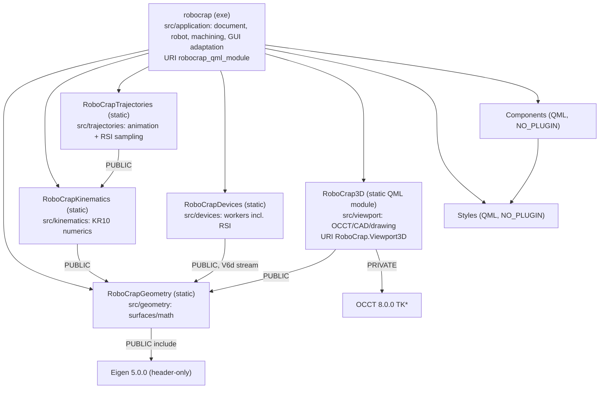

# RoboCrap architecture

A map of the current code and hardware for future sessions. File references are relative to the
repository root; named functions and files are authoritative. The binding constraints for each
area are in [AGENT_CONTRACTS.md](AGENT_CONTRACTS.md) and, for the controller/PC protocol, in
[RSI_Chamfer_Hole_CONTRACT.md](../resources/files/rsi/RSI_Chamfer_Hole_CONTRACT.md); this file does
not repeat them. Code claims were checked against constructors, `connect` calls and call sites on
2026-10-17; unchecked items are listed under [Open questions](#7-open-questions). Compilation and
runtime behavior are not verified by this document.

## 1. Scope and hardware context

Hardware (supplied by the user; not derivable from code):

| Device | Model | Code entry point | Transport (from code) |
|---|---|---|---|
| Robot | KUKA KR10 R1420, KR C4, KSS 8.3.31, RSI 3.3 | `RsiDevice` key `rsi` | XML over UDP, local port 5555 (`resources/json/db.json`) |
| PLC | Delta AS332T with AS16AP11P-A / AS16AP11T-A (8 DI + 8 DO each) | `PlcDevice` key `plc` | Custom binary over TCP to 192.168.1.2:5051, fixed source port 1234 |
| Force/torque sensor | Schunk Delta IP68 SI-660-60 (ATI Net F/T electronics) | `FtsDevice` key `fts` | ATI RDT over UDP, peer port 49152 |
| Touch probe | WP-500 V6 | none | No device code. Probe data enters only as JSON point files (§5.1) |
| Calibration sphere | ⌀25 mm bearing ball, grade G40, ISO 3290 | none | Passive reference sphere for touch-probe calibration, on a vertical rigid pole on a table in front of the robot. The ball sits 2 mm deep in the top of a ⌀17.8 mm strut cylinder (supplied by the user, 2026-10-26), so only the surface above the strut's top face (12.5 − 2 = 10.5 mm below the sphere center) is accessible |
| Network switch | D-Link DGS-1005P (5-port Gigabit, 4 PoE ports, unmanaged) | none | Connects the PC's "Devices-Switch" network adapter to the PLC, force/torque sensor and VFD; the KR C4 is cabled directly to the PC |

### Network

Since 2026-10-23 the PC uses two network adapters with separate subnets. The USB network adapter
(ASIX AX88179, Windows connection "KRC4-Direct") is cabled directly to the KR C4 KLI socket and
carries 172.31.1.47/24 for RSI (KR C4 RSI interface 172.31.1.147/24, `db.json` RSI endpoint) and
192.168.2.100/24 for the KR C4 Windows interface 192.168.2.200/24, through which the KRL program
mounts the `RoboCrapJobs` share. The motherboard network adapter (Intel I219-V,
"Devices-Switch") carries 192.168.1.100/24 and connects through the DGS-1005P to the PLC
192.168.1.2, force/torque sensor 192.168.1.3 and VFD 192.168.1.4. Reason for the split, measured
2026-10-22 with `python/rsi_packet_timing.py` and Wireshark: through the DGS-1005P (a
store-and-forward switch with 802.3az Energy-Efficient Ethernet, 802.3x flow control and 802.1p
QoS, per D-Link's datasheet for hardware version B1), RSI requests from the KR C4 sometimes
reached the PC up to 19 ms late and several at once, and the controller rejected the late replies;
with a direct cable no request was late. The cause inside the switch was not examined.

### Key device specifications

Taken from the manuals folder (checked 2026-10-24) unless marked as supplied by the user. The
manuals folder is `E:\Qt\QtProjects\manuals` on the first PC (DESKTOP-31IFLFK) and
`D:\Qt\QtProjects\manuals` on the second PC. Response times are datasheet values per
component, not measurements of this installation.

| Device | Key data | Source |
|---|---|---|
| KR C4 smallsize-2 | KLI: Ethernet socket on the KUKA PC for external communication (RSI, Windows interface, WorkVisual). X69: KUKA Service Interface (KSI) on the cabinet door, a separate bus for a service notebook; not used by RSI. RSI cycle 4 ms (`#IPO_FAST`). | Spez KR C4 smallsize-2 §3.7, §6.6.6; RSI 3.3 §5.1, §7.1.4 |
| Delta AS332T-A (PLC CPU) | 24 VDC supply; 1× Ethernet, 2× RS-485, USB, micro-SD; onboard 16 DI (X0.0–X0.15) + 16 DO (Y0.0–Y0.15, sinking transistor, 5–30 VDC); up to 1024 I/O; 40K steps/ms; constant scan cycle settable 1–32000 ms in 1 ms steps; 128K steps program. Onboard DI response < 2.5 µs (X0.0–X0.11) / < 50 µs (X0.12–X0.15). | AS Hardware and Operation Manual §2 |
| Delta AS16AP11P-A / AS16AP11T-A | Each 8 DI + 8 DO. Inputs: 24 VDC, 5 mA, 4.7 kΩ, sinking or sourcing; ON > 15 VDC, OFF < 5 VDC; hardware response OFF→ON < 20 µs, ON→OFF < 200 µs; **plus a software input filter of 0–25 ms, default 10 ms** (the value set in the PLC project is not recorded here). Outputs: transistor, P-A sourcing / T-A sinking, 5–30 VDC, 0.5 A per output, 4 A per COM; max. response OFF→ON 0.5 ms, ON→OFF 0.5 ms; max. 100 Hz resistive load. | AS Module Manual §2.1.1 |
| Beckhoff EK1100 | EtherCAT coupler, 100 Mbit/s, 24 VDC supply, E-bus supply 2000 mA, delay approx. 1 µs. | Datasheet EK1100 |
| Beckhoff EL1809 | 16 DI, 24 VDC (−15 %/+20 %), EN 61131-2 type 1/3; "0" −3…+5 V, "1" 11…30 V; typ. 3 mA; **input filter typ. 3.0 ms**; reference ground = 0 V power contact. | Datasheet EL1809 |
| Beckhoff EL2809 | 16 DO, 24 VDC, 0.5 A per channel (short-circuit-proof); **switching times typ. TON 60 µs, TOFF 300 µs**. | Datasheet EL2809 |
| Schunk FTS Delta SI-660-60 (ATI Net F/T) | Sensing ranges Fx, Fy ±660 N; Fz ±1980 N; Tx, Ty, Tz ±60 Nm. Applied loads must be within range on all six axes. RDT streaming over UDP port 49152. | FT Transducer manual §5.10 |
| WP-500 touch probe | Wired optical touch probe; body Ø42 mm, stylus thread M3, standard stylus 30 mm with Ø3 mm ruby ball; repeatability 0.001 mm; XY travel 20°, Z travel 3 mm; IP67; CR2032 battery (approx. 6 months standby); 3 m two-core signal cable with Type-C connector. Output (supplied by the user): normally open NPN, conducting on trigger; it cannot drive the EL1809 inputs and is wired to AS16AP11T-A input X2.5 (working, user-verified 2026-10-24); the signal path to the KR C4 is described under "Additional hardware and Delta I/O wiring". An external LED on the probe lights on contact (supplied by the user), so touches made in jog mode need no signal connection. **The user states the probe can operate from 24 V power; the WP-500 manual (ENG and CHN) does not mention a 24 V supply.** | WP-500 manual, Technical Specifications, Wiring (table values matched by row order from garbled PDF text) |

Discrete signal path between KR C4 and PLC (component datasheet values, not measured). A KR C4
output `$OUT[n]` switches an EL2809 output (typ. 60 µs on, 300 µs off), which drives an
AS16AP11P-A input (< 20 µs on, < 200 µs off in hardware, then the software filter, default
10 ms), which the PLC program reads in its next scan. In the other direction, an AS16AP11P-A
output (at most 0.5 ms) drives an EL1809 input (filter typ. 3.0 ms), which reaches `$IN[n]` over
EtherCAT. The AS software filter is the largest delay on the PLC side, the EL1809 filter on the
KR C4 side.

### Additional hardware and Delta I/O wiring

The Beckhoff EK1100 (EtherCAT coupler), EL1809 (16 digital inputs) and EL2809 (16 digital
outputs) are physical equipment identified by the user; nothing in `src/`, `qml/` or
`resources/json/` addresses them.

The Delta expansion modules are wired as follows (scheme names and terminal connections
supplied by the user):

| Module | Inputs (8 DI) | Outputs (8 DO) |
|---|---|---|
| AS16AP11P-A | X1.0–X1.7; sourcing scheme; S/S connected to 0 V | Y1.0–Y1.7; sourcing scheme; C0 connected to +24 V |
| AS16AP11T-A | X2.0–X2.7; sinking scheme; S/S connected to +24 V | Y2.0–Y2.7; sinking scheme; C0 connected to 0 V |

X2.5 receives the WP-500 NPN output; the S/S connection to +24 V suits an NPN output, which
switches the input to 0 V.

The EK1100 connects to the KR C4 via EtherCAT. The EL1809 and EL2809 terminals connect
to the EK1100. WorkVisual maps all 16 channels of each terminal to the controller signals:

| Beckhoff channel | KR C4 signal |
|---|---|
| EL1809 input n, for n = 1–16 | `$IN[n]` |
| EL2809 output n, for n = 1–16 | `$OUT[n]` |

Only the first six channels in each direction are used for the PLC connection. KR C4
outputs drive EL2809 outputs wired to AS16AP11P-A inputs; AS16AP11P-A outputs drive
EL1809 inputs read by KR C4:

| KR C4 output | EL2809 output | AS16AP11P-A input | AS16AP11P-A output | EL1809 input | KR C4 input |
|---|---|---|---|---|---|
| `$OUT[1]` | 1 | X1.0 | Y1.0 | 1 | `$IN[1]` |
| `$OUT[2]` | 2 | X1.1 | Y1.1 | 2 | `$IN[2]` |
| `$OUT[3]` | 3 | X1.2 | Y1.2 | 3 | `$IN[3]` |
| `$OUT[4]` | 4 | X1.3 | Y1.3 | 4 | `$IN[4]` |
| `$OUT[5]` | 5 | X1.4 | Y1.4 | 5 | `$IN[5]` |
| `$OUT[6]` | 6 | X1.5 | Y1.5 | 6 | `$IN[6]` |

The left and right halves of this table describe separate signal directions; they do not
imply a PLC logic connection between the X and Y signals on the same row. Channels 7–16
remain mapped in WorkVisual; apart from EL1809 input 8 (planned probe signal, below) they are
not used.

Probe trigger path (supplied by the user, 2026-10-24). The PLC connects input X2.5 (WP-500
output) to output Y1.7 of the AS16AP11P-A. Y1.7 currently drives a test LED; it is planned to be
wired to EL1809 input 8, so that the WP-500 trigger reaches the KR C4 as `$IN[8]`. Delays on
this path are datasheet values, not measured: AS16AP11T-A input (< 20 µs in hardware, then the
software filter, default 10 ms), the PLC scan, the AS16AP11P-A output (at most 0.5 ms) and the
EL1809 input filter (typ. 3.0 ms).

`db.json` also lists a VFD (`driver: "vfd"`) that has no device class.

### Controller tool data

Supplied by the user (2026-10-24). TOOL_DATA[5] is the WP-500 probe TCP: the ruby ball centre
X −0.048, Y −0.097, Z 127 mm and A = B = C = 0° relative to the flange. These values come from a
CMM measurement. The probe, clamped in its flange adapter, was measured on a CMM without the
robot: the adapter's flange-side locating surfaces defined an adapter coordinate system {AD},
and the ruby ball centre was measured in {AD}. On the robot those surfaces locate the adapter on
the flange, so {AD} is assumed to coincide with the flange coordinate system {F}, and the CMM
coordinates are used as the ball centre relative to {F}. Mounting clearances and the difference
between the physical flange and the controller's FLANGE frame are not included; they are why the
sphere calibration (`docs/ROBOT_PROBE_SPHERE_CALIBRATION.md`) determines the actual value.
With TOOL_DATA[5] and base $NULLFRAME, HOME is X 1017.00, Y −0.1, Z 1080.05 mm, A 0°, B 90°,
C 0°, S 110, T 111010 (smartPAD bit notation; decimal S 6, T 58): the stylus points
horizontally along +X of WORLD.

Two parts of the code base are outside the active build: `old_imp/` is not built, and `python/`
holds analysis scripts.

## 2. Layers and module dependency graph

Root CMake orchestrates the five library folders and private Application; target ownership,
exported include directories, QML registration and resources follow "Build and modules" in
AGENT_CONTRACTS.md. Application links Qt Core/Gui/Quick/Qml/Network/Charts/Widgets and, in
hot-reload builds, Felgo.

## 3. Subsystems

### 3.1 Geometry and kinematics (`RoboCrapGeometry`, `RoboCrapKinematics`)

Plain value types with `std::optional` factories. There are no QObjects, signals or mutable statics.

- **`geometry/mathtypes.h`**: Eigen aliases `V3d`, `V6d`, `M3d`, `M4d`, `VXd`; `GeomConst::Eps = 1e-9`.
- **`geometry/utils.*`**:
  - `euler2rot(A,B,C)` = Rz(A)·Ry(B)·Rx(C), angles in degrees; `rot2euler` returns two solutions.
  - `makeTransform`, `makeRotation` (principal-axis and arbitrary-axis overloads), `inverseRigidTransform`.
  - `decodeProbeSamples` decodes and validates probe JSON. Object form requires `points`, a finite nonnegative `radius` and numeric `dir` equal to ±1; every point has three finite coordinates. Legacy point arrays use radius 0 and dir 1. It does not apply compensation.
- **Fitting factories**: `Plane` and `BoundedPlane` use an SVD plane fit; `BoundedCylinder` uses a Levenberg–Marquardt (LM) fit from 6 seed axes with RMS acceptance threshold max(0.1 mm, 2 % R).
- **Probe compensation**: `BoundedPlane::fromSamples` and `BoundedCylinder::fromSamples` fit the original coordinates, then call `applyProbe`. The plane moves by `dir·radius` along its fitted unit normal; the cylinder radius becomes `fittedRadius + dir·radius` and must remain greater than `GeomConst::Eps`. There is no circle fitting or import.
- **`surfaceintersection`**: `intersectSurfaces(BoundedPlane, BoundedCylinder)` returns an analytic ellipse (`EdgeGeometry`), or the status `ParallelCylinderAxis` or `InvalidGeometry`.
- **`Kr10Kinematics`** (`src/kinematics/`, published headers in `include/kinematics/`) is a closed-form solver for forward kinematics (FK) and inverse kinematics (IK).
  - `solveFK(q)` returns 7 link transforms; the last is the flange.
  - `calculateIK(T06, previous)` returns six joint angles in degrees and Status/Turn. T06 is the requested BASE-relative flange transform; previous holds the preceding accepted angles and bits. Status chooses shoulder/elbow/wrist; the six angles choose the nearest permitted ±360° equivalents. Turn records angle signs and does not count revolutions. Wrist decomposition multiplies only the first three joint transforms, in FK order.
  - `configuration(q, transforms)` derives Status and Turn from already computed frames and angles.
  - It rejects a wrist singularity (|sin q5| ≤ Eps), a target out of reach, and joints outside their limits.
  - `matchesFlange(target, actual)` checks the target-relative flange residual against `Kr10PosEps = 1e-4` mm and `Kr10RotEps = 1e-6` rotation entries without FK.
  - It stores `const Kr10KinematicModel&`, so the model must outlive the solver. `RobotController` disables copy/move and destroys its solver before its model.
- **`Kr10KinematicModel`** (`kr10kinematicmodel.h`) holds the joints (axis, limits, rated payload speed in °/s), the IK parameters, `qHome` and `pHome`. The application fills it from the constant table in `RobotDefinition::kr10()` (`src/application/robot/robotdefinition.cpp`); there is no robot JSON file.
  - `IgnorePreviewJointPositionLimits = false` is a compile-time diagnostic switch that turns off joint-limit checks. It is read in the kinematics, in `RobotController` and in `chamfermotion.cpp`.

### 3.2 Scene (private Application code)

Classes live under src/application/scene on the GUI thread. They reach QML through src/application/backendqmltypes.h in the application module.

| Class | Responsibility |
|---|---|
| `SceneModel` | Owns `SceneObject`s (QObject parent). IDs come from `m_nextId`, which starts at 1 and is never reused; 0 means no object. `objects` is a read-only `QQmlListProperty`; the class is not an item model. Signals: `objectAdded`, `objectRemoved(id)`, `objectVisibilityChanged`, `objectDiagnosticOverlaysChanged`, `objectsChanged`, `intersectionFailed`. `intersect()` creates an Edge from one plane and one cylinder; `addMachiningPath()` stores a `SceneMachiningData`. |
| `SceneObject` | Holds id, kind (Plane, Cylinder, Cone, Edge, ScanPath, MachiningPath), classification, name, visibility and overlays. A fitted `BoundedPlane`, `BoundedCylinder` or `SceneEdge` (ellipse plus its two source IDs) is stored by value in `std::variant` `Shape`. Only a machining path has a child QObject (`SceneMachiningPath`), exposed as the QML `geometry` property. Setters are private; `SceneModel` is a friend. `drawing()` supplies analytic dimensions/styles or saved TCP phase polylines; `drawingDiagnostics()` supplies bounded markers and normal-line endpoints; `properties` supplies the Properties panel rows (4 decimals, `[x; y; z]` vectors). |
| `scenegeometry.h` | `SceneMachiningSettings` (Q_GADGET value type), `SceneMachiningData{shared_ptr<const ChamferMotion>, sourceEdgeId, robotSetupRevision}`, the `SceneMachiningPath` QObject that wraps it, and the `SceneEdge` value. |
| `SceneSurfaceImporter` | Synchronous, GUI-thread JSON point import of planes and cylinders, both compensated for the probe. It sets `busy` true and emits `busyChanged` before reading/fitting, then clears it before returning; event-loop painting waits for the call to return. |
| `SceneEndEffectors` | Stores the active tool, measuring stylus data, the collet frame `FLANGE_ER` and accepted spindle XYZABC with its reconstructed transform (`spindleTcpFrame`). A collet change emits `spindleColletChanged` then `spindleTcpChanged`; a TCP-only change emits the latter; unchanged values emit neither. The tool CAD models are fixed and are not stored here. |
| `SceneMachining` | Coordinates Generate and Dry Run (§5.2). It holds the `Kr10KinematicModel` copy received once from `RobotController` after initial graphics acceptance, a robot-setup revision counter (incremented when the robot model or the spindle TCP transform changes), and the playback state. It derives the signed unit draft-axis direction and 5–40 mm display length from the selected source/settings and emits the drawing value. |
| `SceneMachiningPreparation` | RSI Sampling (`App.MachiningPreparation`). For the selected compatible saved path, an `std::async` worker runs `sampleChamferRsiStream` on a copied motion handle, polled by a 30 ms timer; the GUI thread accepts only a result whose path still exists, is compatible and holds the same motion. It then writes `C:/RoboCrapJobs/shared_data.txt` and emits `correctionsReady(QVector<V6d>, QString diagnosticId)` (file format, S/T export, KRL reader and stream lifetime: "Machining and playback" in AGENT_CONTRACTS.md). QML reads `canPrepare`, `unavailableReason`, `preparing`, `error` and `summary`. |

QML singletons (`application/backendqmltypes.h`):

- `App.Scene`, `App.Hub`, `App.Machining`, `App.MachiningPreparation`, `App.EndEffectors` and `App.WorkspaceController` each return a stack object from `main()` through `claimQmlSingleton`. This QML_FOREIGN + `create()` pattern is the documented Qt 6.8 replacement for `qmlRegisterSingletonInstance` and does not support several engines.
- Creatable types: `PlaneImporter` (`SceneSurfaceImporter`), `DeviceProfileModel`, and `SceneModel` (named element without `QML_UNCREATABLE`; QML only uses it as a type annotation).

### 3.3 Path generation (`RoboCrapTrajectories`)

Numerical code on copied inputs; the rules for points, splines, rates and RSI samples are in
"Machining and playback" of AGENT_CONTRACTS.md. Implementations live under
src/trajectories/chamfer; published headers under src/trajectories/include/trajectories. TCP means
tool center point; LIN is a prescribed straight Cartesian transfer and PTP a synchronized joint
movement.

| Stage | File | Product |
|---|---|---|
| Analytical curve | `chamferpath` | `ChamferPath::evaluate(angleRad)` evaluates the machining curve at an ellipse parameter in radians; `evaluatePhase(phase, progress)` evaluates LeadIn, Machining or LeadOut at dimensionless phase-local progress in [0,1]. The path also supplies staging point P_s; `create(parameters)` validates the input. |
| Arc length | `chamferarclength` | Per-phase map from progress to distance in mm: adaptive Gauss–Kronrod (G7/K15) integration and a piecewise quintic Hermite inverse (see the [numerical study](../plans/CHAMFER_ARCLENGTH_STUDY.md)). `progressAtDistance` evaluates the inverse; there is no public distanceAt lookup. |
| Central timing | `chamfercentralmotion` | For elapsed seconds: traveled distance in mm, then phase-local progress through the inverse arc-length map, then the analytical TCP pose. All three phases use `machiningFeed`, with an acceleration ramp over `accelerationDistanceFraction` of each lead; there are no separate lead feeds. |
| Point schedule + IK | `chamfercentralvalidation` | `ChamferCentralPreparation` (owned by `MotionCompiler` for one `ChamferMotion::create` call) builds the central maps, timing and 0.01 mm curvature/acceleration point schedule on the first reached central attempt; `CentralValidator` solves and checks each candidate's seeded joint sequence. |
| Whole motion | `chamfermotion` | `ChamferMotion::create(path, robot)` prepares HOME to P_s (PTP), P_s to lead-in start (LIN), the central three phases, lead-out end to P_s (LIN) and P_s to HOME (PTP), then three clamped cubic joint splines. `evaluateJoints(seconds)` uses quintic smoothstep for PTP and the splines elsewhere, without FK or IK; times 0 and `duration()` return `qHome`. The outer motion stores `ChamferPathParameters`; the complete `ChamferPath` is inside `ChamferCentralMotion`. |
| RSI sampling | `chamferrsistream` | `sampleChamferRsiStream(motion)` produces one correction per 4 ms cycle from `ChamferCentralMotion::evaluate`, plus 50 zero settle cycles, and returns start/composed-end/staging frames and the excursion summary. |

### 3.4 Devices and network (`RoboCrapDevices` and private Application adaptation)

| Class | Responsibility |
|---|---|
| `DeviceHub` | Owns the two `QThread`s `ControlIO` and `GeneralIO`, started in the constructor. `startAll`/`stopAll` are public slots, so QML can call them on the `Hub` singleton. `add()` asserts a parentless device, moves it to its thread, connects `QThread::finished` to `deleteLater`, and creates a `DeviceRunner` parented to the hub. `stopAll()` is shown in §5.4. |
| `DeviceRunner` | GUI-thread proxy for QML. Properties: `data` (`QQmlPropertyMap`, pre-filled with `connectionConfig`), `socketState`, `isConnected` (Connected or Bound), `isDisconnected`. Every link to the device uses `Qt::QueuedConnection`. |
| `AbstractDevice` | Public slots `start`, `stop`, `invoke` with an `m_started` guard. `buildApi()` indexes public `Q_INVOKABLE` methods that return `void` and take no arguments or one `QVariantMap`; slots are excluded. Signals: `stateReady`, `socketStateReady`. `attachSocket()` forwards socket state and logs socket errors directly through Qt. |
| `PlcDevice` (GeneralIO) | `QTcpSocket` bound to a local port, then `connectToHost`. Invokables: `connect`, `disconnect`, `setOutput`, `writeMessage`. `PlcMessageManager` builds frames: a 6-byte big-endian header (0xAA55, version, type, transaction id (tid), length) plus a command, and the whole frame is swapped in 16-bit words; its 8/16-bit readers use strict numeric acceptance. Responses are fixed 32-byte frames. Sends SNAPSHOT on connect. State keys: `x1`, `y1`, `x2`, `y2` (8 bools each) and `cellState`. `writeMessage` accepts raw WRITE_RAW/WRITE_REG/SET_VAR frames and is reachable through `invoke()`, although no QML calls it. Pending requests have no deadline (§7). The framing is defined by the PLC program (not in the repository); the user confirmed on 2026-10-13 that the protocol works, which does not establish behavior under response loss. |
| `FtsDevice` (ControlIO) | `QUdpSocket`. Invokables: `connect`, `disconnect`, `startStreaming`, `stopStreaming`, `bias`, `startLogRecording`, `stopLogRecording`, `saveLogToDefaultFile`. RDT request: 0x1234, then command, then count = 0. Parses one 36-byte record per datagram; timestamps use the sequence difference divided by the assumed 7000 Hz, and force/torque scaling uses 1e6 counts per unit. Each accepted packet emits `dataSampleHFReady`. While processing packets, elapsed time ≥16 ms triggers `processBatch`, which uses the last sample for recording and GUI publication; this is not a fixed publication timer. First publication includes all six axes; later publications include changes of at least the 0.05 deadband. Stream/log control flags are published separately. Recording is saved by `std::async` + `QSaveFile` to `<appDir>/records/`. |
| `RsiDevice` (ControlIO, `src/devices/rsi`) | `QUdpSocket`; answers the newest valid `<Rob>` from the configured peer. States Idle → Streaming (one stored increment per packet) → Finished (zeros, Result 1) → Stopping (Stop 1 once Result 1 is echoed). Invokables: `connect`, `disconnect`; slot outside the invoke API: `setCorrections(QVector<V6d>, QString diagnosticId)`. Publishes `rsiState` and `rsiCorrections`. The wire codec is private to `rsidevice.cpp`; behavior: RSI_Chamfer_Hole_CONTRACT.md "PC behavior". |
| `DeviceProfileModel` | Read-only table loaded from `:/json/db.json`. Provides the default endpoints shown in the Network view. |
| Console diagnostics | Output uses the `[ERROR]`/`[OK]`/`[INFO]`/`[WRITE]` labels, source names and message text; Qt's message pattern supplies timestamps; viewport messages are formatted by `logViewportMessage` in main. |
| `QmlChartBridge` | Retained under `src/application` and compiled into `robocrap` with QtCharts; its construction/connections in `main.cpp` are commented out. |

Cross-device wiring in `main.cpp`: `SceneMachiningPreparation::correctionsReady` is connected,
queued, to `RsiDevice::setCorrections`; `QVector<V6d>` is registered in main.

### 3.5 3D viewport (`RoboCrap3D`, namespace `RoboCrap3D`)

Ownership, replay, failure and readiness rules: "Viewport and CAD" in AGENT_CONTRACTS.md.

| Class | Responsibility |
|---|---|
| `OccController` | Viewport3D singleton; owns the native window, the single robot CAD worker, neutral ordered graphics, the accepted `DrawingDocument`/`DrawingPose` and tool display state. |
| `OccViewWindow` | QWindow hosted by RobotViewport's WindowContainer. Owns native-surface lifetime, input events, robot installation and the active tool; exposes `viewport()`. First expose builds the viewport. |
| `OccViewport`, `OccViewer`, `OccScene`, `OccPart`, `OccInputController`, `OccViewCube`, `OccWorldAxes` | OCCT stack: `OpenGl_GraphicDriver` → `V3d_Viewer`/`V3d_View` on a `WNT_Window`, plus `AIS_InteractiveContext`. Rendering is coalesced with a 0 ms single-shot `QTimer` on the GUI thread, except robot installation (`OccViewport::setRobot`), which draws immediately so the robot is on screen before `ready` is reported and the status-bar loading indicator hides. There is no render thread and no `QOpenGLContext`. |
| `OccRobotAdapter` | Converts supplied Eigen matrices to gp_Trsf for existing links, tools and axes (`toOccTransform`). One installation creates the seven links and then the measuring and spindle tools (`m_partIds`: links in model order, then tools). |
| `OccSceneAdapter` | Turns supplied analytic patches/curves, polylines and diagnostic/axis drawing values into OCCT parts; picking returns the stable application ID. |
| `CadLoadWorker` | `QThread` subclass; a function-local static mutex serializes parsing. It reads each absolute `.brep` path through `QFile` bytes into `BRepTools::Read` and returns ordered shapes or `Cannot read CAD file: <path>`. |
| `RobotDefinition` / `RobotController` (application target) | `RobotDefinition::kr10()` builds the fixed numerical model and link filename/RGB records from a constant table. RobotController owns that model (const), the solver, a temporary checked initial HOME candidate and one optional accepted pose. It is not a QML type; its public operations are `loadRobot()` and `applyPlayback(joints, flangeToTcp)`, both returning `ViewportOperationResult`; internally `initialize` and `forward` return `RobotPoseResult` (optional link transforms and error text). There is no manual FK/IK command. |
| `ViewportAssets` (private Application assetpaths.*) | Selects the CAD and OCCT resource directories beside the executable. |

### 3.6 QML UI (`src/application/qml/`, reusable modules under `qml/Modules/`)

- **Main window.** `Main.qml` is a single `ApplicationWindow` with no page navigation (no Loader, StackLayout or StackView).
  - It contains a fixed 3-column `SplitView`:
    - Left: `WorkflowPanel`, `ScenePanel`.
    - Centre: `ModeToolBar`, an RSI status label, `RobotViewport`.
    - Right: `PropertiesPanel`, `EndEffectorPanel` ×2 and `MachiningPanel`, switched by `visible`.
  - The status bar message is right-aligned. While `OccController.ready` is false without `errorString` it reads "Loading…", while `App.Machining.calculating` it reads "Calculating trajectory…", and while `App.MachiningPreparation.preparing` it reads "RSI Sampling…"; a `QxBusyIndicator` then spins just before the text. The indicator is a child of the message label, outside the layout, so showing it moves nothing. No Qt Quick item can draw over the native OCCT window; see `docs/OCCT_SCENE_OVERLAY.md`.
  - Tool windows hold the device panels: PLC `DeltaPanel`, FTS `FtsPanel`, Settings/`Network`.
  - Generate has no modal window; only Generate, Dry Run and RSI Sampling are unavailable while calculating.
- **Application decisions in C++.** WorkspaceController (`src/application/workspacecontroller.*`) owns mode (Measuring/Machining), submode (Rough/Precise) and selected IDs, and reuses SceneModel removal/intersection, SceneMachining input/Stop and SceneEndEffectors' active-tool setter. In Machining mode it makes the sole selected Edge/MachiningPath the machining input. The UI-only dryScanActive/dryScanRunning flags remain in Main.
- **Local UI state.** `chamferEditorOpen` and `toolSetupOpen` choose the right panel. `MachiningPanel` owns draft text, `draftFlipAxis` and captured original settings; `EndEffectorPanel` owns pose draft strings.
- **Device panels.** They use `App.Hub.device(key)`, `isConnected`, `data.<key>` and `invoke(name, map)`. Every `invoke` name used in QML exists as a `Q_INVOKABLE` on the target device. The RSI status label in Main shows `data.rsiState` while the RSI socket is bound.
- **Tools and placeholders.** Dry Scan only toggles `Main.qml` flags; no scan motion is prepared or played. Scan and Start Machining use the toolbar action's default `available: false` and remain disabled. Measuring name/ball diameter/stylus length are displayed read-only; spindle ER coordinates are disabled read-only fields, while TCP relative to ER has Apply, which passes the original ER coordinates, not their four-decimal display values. This UI does not implement measuring calibration or scan execution.
- **Reusable modules.** `Components` contains the `Qx*` wrappers around Qt Quick Controls. `Styles` contains the singletons `Colors`, `Fonts` and `Metrics`. Both are NO_PLUGIN static modules with maintained `qmldir` files.
- **Resources.** `pics.qrc`: SVG icons; `fonts.qrc`: Roboto; `json.qrc`: `db.json`. `resources/files` retains its blade/RSI inputs; they are not embedded in a qrc. `cmake/DeployOcct.cmake` copies the nine `*.brep` files (seven KR10 links, `MEE`, `SEE`) beside the executable; there are no STEP sources.
- **Properties panel.** `PropertiesPanel.qml` renders `selectedObject.properties` with one `Repeater` of `PropertyValue` rows; the label column width comes from a fixed label list, so it does not change with the selection.

## 4. Threading and ownership model

| Thread | Objects / work | Created by |
|---|---|---|
| GUI (main) | `QApplication`, `DeviceHub`, all `DeviceRunner`s, `SceneModel`, `SceneEndEffectors`, `SceneMachining`, `SceneMachiningPreparation`, `OccController`, `OccViewWindow` and its OCCT viewer/rendering, QML engine; also synchronous JSON import, `ChamferPath::create`, `shared_data.txt` write, Dry Run timer (16 ms) | `main()` stack |
| `ControlIO` (`QThread`) | `FtsDevice`, `RsiDevice` and their sockets/timers | `DeviceHub` |
| `GeneralIO` (`QThread`) | `PlcDevice` and its socket | `DeviceHub` |
| Generate worker (`std::async`) | `ChamferMotion::create` on a copied `ChamferPath` + `ChamferRobotSetup`; polled by a 30 ms GUI timer | `SceneMachining::generate` |
| RSI sampling worker (`std::async`) | `sampleChamferRsiStream` on a copied `shared_ptr<const ChamferMotion>`; polled by a 30 ms timer | `SceneMachiningPreparation::prepare` |
| FTS save worker (`std::async`) | JSON write of a copied sample buffer | `FtsDevice` |
| CAD worker (`QThread` subclass) | BREP loading of the seven links and two tools, serialized by a static mutex | `OccController` |

Ownership and lifetime rules:

- **Stack objects in `main()`.** The application singletons are stack objects without a QObject parent. The QML engine is declared last, so it is destroyed first. QML gets these objects through the wrappers' `s_inst` (or `WorkspaceController::s_instance`) and `claimQmlSingleton`, which sets `CppOwnership`.
- **Devices.** Each device is created parentless, then moved to its I/O thread. It is deleted on that thread by `deleteLater` when the thread finishes. Runners are children of the hub.
- **Scene objects.** Each `SceneObject` is a child of `SceneModel`; fitted geometry is held by value, and a machining path's `SceneMachiningPath` is a child of its object. Removal emits `objectRemoved`, then calls `deleteLater`.
- **Immutable shared data.** `ChamferMotion` (scene path, playback, RSI sampling worker) and `CadLoadResult` (controller, window and adapter) are shared as `shared_ptr<const ...>`; the RSI correction stream is an implicitly shared `QVector<V6d>` (GUI thread to ControlIO).
- **Worker result acceptance.** Results are accepted only on the GUI thread. Generate compares the input id, the robot-setup revision, robot availability and the source; RSI sampling requires the sampled path to still exist, be compatible and hold the same motion pointer; CAD loading compares a generation counter.
- **Thread affinity checks.** `Q_ASSERT` checks thread affinity in `AbstractDevice::start/stop/invoke`, `DeviceRunner::invoke`, `OccController::loadRobot`, `RobotController::loadRobot/applyPlayback` and `SceneMachiningPreparation`; `claimQmlSingleton` `qFatal`s on a wrong-thread QML engine.

## 5. Traced workflows

### 5.1 Geometry and CAD import

**Probe point JSON into `SceneModel`.** This is the only path that adds imported geometry to the scene.

1. `ModeToolBar` emits a plane or cylinder import request. `Main.qml` opens the matching `FileDialog` filtered to `*.json`.
2. `onAccepted` calls `surfaceImporter.load` or `loadCylinder(url, App.Scene)`.
3. `SceneSurfaceImporter::importSurface` runs synchronously: `readSamples` reads the JSON and calls `decodeProbeSamples`; `BoundedPlane::fromSamples` or `BoundedCylinder::fromSamples` fits and compensates once; `SceneModel::addBoundedPlane` or `addBoundedCylinder` stores the value in a new `SceneObject`.
4. `SceneModel::appendObject` asks OccController to install `SceneObject::drawing()`. Only accepted insertion publishes `objectAdded`/`objectsChanged`; failure deletes the unpublished candidate and the importer reports failure.
5. The importer emits `loaded(object)`; Main requests `WorkspaceController::selectObject(objectId, false)`.
6. Optional: "Intersect Selected" calls `SceneModel::intersect`, which uses `intersectSurfaces` to add an Edge object. That Edge is the Generate input.

**BREP CAD for robot and end effectors.** This goes to the viewport only. main.cpp calls
`RobotController::loadRobot` once; RobotController checks its constant HOME candidate and supplies
the absolute paths of the seven link BREPs plus `MEE.brep` and `SEE.brep`, the link RGB and
matrices; OccController's CAD worker loads the nine files and one installation inserts links and
tools; on graphics readiness RobotController accepts HOME and supplies the model to SceneMachining
once. Switching Measuring/Machining calls `SceneEndEffectors::setActiveTool`, and OccController
only toggles which tool part is visible.

### 5.2 Generate → Dry Run

**Generate.**

1. Toolbar "Generate Path" opens/focuses `MachiningPanel` and captures the current settings; it does not generate. The panel's "Generate" commits draft settings through `App.Machining.settings`, then emits `generateRequested`, and Main calls `App.Machining.generate()`. Cancel restores the captured settings and closes the editor.
2. `SceneMachining::generate` checks `unavailableReason()` (robot ready, 6-value spindle TCP, an Edge with both source objects still present, or a saved path; the raw-edge parameters use only the edge ellipse and the cylinder origin/axis, but the plane's presence still gates acceptance), builds `ChamferPath::create(settings.applyTo(source))` **on the GUI thread**, copies `Kr10KinematicModel`, `flangeToTcp` and the timing into `ChamferRobotSetup`, records the input id and revision, and starts `std::async(ChamferMotion::create, path, robot)` with a 30 ms poll timer.
3. `finishCalculation` logs one line, rejects a stale result, otherwise calls `SceneModel::addMachiningPath` with `make_shared<const ChamferMotion>`; when regenerating a saved path it copies its name and visibility, then removes the old object; it calls `setInputId(newId)` and emits `generated`.

**Dry Run.**

1. `ModeToolBar` "Dry Run" calls `App.Machining.dryRun()`, which requires `canPlay()` (compatible path, robot available) and the RobotController attached by main, presents time zero, then starts a QElapsedTimer and a 16 ms PreciseTimer.
2. Each tick calls `SceneMachining::advancePlayback` and `presentPlayback(seconds)`: `ChamferMotion::evaluateJoints(seconds)` gives six joint angles and the phase, then `RobotController::applyPlayback(joints, savedFlangeToTcp)` runs one FK and updates the viewport; failure goes to `SceneMachining::failPlayback`.
3. `pause()` stops the timer; calling `dryRun()` again resumes from `m_elapsed`. `stop()` presents time zero (`qHome`) while the robot preview is available, then ends playback, so the robot jumps to HOME without an animated return.
4. Playback also ends at the duration (the last point is `qHome`), on `aboutToQuit`, when the robot becomes unavailable, on a robot model or spindle TCP change (`spindleTcpChanged` or `setRobotModel` increments the revision), on removal of the active path, and when WorkspaceController leaves Machining mode.

### 5.3 Device request from QML and state back

Example: the PLC panel toggles an output.

1. `DeltaModuleAP.qml` calls `plc.invoke("setOutput", {module, index, enabled})`, where `plc` is `App.Hub.device("plc")`.
2. `DeviceRunner::invoke` (GUI thread) asserts the thread and emits `invokeReq`.
3. The queued connection posts the request to GeneralIO. There `AbstractDevice::invoke` checks `m_started`, looks up the name in `m_api`, and calls `QMetaMethod::invoke(..., DirectConnection)`.
4. `PlcDevice::setOutput` builds a WRITE_IO frame with `PlcMessageManager`, swaps 16-bit words, and writes it to the TCP socket.
5. `readyRead` collects 32-byte responses. They are matched by transaction id (tid) and command, then decoded into `x1/y1/x2/y2` and `cellState`. The device emits `stateReady(QVariantHash)`.
6. The queued connection calls `DeviceRunner::onStateReady` on the GUI thread. `m_data->insert(vals)` updates the `QQmlPropertyMap`, and QML bindings on `data.x1` and the others update.
7. Socket state follows the same pattern: `QAbstractSocket::stateChanged` → `AbstractDevice::onSocketStateChanged` → `socketStateReady` (queued) → `onSockState` → `socketStateChanged` → `isConnected`/`isDisconnected`.

Startup: `hub.startAll()` in `main.cpp` runs `DeviceRunner::start` → `startReq` (queued) →
`AbstractDevice::start` on the I/O thread → `buildApi()` + `startDevice()`. `startDevice()` creates
the socket; the network connection waits for an explicit `invoke("connect", config)` from
`Network.qml`.

### 5.4 Application shutdown

1. **`aboutToQuit`.** Slots run in connection order:
   1. `SceneMachining::endPlayback` (connected in its constructor).
   2. `SceneMachiningPreparation::shutdown` (connected in `main.cpp`). It **blocks** on an in-flight sampling future, then drops any held stream (always emitting an empty `correctionsReady` to ControlIO) and deletes `C:/RoboCrapJobs/shared_data.txt`.
   3. `DeviceHub::stopAll` (connected in `main.cpp`).
2. **`stopAll`.** It returns at once if both threads are already stopped. Otherwise:
   - for each device: `invokeMethod(dev, &AbstractDevice::stop, BlockingQueuedConnection)`. Preparation shutdown posts its empty `setCorrections` from the GUI thread to `rsiDev` before this same GUI thread posts that device's blocking stop. This orders those queued calls to the same receiver; it is not a universal FIFO claim across unrelated senders, receivers or Qt event kinds. `FtsDevice::stopDevice` waits for an outstanding save.
   - `quit()` and `wait()` both I/O threads. `QThread::finished` triggers `deleteLater`, which deletes each device on its own thread.
   - `stopAll()` asserts that the caller is outside both I/O threads: a blocking queued stop from its receiving thread would deadlock. The current shutdown caller is the GUI thread.
3. **`app.exec()` returns.** Stack objects are destroyed in reverse declaration order:
   1. `QQmlApplicationEngine`. QML is destroyed; `RobotViewport` `onDestruction` calls `detachViewWindow`.
   2. RobotController marks machining unavailable; OccController then interrupts and **waits** for the CAD worker (a BREP read cannot be interrupted mid-file), then deletes the window.
   3. `SceneMachiningPreparation`. Its destructor calls `shutdown()` again, which is a no-op.
   4. `SceneMachining`. There is no explicit wait, but destroying a `std::future` returned by `std::async` blocks until an in-flight `ChamferMotion::create` finishes.
   5. `SceneEndEffectors`, then `SceneModel`.
   6. `DeviceHub`. Its destructor calls `stopAll()`, a no-op because the threads are stopped.
   7. `QApplication`.

## 6. External-library boundaries

- **Qt 6.8 / QML.** `USE_HOT_RELOAD` defaults to OFF in the root CMakeLists.txt (QML embedded and loaded with `engine.loadFromModule("robocrap_qml_module", "Main")`); an existing build cache can hold a different value. `FAST_QML_BUILD=ON` (default) adds `NO_CACHEGEN`. Numerical code uses only QtCore: containers, JSON, `QElapsedTimer`.
- **OCCT 8.0.0.** Used only by src/viewport/occt, src/viewport/adapters and OccController's initialization/drawing implementation; the public `OccController` header exposes no OCCT types. Only Release OCCT libraries are mapped. `ready` requires the robot CAD to be presented, so Generate depends on OCCT initialization and the BREP load; while the native surface is destroyed and not yet rebuilt (on exit or during Felgo hot reload), availability is false and a Generate result arriving then is rejected (user-confirmed behavior).
- **Eigen 5.0.0.** Header-only, vendored in `libs/`, exported PUBLIC by `RoboCrapGeometry` because `mathtypes.h`, `utils.h`, the kinematics and the path types expose Eigen in their headers.
- **Felgo.** Only in hot-reload builds (`FelgoApplication`, `FelgoHotReload` in `main.cpp`).
- **Standard library concurrency.** `std::async` / `std::future` is used for the Generate, RSI sampling and FTS save workers. `QtConcurrent` is not used.

## 7. Open questions

Source-level facts, unresolved decisions and runtime/hardware checks not performed. Controller-side
RSI items not yet verified are listed in RSI_Chamfer_Hole_CONTRACT.md.

**Protocols and controller side**
- **Net F/T.** The ATI Net F/T manual confirms header 0x1234; commands 0x0000 stop, 0x0002 real-time streaming, 0x0042 software bias; UDP port 49152; an internal rate of 7000 Hz with an RDT output rate configurable from 1 to 7000 Hz; counts per force and counts per torque set by the calibration. Unverified in code: the configured RDT rate (the code assumes 7000 Hz for timestamps) and the counts per force/torque (hard-coded to 1e6 for both). With command 0x0002 each datagram carries one record, so parsing 36 bytes is consistent with the manual.
- **RSI.** The RSI 3.3 manual confirms IPO_FAST = 4 ms (12 ms in IPO mode), that a packet is valid only with the echoed IPOC, that late packets are counted and stop the robot, and that `HOLDON` controls output behaviour on late packets. The user reported on 2026-10-24 that RSI Sampling works and the real robot motion matches it.
- **PLC pending lifetime.** `availableTid()` scans all 256 8-bit IDs. If complete socket writes keep succeeding, matching replies never arrive and the connection stays open, pending entries accumulate until every ID is occupied; another write is rejected with "All PLC transaction ids are pending". Matching responses, including matched error replies, remove their entry; a failed/partial write removes its entry, and partial writes also abort the socket. Explicit disconnect, socket transition to UnconnectedState and device stop clear pending requests. No timeout/retry policy exists. This condition is derived from code, not an observed incident.

**Runtime behaviour not exercised**
- Whether `QQmlPropertyMap::insert(QVariantHash)` notifies bindings for every key in practice. Assumed from Qt documentation; not run.
- ControlIO latency. The 4 ms RSI reply loop shares an event loop with FTS datagram handling and `FtsDevice::stopDevice` waiting for a save. Latency is unmeasured; the shared thread alone does not prove a race or deadlock.
- Shutdown can block on an in-flight Generate (future destructor), an RSI sampling worker or a BREP read. Durations not measured.
- Felgo hot reload with the `qFatal` "one engine" singleton checks. Not run.
- Outline reuse, picking, hide/show/replacement, partial OCCT failures and drawing replay in OccScene have not been observed in a rebuilt runtime; source inspection establishes the intended operations only.

**Data and units**
- Imported files contain no unit tag that the importer validates or converts; point coordinates and probe radius must already use scene units (millimeters).
- `SceneEndEffectors` uses a hard-coded collet frame `FLANGE_ER`: the ER y-axis direction and origin from CMM data, with the roll fixed by projecting the flange z-axis perpendicular to that y-axis. The frame only serves as a convenient reference for entering the spindle TCP relative to ER (user, 2026-10-24); the "provisional roll" code comment does not mean pending data.
- The nine BREPs in `resources/cad/kr10` are the only CAD inputs; there are no STEP sources to regenerate them from. Their compatibility with the linked OCCT version is not checked beyond `BRepTools::Read` succeeding.
- `IkSolution::status` selects the next animation IK branch; `turn` remains angle-sign metadata, and nearest winding uses the preceding six angles. Exact compatibility of the project's bit mapping with installed KUKA controller semantics remains unverified.

**Retained interfaces and code hygiene**
- `SceneModel` is registered under both `SceneModel` and the singleton `Scene`; one C++ class under two QML names is not a documented Qt pattern, though the build has used it.
- `FtsDevice::dataSampleHFReady`, `dataBatchReady` and `streamReset` have no active connections; they and the queued `RDTResponse` metatype registrations are kept for future force-controlled motion (user decision). `ChamferPathSample`/`ChamferPathResult` serve analytical evaluation/construction.
- Additional operation-status/error properties and QML error displays for device/viewport diagnostics are deferred at the user's request.
- Retained assets: nine KR10/tool BREPs and `resources/files` blade/RSI inputs; lack of embedding does not make them disposable.
- The `devicehub.h:12-17` comment still mentions a single shared I/O thread.
