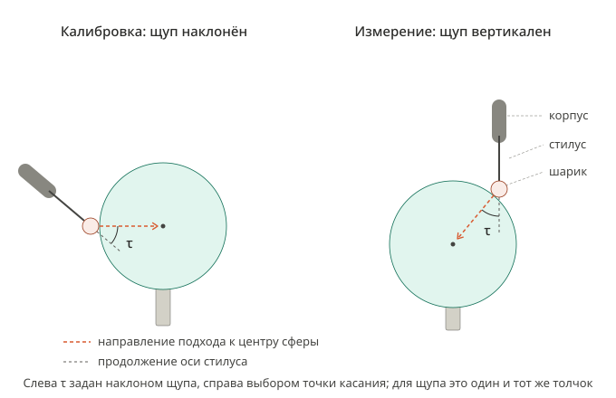
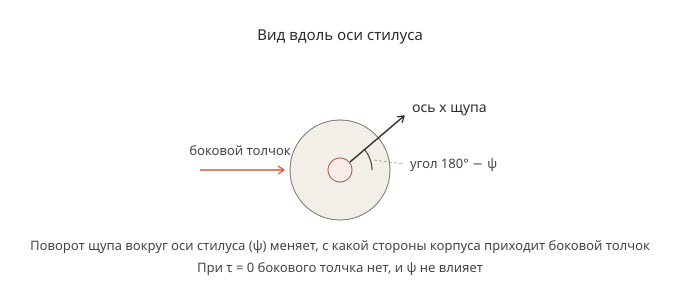

# Калибровка щупа WP-500 по сфере: погрешности регистрации касания

Сводка обсуждения от 2026-10-30. Документ объясняет, какую задачу решает пользователь, какие погрешности возникают при регистрации касания, что из этого следует для калибровки и какие решения ещё не приняты. Это не ExecPlan; ничего из того, что помечено как предложение, не реализовано.

Связанные файлы:

- `plans/PROBE_SPHERE_CALIBRATION_EXECPLAN.md`, раздел «The touch geometry» — 37 касаний, их углы, порядок, переходы по дуге, зазоры до стола и стойки.
- `src/trajectories/probe/probetouchplan.cpp` — таблица касаний `Touches` и функция поворота щупа `touchRotation`.
- `resources/files/rsi/RSI_Probe_Lin_CONTRACT.md` — тестовое RSI-движение LIN с остановкой по `$IN[11]` (пользователь проверил: работает).
- `docs/ARCHITECTURE.md`, раздел «Additional hardware and Delta I/O wiring» — путь сигнала щупа.
- `docs/figures/probe_tilt_tau.svg`, `docs/figures/probe_roll_psi.svg` — рисунки к разделу 3.

## 1. Какая задача решается

Конечная цель — измерять поверхности деталей щупом WP-500, установленным на фланце робота KUKA KR 10 R1420 с контроллером KR C4. Для этого нужно точно знать положение центра рубинового шарика щупа относительно фланца робота. Сейчас известно только приближённое значение из TOOL_DATA[5]: X −0,048, Y −0,097, Z 127 мм (измерено на КИМ для щупа с адаптером).

Способ: шарик касается неподвижной эталонной сферы Ø25 мм много раз при разных ориентациях фланца. В каждом касании записываются углы сочленений робота. Затем методом наименьших квадратов оцениваются центр шарика относительно фланца и центр сферы так, чтобы при всех касаниях рассчитанный центр шарика отстоял от центра сферы на одно и то же расстояние.

Порядок калибровки (что из него реализовано — раздел 10):

1. Сфера жёстко закреплена на стойке (раздел 2.3).
2. Приближённый TCP, TOOL_DATA[5], используется только для безопасного движения робота.
3. Центр сферы измерен грубо ручными касаниями (раздел 9.1).
4. Робот выполняет 37 касаний таблицы `Touches` при разных ориентациях фланца (раздел 3): переход, подход с поиском при постоянной скорости поиска, отход (раздел 2.4).
5. При обнаружении касания записываются углы сочленений $\bar{q}_i$ — в момент обнаружения, а не срабатывания щупа (раздел 4).
6. По записанным углам методом наименьших квадратов оцениваются центр шарика в {F} и центр сферы в {B} (разделы 5.1, 5.4).
7. Невязки проверяются (разделы 5.3.5, 5.5).
8. Найденный центр шарика сохраняется как положение TCP щупа.

Проблема, ради которой написан документ: робот узнаёт о касании с запаздыванием и к этому моменту успевает проехать дальше к центру сферы. Этот перебег шарика состоит из двух частей. Одна из них зависит от того, с какой стороны щупа толкает сфера, и поэтому различается между касаниями. Нужно понять, какие из этих погрешностей искажают найденный центр шарика, какие нет, и что с ними делать.

Что документ должен получить:

1. Модель регистрации касания: какую координату TCP записывает робот при обнаружении касания (раздел 4).
2. Уравнения калибровки по МНК и условия на набор касаний, при которых центр шарика находится однозначно (разделы 5.1, 5.2).
3. Какие невязки даёт один только шум и как по невязкам проверить модель (раздел 5.3).
4. Какие составляющие перебега шарика и хода до срабатывания искажают найденный центр шарика (разделы 5.4, 5.5).
5. Что делать с задержкой сигнала и различиями хода до срабатывания между касаниями (разделы 6, 7).

Ответы на эти пункты сведены в раздел 12.

## 2. Термины и обозначения

Каждый термин вводится в виде «русский термин (английский термин) — определение»; дальше в тексте используется только русский термин. Все обозначения, в том числе в таблицах, записаны в LaTeX. Векторы обозначаются строчными буквами с чертой, например $\bar{q}$; система координат, в которой выражен вектор, — левый верхний индекс. Формулы, на которые есть ссылки, пронумерованы в пределах раздела второго уровня: (5.2.1) — первая такая формула раздела 5.2.

### 2.1. Системы координат

- {B} — базовая система робота (KUKA `$BASE`). Программа задаёт `$BASE = $NULLFRAME`, а `$ROBROOT` в машинных данных нулевой, поэтому {B} совпадает с WORLD KUKA. Позы приложения «относительно BASE» выражены в {B}.
- {F} — система фланца (KUKA FLANGE; последнее преобразование `Kr10Kinematics::solveFK`).
- {P} — система щупа: начало в центре шарика, оси параллельны осям {F}, ось z направлена от фланца вдоль стилуса. На контроллере это TOOL_DATA[5] с $A = B = C = 0$.
- {S} — система сферы: начало в центре сферы, оси параллельны осям {B}.

Калибровка находит только начала {P} и {S}: центр шарика и центр сферы; оси {P} и {S} заданы этими определениями.

Матрица преобразования из системы {i} в систему {j} — однородная матрица размером $4 \times 4$, которая переводит координаты, заданные в {i}, в координаты в {j}:

$$
{}^{j}A_i = \begin{bmatrix} {}^{j}R_i & {}^{j}\bar{p}_i \\ \bar{0}^T & 1 \end{bmatrix}
$$

где ${}^{j}R_i$ — матрица поворота размером $3 \times 3$;
&emsp;&emsp;${}^{j}\bar{p}_i$ — положение начала {i}, выраженное в {j}, мм;
&emsp;&emsp;$\bar{0}$ — нулевой вектор-столбец размером $3 \times 1$.

Положение точки $a$, выраженное в {j}, обозначается ${}^{j}\bar{p}_a$, мм.

Поза фланца при касании $i$ — результат прямой задачи кинематики `Kr10Kinematics::solveFK` (последнее преобразование) по углам сочленений $\bar{q}_i$:

$$
{}^{B}A_F(\bar{q}_i) = \begin{bmatrix} {}^{B}R_F(\bar{q}_i) & {}^{B}\bar{p}_F(\bar{q}_i) \\ \bar{0}^T & 1 \end{bmatrix}
$$

Та же поза фланца читается на KR C4 как `$POS_ACT` при `$TOOL = $NULLFRAME` и `$BASE = $NULLFRAME`.

KUKA задаёт позу координатами X, Y, Z, мм, и углами Эйлера Z-Y-X $A$, $B$, $C$, градусы. Поворот фланца:

$$
{}^{B}R_F(A, B, C) = R_z(A)\,R_y(B)\,R_x(C)
\tag{2.1.1}
$$

где $A$, $B$, $C$ — углы позы KUKA, градусы; буква $A$ без индексов — угол, а не матрица преобразования;
&emsp;&emsp;$R_z(A)$, $R_y(B)$, $R_x(C)$ — матрицы поворота на углы $A$, $B$, $C$ вокруг осей z, y, x.

### 2.2. Оборудование и сигналы

- Шарик (ruby ball) — рубиновый шарик Ø3 мм на конце стилуса щупа WP-500 V6.
- Стилус (stylus) — стержень щупа, на конце которого закреплён шарик.
- Корпус щупа (probe body) — часть щупа между фланцем и стилусом.
- Кинематический щуп (kinematic touch-trigger probe) — щуп, в котором держатель стилуса лежит на трёх опорах; щуп срабатывает, когда держатель сдвигается с них. WP-500, по-видимому, такой; паспорта в `manuals` нет, не проверено.
- Срабатывание щупа (trigger) — момент, когда выход WP-500 (NPN) переключается.
- `$IN[11]` — вход KR C4, на который приходит срабатывание. Путь сигнала: выход WP-500 → вход X2.0 ПЛК Delta → программа ПЛК копирует его на выход Y1.5 → вход 11 модуля EL1809 → `$IN[11]` (раздел «Additional hardware and Delta I/O wiring» в [ARCHITECTURE.md](ARCHITECTURE.md)).
- RSI (RobotSensorInterface) — интерфейс KUKA, через который контроллер раз в цикл длительностью 4 мс обменивается данными с ПК и опрашивает входы. Объект STOP в контексте RSI останавливает движение по переднему фронту `$IN[11]` прямо на контроллере, без участия ПК.
- TCP — точка, которую робот считает центром шарика: вычисляется прямой задачей кинематики по углам сочленений с TOOL_DATA[5]. После касания реальный шарик стоит на поверхности сферы, а TCP движется дальше вместе с корпусом щупа; стилус при этом изгибается.
- Обнаружение касания (detection) — момент, когда контроллер видит `$IN[11]` = TRUE.

### 2.3. Геометрия сферы и касаний

- $r_b$ — радиус шарика, номинал 1,5 мм.
- $r_s$ — радиус эталонной сферы, номинал 12,5 мм.
- Стойка (strut) — вертикальный цилиндр Ø17,8 мм; сфера утоплена в его верхний торец на 2 мм. Касаться можно только поверхности сферы выше торца стойки: не ниже 10,5 мм под центром сферы. Положение центра сферы заранее неизвестно и оценивается вместе с центром шарика.
- $L$ — расстояние между центрами шарика и сферы в момент касания, мм: $L = r_b + r_s = 14$ мм.
- Оболочка касания (contact shell) — сфера радиуса $L$ вокруг центра эталонной сферы; на ней лежит центр шарика в момент касания.
- Зазор подхода (approach gap) $g$ — расстояние от оболочки старта до оболочки касания, 3 мм.
- Оболочка старта (start shell) — сфера радиуса $L + g = 17$ мм вокруг центра эталонной сферы.
- $\lambda$ — широта точки касания на сфере, градусы.
- $\mu$ — долгота точки касания на сфере, градусы; $\mu = 0$ вдоль оси x системы {B}, $\mu = 90°$ вдоль оси y.
- $i$ — номер касания калибровки, 1…37, в порядке выполнения (порядок строк таблицы `Touches`).
- $m$ — число касаний одной калибровки; при текущей таблице `Touches` $m = 37$.

Орты (единичные векторы) обозначаются буквой $e$ с индексом оси или того вектора, чьим ортом они являются; система координат, в которой выражен орт, — левый верхний индекс.

Орт внешней нормали сферы в точке касания (индекс $n$ — нормаль), выраженный в {B}, как в коде (`sphereNormal`):

$$
{}^{B}\bar{e}_n(\lambda,\mu) = \begin{bmatrix} \cos\lambda\cos\mu \\ \cos\lambda\sin\mu \\ \sin\lambda \end{bmatrix}
\tag{2.3.1}
$$

Он направлен от центра сферы наружу через точку касания; $\lambda$ — широта точки касания; $\mu$ — долгота точки касания.

- Направление подхода (approach direction) — направление, в котором робот ведёт шарик к центру сферы. Его орт обозначается $\bar{e}_a$ (индекс $a$ — approach); в {B} он противоположен орту нормали:

$$
{}^{B}\bar{e}_a(\lambda,\mu) = -\,{}^{B}\bar{e}_n(\lambda,\mu)
\tag{2.3.2}
$$

- Наклон щупа (tilt) $\tau$ — угол между осью стилуса и направлением подхода, градусы. Подробно в разделе 3.
- Поворот щупа вокруг оси стилуса (roll) $\psi$ — угол поворота щупа вокруг собственной оси стилуса, градусы; отсчёт — в разделе 3.

### 2.4. Движение одного касания

- Точка старта (start point) — точка оболочки старта, лежащая на нормали касания; в коде `p_start`.
- Переход (transfer) — движение по дуге CIRC по оболочке старта от точки старта предыдущего касания к точке старта текущего; в коде `ProbeSegment::Transfer`.
- Подход (approach) — движение от точки старта по нормали касания к центру сферы до обнаружения касания. В коде это `ProbeSegment::Approach`; в анимации он имеет длину 3 мм и постоянную скорость 1 мм/с. Предложено разбить подход на предподход и поиск.
- Отход (retract) — движение от точки обнаружения касания обратно к точке старта; в коде `ProbeSegment::Retract`.
- Точка ожидания (standoff point) — предлагаемая точка на прямой подхода вблизи поверхности, но гарантированно до касания.
- Предподход (pre-approach) — предлагаемый быстрый участок подхода от точки старта до точки ожидания.
- Поиск (search) — предлагаемый участок подхода от точки ожидания с постоянной скоростью поиска до обнаружения касания. Если на заданной длине поиска касание не обнаружено, оно считается неудачным: робот возвращается в точку старта, и сообщается ошибка.

### 2.5. Величины модели касания

Все величины, кроме $t$, измеряются вдоль направления подхода.

- $t$ — время от начала поиска, с; $t = 0$ в точке ожидания.
- Скорость поиска (search speed) $v_s$ — постоянная скорость TCP на всём поиске, мм/с.
- $p_a(t)$ — координата TCP вдоль направления подхода в момент $t$, мм.
- $t_c$ — момент касания (contact) шарика со сферой, с.
- $p_a(t_c)$ — координата TCP в момент касания, мм. Задаётся положением поверхности и от $v_s$ не зависит.
- Отклонение стилуса (stylus deflection) $\delta(t)$ — насколько TCP прошёл дальше положения касания к моменту $t$, мм.
- Ход до срабатывания (pretravel) $\delta_p$ — отклонение стилуса, при котором щуп срабатывает, мм.
- $t_{trig}$ — момент срабатывания щупа, с.
- Задержка сигнала (latency) $t_{lat}$ — время от срабатывания щупа до обнаружения касания, с.
- $t_{det}(v_s)$ — момент обнаружения касания при скорости поиска $v_s$, с.
- Зарегистрированная координата (detected position) $p_{a.det}(v_s)$ — координата TCP в момент обнаружения касания, мм.
- Расстояние касания (contact distance) $\rho$ — расстояние от центра сферы до зарегистрированного центра шарика, мм.

### 2.6. Оценивание параметров

- Оценивание параметров методом наименьших квадратов (МНК; least-squares estimation) — нахождение значений искомых параметров, при которых сумма квадратов невязок наименьшая.
- Невязка (residual) уравнения касания $i$ — разность между расстоянием от рассчитанного центра шарика до центра сферы и требуемым расстоянием касания, мм.
- Идентифицируемость (identifiability) параметров — свойство набора касаний: наименьшую сумму квадратов невязок даёт только один набор значений параметров (раздел 5.2).
- Аппроксимация сферы (sphere fit) — оценивание центра и радиуса сферы по точкам по МНК (разделы 8, 9).
- Шум (noise) — часть невязки, которая при повторении того же касания принимает другое значение и для отдельного касания непредсказуема (раздел 5.3).
- Систематическая часть (systematic component) невязки — часть, которая при повторении того же касания повторяется (раздел 5.3).
- СКО, среднеквадратическое отклонение (standard deviation) — корень из математического ожидания квадрата отклонения величины от её среднего; мера разброса (раздел 5.3).
- Число степеней свободы (degrees of freedom) — число касаний минус число искомых параметров (раздел 5.3).
- Выброс (outlier) — невязка отдельного касания, по модулю превышающая три СКО невязок (раздел 5.3).

### 2.7. Термины КИМ (раздел 8)

- КИМ (CMM, coordinate measuring machine) — координатно-измерительная машина.
- Квалификация щупа (probe qualification) — касания эталонной сферы на КИМ, по которым находят положение и эффективный радиус шарика.
- Эффективный радиус шарика (effective, «electronic» ball radius) $r_{eff}$ — радиус шарика за вычетом среднего хода до срабатывания, мм.
- Разброс хода до срабатывания по направлениям (pre-travel variation, PTV; lobing) — различие хода до срабатывания при касании с разных сторон относительно щупа.
- Расстояние предварительного подхода (prehit distance) — расстояние до поверхности, с которого КИМ переходит с быстрого движения на постоянную скорость касания; аналог точки ожидания.

## 3. Наклон щупа $\tau$ и поворот щупа вокруг оси стилуса $\psi$

Наклон $\tau$ — угол между осью стилуса и направлением подхода. При $\tau = 0$ стилус смотрит прямо в центр сферы, и сфера толкает шарик вдоль оси стилуса. При $\tau > 0$ толчок приходится частично вбок.

Один и тот же наклон щупа получается двумя способами (рисунок 1). Слева калибровка: точка касания задана широтой и долготой, а щуп наклоняется на $\tau$; в коде наклон щупа выполняется в плоскости меридиана, от направления на центр сферы в сторону «вниз». Справа ориентация щупа неизменна: он смотрит вертикально вниз, а наклон щупа относительно направления подхода получается выбором точки касания: точка лежит на угловом расстоянии $\tau$ от верхнего полюса сферы. Для самого щупа оба случая одинаковы: толчок приходит под тем же углом $\tau$ к оси стилуса.

Поворот щупа вокруг оси стилуса $\psi$ определяет, с какой стороны корпуса щупа приходится боковая часть толчка (рисунок 2). Кинематический щуп с тремя опорами реагирует на толчки с разных сторон по-разному. При $\tau = 0$ бокового толчка нет, и поворот щупа вокруг оси стилуса роли не играет.

Поворот щупа при касании в коде (`touchRotation`):

$$
{}^{B}R_P(\lambda,\mu,\tau,\psi) = R_z(\mu)\,R_y(90° - \lambda - \tau)\,R_x(180°)\,R_z(\psi)
\tag{3.1}
$$

где ${}^{B}R_P(\lambda,\mu,\tau,\psi)$ — матрица поворота системы {P} относительно {B} при касании;
&emsp;&emsp;$R_z,\ R_y,\ R_x$ — матрицы поворота вокруг осей z, y, x на указанный угол;
&emsp;&emsp;$\lambda,\ \mu$ — широта и долгота точки касания, градусы;
&emsp;&emsp;$\tau$ — наклон щупа: угол между осью стилуса и направлением подхода, градусы;
&emsp;&emsp;$\psi$ — поворот щупа вокруг оси стилуса, градусы; отсчитывается от ориентации, которую задают первые три множителя.

Орт направления подхода, выраженный в системе {P} (выведено в обсуждении из формулы (3.1), численно не проверено):

$$
{}^{P}\bar{e}_a(\tau,\psi) = \begin{bmatrix} -\sin\tau\cos\psi \\ \sin\tau\sin\psi \\ \cos\tau \end{bmatrix}
\tag{3.2}
$$

где $\tau$ — наклон щупа;
&emsp;&emsp;$\psi$ — поворот щупа вокруг оси стилуса.

При $\tau = 0$ из (3.2): ${}^{P}\bar{e}_a(0,\psi) = {}^{P}\bar{e}_z$ — орт оси стилуса.

Направление подхода в системе щупа зависит только от наклона щупа и поворота щупа вокруг оси стилуса. Поэтому всё, что зависит от направления толчка относительно щупа, в частности ход до срабатывания, является функцией пары $(\tau, \psi)$.

37 касаний используют 19 разных пар $(\tau, \psi)$; все касания с $\tau = 0$ считаются одной парой. Углы в градусах, номера касаний — по порядку строк таблицы `Touches`.

| Пара | $\tau$ | $\psi$ | Касания                                            |
| ---- | ------ | ------ | -------------------------------------------------- |
| 1    | 0      | любой  | 1, 4, 5, 8, 13, 14, 18, 19, 21, 22, 23, 26, 27, 37 |
| 2    | 15     | 30     | 20                                                 |
| 3    | 15     | 90     | 12, 34, 35                                         |
| 4    | 15     | 120    | 31                                                 |
| 5    | 15     | −150   | 24                                                 |
| 6    | 30     | 0      | 3, 6                                               |
| 7    | 30     | 30     | 2                                                  |
| 8    | 30     | 60     | 11, 36                                             |
| 9    | 30     | 120    | 29                                                 |
| 10   | 30     | −90    | 25                                                 |
| 11   | 40     | 30     | 9                                                  |
| 12   | 45     | 60     | 10                                                 |
| 13   | 45     | 90     | 28, 33                                             |
| 14   | 45     | 120    | 32                                                 |
| 15   | 50     | 0      | 7                                                  |
| 16   | 50     | −90    | 17                                                 |
| 17   | 50     | −120   | 16                                                 |
| 18   | 50     | −150   | 15                                                 |
| 19   | 55     | 120    | 30                                                 |

Почему наклон щупа и поворот щупа вокруг оси стилуса у касаний разные, а не одни и те же: при $\tau = 0$ у нижних касаний ($\lambda = -30°$) корпуса сочленений A4 и A5 опускались к поверхности стола или ниже её; наклон щупа 30–45° поднимает их, и минимальный зазор составляет около 65 мм. Поворот щупа вокруг оси стилуса подобран для каждого касания так, чтобы A6 не выходил за ±350°, а A4 и A5 (не более 115°) оставались в своих пределах. Одна фиксированная пара не позволила бы выполнить все 37 касаний; какие касания тогда остались бы выполнимыми, не вычислялось.

## 4. Модель регистрации касания

Модель описывает только поиск: от точки ожидания ($t = 0$) до обнаружения касания. Предподход и торможение после обнаружения в модель не входят.

Движение TCP при поиске:

$$
p_a(t) = p_a(0) + v_s\,t
$$

где $p_a(t)$ — координата TCP вдоль направления подхода в момент $t$;
&emsp;&emsp;$p_a(0)$ — координата точки ожидания;
&emsp;&emsp;$v_s$ — скорость поиска;
&emsp;&emsp;$t$ — время от начала поиска.

Момент касания:

$$
t_c = \frac{p_a(t_c) - p_a(0)}{v_s}
$$

где $t_c$ — момент касания;
&emsp;&emsp;$p_a(t_c)$ — координата TCP в момент касания;
&emsp;&emsp;$p_a(0)$ — координата точки ожидания;
&emsp;&emsp;$v_s$ — скорость поиска.

До касания стилус не отклонён. После касания реальный шарик стоит на поверхности, а TCP продолжает движение, поэтому отклонение стилуса равно пути TCP после касания:

$$
\delta(t) = 0 \ \text{при } t < t_c, \qquad \delta(t) = p_a(t) - p_a(t_c) = v_s\,(t - t_c) \ \text{при } t \ge t_c
$$

где $\delta(t)$ — отклонение стилуса в момент $t$;
&emsp;&emsp;$p_a(t)$ — координата TCP в момент $t$;
&emsp;&emsp;$p_a(t_c)$ — координата TCP в момент касания;
&emsp;&emsp;$v_s$ — скорость поиска;
&emsp;&emsp;$t_c$ — момент касания.

Щуп срабатывает, когда отклонение стилуса достигает хода до срабатывания:

$$
t_{trig} = t_c + \frac{\delta_p}{v_s}
$$

где $t_{trig}$ — момент срабатывания щупа;
&emsp;&emsp;$t_c$ — момент касания;
&emsp;&emsp;$\delta_p$ — ход до срабатывания;
&emsp;&emsp;$v_s$ — скорость поиска.

Контроллер обнаруживает касание через задержку сигнала после срабатывания:

$$
t_{det}(v_s) = t_{trig} + t_{lat} = t_c + \frac{\delta_p}{v_s} + t_{lat}
$$

где $t_{det}(v_s)$ — момент обнаружения касания;
&emsp;&emsp;$t_{trig}$ — момент срабатывания щупа;
&emsp;&emsp;$t_{lat}$ — задержка сигнала;
&emsp;&emsp;$t_c$ — момент касания;
&emsp;&emsp;$\delta_p$ — ход до срабатывания;
&emsp;&emsp;$v_s$ — скорость поиска.

Зарегистрированная координата:

$$
p_{a.det}(v_s) = p_a(t_{det}(v_s)) = p_a(t_c) + \delta_p + v_s\,t_{lat}
$$

$$
\boxed{p_{a.det}(v_s) = p_a(t_c) + \delta_p + v_s\,t_{lat}}
\tag{4.1}
$$

где $p_{a.det}(v_s)$ — зарегистрированная координата при скорости поиска $v_s$;
&emsp;&emsp;$p_a(t_{det}(v_s))$ — координата TCP в момент обнаружения касания;
&emsp;&emsp;$p_a(t_c)$ — координата TCP в момент касания;
&emsp;&emsp;$\delta_p$ — ход до срабатывания;
&emsp;&emsp;$v_s$ — скорость поиска;
&emsp;&emsp;$t_{lat}$ — задержка сигнала.

Ход до срабатывания и перебег шарика $v_s\,t_{lat}$ проходятся последовательно, а не одновременно: $\delta_p$ — путь TCP от касания до срабатывания, $v_s\,t_{lat}$ — путь TCP от срабатывания до обнаружения. Стилус всё это время изгибается, и в момент обнаружения его отклонение равно их сумме.

Пример с условными значениями: поиск начинается в точке с координатой 1027 мм, скорость поиска 1 мм/с, касание происходит при координате 1030 мм, ход до срабатывания 0,008 мм, задержка сигнала 15 мс.

| Событие             | Время, с | Координата TCP, мм | Отклонение стилуса, мм |
| ------------------- | -------- | ------------------ | ---------------------- |
| начало поиска       | 0,000    | 1027,000           | 0                      |
| касание             | 3,000    | 1030,000           | 0                      |
| срабатывание щупа   | 3,008    | 1030,008           | 0,008                  |
| обнаружение касания | 3,023    | 1030,023           | 0,023                  |

Допущения модели:

- Скорость TCP постоянна и равна $v_s$ от касания до обнаружения, поэтому касание должно произойти на поиске, а не на предподходе.
- Всё, кроме стилуса, жёсткое: сфера, стойка, крепление щупа и робот при малой силе срабатывания.
- Задержка сигнала меняется от касания к касанию случайно (раздел 6).

## 5. Оценивание параметров калибровки методом наименьших квадратов (МНК)

Модель калибровки рассматривается в трёх случаях; каждый следующий случай добавляет одно явление из раздела 4.

| Случай              | Что добавляется                                                                              | Расстояние от центра сферы до зарегистрированного центра шарика              |
| ------------------- | -------------------------------------------------------------------------------------------- | ---------------------------------------------------------------------------- |
| 1 (разделы 5.1–5.3) | ничего: шарик регистрируется в момент касания, отличие касаний друг от друга — только шум    | известно и одинаково у всех касаний: $L = 14$ мм |
| 2 (раздел 5.4)      | постоянный перебег шарика после касания: одна и та же величина при всех точках и ориентациях | неизвестно и одинаково у всех касаний: $\rho$ — один искомый параметр |
| 3 (раздел 5.5)      | ход до срабатывания зависит от направления толчка                                            | неизвестно и своё для каждой пары $(\tau, \psi)$: $\rho_i$ |

### 5.1. Случай 1: регистрация без перебега шарика

Допущение случая: в момент обнаружения касания центр шарика находится на расстоянии $L = r_b + r_s = 14$ мм от центра сферы; отличие отдельного касания от этого значения — только шум (раздел 5.3).

Центр шарика в {B} при касании $i$ вычисляется по углам сочленений:

$$
{}^{B}\bar{p}_r(\bar{q}_i) = {}^{B}\bar{p}_F(\bar{q}_i) + {}^{B}R_F(\bar{q}_i)\,{}^{F}\bar{p}_r
$$

где $\bar{q}_i$ — углы сочленений A1…A6 в момент обнаружения касания $i$, градусы;
&emsp;&emsp;${}^{B}\bar{p}_r(\bar{q}_i)$ — рассчитанный центр шарика в {B} при касании $i$, мм;
&emsp;&emsp;${}^{B}\bar{p}_F(\bar{q}_i),\ {}^{B}R_F(\bar{q}_i)$ — положение начала {F} в {B} и поворот {F} относительно {B};
&emsp;&emsp;${}^{F}\bar{p}_r$ — центр шарика в {F}, мм; не зависит от $\bar{q}$;
&emsp;&emsp;${}^{B}\bar{p}_s$ — центр сферы в {B}, мм.

Уравнение касания $i$:

$$
\left\| {}^{B}\bar{p}_r(\bar{q}_i) - {}^{B}\bar{p}_s \right\| = L, \qquad i = 1 \ldots m
$$

где $m$ — число касаний одной калибровки; при текущей таблице `Touches` $m = 37$.

| Величина                                                                     | Статус                                        | Откуда                                                                                                                                                                   |
| ---------------------------------------------------------------------------- | --------------------------------------------- | ------------------------------------------------------------------------------------------------------------------------------------------------------------------------ |
| углы сочленений $\bar{q}_i$, 6 чисел на касание                              | измеряются                                    | контроллер в момент обнаружения касания; запись в RSI не сделана (раздел 10)                                                                                             |
| положение и поворот фланца в {B} при касании $i$                             | вычисляются по $\bar{q}_i$                    | прямая задача кинематики `Kr10Kinematics::solveFK`, номинальная модель KR 10 R1420; ошибки модели робота (длины звеньев, нули сочленений) считаются нулевыми — допущение |
| $L = 14$ мм                                                                  | известно                                      | номинальные радиусы: шарик 1,5 мм, сфера 12,5 мм                                                                                                                         |
| центр шарика в {F}, 3 числа                                                  | искомый параметр; результат калибровки        | начальное приближение TOOL_DATA[5]: (−0,048; −0,097; 127) мм                                                                                                             |
| центр сферы в {B}, 3 числа                                                   | искомый параметр; нужен только для оценивания | начальное приближение по ручным касаниям (раздел 9): (1054,1403; −331,9692; 454,2727) мм                                                                                 |
| широта и долгота точки касания, наклон щупа, поворот щупа вокруг оси стилуса | известны; в уравнение касания не входят       | таблица `Touches`; задают только то, куда робот ведёт шарик                                                                                                              |

Вектор искомых параметров случая 1 — три составляющие центра шарика в {F} и три составляющие центра сферы в {B}, мм:

$$
\bar{x} = \begin{bmatrix} {}^{F}p_{r,x} & {}^{F}p_{r,y} & {}^{F}p_{r,z} & {}^{B}p_{s,x} & {}^{B}p_{s,y} & {}^{B}p_{s,z} \end{bmatrix}^{T}
\tag{5.1.1}
$$

Число искомых параметров случая 1: $n = 6$.

Невязка уравнения касания $i$ — на сколько миллиметров рассчитанный центр шарика не достаёт до оболочки радиуса $L$ вокруг центра сферы (минус) или выходит за неё (плюс):

$$
\varepsilon_i(\bar{x}) = \left\| {}^{B}\bar{p}_F(\bar{q}_i) + {}^{B}R_F(\bar{q}_i)\,{}^{F}\bar{p}_r - {}^{B}\bar{p}_s \right\| - L
\tag{5.1.2}
$$

Оценивание по МНК находит вектор параметров с наименьшей суммой квадратов невязок:

$$
\Phi(\bar{x}) = \sum_{i=1}^{m} \varepsilon_i(\bar{x})^2 = \bar{\varepsilon}(\bar{x})^T\,\bar{\varepsilon}(\bar{x}),
\qquad
\hat{\bar{x}} = \arg\min_{\bar{x} \in \mathbb{R}^n} \Phi(\bar{x})
\tag{5.1.3}
$$

где $\Phi:\ \mathbb{R}^n \to \mathbb{R}$ — целевая функция МНК, сумма квадратов невязок, мм²;
&emsp;&emsp;$\bar{\varepsilon}(\bar{x}) = \left(\varepsilon_1(\bar{x}), \ldots, \varepsilon_m(\bar{x})\right)^T$ — вектор-столбец невязок размером $m \times 1$, мм;
&emsp;&emsp;$\hat{\bar{x}}$ — вектор параметров, найденный МНК.

Невязки после оценивания — значения $\varepsilon_i(\hat{\bar{x}})$. Пример с условными значениями: при найденном $\bar{x}$ рассчитанный центр шарика касания 5 отстоит от найденного центра сферы на 13,990 мм; невязка $\varepsilon_5 = 13{,}990 - 14 = -0{,}010$ мм.

### 5.2. Идентифицируемость параметров случая 1

Параметры идентифицируемы, если наименьшую сумму квадратов невязок даёт только один вектор параметров. Если два разных вектора дают одинаковые невязки при всех касаниях, оценивание по МНК не может выбрать между ними: такие параметры неидентифицируемы. Проверяется это по матрице Якоби невязок: она входит в уравнение (5.2.2) — необходимое условие минимума.

#### 5.2.1. Условие минимума суммы квадратов невязок

Получим необходимое условие минимума суммы квадратов невязок (5.1.3), записанное через матрицу Якоби невязок.

Вектор $\hat{\bar{x}}$ из (5.1.3) — точка минимума $\Phi(\bar{x})$. В точке минимума частные производные $\Phi$ по всем параметрам равны нулю. Частная производная по параметру $j$:

$$
\frac{\partial \Phi(\bar{x})}{\partial x_j} = \frac{\partial}{\partial x_j}\sum_{i=1}^{m} \varepsilon_i(\bar{x})^2 = \sum_{i=1}^{m} \frac{\partial}{\partial x_j}\varepsilon_i(\bar{x})^2 = \sum_{i=1}^{m} 2\,\varepsilon_i(\bar{x})\,\frac{\partial \varepsilon_i(\bar{x})}{\partial x_j},
\qquad j = 1 \ldots n
$$

где $x_j$ — элемент $j$ вектора $\bar{x}$.

Частные производные невязок по параметрам образуют матрицу Якоби невязок:

$$
J_{ij}(\bar{x}) = \frac{\partial \varepsilon_i(\bar{x})}{\partial x_j}, \qquad i = 1 \ldots m, \quad j = 1 \ldots n
\tag{5.2.1}
$$

где $J(\bar{x})$ — матрица размером $m \times n$.

Подставим (5.2.1) в производную $\Phi$:

$$
\frac{\partial \Phi(\bar{x})}{\partial x_j} = 2\sum_{i=1}^{m} J_{ij}(\bar{x})\,\varepsilon_i(\bar{x}) = 2\left(J(\bar{x})^T\,\bar{\varepsilon}(\bar{x})\right)_j
$$

Поэтому необходимое условие минимума для всех $j = 1 \ldots n$ сразу:

$$
\boxed{J(\hat{\bar{x}})^T\,\bar{\varepsilon}(\hat{\bar{x}}) = \bar{0}}
\tag{5.2.2}
$$

где $\bar{0}$ — нулевой вектор-столбец размером $n \times 1$.

Система (5.2.2) — нормальные уравнения нелинейного МНК. Строка $J$ выводится в 5.2.2, явный вид системы для калибровки — в 5.2.3, её решение методом Гаусса — Ньютона и единственность решения — в 5.2.4, условия на набор касаний — в 5.2.5.

#### 5.2.2. Матрица Якоби невязок

Получим строку $i$ матрицы Якоби (5.2.1) в явном виде: через орты ${}^{B}\bar{e}_{sr}(\bar{q}_i,\bar{x})$, ${}^{F}\bar{e}_{sr}(\bar{q}_i,\bar{x})$ и вектор ${}^{B}\bar{r}_{sr}(\bar{q}_i,\bar{x})$ при касании $i$.

Вектор искомых параметров (5.1.1) состоит из двух блоков: элементы 1–3 — координаты центра шарика в {F}, элементы 4–6 — координаты центра сферы в {B}:

$$
\bar{x} = \begin{bmatrix} {}^{F}\bar{p}_r \\ {}^{B}\bar{p}_s \end{bmatrix}
$$

Строка $i$ матрицы Якоби (5.2.1) в блочной записи:

$$
\begin{bmatrix} J_{i1} & J_{i2} & J_{i3} \end{bmatrix} = \frac{\partial \varepsilon_i(\bar{x})}{\partial\,{}^{F}\bar{p}_r},
\qquad
\begin{bmatrix} J_{i4} & J_{i5} & J_{i6} \end{bmatrix} = \frac{\partial \varepsilon_i(\bar{x})}{\partial\,{}^{B}\bar{p}_s}
$$

где $\partial \varepsilon_i(\bar{x}) / \partial\,{}^{F}\bar{p}_r$, $\partial \varepsilon_i(\bar{x}) / \partial\,{}^{B}\bar{p}_s$ — строки частных производных $\varepsilon_i(\bar{x})$ по элементам ${}^{F}\bar{p}_r$ и ${}^{B}\bar{p}_s$.

Вектор, проведённый из центра сферы (точка $s$) в рассчитанный центр шарика (точка $r$) при касании $i$, выраженный в {B}, его орт и невязка (5.1.2) через этот вектор:

$$
\begin{gathered}
{}^{B}\bar{r}_{sr}(\bar{q}_i,\bar{x}) = {}^{B}\bar{p}_F(\bar{q}_i) + {}^{B}R_F(\bar{q}_i)\,{}^{F}\bar{p}_r - {}^{B}\bar{p}_s,
\qquad
{}^{B}\bar{e}_{sr}(\bar{q}_i,\bar{x}) = \frac{{}^{B}\bar{r}_{sr}(\bar{q}_i,\bar{x})}{\left\|{}^{B}\bar{r}_{sr}(\bar{q}_i,\bar{x})\right\|},
\qquad
\varepsilon_i(\bar{x}) = \left\|{}^{B}\bar{r}_{sr}(\bar{q}_i,\bar{x})\right\| - L
\end{gathered}
\tag{5.2.3}
$$

Длина вектора — расстояние между центрами, около $L$ = 14 мм.

Ниже строка $i$ выводится в четыре шага. Углы сочленений $\bar{q}_i$ измерены и от $\bar{x}$ не зависят, поэтому положение и поворот фланца при касании $i$ при дифференцировании по $\bar{x}$ постоянны.

Шаг 1 — правило дифференцирования сложной функции. $L$ постоянна, и невязка зависит от параметров только через вектор:

$$
\frac{\partial \varepsilon_i(\bar{x})}{\partial\,{}^{F}\bar{p}_r} = \frac{\partial \left\|{}^{B}\bar{r}_{sr}(\bar{q}_i,\bar{x})\right\|}{\partial\,{}^{B}\bar{r}_{sr}}\,\frac{\partial\,{}^{B}\bar{r}_{sr}(\bar{q}_i,\bar{x})}{\partial\,{}^{F}\bar{p}_r},
\qquad
\frac{\partial \varepsilon_i(\bar{x})}{\partial\,{}^{B}\bar{p}_s} = \frac{\partial \left\|{}^{B}\bar{r}_{sr}(\bar{q}_i,\bar{x})\right\|}{\partial\,{}^{B}\bar{r}_{sr}}\,\frac{\partial\,{}^{B}\bar{r}_{sr}(\bar{q}_i,\bar{x})}{\partial\,{}^{B}\bar{p}_s}
\tag{5.2.4}
$$

Шаг 2 — производная длины вектора по его координатам. Координаты вектора в {B} обозначаются той же буквой $r$ с индексами $sr$ и номером координаты $k \in \{x, y, z\}$; длина — корень из суммы квадратов координат:

$$
{}^{B}\bar{r}_{sr}(\bar{q}_i,\bar{x}) = \left({}^{B}r_{sr,x}(\bar{q}_i,\bar{x}),\ {}^{B}r_{sr,y}(\bar{q}_i,\bar{x}),\ {}^{B}r_{sr,z}(\bar{q}_i,\bar{x})\right)^T,
\qquad
\left\|{}^{B}\bar{r}_{sr}(\bar{q}_i,\bar{x})\right\| = \sqrt{\sum_{k' \in \{x,y,z\}} {}^{B}r_{sr,k'}(\bar{q}_i,\bar{x})^2}
$$

где $k' \in \{x, y, z\}$ — индекс суммирования по координатам.

Производная длины по вектору — по определению строка частных производных длины по координатам вектора:

$$
\frac{\partial \left\|{}^{B}\bar{r}_{sr}(\bar{q}_i,\bar{x})\right\|}{\partial\,{}^{B}\bar{r}_{sr}}
=
\left(
\frac{\partial \left\|{}^{B}\bar{r}_{sr}(\bar{q}_i,\bar{x})\right\|}{\partial\,{}^{B}r_{sr,x}},\
\frac{\partial \left\|{}^{B}\bar{r}_{sr}(\bar{q}_i,\bar{x})\right\|}{\partial\,{}^{B}r_{sr,y}},\
\frac{\partial \left\|{}^{B}\bar{r}_{sr}(\bar{q}_i,\bar{x})\right\|}{\partial\,{}^{B}r_{sr,z}}
\right)
\tag{5.2.5}
$$

Частная производная по координате $k$ по правилу дифференцирования сложной функции:

$$
\begin{gathered}
\frac{\partial \left\|{}^{B}\bar{r}_{sr}(\bar{q}_i,\bar{x})\right\|}{\partial\,{}^{B}r_{sr,k}}
= \frac{\partial}{\partial\,{}^{B}r_{sr,k}}\sqrt{\sum_{k' \in \{x,y,z\}} {}^{B}r_{sr,k'}(\bar{q}_i,\bar{x})^2}
= \frac{1}{2\sqrt{\sum_{k' \in \{x,y,z\}} {}^{B}r_{sr,k'}(\bar{q}_i,\bar{x})^2}}\cdot\frac{\partial}{\partial\,{}^{B}r_{sr,k}}\sum_{k' \in \{x,y,z\}} {}^{B}r_{sr,k'}(\bar{q}_i,\bar{x})^2 =\\
= \frac{1}{2\left\|{}^{B}\bar{r}_{sr}(\bar{q}_i,\bar{x})\right\|}\cdot 2\,{}^{B}r_{sr,k}(\bar{q}_i,\bar{x})
= \frac{{}^{B}r_{sr,k}(\bar{q}_i,\bar{x})}{\left\|{}^{B}\bar{r}_{sr}(\bar{q}_i,\bar{x})\right\|}
\end{gathered}
\tag{5.2.6}
$$

Подстановка (5.2.6) для каждого $k \in \{x, y, z\}$ в (5.2.5):

$$
\frac{\partial \left\|{}^{B}\bar{r}_{sr}(\bar{q}_i,\bar{x})\right\|}{\partial\,{}^{B}\bar{r}_{sr}}
= \frac{\left({}^{B}r_{sr,x}(\bar{q}_i,\bar{x}),\ {}^{B}r_{sr,y}(\bar{q}_i,\bar{x}),\ {}^{B}r_{sr,z}(\bar{q}_i,\bar{x})\right)}{\left\|{}^{B}\bar{r}_{sr}(\bar{q}_i,\bar{x})\right\|}
= {}^{B}\bar{e}_{sr}(\bar{q}_i,\bar{x})^T
\tag{5.2.7}
$$

Шаг 3 — производные координат вектора по координатам центров. Координата $k \in \{x, y, z\}$ вектора (5.2.3):

$$
{}^{B}r_{sr,k}(\bar{q}_i,\bar{x}) = {}^{B}p_{F,k}(\bar{q}_i) + \sum_{k' \in \{x,y,z\}} R_{kk'}(\bar{q}_i)\;{}^{F}p_{r,k'} - {}^{B}p_{s,k}
$$

где ${}^{B}p_{F,k}(\bar{q}_i)$ — координата $k$ начала {F} в {B}, мм;
&emsp;&emsp;$R_{kk'}(\bar{q}_i)$ — элемент строки $k$ и столбца $k'$ матрицы ${}^{B}R_F(\bar{q}_i)$;
&emsp;&emsp;${}^{F}p_{r,k'}$ — координата $k'$ центра шарика в {F}, мм;
&emsp;&emsp;${}^{B}p_{s,k}$ — координата $k$ центра сферы в {B}, мм.

Частные производные:

$$
\frac{\partial\,{}^{B}r_{sr,k}(\bar{q}_i,\bar{x})}{\partial\,{}^{F}p_{r,k'}} = R_{kk'}(\bar{q}_i)
\;\Longrightarrow\;
\frac{\partial\,{}^{B}\bar{r}_{sr}(\bar{q}_i,\bar{x})}{\partial\,{}^{F}\bar{p}_r} = {}^{B}R_F(\bar{q}_i),
\qquad
\frac{\partial\,{}^{B}r_{sr,k}(\bar{q}_i,\bar{x})}{\partial\,{}^{B}p_{s,k'}} = \begin{cases} -1, & k = k'\\ 0, & k \ne k' \end{cases}
\;\Longrightarrow\;
\frac{\partial\,{}^{B}\bar{r}_{sr}(\bar{q}_i,\bar{x})}{\partial\,{}^{B}\bar{p}_s} = -I
\tag{5.2.8}
$$

где $I$ — единичная матрица $3 \times 3$.

Шаг 4 — подстановка (5.2.7) и (5.2.8) в (5.2.4):

$$
\frac{\partial \varepsilon_i(\bar{x})}{\partial\,{}^{F}\bar{p}_r} = {}^{B}\bar{e}_{sr}(\bar{q}_i,\bar{x})^T\,{}^{B}R_F(\bar{q}_i),
\qquad
\frac{\partial \varepsilon_i(\bar{x})}{\partial\,{}^{B}\bar{p}_s} = {}^{B}\bar{e}_{sr}(\bar{q}_i,\bar{x})^T\,(-I) = -\,{}^{B}\bar{e}_{sr}(\bar{q}_i,\bar{x})^T
\tag{5.2.9}
$$

Покажем, что ${}^{B}\bar{e}_{sr}(\bar{q}_i,\bar{x})^T\,{}^{B}R_F(\bar{q}_i)$ — транспонированный орт ${}^{F}\bar{e}_{sr}(\bar{q}_i,\bar{x})$; координаты из {B} в {F} переводит матрица ${}^{B}R_F(\bar{q}_i)^T$:

$$
{}^{B}\bar{e}_{sr}(\bar{q}_i,\bar{x})^T\,{}^{B}R_F(\bar{q}_i) = \left({}^{B}R_F(\bar{q}_i)^T\,{}^{B}\bar{e}_{sr}(\bar{q}_i,\bar{x})\right)^T = {}^{F}\bar{e}_{sr}(\bar{q}_i,\bar{x})^T
\tag{5.2.10}
$$

Итог — строка $i$ матрицы $J$:

$$
\begin{bmatrix} J_{i1} & J_{i2} & J_{i3} \end{bmatrix} = \frac{\partial \varepsilon_i(\bar{x})}{\partial\,{}^{F}\bar{p}_r} = {}^{F}\bar{e}_{sr}(\bar{q}_i,\bar{x})^T,
\qquad
\begin{bmatrix} J_{i4} & J_{i5} & J_{i6} \end{bmatrix} = \frac{\partial \varepsilon_i(\bar{x})}{\partial\,{}^{B}\bar{p}_s} = -\,{}^{B}\bar{e}_{sr}(\bar{q}_i,\bar{x})^T
$$

$$
\boxed{\begin{bmatrix} J_{i1} & J_{i2} & J_{i3} \end{bmatrix} = {}^{F}\bar{e}_{sr}(\bar{q}_i,\bar{x})^T, \qquad \begin{bmatrix} J_{i4} & J_{i5} & J_{i6} \end{bmatrix} = -\,{}^{B}\bar{e}_{sr}(\bar{q}_i,\bar{x})^T}
\tag{5.2.11}
$$

#### 5.2.3. Нормальные уравнения нелинейного МНК для калибровки

Получим систему нормальных уравнений нелинейного МНК (5.2.2) для калибровки в явном виде и покажем, что она нелинейна относительно $\hat{\bar{x}}$.

Произведение матриц в левой части уравнения (5.2.2):

$$
\begin{gathered}
J(\hat{\bar{x}})^T\,\bar{\varepsilon}(\hat{\bar{x}}) = \begin{bmatrix}
J_{11}(\hat{\bar{x}}) & J_{12}(\hat{\bar{x}}) & \cdots & J_{1n}(\hat{\bar{x}})\\
J_{21}(\hat{\bar{x}}) & J_{22}(\hat{\bar{x}}) & \cdots & J_{2n}(\hat{\bar{x}})\\
\vdots & \vdots & \ddots & \vdots\\
J_{m1}(\hat{\bar{x}}) & J_{m2}(\hat{\bar{x}}) & \cdots & J_{mn}(\hat{\bar{x}})
\end{bmatrix}^T
\begin{bmatrix} \varepsilon_1(\hat{\bar{x}}) \\ \varepsilon_2(\hat{\bar{x}}) \\ \vdots \\ \varepsilon_m(\hat{\bar{x}}) \end{bmatrix} =\\
= \begin{bmatrix}
J_{11}(\hat{\bar{x}}) & J_{21}(\hat{\bar{x}}) & \cdots & J_{m1}(\hat{\bar{x}})\\
J_{12}(\hat{\bar{x}}) & J_{22}(\hat{\bar{x}}) & \cdots & J_{m2}(\hat{\bar{x}})\\
\vdots & \vdots & \ddots & \vdots\\
J_{1n}(\hat{\bar{x}}) & J_{2n}(\hat{\bar{x}}) & \cdots & J_{mn}(\hat{\bar{x}})
\end{bmatrix}
\begin{bmatrix} \varepsilon_1(\hat{\bar{x}}) \\ \varepsilon_2(\hat{\bar{x}}) \\ \vdots \\ \varepsilon_m(\hat{\bar{x}}) \end{bmatrix} =\\
= \begin{bmatrix}
J_{11}(\hat{\bar{x}})\,\varepsilon_1(\hat{\bar{x}}) + J_{21}(\hat{\bar{x}})\,\varepsilon_2(\hat{\bar{x}}) + \cdots + J_{m1}(\hat{\bar{x}})\,\varepsilon_m(\hat{\bar{x}})\\
J_{12}(\hat{\bar{x}})\,\varepsilon_1(\hat{\bar{x}}) + J_{22}(\hat{\bar{x}})\,\varepsilon_2(\hat{\bar{x}}) + \cdots + J_{m2}(\hat{\bar{x}})\,\varepsilon_m(\hat{\bar{x}})\\
\vdots\\
J_{1n}(\hat{\bar{x}})\,\varepsilon_1(\hat{\bar{x}}) + J_{2n}(\hat{\bar{x}})\,\varepsilon_2(\hat{\bar{x}}) + \cdots + J_{mn}(\hat{\bar{x}})\,\varepsilon_m(\hat{\bar{x}})
\end{bmatrix} =\\
= \varepsilon_1(\hat{\bar{x}})\begin{bmatrix} J_{11}(\hat{\bar{x}}) \\ J_{12}(\hat{\bar{x}}) \\ \vdots \\ J_{1n}(\hat{\bar{x}}) \end{bmatrix} + \varepsilon_2(\hat{\bar{x}})\begin{bmatrix} J_{21}(\hat{\bar{x}}) \\ J_{22}(\hat{\bar{x}}) \\ \vdots \\ J_{2n}(\hat{\bar{x}}) \end{bmatrix} + \cdots + \varepsilon_m(\hat{\bar{x}})\begin{bmatrix} J_{m1}(\hat{\bar{x}}) \\ J_{m2}(\hat{\bar{x}}) \\ \vdots \\ J_{mn}(\hat{\bar{x}}) \end{bmatrix} =\\
= J_1(\hat{\bar{x}})^T\,\varepsilon_1(\hat{\bar{x}}) + J_2(\hat{\bar{x}})^T\,\varepsilon_2(\hat{\bar{x}}) + \cdots + J_m(\hat{\bar{x}})^T\,\varepsilon_m(\hat{\bar{x}}) = \sum_{i=1}^{m} J_i(\hat{\bar{x}})^T\,\varepsilon_i(\hat{\bar{x}})
\end{gathered}
$$

где $J_i(\hat{\bar{x}})$ — строка $i$ матрицы $J(\hat{\bar{x}})$, вектор-строка размером $1 \times n$.

Подставим (5.2.11) при $\bar{x} = \hat{\bar{x}}$ в строку $J_i(\hat{\bar{x}})$:

$$
J_i(\hat{\bar{x}}) = \begin{bmatrix} {}^{F}\bar{e}_{sr}(\bar{q}_i,\hat{\bar{x}})^T \quad & \quad -\,{}^{B}\bar{e}_{sr}(\bar{q}_i,\hat{\bar{x}})^T \end{bmatrix}
$$

Подставим (5.2.10) вместо ${}^{F}\bar{e}_{sr}(\bar{q}_i,\hat{\bar{x}})^T$:

$$
J_i(\hat{\bar{x}}) = \begin{bmatrix} {}^{B}\bar{e}_{sr}(\bar{q}_i,\hat{\bar{x}})^T\,{}^{B}R_F(\bar{q}_i) \quad & \quad -\,{}^{B}\bar{e}_{sr}(\bar{q}_i,\hat{\bar{x}})^T \end{bmatrix} = {}^{B}\bar{e}_{sr}(\bar{q}_i,\hat{\bar{x}})^T \begin{bmatrix} {}^{B}R_F(\bar{q}_i) \quad & \quad -I \end{bmatrix}
$$

где $I$ — единичная матрица $3 \times 3$;
&emsp;&emsp;$\begin{bmatrix} {}^{B}R_F(\bar{q}_i) \quad & \quad -I \end{bmatrix}$ — матрица размером $3 \times 6$.

Слагаемое $i$ суммы:

$$
J_i(\hat{\bar{x}})^T\,\varepsilon_i(\hat{\bar{x}}) = \left({}^{B}\bar{e}_{sr}(\bar{q}_i,\hat{\bar{x}})^T \begin{bmatrix} {}^{B}R_F(\bar{q}_i) \quad & \quad -I \end{bmatrix}\right)^T \varepsilon_i(\hat{\bar{x}}) = \begin{bmatrix} {}^{B}R_F(\bar{q}_i) \quad & \quad -I \end{bmatrix}^T {}^{B}\bar{e}_{sr}(\bar{q}_i,\hat{\bar{x}})\,\varepsilon_i(\hat{\bar{x}}) = \begin{bmatrix} {}^{B}R_F(\bar{q}_i)^T \\ -I \end{bmatrix} {}^{B}\bar{e}_{sr}(\bar{q}_i,\hat{\bar{x}})\,\varepsilon_i(\hat{\bar{x}})
$$

Подставим орт и невязку из (5.2.3) при $\bar{x} = \hat{\bar{x}}$:

$$
J_i(\hat{\bar{x}})^T\,\varepsilon_i(\hat{\bar{x}}) = \begin{bmatrix} {}^{B}R_F(\bar{q}_i)^T \\ -I \end{bmatrix} \frac{{}^{B}\bar{r}_{sr}(\bar{q}_i,\hat{\bar{x}})}{\left\|{}^{B}\bar{r}_{sr}(\bar{q}_i,\hat{\bar{x}})\right\|}\left(\left\|{}^{B}\bar{r}_{sr}(\bar{q}_i,\hat{\bar{x}})\right\| - L\right) = \begin{bmatrix} {}^{B}R_F(\bar{q}_i)^T \\ -I \end{bmatrix} {}^{B}\bar{r}_{sr}(\bar{q}_i,\hat{\bar{x}})\left(1 - \frac{L}{\left\|{}^{B}\bar{r}_{sr}(\bar{q}_i,\hat{\bar{x}})\right\|}\right)
$$

Подставим это слагаемое в последнюю строку разложения произведения и приравняем к $\bar{0}$ по (5.2.2):

$$
\boxed{\sum_{i=1}^{m} \begin{bmatrix} {}^{B}R_F(\bar{q}_i)^T \\ -I \end{bmatrix} {}^{B}\bar{r}_{sr}(\bar{q}_i,\hat{\bar{x}})\left(1 - \frac{L}{\left\|{}^{B}\bar{r}_{sr}(\bar{q}_i,\hat{\bar{x}})\right\|}\right) = \bar{0}}
\tag{5.2.12}
$$

Подставим $\bar{x} = \hat{\bar{x}}$ в вектор ${}^{B}\bar{r}_{sr}(\bar{q}_i,\bar{x})$ из (5.2.3):

$$
{}^{B}\bar{r}_{sr}(\bar{q}_i,\hat{\bar{x}}) = {}^{B}\bar{p}_F(\bar{q}_i) + {}^{B}R_F(\bar{q}_i)\,{}^{F}\hat{\bar{p}}_r - {}^{B}\hat{\bar{p}}_s = {}^{B}\bar{p}_F(\bar{q}_i) + \begin{bmatrix} {}^{B}R_F(\bar{q}_i) \quad & \quad -I \end{bmatrix} \begin{bmatrix} {}^{F}\hat{\bar{p}}_r \\ {}^{B}\hat{\bar{p}}_s \end{bmatrix} = {}^{B}\bar{p}_F(\bar{q}_i) + \begin{bmatrix} {}^{B}R_F(\bar{q}_i) \quad & \quad -I \end{bmatrix} \hat{\bar{x}}
\tag{5.2.13}
$$

где ${}^{F}\hat{\bar{p}}_r$, ${}^{B}\hat{\bar{p}}_s$ — элементы 1–3 и 4–6 вектора $\hat{\bar{x}}$ (5.1.1): найденные МНК координаты центра шарика в {F} и центра сферы в {B}, мм.

Подставим (5.2.13) в норму вектора ${}^{B}\bar{r}_{sr}(\bar{q}_i,\hat{\bar{x}})$:

$$
\begin{gathered}
\left\|{}^{B}\bar{r}_{sr}(\bar{q}_i,\hat{\bar{x}})\right\| = \sqrt{{}^{B}\bar{r}_{sr}(\bar{q}_i,\hat{\bar{x}})^T\,{}^{B}\bar{r}_{sr}(\bar{q}_i,\hat{\bar{x}})}
= \sqrt{\left({}^{B}\bar{p}_F(\bar{q}_i) + \begin{bmatrix} {}^{B}R_F(\bar{q}_i) \quad & \quad -I \end{bmatrix} \hat{\bar{x}}\right)^T\left({}^{B}\bar{p}_F(\bar{q}_i) + \begin{bmatrix} {}^{B}R_F(\bar{q}_i) \quad & \quad -I \end{bmatrix} \hat{\bar{x}}\right)}\\
= \sqrt{{}^{B}\bar{p}_F(\bar{q}_i)^T\,{}^{B}\bar{p}_F(\bar{q}_i) + {}^{B}\bar{p}_F(\bar{q}_i)^T \begin{bmatrix} {}^{B}R_F(\bar{q}_i) \quad & \quad -I \end{bmatrix} \hat{\bar{x}} + \hat{\bar{x}}^T \begin{bmatrix} {}^{B}R_F(\bar{q}_i) \quad & \quad -I \end{bmatrix}^T {}^{B}\bar{p}_F(\bar{q}_i) + \hat{\bar{x}}^T \begin{bmatrix} {}^{B}R_F(\bar{q}_i) \quad & \quad -I \end{bmatrix}^T \begin{bmatrix} {}^{B}R_F(\bar{q}_i) \quad & \quad -I \end{bmatrix} \hat{\bar{x}}}\\
= \sqrt{{}^{B}\bar{p}_F(\bar{q}_i)^T\,{}^{B}\bar{p}_F(\bar{q}_i) + 2\,{}^{B}\bar{p}_F(\bar{q}_i)^T \begin{bmatrix} {}^{B}R_F(\bar{q}_i) \quad & \quad -I \end{bmatrix} \hat{\bar{x}} + \hat{\bar{x}}^T \begin{bmatrix} {}^{B}R_F(\bar{q}_i) \quad & \quad -I \end{bmatrix}^T \begin{bmatrix} {}^{B}R_F(\bar{q}_i) \quad & \quad -I \end{bmatrix} \hat{\bar{x}}}
\end{gathered}
\tag{5.2.14}
$$

Посмотрим, каким станет уравнение (5.2.12) при $L = 0$. Подставим $L = 0$ в (5.2.12):

$$
\sum_{i=1}^{m} \begin{bmatrix} {}^{B}R_F(\bar{q}_i)^T \\ -I \end{bmatrix} {}^{B}\bar{r}_{sr}(\bar{q}_i,\hat{\bar{x}})\left(1 - \frac{0}{\left\|{}^{B}\bar{r}_{sr}(\bar{q}_i,\hat{\bar{x}})\right\|}\right) = \sum_{i=1}^{m} \begin{bmatrix} {}^{B}R_F(\bar{q}_i)^T \\ -I \end{bmatrix} {}^{B}\bar{r}_{sr}(\bar{q}_i,\hat{\bar{x}}) = \bar{0}
$$

Подставим в это уравнение вектор (5.2.13) и раскроем скобки:

$$
\begin{gathered}
\sum_{i=1}^{m} \begin{bmatrix} {}^{B}R_F(\bar{q}_i)^T \\ -I \end{bmatrix} \left({}^{B}\bar{p}_F(\bar{q}_i) + \begin{bmatrix} {}^{B}R_F(\bar{q}_i) \quad & \quad -I \end{bmatrix} \hat{\bar{x}}\right) =\\
= \sum_{i=1}^{m} \begin{bmatrix} {}^{B}R_F(\bar{q}_i)^T \\ -I \end{bmatrix} {}^{B}\bar{p}_F(\bar{q}_i) + \left(\sum_{i=1}^{m} \begin{bmatrix} {}^{B}R_F(\bar{q}_i)^T \\ -I \end{bmatrix} \begin{bmatrix} {}^{B}R_F(\bar{q}_i) \quad & \quad -I \end{bmatrix}\right) \hat{\bar{x}} = \bar{0}
\end{gathered}
$$

$$
\boxed{G\,\hat{\bar{x}} = \bar{b}},
\qquad
G = \sum_{i=1}^{m} \begin{bmatrix} {}^{B}R_F(\bar{q}_i)^T \\ -I \end{bmatrix} \begin{bmatrix} {}^{B}R_F(\bar{q}_i) \quad & \quad -I \end{bmatrix},
\qquad
\bar{b} = -\sum_{i=1}^{m} \begin{bmatrix} {}^{B}R_F(\bar{q}_i)^T \\ -I \end{bmatrix} {}^{B}\bar{p}_F(\bar{q}_i)
$$

где $G$ — матрица размером $6 \times 6$;
&emsp;&emsp;$\bar{b}$ — вектор-столбец размером $6 \times 1$, мм.

Величины $G$ и $\bar{b}$ зависят только от измеренных углов сочленений $\bar{q}_i$ и не зависят от $\hat{\bar{x}}$, поэтому $G\,\hat{\bar{x}} = \bar{b}$ — система $n = 6$ линейных уравнений относительно $n$ элементов $\hat{\bar{x}}$.

При $L = 14$ мм множитель в скобках (5.2.12) содержит норму вектора (5.2.14), и (5.2.12) не приводится к виду $G\,\hat{\bar{x}} = \bar{b}$. Поэтому (5.2.12) можно решить методом Гаусса — Ньютона.

#### 5.2.4. Решение нормальных уравнений методом Гаусса — Ньютона

Получим нормальные уравнения линеаризованной задачи для приращения вектора параметров на итерации метода Гаусса — Ньютона и докажем, что приращение единственно тогда и только тогда, когда столбцы матрицы Якоби линейно независимы.

На итерации $\nu$ вектор невязок вблизи текущего приближения $\bar{x}_\nu$ приближается многочленом Тейлора первой степени:

$$
\bar{\varepsilon}(\bar{x}_\nu + \Delta\bar{x}) \approx \bar{\varepsilon}(\bar{x}_\nu) + J(\bar{x}_\nu)\,\Delta\bar{x}
$$

где $\nu = 0, 1, 2, \ldots$ — номер итерации;
&emsp;&emsp;$\bar{x}_\nu$ — приближение на итерации $\nu$, $\bar{x}_0$ — начальное приближение;
&emsp;&emsp;$\Delta\bar{x} \in \mathbb{R}^n$ — приращение, вектор-столбец размером $n \times 1$;
&emsp;&emsp;$\Delta x_j$ — элемент $j$ вектора $\Delta\bar{x}$;
&emsp;&emsp;$J(\bar{x}_\nu)$ — матрица Якоби (5.2.1) при $\bar{x}_\nu$, размером $m \times n$.

Ниже для краткости $\bar{\varepsilon}_\nu = \bar{\varepsilon}(\bar{x}_\nu)$ и $J_\nu = J(\bar{x}_\nu)$.

Сумма квадратов невязок при $\bar{x}_\nu + \Delta\bar{x}$ в линейном приближении:

$$
\begin{gathered}
\Phi(\bar{x}_\nu + \Delta\bar{x}) \approx \Phi_\nu(\Delta\bar{x}) = \left(\bar{\varepsilon}_\nu + J_\nu\,\Delta\bar{x}\right)^T\left(\bar{\varepsilon}_\nu + J_\nu\,\Delta\bar{x}\right)
= \bar{\varepsilon}_\nu^T\bar{\varepsilon}_\nu + \bar{\varepsilon}_\nu^T J_\nu\,\Delta\bar{x} + \Delta\bar{x}^T J_\nu^T\,\bar{\varepsilon}_\nu + \Delta\bar{x}^T J_\nu^T J_\nu\,\Delta\bar{x} =\\
= \bar{\varepsilon}_\nu^T\bar{\varepsilon}_\nu + 2\,\Delta\bar{x}^T J_\nu^T\,\bar{\varepsilon}_\nu + \Delta\bar{x}^T J_\nu^T J_\nu\,\Delta\bar{x}
\end{gathered}
\tag{5.2.15}
$$

где $\Phi_\nu(\Delta\bar{x})$ — сумма квадратов линеаризованных невязок на итерации $\nu$, мм².

Приращение выбирается из необходимого условия минимума $\Phi_\nu(\Delta\bar{x})$: частные производные $\Phi_\nu$ по всем элементам $\Delta x_j$ равны нулю. Частная производная вектора $\Delta\bar{x}$ по его элементу $j$ — орт $\bar{e}_j$ оси $j$ пространства $\mathbb{R}^n$. Матрица $J_\nu^T J_\nu$ симметрична:

$$
\left(J_\nu^T J_\nu\right)^T = J_\nu^T\left(J_\nu^T\right)^T = J_\nu^T J_\nu
$$

Частные производные слагаемых (5.2.15) по правилу дифференцирования произведения:

$$
\begin{gathered}
\frac{\partial}{\partial \Delta x_j}\left(\bar{\varepsilon}_\nu^T\bar{\varepsilon}_\nu\right) = 0\\
\frac{\partial}{\partial \Delta x_j}\left(2\,\Delta\bar{x}^T J_\nu^T\,\bar{\varepsilon}_\nu\right) = 2\,\bar{e}_j^T J_\nu^T\,\bar{\varepsilon}_\nu = 2\left(J_\nu^T\,\bar{\varepsilon}_\nu\right)_j\\
\frac{\partial}{\partial \Delta x_j}\left(\Delta\bar{x}^T J_\nu^T J_\nu\,\Delta\bar{x}\right) = \bar{e}_j^T J_\nu^T J_\nu\,\Delta\bar{x} + \Delta\bar{x}^T J_\nu^T J_\nu\,\bar{e}_j = \bar{e}_j^T J_\nu^T J_\nu\,\Delta\bar{x} + \bar{e}_j^T \left(J_\nu^T J_\nu\right)^T \Delta\bar{x} =\\
= 2\,\bar{e}_j^T J_\nu^T J_\nu\,\Delta\bar{x} = 2\left(J_\nu^T J_\nu\,\Delta\bar{x}\right)_j
\end{gathered}
$$

где $j = 1 \ldots n$.

Равенство нулю всех $n$ частных производных и нормальные уравнения:

$$
2\left(J_\nu^T\,\bar{\varepsilon}_\nu\right)_j + 2\left(J_\nu^T J_\nu\,\Delta\bar{x}\right)_j = 0, \quad j = 1 \ldots n
\;\Longleftrightarrow\;
2\,J_\nu^T\,\bar{\varepsilon}_\nu + 2\,J_\nu^T J_\nu\,\Delta\bar{x} = \bar{0}
\;\Longleftrightarrow\;
\left(J_\nu^T J_\nu\right)\Delta\bar{x} = -J_\nu^T\,\bar{\varepsilon}_\nu
$$

$$
\boxed{\left(J_\nu^T J_\nu\right)\Delta\bar{x} = -J_\nu^T\,\bar{\varepsilon}_\nu}
\tag{5.2.16}
$$

Нормальные уравнения линеаризованной задачи — система из $n$ линейных уравнений относительно $n$ элементов $\Delta\bar{x}$ с матрицей $J_\nu^T J_\nu$ размером $n \times n$. Найденное приращение даёт следующее приближение:

$$
\bar{x}_{\nu+1} = \bar{x}_\nu + \Delta\bar{x}
$$

Если $\Delta\bar{x} = \bar{0}$ (итерации сошлись: $\bar{x}_{\nu+1} = \bar{x}_\nu$), нормальные уравнения (5.2.16) совпадают с уравнением (5.2.2) при $\hat{\bar{x}} = \bar{x}_\nu$.

Докажем, что при линейно независимых столбцах $J_\nu$ приращение единственно, а при линейно зависимых — нет.

Столбцы линейно независимы, $\operatorname{rank} J_\nu = n$. Пусть $J_\nu^T J_\nu\,\bar{\alpha} = \bar{0}$ для некоторого $\bar{\alpha} \in \mathbb{R}^n$. Тогда

$$
0 = \bar{\alpha}^T J_\nu^T J_\nu\,\bar{\alpha} = \left(J_\nu\,\bar{\alpha}\right)^T\left(J_\nu\,\bar{\alpha}\right) = \left\|J_\nu\,\bar{\alpha}\right\|^2
\;\Longrightarrow\; J_\nu\,\bar{\alpha} = \bar{0}
\;\Longrightarrow\; \bar{\alpha} = \bar{0}
$$

где $\bar{\alpha}$ — вектор-столбец размером $n \times 1$.

Квадратная матрица, для которой из $J_\nu^T J_\nu\,\bar{\alpha} = \bar{0}$ следует $\bar{\alpha} = \bar{0}$, обратима, поэтому приращение единственно:

$$
\boxed{\Delta\bar{x} = -\left(J_\nu^T J_\nu\right)^{-1} J_\nu^T\,\bar{\varepsilon}_\nu}
$$

Столбцы линейно зависимы:

$$
\exists\, \bar{\alpha} \in \mathbb{R}^n \setminus \{\bar{0}\}:\; J_\nu\,\bar{\alpha} = \sum_{j=1}^{n} \alpha_j\,\bar{c}_j = \bar{0}
\tag{5.2.17}
$$

где $\bar{c}_j$ — столбец $j$ матрицы $J_\nu$, вектор-столбец размером $m \times 1$;
&emsp;&emsp;$\alpha_j$ — элемент $j$ вектора $\bar{\alpha}$.

Тогда $J_\nu^T J_\nu$ вырождена, и вместе с любым решением $\Delta\bar{x}$ нормальных уравнений (5.2.16) решением является $\Delta\bar{x} + \theta\,\bar{\alpha}$ при любом $\theta \in \mathbb{R}$:

$$
J_\nu^T J_\nu\,\bar{\alpha} = J_\nu^T\left(J_\nu\,\bar{\alpha}\right) = J_\nu^T\,\bar{0} = \bar{0},
\qquad
\left(J_\nu^T J_\nu\right)\left(\Delta\bar{x} + \theta\,\bar{\alpha}\right) = \left(J_\nu^T J_\nu\right)\Delta\bar{x} + \theta\,J_\nu^T J_\nu\,\bar{\alpha} = -J_\nu^T\,\bar{\varepsilon}_\nu
$$

Все эти приращения дают одну и ту же сумму квадратов линеаризованных невязок, потому что $J_\nu\,\bar{\alpha} = \bar{0}$:

$$
\Phi_\nu(\Delta\bar{x} + \theta\,\bar{\alpha}) = \left\|\bar{\varepsilon}_\nu + J_\nu\,\Delta\bar{x} + \theta\,J_\nu\,\bar{\alpha}\right\|^2 = \left\|\bar{\varepsilon}_\nu + J_\nu\,\Delta\bar{x}\right\|^2 = \Phi_\nu(\Delta\bar{x})
\tag{5.2.18}
$$

Итог: при линейно зависимых столбцах решения нормальных уравнений на итерации $\nu$ образуют не одну точку, а прямую $\Delta\bar{x} + \theta\,\bar{\alpha}$, $\theta \in \mathbb{R}$, и $\Phi_\nu$ на ней одинакова. Комбинация параметров вдоль $\bar{\alpha}$ неидентифицируема в линейном приближении; что одинакова и сама $\Phi$, для нарушенных условий на набор касаний показано в разделе 5.2.5:

$$
\boxed{\operatorname{rank} J_\nu < n \;\Longrightarrow\; J_\nu^T J_\nu \text{ вырождена} \;\Longrightarrow\; \text{приращение } \Delta\bar{x} \text{ не единственно},
\qquad
\operatorname{rank} J_\nu = n \;\Longrightarrow\; J_\nu^T J_\nu \text{ обратима} \;\Longrightarrow\; \text{приращение единственно}}
\tag{5.2.19}
$$

#### 5.2.5. Условия на набор касаний и ранг матрицы Якоби

Докажем, что при нарушении любого из трёх условий на набор касаний ранг матрицы Якоби меньше 6, и найдём для каждого условия неидентифицируемую комбинацию параметров.

По (5.2.19) приращение метода Гаусса — Ньютона единственно при $\operatorname{rank} J = n = 6$. Если выполнено (5.2.17), то по (5.2.18) приращения, отличающиеся на $\theta\,\bar{\alpha}$, $\theta \in \mathbb{R}$, дают одну и ту же сумму квадратов линеаризованных невязок, и комбинация параметров вдоль $\bar{\alpha}$ неидентифицируема.

Условие 1: касаний не меньше, чем параметров, $m \ge n = 6$; в таблице `Touches` $m = 37$.

Докажем, что при $m < 6$ ранг $J$ меньше 6. Ранг матрицы равен числу её линейно независимых строк и числу её линейно независимых столбцов; у $J$ всего $m$ строк:

$$
\operatorname{rank} J \le m < 6 = n
$$

Число векторов в фундаментальной системе решений однородной системы из (5.2.17) равно $n - \operatorname{rank} J$:

$$
\boxed{n - \operatorname{rank} J \ge 6 - m}
$$

поэтому неидентифицируемы не меньше $6 - m$ линейно независимых комбинаций параметров.

Условие 2: ориентация фланца меняется между касаниями.

Докажем, что при одной ориентации у всех касаний ранг $J$ не больше 3. При одной ориентации поворот фланца одинаков у всех касаний:

$$
{}^{B}R_F(\bar{q}_i) = {}^{B}R_F, \qquad i = 1 \ldots m
$$

где ${}^{B}R_F$ — общая для всех касаний матрица поворота фланца.

Второе равенство (5.2.9), умноженное на $-1$:

$$
{}^{B}\bar{e}_{sr}(\bar{q}_i,\bar{x})^T = -\,\frac{\partial \varepsilon_i(\bar{x})}{\partial\,{}^{B}\bar{p}_s}
\tag{5.2.20}
$$

Подставим в первое равенство (5.2.9) сначала общую матрицу поворота, затем (5.2.20):

$$
\frac{\partial \varepsilon_i(\bar{x})}{\partial\,{}^{F}\bar{p}_r} = {}^{B}\bar{e}_{sr}(\bar{q}_i,\bar{x})^T\,{}^{B}R_F(\bar{q}_i) = {}^{B}\bar{e}_{sr}(\bar{q}_i,\bar{x})^T\,{}^{B}R_F = -\,\frac{\partial \varepsilon_i(\bar{x})}{\partial\,{}^{B}\bar{p}_s}\,{}^{B}R_F,
\qquad i = 1 \ldots m
$$

Поэлементно, для каждого $k' \in \{x, y, z\}$:

$$
\frac{\partial \varepsilon_i(\bar{x})}{\partial\,{}^{F}p_{r,k'}} = -\sum_{k \in \{x,y,z\}} \frac{\partial \varepsilon_i(\bar{x})}{\partial\,{}^{B}p_{s,k}}\,R_{kk'}
\;\Longrightarrow\;
\bar{c}_{k'} = -\sum_{k \in \{x,y,z\}} R_{kk'}\,\bar{c}_{3+k}
$$

где $R_{kk'}$ — элемент строки $k$ и столбца $k'$ матрицы поворота фланца, одинаковый у всех касаний;
&emsp;&emsp;$\bar{c}_j$ — столбец $j$ матрицы $J$, как в (5.2.17);
&emsp;&emsp;$\bar{c}_{k'}$, $\bar{c}_{3+k}$ — столбцы производных по координате $k'$ центра шарика и по координате $k$ центра сферы; в их индексах x, y, z заменены номерами 1, 2, 3, как номера параметров $j$ в (5.1.1).

Поэтому $\operatorname{rank} J \le 3$ при любом числе касаний, в том числе при $m = 37$, и условие 1 необходимо, но недостаточно.

Та же связь столбцов в виде однородной системы из (5.2.17):

$$
\bar{c}_{k'} + \sum_{k \in \{x,y,z\}} R_{kk'}\,\bar{c}_{3+k} = \bar{0}
\;\Longleftrightarrow\;
J\,\bar{\alpha}_{k'} = \bar{0},
\qquad
\bar{\alpha}_{k'} = \begin{bmatrix} {}^{F}\bar{e}_{k'} \\ {}^{B}R_F\,{}^{F}\bar{e}_{k'} \end{bmatrix} = \begin{bmatrix} {}^{F}\bar{e}_{k'} \\ {}^{B}\bar{e}_{k'} \end{bmatrix},
\qquad k' \in \{x, y, z\}
$$

$$
\boxed{J\,\bar{\alpha}_{k'} = \bar{0}, \qquad \bar{\alpha}_{k'} = \begin{bmatrix} {}^{F}\bar{e}_{k'} \\ {}^{B}\bar{e}_{k'} \end{bmatrix}, \qquad k' \in \{x, y, z\}}
\tag{5.2.21}
$$

где $\bar{\alpha}_{k'} \in \mathbb{R}^6$ — вектор-столбец;
&emsp;&emsp;${}^{F}\bar{e}_{k'}$ — орт оси $k'$ системы {F}, выраженный в {F};
&emsp;&emsp;${}^{B}\bar{e}_{k'}$ — тот же орт, выраженный в {B}.

Изменение параметров на $\theta\,\bar{\alpha}_{k'}$ не меняет вектор ${}^{B}\bar{r}_{sr}$ из (5.2.3) ни при одном касании и ни при каком $\theta$, не только в линейном приближении:

$$
\begin{gathered}
{}^{B}\bar{r}_{sr}(\bar{q}_i,\bar{x} + \theta\,\bar{\alpha}_{k'}) = {}^{B}\bar{p}_F(\bar{q}_i) + {}^{B}R_F\left({}^{F}\bar{p}_r + \theta\,{}^{F}\bar{e}_{k'}\right) - \left({}^{B}\bar{p}_s + \theta\,{}^{B}\bar{e}_{k'}\right) =\\
= {}^{B}\bar{r}_{sr}(\bar{q}_i,\bar{x}) + \theta\left({}^{B}R_F\,{}^{F}\bar{e}_{k'} - {}^{B}\bar{e}_{k'}\right) = {}^{B}\bar{r}_{sr}(\bar{q}_i,\bar{x}),
\qquad \theta \in \mathbb{R}, \quad i = 1 \ldots m
\end{gathered}
$$

Поэтому невязки при $\bar{x}$ и $\bar{x} + \theta\,\bar{\alpha}_{k'}$ одинаковы. Неидентифицируемы три комбинации: сдвиг центра шарика на $\theta$ вдоль оси $k'$ системы {F} вместе со сдвигом центра сферы на $\theta$ вдоль той же оси, выраженной в {B}.

Условие 3: орт оси стилуса в {B} меняет направление между касаниями, то есть повороты происходят не только вокруг оси стилуса.

Докажем, что при поворотах только вокруг оси стилуса ранг $J$ не больше 5. Орт оси стилуса, выраженный в {B} при касании $i$:

$$
{}^{B}\bar{e}_z(\bar{q}_i) = {}^{B}R_F(\bar{q}_i)\,{}^{F}\bar{e}_z
\tag{5.2.22}
$$

Если повороты происходят только вокруг оси стилуса, этот орт одинаков у всех касаний:

$$
{}^{B}\bar{e}_z(\bar{q}_i) = {}^{B}\bar{e}_z, \qquad i = 1 \ldots m
$$

Подставим в производную по координате z центра шарика по очереди первое равенство (5.2.9), (5.2.22), одинаковый у всех касаний орт ${}^{B}\bar{e}_z$ и (5.2.20):

$$
\frac{\partial \varepsilon_i(\bar{x})}{\partial\,{}^{F}p_{r,z}} = \frac{\partial \varepsilon_i(\bar{x})}{\partial\,{}^{F}\bar{p}_r}\,{}^{F}\bar{e}_z = {}^{B}\bar{e}_{sr}(\bar{q}_i,\bar{x})^T\,{}^{B}R_F(\bar{q}_i)\,{}^{F}\bar{e}_z = {}^{B}\bar{e}_{sr}(\bar{q}_i,\bar{x})^T\,{}^{B}\bar{e}_z(\bar{q}_i) = {}^{B}\bar{e}_{sr}(\bar{q}_i,\bar{x})^T\,{}^{B}\bar{e}_z = -\,\frac{\partial \varepsilon_i(\bar{x})}{\partial\,{}^{B}\bar{p}_s}\,{}^{B}\bar{e}_z
$$

Коэффициенты — координаты орта оси стилуса в {B} — одинаковы у всех касаний, поэтому столбец 3 — линейная комбинация столбцов 4–6, и ранг $J$ не больше 5. Для координат x и y так не получается: выраженные в {B} орты осей x и y при повороте вокруг оси стилуса меняются от касания к касанию,

$$
{}^{B}\bar{e}_x(\bar{q}_i) = {}^{B}R_F(\bar{q}_i)\,{}^{F}\bar{e}_x \ne \text{const},
$$

поэтому коэффициенты комбинации разные в разных строках, и столбцы 1 и 2 линейными комбинациями столбцов 4–6 не являются.

Связь столбца 3 со столбцами 4–6 в виде однородной системы из (5.2.17):

$$
\bar{c}_3 + \sum_{k \in \{x,y,z\}} {}^{B}e_{z,k}\,\bar{c}_{3+k} = \bar{0}
\;\Longleftrightarrow\;
J\,\bar{\alpha}_z = \bar{0}
$$

$$
\boxed{J\,\bar{\alpha}_z = \bar{0}}
$$

где $\bar{\alpha}_z$ — вектор (5.2.21) при $k' = z$;
&emsp;&emsp;${}^{B}e_{z,k}$ — координата $k$ орта ${}^{B}\bar{e}_z$;
&emsp;&emsp;$\bar{c}_3$ — столбец производных по координате z центра шарика.

Подставим $\bar{x} + \theta\,\bar{\alpha}_z$ в вектор ${}^{B}\bar{r}_{sr}$ из (5.2.3), затем (5.2.22) с одинаковым у всех касаний ${}^{B}\bar{e}_z$:

$$
\begin{gathered}
{}^{B}\bar{r}_{sr}(\bar{q}_i,\bar{x} + \theta\,\bar{\alpha}_z) = {}^{B}\bar{p}_F(\bar{q}_i) + {}^{B}R_F(\bar{q}_i)\left({}^{F}\bar{p}_r + \theta\,{}^{F}\bar{e}_z\right) - \left({}^{B}\bar{p}_s + \theta\,{}^{B}\bar{e}_z\right) =\\
= {}^{B}\bar{r}_{sr}(\bar{q}_i,\bar{x}) + \theta\left({}^{B}R_F(\bar{q}_i)\,{}^{F}\bar{e}_z - {}^{B}\bar{e}_z\right) = {}^{B}\bar{r}_{sr}(\bar{q}_i,\bar{x}),
\qquad \theta \in \mathbb{R}, \quad i = 1 \ldots m
\end{gathered}
$$

Неидентифицируема одна комбинация: сдвиг центра шарика на $\theta$ вдоль оси стилуса вместе со сдвигом центра сферы на $\theta$ вдоль оси стилуса, выраженной в {B}.

Пример — ручные касания раздела 9: ориентации A 180, B 0, C 180 и A 0, B 0, C 180. Поворот фланца — (2.1.1). Ось стилуса в осях {F} — вектор (0, 0, 1). Его образ в {B} по шагам:

| Множитель                                        | Вектор после множителя                                                     |
| ------------------------------------------------ | -------------------------------------------------------------------------- |
| поворот вокруг x на $C = 180°$                   | (0, 0, −1)                                                                 |
| поворот вокруг y на $B = 0°$ (единичная матрица) | (0, 0, −1)                                                                 |
| поворот вокруг z на $A = 180°$ или $A = 0°$      | (0, 0, −1): поворот вокруг оси z системы {B} не меняет вертикальный вектор |

Ось стилуса в {B} в обеих ориентациях одна и та же — вертикально вниз, условие 3 нарушено, и составляющая центра шарика вдоль стилуса неидентифицируема.

Итог: при нарушении любого из условий 1–3 выполнено (5.2.17) и $\operatorname{rank} J < 6$, поэтому условия 1–3 необходимы. Что их выполнение даёт $\operatorname{rank} J = 6$, здесь не доказано; для конкретного набора касаний это проверяется вычислением ранга $J(\hat{\bar{x}})$.

| №   | Условие                                                           | Нарушение                          | Ранг $J$              | Неидентифицируемая комбинация: вектор $\bar{\alpha}$ из (5.2.17)                                                                |
| --- | ----------------------------------------------------------------- | ---------------------------------- | --------------------- | ------------------------------------------------------------------------------------------------------------------------------- |
| 1   | касаний не меньше, чем параметров: $m \ge n = 6$; сейчас $m = 37$ | $m < 6$                            | $\le m$               | не меньше $6 - m$ линейно независимых векторов $\bar{\alpha}$                                                                   |
| 2   | ориентация фланца меняется между касаниями                        | одна ориентация у всех касаний     | $\le 3$ при любом $m$ | $\bar{\alpha}_{k'}$, $k' \in \{x, y, z\}$: сдвиг центра шарика вдоль оси $k'$ системы {F} и центра сферы вдоль той же оси в {B} |
| 3   | орт оси стилуса в {B} меняет направление между касаниями          | повороты только вокруг оси стилуса | $\le 5$ при любом $m$ | $\bar{\alpha}_{k'}$ при $k' = z$: сдвиг центра шарика и центра сферы вдоль оси стилуса                                          |

### 5.3. Случай 1: невязки после оценивания и шум

Невязка — это просто разность рассчитанного и требуемого расстояния; сама по себе она не хороша и не плоха. Вопрос в другом: чем она вызвана. Одна невязка, например $\varepsilon_5 = -0{,}010$ мм из раздела 5.1, этого не говорит: −0,010 мм может быть шумом, а может быть следом того, что модель не учитывает (выброс отдельного касания, перебег шарика после касания из случая 2, зависимость хода до срабатывания от направления из случая 3). Чтобы отличить одно от другого, нужно знать, какие невязки даёт один только шум. Ниже это выводится последовательно.

Понятия:

| Понятие                               | Определение                                                                                                                                                                                                                                                                                                  |
| ------------------------------------- | ------------------------------------------------------------------------------------------------------------------------------------------------------------------------------------------------------------------------------------------------------------------------------------------------------------ |
| шум                                   | часть невязки, которая при повторении того же касания (та же точка сферы, та же ориентация, та же скорость поиска) принимает другое значение; для отдельного касания её предсказать нельзя                                                                                                                   |
| систематическая часть                 | часть невязки, которая при повторении того же касания повторяется                                                                                                                                                                                                                                            |
| математическое ожидание $E[\cdot]$    | среднее значение величины по бесконечному числу повторений той же калибровки                                                                                                                                                                                                                                 |
| СКО (среднеквадратическое отклонение) | мера разброса случайной величины: корень из математического ожидания квадрата её отклонения от среднего. Для равномерного распределения на отрезке длиной $a$ СКО равно $a / \sqrt{12}$. Для нормального распределения около 68 % значений лежат в пределах ±1 СКО от среднего и 99,73 % — в пределах ±3 СКО |

#### 5.3.1. Невязки при истинных параметрах равны шуму

Пример с одной величиной ($n = 1$): величина измеряется $m$ раз.

$$
y_i = y^{*} + w_i, \qquad \varepsilon_i(y) = y_i - y, \qquad i = 1 \ldots m
\tag{5.3.1}
$$

где $y_i$ — результат измерения $i$;
&emsp;&emsp;$y^{*}$ — истинное значение измеряемой величины;
&emsp;&emsp;$w_i$ — шум измерения $i$;
&emsp;&emsp;$\varepsilon_i(y)$ — невязка измерения $i$ при значении $y$.

Невязка при истинном значении:

$$
\varepsilon_i(y^{*}) = y_i - y^{*} = \left(y^{*} + w_i\right) - y^{*} = w_i
$$

Сумма квадратов невязок при истинном значении:

$$
\sum_{i=1}^{m}\varepsilon_i(y^{*})^2 = \sum_{i=1}^{m}(y_i - y^{*})^2 = \sum_{i=1}^{m} w_i^2
$$

$$
\boxed{\sum_{i=1}^{m}\varepsilon_i(y^{*})^2 = \sum_{i=1}^{m} w_i^2}
$$

#### 5.3.2. Невязки после оценивания

Продолжение примера раздела 5.3.1.

МНК-оценка $\hat{y}$ — значение $y$, при котором сумма квадратов невязок минимальна. Производная суммы квадратов невязок по $y$:

$$
\begin{gathered}
\frac{d}{dy}\sum_{i=1}^{m}\varepsilon_i(y)^2 = \frac{d}{dy}\sum_{i=1}^{m}(y_i - y)^2 = \sum_{i=1}^{m}\frac{d}{dy}(y_i - y)^2 = \sum_{i=1}^{m} 2\,(y_i - y)\cdot\frac{d}{dy}(y_i - y) = \sum_{i=1}^{m} 2\,(y_i - y)\cdot(-1) =\\
= -2\sum_{i=1}^{m}(y_i - y) = -2\left(\sum_{i=1}^{m} y_i - \sum_{i=1}^{m} y\right) = -2\left(\sum_{i=1}^{m} y_i - \underbrace{(y + y + \ldots + y)}_{m \text{ слагаемых}}\right) = -2\left(\sum_{i=1}^{m} y_i - m\,y\right)
\end{gathered}
$$

Приравнивание производной к нулю:

$$
-2\left(\sum_{i=1}^{m} y_i - m\,y\right) = 0
\;\Longrightarrow\; \sum_{i=1}^{m} y_i - m\,y = 0
\;\Longrightarrow\; m\,y = \sum_{i=1}^{m} y_i
\;\Longrightarrow\; y = \frac{1}{m}\sum_{i=1}^{m} y_i
$$

Вторая производная:

$$
\frac{d^2}{dy^2}\sum_{i=1}^{m}\varepsilon_i(y)^2 = \frac{d}{dy}\left[-2\left(\sum_{i=1}^{m} y_i - m\,y\right)\right] = \frac{d}{dy}\left(-2\sum_{i=1}^{m} y_i + 2m\,y\right) = 0 + 2m = 2m > 0
$$

Вторая производная положительна, поэтому найденное значение — минимум:

$$
\boxed{\hat{y} = \frac{1}{m}\sum_{i=1}^{m} y_i = \bar{y}}
$$

где $\bar{y}$ — среднее $m$ измерений $y_1 \ldots y_m$.

Докажем, что сумма квадратов невязок после оценивания меньше суммы квадратов шума ровно на $m\,(\bar{y} - y^{*})^2$.

$$
\begin{gathered}
\sum_{i=1}^{m}\varepsilon_i(\hat{y})^2 = \sum_{i=1}^{m}(y_i - \hat{y})^2 = \sum_{i=1}^{m}(y_i - \bar{y})^2 = \sum_{i=1}^{m}\Big((y_i - y^{*}) - (\bar{y} - y^{*})\Big)^2 =\\
= \sum_{i=1}^{m}\Big[(y_i - y^{*})^2 - 2\,(y_i - y^{*})(\bar{y} - y^{*}) + (\bar{y} - y^{*})^2\Big]
= \sum_{i=1}^{m}(y_i - y^{*})^2 - 2\,(\bar{y} - y^{*})\sum_{i=1}^{m}(y_i - y^{*}) + \sum_{i=1}^{m}(\bar{y} - y^{*})^2
\end{gathered}
\tag{5.3.2}
$$

Сумма $\sum_{i=1}^{m}(y_i - y^{*})$ из второго слагаемого:

$$
\bar{y} = \frac{1}{m}\sum_{i=1}^{m} y_i \;\Longrightarrow\; \sum_{i=1}^{m} y_i = m\,\bar{y},
\qquad
\sum_{i=1}^{m}(y_i - y^{*}) = \sum_{i=1}^{m} y_i - \underbrace{(y^{*} + \ldots + y^{*})}_{m \text{ слагаемых}} = m\,\bar{y} - m\,y^{*} = m\,(\bar{y} - y^{*})
\tag{5.3.3}
$$

Сумма $\sum_{i=1}^{m}(\bar{y} - y^{*})^2$ из третьего слагаемого:

$$
\sum_{i=1}^{m}(\bar{y} - y^{*})^2
= \underbrace{(\bar{y} - y^{*})^2 + (\bar{y} - y^{*})^2 + \ldots + (\bar{y} - y^{*})^2}_{m \text{ слагаемых}}
= m\,(\bar{y} - y^{*})^2
\tag{5.3.4}
$$

Подставим (5.3.3) и (5.3.4) в (5.3.2), затем (5.3.1):

$$
\begin{gathered}
\sum_{i=1}^{m}\varepsilon_i(\hat{y})^2 = \sum_{i=1}^{m}(y_i - y^{*})^2 - 2\,(\bar{y} - y^{*})\cdot m\,(\bar{y} - y^{*}) + m\,(\bar{y} - y^{*})^2 = \sum_{i=1}^{m}(y_i - y^{*})^2 - m\,(\bar{y} - y^{*})^2 =\\
= \sum_{i=1}^{m} w_i^2 - m\,(\bar{y} - y^{*})^2 \;\le\; \sum_{i=1}^{m} w_i^2
\end{gathered}
$$

$$
\boxed{\sum_{i=1}^{m}\varepsilon_i(\hat{y})^2 = \sum_{i=1}^{m} w_i^2 - m\,(\bar{y} - y^{*})^2}
\tag{5.3.5}
$$

Докажем, что $\bar{y} - y^{*}$ равно среднему шуму, а каждая невязка после оценивания — шуму измерения минус средний шум.

$$
\bar{y} - y^{*} = \frac{1}{m}\sum_{i=1}^{m} y_i - \frac{1}{m}\,m\,y^{*} = \frac{1}{m}\sum_{i=1}^{m} y_i - \frac{1}{m}\sum_{i=1}^{m} y^{*} = \frac{1}{m}\sum_{i=1}^{m} \left(y_i - y^{*}\right) = \frac{1}{m}\sum_{i=1}^{m} w_i = \langle w \rangle
$$

где $\langle w \rangle$ — средний шум $m$ измерений, мм.

Отсюда

$$
m\,(\bar{y} - y^{*})^2 = m\,\langle w \rangle^2,
\qquad
\varepsilon_i(\hat{y}) = y_i - \hat{y} = y_i - \bar{y} = \left(y^{*} + w_i\right) - \left(y^{*} + \langle w \rangle\right) = w_i - \langle w \rangle
\tag{5.3.6}
$$

Подставим второе равенство (5.3.6) в сумму квадратов невязок после оценивания:

$$
\begin{gathered}
\sum_{i=1}^{m} \varepsilon_i(\hat{y})^2 = \sum_{i=1}^{m} \left(w_i - \langle w \rangle\right)^2 = \sum_{i=1}^{m} \left[w_i^2 - 2\,w_i\,\langle w \rangle + \langle w \rangle^2\right]
= \sum_{i=1}^{m} w_i^2 - 2\,\langle w \rangle \sum_{i=1}^{m} w_i + m\,\langle w \rangle^2 =\\
= \sum_{i=1}^{m} w_i^2 - 2\,\langle w \rangle\cdot m\,\langle w \rangle + m\,\langle w \rangle^2
= \sum_{i=1}^{m} w_i^2 - m\,\langle w \rangle^2
\end{gathered}
$$

$$
\boxed{\sum_{i=1}^{m} \varepsilon_i(\hat{y})^2 = \sum_{i=1}^{m} w_i^2 - m\,\langle w \rangle^2}
$$

Результат совпадает с (5.3.5) по первому равенству (5.3.6).

Крайний случай: шум всех $m$ измерений одинаковый, $w_i = 0{,}003$ мм:

$$
\langle w \rangle = \frac{1}{m}\sum_{i=1}^{m} 0{,}003 = 0{,}003\ \text{мм},
\qquad
\bar{y} - y^{*} = \langle w \rangle = 0{,}003\ \text{мм},
\qquad
\varepsilon_i(\hat{y}) = w_i - \langle w \rangle = 0{,}003 - 0{,}003 = 0
$$

#### 5.3.3. Насколько меньше: делитель $m - n$

$$
\begin{aligned}
\bar{x}^{*} &\ \text{— истинные значения искомых параметров; неизвестны}\\
\hat{\bar{x}} &\ \text{— вектор параметров, найденный МНК}
\end{aligned}
$$

Докажем, что для калибровки невязка при истинных параметрах тоже равна шуму. По допущению случая 1:

$$
\left\|{}^{B}\bar{r}_{sr}(\bar{q}_i,\bar{x}^{*})\right\| = L + w_i
\quad\Longrightarrow\quad
\varepsilon_i(\bar{x}^{*}) = \left\|{}^{B}\bar{r}_{sr}(\bar{q}_i,\bar{x}^{*})\right\| - L = L + w_i - L = w_i
\tag{5.3.7}
$$

где $\left\|{}^{B}\bar{r}_{sr}(\bar{q}_i,\bar{x}^{*})\right\|$ — длина вектора (5.2.3) при истинных параметрах, мм;
&emsp;&emsp;$w_i$ — шум касания $i$, мм.

Допущения о шуме: среднее 0; у всех касаний одно и то же СКО $\sigma$ (истинное СКО шума одного касания, мм); шум разных касаний независим. Если бы $\bar{x}^{*}$ были известны, $\sigma$ оценивалось бы прямо по определению СКО (среднее шума 0):

$$
\sigma \approx \sqrt{\frac{1}{m}\sum_{i=1}^{m} w_i^2}
\tag{5.3.8}
$$

Ниже $\Phi(\bar{x})$ — сумма квадратов невязок (5.1.3).

Докажем, что сумма квадратов невязок при векторе параметров, найденном МНК, не больше суммы квадратов шума. Подставим (5.1.3), затем (5.3.7):

$$
\sum_{i=1}^{m} \varepsilon_i(\hat{\bar{x}})^2 = \Phi(\hat{\bar{x}}) = \min_{\bar{x}} \Phi(\bar{x}) \le \Phi(\bar{x}^{*}) = \sum_{i=1}^{m} \varepsilon_i(\bar{x}^{*})^2 = \sum_{i=1}^{m} w_i^2
$$

Разделим обе части на $m$ и извлечём корень, чтобы правая часть приняла вид (5.3.8):

$$
\boxed{\sqrt{\frac{1}{m}\sum_{i=1}^{m} \varepsilon_i(\hat{\bar{x}})^2} \le \sqrt{\frac{1}{m}\sum_{i=1}^{m} w_i^2}}
$$

Вывод в линейном приближении. Вблизи $\bar{x}^{*}$ невязки линейны по параметрам (шум много меньше $L$ = 14 мм):

$$
\bar{\varepsilon}(\bar{x}) \approx \bar{w} + J\,(\bar{x} - \bar{x}^{*})
$$

где $\bar{\varepsilon}(\bar{x})$ — вектор из $m$ невязок;
&emsp;&emsp;$\bar{w}$ — вектор из $m$ значений шума;
&emsp;&emsp;$J$ — матрица Якоби (5.2.1).

Минимум суммы квадратов этого выражения:

$$
\boxed{\begin{aligned}
\hat{\bar{x}} - \bar{x}^{*} &= -(J^T J)^{-1} J^T \bar{w}\\
\bar{\varepsilon}(\hat{\bar{x}}) &= (I - H)\,\bar{w}, \qquad H = J\,(J^T J)^{-1} J^T
\end{aligned}}
\tag{5.3.9}
$$

где $I$ — единичная матрица $m \times m$;
&emsp;&emsp;$H$ — матрица $m \times m$.

$(J^T J)^{-1}$ существует при $\operatorname{rank} J = n$ (5.2.19).

В какой мере шум переходит в ошибку найденного центра шарика, зависит от набора ориентаций через матрицу $J$ в первом равенстве (5.3.9). Для таблицы `Touches` это не вычислено; оценка вычисляется по матрице $J$ и СКО шума.

Три свойства, каждое проверяется подстановкой:

| Свойство                                                                                             | Почему                                                                                                                                                                                                                                                                      |
| ---------------------------------------------------------------------------------------------------- | --------------------------------------------------------------------------------------------------------------------------------------------------------------------------------------------------------------------------------------------------------------------------- |
| $(I - H)^T = I - H$ и $(I - H)^2 = I - H$                                                            | $H H = J (J^T J)^{-1} J^T J (J^T J)^{-1} J^T = H$                                                                                                                                                                                                                           |
| $\operatorname{tr} H = n$                                                                            | след $\operatorname{tr}$ (сумма диагональных элементов) не меняется при перестановке сомножителей: $\operatorname{tr}\left(J (J^T J)^{-1} J^T\right) = \operatorname{tr}\left((J^T J)^{-1} J^T J\right) = n$, так как $(J^T J)^{-1} J^T J$ — единичная матрица $n \times n$ |
| для любой матрицы $M$ размером $m \times m$: $E[\bar{w}^T M \bar{w}] = \sigma^2 \operatorname{tr} M$ | $\bar{w}^T M \bar{w} = \sum_{i} \sum_{i'} M_{ii'} w_i w_{i'}$, где $i, i' = 1 \ldots m$ — номера касаний; при независимом шуме со средним 0 $E[w_i w_{i'}] = \sigma^2$ при $i = i'$ и $0$ при $i \ne i'$                                                                    |

Отсюда математическое ожидание суммы квадратов невязок после оценивания:

$$
E\left[\sum_{i=1}^{m} \varepsilon_i(\hat{\bar{x}})^2\right]
= E\left[\bar{w}^T (I - H)^T (I - H)\,\bar{w}\right]
= E\left[\bar{w}^T (I - H)\,\bar{w}\right]
= \sigma^2\,(m - n)
$$

$$
\boxed{E\left[\sum_{i=1}^{m} \varepsilon_i(\hat{\bar{x}})^2\right] = \sigma^2\,(m - n)}
\tag{5.3.10}
$$

Оценивание в среднем убирает из суммы квадратов ровно $n\sigma^2$ — по $\sigma^2$ на каждый искомый параметр. Поэтому СКО невязок после оценивания

$$
\boxed{s = \sqrt{\frac{1}{m - n}\sum_{i=1}^{m} \varepsilon_i(\hat{\bar{x}})^2}}
\tag{5.3.11}
$$

удовлетворяет $E[s^2] = \sigma^2$: $s$ — оценка СКО шума одного касания по невязкам. Разность $m - n$ называется числом степеней свободы; в случае 1 она равна $37 - 6 = 31$.

Пример раздела 5.3.2 ($n = 1$). Подставим (5.3.1) в (5.2.1), затем в $H$ из (5.3.9):

$$
J = \frac{\partial}{\partial y}\begin{bmatrix} y_1 - y \\ \vdots \\ y_m - y \end{bmatrix} = \begin{bmatrix} -1 \\ \vdots \\ -1 \end{bmatrix},
\qquad
H = J\,(J^T J)^{-1} J^T = \frac{1}{m}\begin{bmatrix} 1 & \cdots & 1 \\ \vdots & \ddots & \vdots \\ 1 & \cdots & 1 \end{bmatrix},
\qquad
\operatorname{tr} H = m \cdot \frac{1}{m} = 1 = n
$$

где $\operatorname{tr} H$ — след матрицы $H$.

Формулы (5.3.10) и (5.3.11) при $n = 1$:

$$
E\left[\sum_{i=1}^{m}(y_i - \bar{y})^2\right] = \sigma^2\,(m - 1),
\qquad
s = \sqrt{\frac{1}{m - 1}\sum_{i=1}^{m}(y_i - \bar{y})^2}
$$

где $s$ — СКО невязок после оценивания, мм;
&emsp;&emsp;$\sigma$ — истинное СКО шума одного измерения, мм.

#### 5.3.4. Крайний случай $m = n$

При $m = n$ матрица $J$ квадратная и обратима, поэтому в (5.3.9) $H = J J^{-1} (J^T)^{-1} J^T = I$ и $\bar{\varepsilon}(\hat{\bar{x}}) = (I - I)\,\bar{w} = 0$ при любом шуме: $n$ параметров принимают такие значения, что все $n$ уравнений касания выполняются точно. Шум целиком уходит в ошибку параметров, а в невязках не остаётся ничего.

| Пример                                       | Что происходит                                                    | Делитель $m$                              | Делитель $m - n$                                                 |
| -------------------------------------------- | ----------------------------------------------------------------- | ----------------------------------------- | ---------------------------------------------------------------- |
| 1 параметр, 1 касание ($m = n = 1$)          | $\hat{y} = y_1$, невязка $\varepsilon_1 = 0$ при любом шуме $w_1$ | $s = 0$: ложно показывает отсутствие шума | $0/0$: $s$ не определено — одно касание ничего не говорит о шуме |
| 6 параметров случая 1, 6 касаний ($m = n = 6$) | все 6 невязок равны 0 при любом шуме (в линейном приближении)     | $s = 0$, ложно                            | $0/0$, $s$ не определено                                         |

#### 5.3.5. Ожидаемый шум и проверки невязок

Ожидаемое СКО шума $\sigma_0$ — значение $\sigma$, которое следует из известных случайных источников шума; при скорости поиска 1 мм/с:

| Источник шума                                                                                                  | Распределение                          | СКО                                 |
| -------------------------------------------------------------------------------------------------------------- | -------------------------------------- | ----------------------------------- |
| момент опроса `$IN[11]` в 4-мс цикле RSI (раздел 6): после срабатывания TCP движется до обнаружения ещё 0–4 мс | равномерное, перебег шарика 0…0,004 мм | $0{,}004 / \sqrt{12} = 0{,}0012$ мм |
| фаза цикла ПЛК (раздел 6)                                                                                      | неизвестно                             | не оценено                          |
| разрешение и шум датчиков углов сочленений                                                                     | неизвестно                             | не оценено                          |

СКО независимых источников складываются как $\sigma_0 = \sqrt{\sigma_1^2 + \sigma_2^2 + \ldots}$, где $\sigma_1, \sigma_2, \ldots$ — СКО отдельных источников. Оценён только первый, поэтому сейчас известна только нижняя граница: $\sigma_0 \ge 0{,}0012$ мм.

Термины проверок:

| Термин                                             | Определение                                                                                                                             |
| -------------------------------------------------- | --------------------------------------------------------------------------------------------------------------------------------------- |
| нормальный шум                                     | шум с нормальным (гауссовым) распределением                                                                                             |
| распределение $\chi^2$ с $m - n$ степенями свободы | распределение суммы квадратов $m - n$ независимых нормально распределённых величин со средним 0 и СКО 1                                 |
| квантиль 0,99                                      | значение, которое случайная величина превышает с вероятностью 1 %; для $\chi^2$ — табличное: 52,19 при 31 степени свободы, 50,89 при 30 |

Две проверки невязок:

| Проверка                                  | Что сравнивается                    | Когда проверка не пройдена            | Откуда граница                                                                                                                                                                                                                                                                                                                                                                                                                                                                                                                                                                                                                                 | Что делать                                                                                                              |
| ----------------------------------------- | ----------------------------------- | ------------------------------------- | ---------------------------------------------------------------------------------------------------------------------------------------------------------------------------------------------------------------------------------------------------------------------------------------------------------------------------------------------------------------------------------------------------------------------------------------------------------------------------------------------------------------------------------------------------------------------------------------------------------------------------------------------- | ----------------------------------------------------------------------------------------------------------------------- |
| 1. Разброс невязок против известного шума | $s$ и $\sigma_0$                    | $s / \sigma_0 > 1{,}30$               | $s$ вычислено по случайным невязкам и само случайно: даже если $\sigma = \sigma_0$, $s \ne \sigma_0$. При нормальном шуме $(m - n)\, s^2 / \sigma^2 = \bar{w}^T (I - H)\, \bar{w} / \sigma^2$ распределено по закону $\chi^2$ с $m - n$ степенями свободы: матрица $I - H$ симметрична и $(I - H)^2 = I - H$, поэтому её собственные значения — только 0 и 1, а их сумма (след) равна $m - n$; после поворота осей к собственным векторам это сумма квадратов $m - n$ независимых нормальных величин со СКО 1; значение 52,19 оно превышает с вероятностью 1 % (квантиль 0,99 при 31 степени свободы). Граница: $\sqrt{52{,}19 / 31} = 1{,}30$ | искать неучтённый источник шума или неучтённое явление (случаи 2 и 3)                                                     |
| 2. Выброс                                 | $\lvert \varepsilon_i \rvert$ и $s$ | $\lvert \varepsilon_i \rvert / s > 3$ | при нормальном шуме $\lvert \varepsilon_i \rvert > 3$ СКО с вероятностью 0,27 %; на 37 касаниях это в среднем $37 \cdot 0{,}0027 = 0{,}1$ ложного выброса на калибровку                                                                                                                                                                                                                                                                                                                                                                                                                                                                        | касание $i$ исключить и повторить; возможные причины — пыль на сфере, ложное срабатывание щупа, неверно записанные углы |

Ограничение проверки 1: шум опроса RSI распределён равномерно, а не нормально, поэтому граница 1,30 приближённая.

Пример с условными значениями: $s = 0{,}004$ мм, $\varepsilon_5 = -0{,}010$ мм.

| Проверка | Вычисление                  | Вывод                                                                                                                      |
| -------- | --------------------------- | -------------------------------------------------------------------------------------------------------------------------- |
| 1        | 0,004 / 0,0012 = 3,3 > 1,30 | модель случая 1 с известным шумом невязки не объясняет: либо неоценённые источники шума больше, либо есть неучтённое явление |
| 2        | 0,010 / 0,004 = 2,5 < 3     | касание 5 не выброс                                                                                                        |

Отличить шум от систематической части по невязкам одного касания нельзя. Это возможно, если у нескольких касаний есть общая причина систематической части; такая проверка вводится в случае 3 (раздел 5.5).

### 5.4. Случай 2: постоянный перебег шарика после касания

Согласно (4.1), к моменту обнаружения TCP проходит после касания путь $\delta_p + v_s\,t_{lat}$ вдоль направления подхода, то есть к центру сферы. Поэтому зарегистрированный центр шарика находится от центра сферы на расстоянии

$$
\boxed{\rho = L - \delta_p - v_s\,t_{lat}}
$$

Пример с условными значениями раздела 4: $\rho = 14 - 0{,}008 - 0{,}015 = 13{,}977$ мм.

Допущение случая: ход до срабатывания и средняя задержка сигнала одинаковы у всех касаний; скорость поиска задана одинаковой. Случайная часть задержки, как в случае 1, — шум.

Первые три элемента строки (5.2.11) через наклон щупа $\tau_i$ и поворот щупа вокруг оси стилуса $\psi_i$ при касании $i$:

$$
\begin{aligned}
{}^{F}\bar{e}_{sr}(\bar{q}_i,\bar{x}) &= {}^{B}R_F(\bar{q}_i)^T\,{}^{B}\bar{e}_{sr}(\bar{q}_i,\bar{x}) && \text{(5.2.10), точно}\\
{}^{B}R_F(\bar{q}_i) &\approx {}^{B}R_P(\lambda_i,\mu_i,\tau_i,\psi_i) && \text{допущение 1}\\
{}^{B}\bar{e}_{sr}(\bar{q}_i,\bar{x}) &\approx {}^{B}\bar{e}_n(\lambda_i,\mu_i) && \text{допущение 2}\\
{}^{F}\bar{e}_{sr}(\bar{q}_i,\bar{x}) &\approx {}^{B}R_P(\lambda_i,\mu_i,\tau_i,\psi_i)^T\,{}^{B}\bar{e}_n(\lambda_i,\mu_i) = -\,{}^{P}\bar{e}_a(\tau_i,\psi_i) && \text{(2.3.2), (3.2)}
\end{aligned}
\tag{5.4.1}
$$

где ${}^{F}\bar{e}_{sr}(\bar{q}_i,\bar{x}),\ {}^{B}\bar{e}_{sr}(\bar{q}_i,\bar{x})$ — орт вектора из центра сферы $s$ в рассчитанный центр шарика $r$ при касании $i$, выраженный в {F} и в {B};
&emsp;&emsp;${}^{B}R_F(\bar{q}_i)$ — поворот {F} относительно {B} по измеренным углам сочленений;
&emsp;&emsp;${}^{B}R_P(\lambda_i,\mu_i,\tau_i,\psi_i)$ — поворот {P} относительно {B} по плану касания $i$ (3.1);
&emsp;&emsp;$\lambda_i,\ \mu_i$ — широта и долгота запланированной точки касания $i$, градусы;
&emsp;&emsp;$\tau_i$ — наклон щупа при касании $i$: угол между осью стилуса и направлением подхода, градусы;
&emsp;&emsp;$\psi_i$ — поворот щупа вокруг оси стилуса при касании $i$, градусы;
&emsp;&emsp;${}^{B}\bar{e}_n(\lambda_i,\mu_i)$ — орт внешней нормали сферы в запланированной точке касания $i$, в {B};
&emsp;&emsp;${}^{P}\bar{e}_a(\tau_i,\psi_i)$ — орт направления подхода при касании $i$, в {P}.

| Строка цепочки | Основание                                                                                                                                                                                                          | Погрешность                                                                                                    |
| -------------- | ------------------------------------------------------------------------------------------------------------------------------------------------------------------------------------------------------------------ | -------------------------------------------------------------------------------------------------------------- |
| 1              | формула (5.2.10)                                                                                                                                                                                                   | нет                                                                                                            |
| 2, допущение 1 | фланец повёрнут так, как задано планом касания; оси {P} параллельны осям {F}, поэтому поворот {P} и поворот {F} относительно {B} — одна матрица                                                                    | определяется точностью ориентации робота; не оценена                                                           |
| 3, допущение 2 | касание произошло в запланированной точке, и параметры близки к истинным; у двух касающихся сфер центры и точка касания лежат на одной прямой, поэтому вектор от центра сферы к центру шарика направлен по нормали | смещение центра сферы на 0,1 мм поперёк нормали поворачивает орт примерно на $0{,}1 / 14$ рад $\approx 0{,}4°$ |
| 4              | подстановка строк 2 и 3 в строку 1; затем формулы (2.3.2) и (3.2)                                                                                                                                                  | наследует допущения 1 и 2; формула (3.2) численно не проверена                                                 |

Подставим строку 4 цепочки (5.4.1) в (5.2.11), затем третий элемент (3.2):

$$
\boxed{\frac{\partial \varepsilon_i(\bar{x})}{\partial\,{}^{F}p_{r,z}} = J_{i3} \approx -\cos\tau_i}
\tag{5.4.2}
$$

где $\tau_i$ — наклон щупа при касании $i$.

Этот результат наследует допущения 1 и 2.

Что будет, если оставить в уравнениях касания $L = 14$ мм? Подставим (5.4.2) в изменение невязки касания $i$ при сдвиге центра шарика вдоль оси стилуса:

$$
\Delta\varepsilon_i \approx \frac{\partial \varepsilon_i(\bar{x})}{\partial\,{}^{F}p_{r,z}}\,\Delta{}^{F}p_{r,z} \approx -\cos\tau_i\,\Delta{}^{F}p_{r,z}
$$

где $\Delta{}^{F}p_{r,z}$ — сдвиг центра шарика вдоль оси стилуса (от фланца), элемент 3 вектора (5.1.1), мм; $\left|\Delta{}^{F}p_{r,z}\right| \ll L$;
&emsp;&emsp;$\Delta\varepsilon_i$ — изменение невязки касания $i$, мм.

Отсюда:

| Наклоны щупа при касаниях                                         | Результат оценивания с $L = 14$ мм                                                                                                          |
| ----------------------------------------------------------------- | ------------------------------------------------------------------------------------------------------------------------------------------- |
| все $\tau = 0$                                                    | сдвиг на 0,023 мм к фланцу делает все невязки нулевыми; центр шарика найден с ошибкой 0,023 мм вдоль стилуса, и невязки этого не показывают |
| $\tau = 0 \ldots 55°$, как в `Touches` ($\cos\tau$ от 1 до 0,574) | один сдвиг не обнуляет все невязки; часть ошибки уходит в центр шарика, часть остаётся в невязках; величины не вычислялись                  |

Предложение: оценивать расстояние касания как седьмой искомый параметр $\rho$ вместо известного $L$:

$$
\bar{x} = \begin{bmatrix} {}^{F}p_{r,x} & {}^{F}p_{r,y} & {}^{F}p_{r,z} & {}^{B}p_{s,x} & {}^{B}p_{s,y} & {}^{B}p_{s,z} & \rho \end{bmatrix}^{T},
\qquad
\varepsilon_i(\bar{x}) = \left\| {}^{B}\bar{p}_F(\bar{q}_i) + {}^{B}R_F(\bar{q}_i)\,{}^{F}\bar{p}_r - {}^{B}\bar{p}_s \right\| - \rho
\tag{5.4.3}
$$

Оценивание по МНК находит одно число $\rho$, но не слагаемые, из которых оно состоит. Если любое из этих слагаемых отличается от предположенного, оценивание находит другое $\rho$, а центр шарика и центр сферы не меняются. Поэтому слагаемые по отдельности неидентифицируемы: идентифицируема только их комбинация $\rho$. Для калибровки знать их не нужно, но и найти их по отдельности она не позволяет. Пример: истинный радиус сферы 12,497 мм вместо 12,5 мм даёт $\rho$ = 13,974 мм вместо 13,977 мм при том же центре шарика.

| Величина                                         | Номинал или оценка                                                  | Входит в $\rho$ и по отдельности неидентифицируема? |
| ------------------------------------------------ | ------------------------------------------------------------------- | --------------------------------------------------- |
| радиус шарика                                    | 1,5 мм                                                              | да                                                  |
| радиус сферы                                     | 12,5 мм                                                             | да                                                  |
| ход до срабатывания, одинаковый у всех касаний   | неизвестен; в примере 0,008 мм                                      | да                                                  |
| перебег шарика за время средней задержки сигнала | 0,015–0,020 мм при скорости поиска 1 мм/с (раздел 6)                | да, если скорость поиска одинакова у всех касаний   |
| случайная часть задержки сигнала                 | перебег шарика 0…0,004 мм, СКО 0,0012 мм при скорости поиска 1 мм/с | нет: это шум, он остаётся в невязках                |

Что меняется по сравнению со случаем 1:

| Что                                       | Случай 1                          | Случай 2                                                                                                 |
| ----------------------------------------- | ------------------------------ | ----------------------------------------------------------------------------------------------------- |
| число искомых параметров $n$              | 6                              | 7                                                                                                     |
| число степеней свободы $m - n$            | 31                             | 30                                                                                                    |
| граница проверки 1 (раздел 5.3.5)         | $\sqrt{52{,}19 / 31} = 1{,}30$ | $\sqrt{50{,}89 / 30} = 1{,}30$ (50,89 — квантиль 0,99 распределения $\chi^2$ при 30 степенях свободы) |
| условие идентифицируемости 1 (раздел 5.2) | $m \ge 6$                      | $m \ge 7$                                                                                             |
| условие идентифицируемости 4              | —                              | наклон щупа $\tau \ne 0$ у части касаний                                                       |

Условие 4 в терминах матрицы Якоби (раздел 5.2). С седьмым параметром у $J$ появляется седьмой столбец — производные (5.4.3) по $\rho$. Третий столбец — производная по координате z центра шарика в {F} — не изменился по сравнению со случаем 1: его элементы даёт (5.4.2). Седьмой столбец:

$$
J_{i7} = \frac{\partial \varepsilon_i(\bar{x})}{\partial \rho} = -1
$$

| Наклоны щупа при касаниях              | Столбцы 3 и 7                                            | $\Delta\bar{x}$ с $J\,\Delta\bar{x} = \bar{0}$                                                                                                                                 | Вывод                                                                                              |
| -------------------------------------- | -------------------------------------------------------- | ------------------------------------------------------------------------------------------------------------------------------------------------------------------------------ | -------------------------------------------------------------------------------------------------- |
| все $\tau = 0$                         | оба столбца состоят из −1 и совпадают                    | $\Delta\bar{x} = (0, 0, 1, 0, 0, 0, -1)^T$: сдвиг центра шарика на 1 мм вдоль стилуса и уменьшение $\rho$ на 1 мм. Проверка: $J_{i3} \cdot 1 + J_{i7} \cdot (-1) = -1 + 1 = 0$ | составляющая центра шарика вдоль стилуса и $\rho$ неидентифицируемы: $\operatorname{rank} J \le 6$ |
| $\tau = 0 \ldots 55°$, как в `Touches` | столбец 3 — от −1 до −0,574, не пропорционален столбцу 7 | эта зависимость исчезает                                                                                                                                                       | составляющая вдоль стилуса и $\rho$ разделяются; полная проверка — $\operatorname{rank} J = 7$     |

### 5.5. Случай 3: ход до срабатывания зависит от направления толчка

У кинематического щупа ход до срабатывания зависит от направления толчка относительно корпуса, то есть от наклона щупа и поворота щупа вокруг оси стилуса (раздел 3):

$$
\rho_i = L - \delta_p(\tau_i,\psi_i) - v_s\,t_{lat}
$$

где $\rho_i$ — расстояние касания $i$;
&emsp;&emsp;$\delta_p(\tau_i,\psi_i)$ — ход до срабатывания при касании $i$, у которого наклон щупа $\tau_i$ и поворот щупа вокруг оси стилуса $\psi_i$.

Оценивание по МНК по-прежнему находит одно $\rho$. Чтобы понять, что оно делает с различиями между касаниями, ход до срабатывания раскладывается на четыре слагаемых:

$$
\delta_p(\tau_i,\psi_i) = \delta_{p0} + \left({}^{P}\bar{u}\right)^{T}\,{}^{P}\bar{e}_a(\tau_i,\psi_i) + \left({}^{B}\bar{f}\right)^{T}\,{}^{B}\bar{e}_n(\lambda_i,\mu_i) + \eta_i
\tag{5.5.1}
$$

где $\delta_{p0}$ — постоянная часть, мм;
&emsp;&emsp;$\bar{u}$ — постоянный вектор, выраженный в {P}, мм;
&emsp;&emsp;${}^{P}\bar{e}_a(\tau_i,\psi_i)$ — орт направления подхода при касании $i$ (3.2);
&emsp;&emsp;$\bar{f}$ — постоянный вектор, выраженный в {B}, мм;
&emsp;&emsp;${}^{B}\bar{e}_n(\lambda_i,\mu_i)$ — орт внешней нормали сферы при касании $i$ (2.3.1);
&emsp;&emsp;$\eta_i$ — всё остальное, мм.

Значения $\delta_{p0}$, $\bar{u}$, $\bar{f}$ выбираются по методу наименьших квадратов по $m$ касаниям, поэтому $\eta_i$ — то, что эти три слагаемых описать не могут.

Почему выбраны именно эти слагаемые: так меняется расстояние касания при малом сдвиге параметра (приближение линейное, как в случае 2).

| Сдвиг параметра                                 | Изменение невязки касания $i$                                                                                      |
| ----------------------------------------------- | ------------------------------------------------------------------------------------------------------------------ |
| расстояние касания изменено на $\Delta\rho$ мм  | одинаково у всех касаний: $-\Delta\rho$ (невязка (5.4.3))                                                          |
| центр шарика сдвинут на постоянный вектор в {F} | минус скалярное произведение этого вектора на направление подхода в {P} касания $i$ (оси {P} параллельны осям {F}) |
| центр сферы сдвинут на постоянный вектор в {B}  | минус скалярное произведение этого вектора на нормаль касания $i$                                                  |

Каждое из первых трёх слагаемых хода до срабатывания совпадает по форме с одной строкой этой таблицы, поэтому оценивание по МНК воспроизводит его сдвигом соответствующего параметра:

| Слагаемое хода до срабатывания             | Чем оценивание его воспроизводит          | Последствие для калибровки                                                                                                                                             |
| ------------------------------------------ | ----------------------------------------- | ---------------------------------------------------------------------------------------------------------------------------------------------------------------------- |
| 1-е, постоянное                            | изменением расстояния касания             | центр шарика не меняется                                                                                                                                               |
| 2-е, линейное по направлению подхода в {P} | сдвигом центра шарика на вектор $\bar{u}$ | найденный центр шарика смещён на $\bar{u}$ от истинного: это «эффективный» центр шарика                                                                                        |
| 3-е, линейное по нормали в {B}             | сдвигом центра сферы на вектор $\bar{f}$  | центр сферы — вспомогательный параметр; на центр шарика не влияет                                                                                                      |
| 4-е, $\eta_i$                              | ничем                                     | остаётся в невязках как систематическая часть: повторное касание с той же парой $(\tau, \psi)$ даёт ту же $\eta_i$; найденные параметры в первом приближении не меняет |

Выводы:

- Ошибку найденного центра шарика даёт только 2-е слагаемое (вектор $\bar{u}$). Это слагаемое — наилучшее линейное приближение хода до срабатывания по использованным направлениям, поэтому другой набор касаний дал бы другое $\bar{u}$.
- Для последующих измерений поверхностей смещение на $\bar{u}$, по выводу обсуждения, не ошибка: «эффективный» центр шарика учитывает и линейную часть хода до срабатывания. Численно не проверено.
- 4-е слагаемое делает невязку касания $i$ равной $\eta_i$ плюс шум: рассчитанные центры шарика отстоят от найденной сферы на $\eta_i$.
- Величина $\eta_i$ для WP-500 неизвестна; у щупов Renishaw разброс хода до срабатывания по направлениям ±0,6…±2 мкм (раздел 8).
- Таблица и выводы получены линеаризацией в этом документе; численно не проверены. Они уточняют прежнюю формулировку «отклонение от среднего искажает центр шарика»: искажает только его линейная по направлению подхода часть.

#### Проверка 3: систематическая зависимость невязок от пары $(\tau, \psi)$

У касаний одной пары $(\tau, \psi)$ (раздел 3) слагаемое $\eta_i$ одинаково, а шум разный. Поэтому среднее невязок пары оценивает $\eta_i$ этой пары:

$$
\langle \varepsilon \rangle_k = \frac{1}{m_k}\sum_{i \in k} \varepsilon_i
$$

где $k$ — номер пары;
&emsp;&emsp;$\langle \varepsilon \rangle_k$ — среднее невязок касаний пары $k$, мм;
&emsp;&emsp;$m_k$ — число касаний пары $k$;
&emsp;&emsp;$i \in k$ — касания пары $k$.

| Проверка                               | Когда проверка не пройдена                                       | Откуда граница                                                                                                                  | Вывод                                                                          |
| -------------------------------------- | ---------------------------------------------------------------- | ------------------------------------------------------------------------------------------------------------------------------- | ------------------------------------------------------------------------------ |
| 3. Систематическая зависимость от пары | $\lvert \langle \varepsilon \rangle_k \rvert > 3 s / \sqrt{m_k}$ | среднее $m_k$ значений шума со СКО $s$ имеет СКО $s / \sqrt{m_k}$ (стандартная ошибка среднего); множитель 3 — как в проверке 2 | у пары $k$ своё $\eta_i$: ход до срабатывания этой пары отличается от среднего |

Проверка 3 возможна только для пар с несколькими касаниями. В таблице `Touches` это 5 пар из 19: пара 1 ($\tau = 0$, 14 касаний), пара 3 (3 касания), пары 6, 8 и 13 (по 2 касания). У остальных 14 пар по одному касанию: среднее равно единственной невязке, и отличить $\eta_i$ от шума нельзя.

Продолжение примера раздела 5.3.5 с условными значениями, теперь для модели случая 3: $s = 0{,}004$ мм, $\varepsilon_5 = -0{,}010$ мм; касание 5 входит в пару 1 ($m_1 = 14$), $\langle \varepsilon \rangle_1 = -0{,}006$ мм.

| Проверка                   | Вычисление                                                                                                                   | Вывод                                                                                  |
| -------------------------- | ---------------------------------------------------------------------------------------------------------------------------- | -------------------------------------------------------------------------------------- |
| 3, пара 1                  | $3 \cdot 0{,}004 / \sqrt{14} = 0{,}0032$ мм; $0{,}006 > 0{,}0032$                                                            | у касаний с $\tau = 0$ ход до срабатывания отличается от среднего по всем касаниям     |
| разложение $\varepsilon_5$ | $\varepsilon_5 = \langle \varepsilon \rangle_1 + (\varepsilon_5 - \langle \varepsilon \rangle_1) = -0{,}006 + (-0{,}004)$ мм | систематическая часть пары 1: −0,006 мм; шум касания 5: −0,004 мм, то есть $1 \cdot s$ |

### 5.6. Сводка случаев

| Величина                                         | Случай 1                 | Случай 2                                             | Случай 3                                                               |
| ------------------------------------------------ | --------------------- | ------------------------------------------------- | ------------------------------------------------------------------- |
| центр шарика в {F}                               | искомый               | искомый                                           | искомый; найден со смещением на линейную часть хода до срабатывания |
| центр сферы в {B}                                | искомый               | искомый                                           | искомый                                                             |
| расстояние касания                               | $L = 14$ мм, известно | $\rho$, искомый                                   | $\rho$, искомый                                                     |
| радиусы шарика и сферы                           | входят в $L$          | входят в $\rho$, по отдельности неидентифицируемы | входят в $\rho$, по отдельности неидентифицируемы                   |
| постоянная часть хода до срабатывания            | не учитывается        | входит в $\rho$                                   | входит в $\rho$                                                     |
| перебег шарика за время средней задержки сигнала | не учитывается        | входит в $\rho$                                   | входит в $\rho$                                                     |
| случайная часть задержки сигнала                 | шум, в невязках       | шум, в невязках                                   | шум, в невязках                                                     |
| различия хода до срабатывания между касаниями    | не учитываются        | не учитываются                                    | линейные части — в центрах шарика и сферы, $\eta_i$ — в невязках    |
| число искомых параметров $n$                     | 6                     | 7                                                 | 7                                                                   |
| число степеней свободы $m - n$ при $m = 37$      | 31                    | 30                                                | 30                                                                  |
| условия идентифицируемости (разделы 5.2, 5.4)    | 1–3                   | 1–4                                               | 1–4                                                                 |
| проверки невязок                                 | 1, 2 (раздел 5.3.5)   | 1, 2                                              | 1, 2, 3 (раздел 5.5)                                                |

## 6. Задержка сигнала

Состав (оценка по паспортам и настройкам, не измерено):

| Звено                                                   | Задержка                                                                     |
| ------------------------------------------------------- | ---------------------------------------------------------------------------- |
| программный фильтр входа ПЛК (X2.0, модуль AS16AP11T-A) | 10 мс по скриншоту пользователя; диапазон 0–25 мс, одно значение на модуль   |
| цикл ПЛК                                                | 1–2 цикла, длительность цикла неизвестна                                     |
| выход Y1.5                                              | не более 0,5 мс                                                              |
| фильтр EL1809                                           | 3 мс, фиксированный                                                          |
| EtherCAT                                                | неизвестно                                                                   |
| опрос `$IN[11]` в RSI                                   | 0–4 мс, зависит от того, в какой момент 4-мс цикла пришёл сигнал             |
| итого                                                   | порядка 15–20 мс; при скорости поиска 1 мм/с — перебег шарика 0,015–0,020 мм |

Свойства:

| Свойство                                       | Значение                                                                                                                                | Основание                                                                                                    |
| ---------------------------------------------- | --------------------------------------------------------------------------------------------------------------------------------------- | ------------------------------------------------------------------------------------------------------------ |
| средняя задержка зависит от ориентации касания | нет                                                                                                                                     | допущение: всё, что зависит от направления толчка, происходит до срабатывания и входит в ход до срабатывания |
| случайная часть                                | от опроса RSI 0–4 мс, равномерно: перебег шарика 0…0,004 мм, СКО 0,0012 мм при скорости поиска 1 мм/с; плюс фаза цикла ПЛК (не оценена) | для отдельного касания не определяется                                                                       |
| нужна для калибровки центра шарика             | нет, если расстояние касания оценивается как искомый параметр и скорость поиска одинакова                                               | перебег шарика за время задержки входит в $\rho$ и по отдельности не нужен (раздел 5.4)                      |
| нужна для                                      | тормозного пути после касания; измерений поверхностей                                                                                   | при измерении поверхности оценить расстояние касания нельзя: эталонной сферы нет                             |

Способы измерить среднюю задержку сигнала:

| Способ                                                   | Что охватывает                 | Что нужно                                                                                                                                                                                                           |
| -------------------------------------------------------- | ------------------------------ | ------------------------------------------------------------------------------------------------------------------------------------------------------------------------------------------------------------------- |
| 1. Две скорости поиска (рекомендовано)                   | всю цепь                       | около 10 касаний одной точки при $v_1 \approx 0{,}5$ мм/с и около 10 при $v_2 \approx 5$ мм/с, одна ориентация; передача `$IN[11]` на ПК каждый цикл RSI (объект DIGIN1 соединить со входом ETHERNET1) — не сделано |
| 2. Осциллограф: фронт на X2.0 и фронт на входе 11 EL1809 | цепь без EtherCAT и опроса RSI | осциллограф                                                                                                                                                                                                         |
| 3. Паспорта                                              | —                              | оценка 15–20 мс; только для проверки способов 1 и 2                                                                                                                                                                 |

Способ 1: для одной точки при одной ориентации координата касания $p_a(t_c)$ и ход до срабатывания $\delta_p$ одинаковы при обеих скоростях, поэтому при вычитании формулы (4.1) при $v_1$ из неё же при $v_2$ они сокращаются:

$$
\begin{aligned}
p_{a.det}(v_1) &= p_a(t_c) + \delta_p + v_1\,t_{lat}\\
p_{a.det}(v_2) &= p_a(t_c) + \delta_p + v_2\,t_{lat}\\
t_{lat} &= \frac{p_{a.det}(v_2) - p_{a.det}(v_1)}{v_2 - v_1}
\end{aligned}
$$

$$
\boxed{t_{lat} = \frac{p_{a.det}(v_2) - p_{a.det}(v_1)}{v_2 - v_1}}
$$

где $p_{a.det}(v_1)$, $p_{a.det}(v_2)$ — средние зарегистрированные координаты при скоростях поиска $v_1$ и $v_2$.

ПК должен знать цикл RSI, в котором контроллер увидел `$IN[11]`, — отсюда требование передачи `$IN[11]` на ПК.

Меры уменьшения задержки (решение не принято):

| Мера                                                                       | Что даёт                                | Ограничение                                     |
| -------------------------------------------------------------------------- | --------------------------------------- | ----------------------------------------------- |
| фильтр модуля с X2.0 = 0 мс                                                | убирает 10 мс                           | действует на все входы модуля                   |
| постоянный цикл ПЛК 1 мс или немедленный ввод-вывод Delta (REF и подобные) | сокращает задержку, вносимую циклом ПЛК | —                                               |
| внешнее прерывание ПЛК                                                     | —                                       | доступно только на X0.0–X0.15; X2.0 не подходит |
| преобразователь NPN→PNP, выход WP-500 прямо на EL1809                      | обход ПЛК                               | только если действительно необходимо            |
| замена модулей EL (например EL1819 с фильтром 10 мкс)                      | —                                       | исключено пользователем                         |

## 7. Учёт различий хода до срабатывания между парами $(\tau, \psi)$

Задача раздела — устранить 2-е и 4-е слагаемые хода до срабатывания (5.5.1): смещение центра шарика на вектор $\bar{u}$ и систематические невязки $\eta_i$.

| Вариант     | Суть                                                                           | Достоинство                   | Недостаток                                                                                                     |
| ----------- | ------------------------------------------------------------------------------ | ----------------------------- | -------------------------------------------------------------------------------------------------------------- |
| 0. Проверка | калибровка с оцениваемым расстоянием касания, анализ невязок                   | без дополнительных измерений  | только решает, нужна ли поправка; 2-е слагаемое в невязках не видно                                            |
| 1           | одна пара $(\tau, \psi)$ на все касания                                        | ход до срабатывания одинаков  | многие касания недостижимы или опасны (раздел 3)                                                               |
| 2           | таблица расстояний касания $\rho(\tau, \psi)$ по 19 парам, отдельное измерение | учитывает все различия        | дополнительное измерение; требования ниже                                                                      |
| 3           | классы касаний по $(\tau, \psi)$, своё расстояние касания у каждого класса     | без дополнительного измерения | на каждый класс нужно достаточно касаний; каждый новый искомый параметр ослабляет идентифицируемость остальных |

Критерий варианта 0: различиями можно пренебречь, если проверка 1 (раздел 5.3.5) даёт $s / \sigma_0 \le 1{,}30$ и проверку 3 (раздел 5.5) проходят все 5 пар с несколькими касаниями. Пары с одним касанием этим критерием не проверяются. Предложенный порядок: вариант 0, затем вариант 2 — только если невязки покажут различия.

В варианте 2 ход до срабатывания каждой пары измеряется так, чтобы ошибка центра шарика не влияла на результат: ориентация щупа не меняется, поэтому сдвиг центра шарика одинаков у всех касаний и уходит в центр сферы (условие 2 раздела 5.2.5).

| Шаг | Действие                                                                                                                                                                                                                                                                          |
| --- | --------------------------------------------------------------------------------------------------------------------------------------------------------------------------------------------------------------------------------------------------------------------------------- |
| 1   | щуп вертикально вниз (A 180, B 0, C 180); ориентация не меняется до конца измерения                                                                                                                                                                                               |
| 2   | для каждой пары $k = 1 \ldots 19$ робот ведёт шарик к сфере так, чтобы направление подхода в {P} было таким же, как у пары $k$ при калибровке; оно отклонено от вертикали на $\tau_k$, поэтому точка касания лежит на широте $90° - \tau_k$ (верх сферы, вдали от стойки и стола) |
| 3   | около 5 повторов на пару (условное число), скорость поиска как при калибровке                                                                                                                                                                                                     |
| 4   | оценивание по МНК центра сферы и расстояний касания $\rho_1 \ldots \rho_{19}$                                                                                                                                                                                                        |
| 5   | в уравнении касания $i$ при калибровке вместо $L$ или $\rho$ стоит табличное расстояние для его пары $(\tau_i, \psi_i)$                                                                                                                                                           |

Шаг 4:

$$
\min_{{}^{B}\bar{p}_s,\,\rho_1 \ldots \rho_{19}} \sum_{k=1}^{19}\sum_{h} \left( \left\|{}^{B}\bar{p}_r(\bar{q}_{kh}) - {}^{B}\bar{p}_s\right\| - \rho_k \right)^2,
\qquad
\sum_{k=1}^{19} \left(\rho_k - \rho_0\right) {}^{P}\bar{e}_a(\tau_k,\psi_k) = \bar{0}
$$

где ${}^{B}\bar{p}_s$, ${}^{B}\bar{p}_r(\bar{q}_{kh})$ — центр сферы и рассчитанный центр шарика, как в 5.1;
&emsp;&emsp;$\bar{q}_{kh}$ — углы сочленений в повторе $h$ пары $k$; центр шарика рассчитывается по ним с номинальным TOOL_DATA[5];
&emsp;&emsp;$\rho_k$ — расстояние касания пары $k$, мм;
&emsp;&emsp;$\rho_0$ — среднее всех $\rho_k$;
&emsp;&emsp;$\bar{0}$ — нулевой вектор.

Зачем нужно второе условие: сдвиг центра сферы на вектор меняет каждое $\rho_k$ на проекцию этого вектора на направление подхода пары $k$. Поэтому часть $\rho_k$, линейная по направлению подхода, неидентифицируема (то же, что 3-е слагаемое (5.5.1)), и её принимают равной нулю.

Шаг 5:

$$
\left\| {}^{B}\bar{p}_F(\bar{q}_i) + {}^{B}R_F(\bar{q}_i)\,{}^{F}\bar{p}_r - {}^{B}\bar{p}_s \right\| = \rho(\tau_i,\psi_i)
$$

где $\rho(\tau_i,\psi_i)$ — табличное расстояние касания для пары $(\tau_i, \psi_i)$.

Ошибки робота варианту 2 не мешают: ориентация постоянна, область движения около 30 мм. Неточность TOOL_DATA[5] и погрешность позиционирования робота (допущение: в этой области почти одинакова) сдвигают все рассчитанные центры шарика одинаково и уходят в центр сферы, а не в расстояния касания.

| Условие варианта 2                                                                  | Статус                                                                                                                                      |
| ----------------------------------------------------------------------------------- | ------------------------------------------------------------------------------------------------------------------------------------------- |
| знать радиусы шарика и сферы, ход до срабатывания и задержку сигнала по отдельности | не нужно: всё входит в табличные расстояния касания                                                                                         |
| та же сфера и та же скорость поиска при калибровке                                  | требуется                                                                                                                                   |
| малая погрешность формы сферы                                                       | требуется: отклонение формы в точке касания будет принято за различие хода до срабатывания; класс сферы неизвестен                          |
| ход до срабатывания не зависит от направления силы тяжести относительно щупа        | допущение: здесь щуп всегда смотрит вниз, при калибровке — в разные стороны; проверка — повторить с горизонтальным щупом и сравнить таблицы |
| касания под другими $(\tau, \psi)$                                                  | таблица верна только для 19 пар; нужна более густая таблица или касания только под измеренными парами                                       |

## 8. Как это делается на КИМ (для сравнения)

Источники: Renishaw white paper «Innovations in touch-trigger probe sensor technology», паспорт TP20, руководство Renishaw по калибровке станочных щупов, описание Inspection Plus (ссылки в чате 2026-10-30). Пункты с пометкой «общая практика» по документации не проверены.

Квалификация щупа и измерение детали на КИМ:

$$
\begin{aligned}
R_{fit} &= r_s + r_b - \delta_{p0}\\
r_{eff} &= R_{fit} - r_s = r_b - \delta_{p0}\\
\bar{p}_{surf} &= \bar{p}_{det} - r_{eff}\,\bar{e}_{n,surf}
\end{aligned}
$$

где $R_{fit}$ — радиус аппроксимирующей сферы, найденной по МНК по зарегистрированным центрам шарика, мм;
&emsp;&emsp;$r_s$ — радиус эталонной сферы по сертификату;
&emsp;&emsp;$r_b$ — физический радиус шарика;
&emsp;&emsp;$\delta_{p0}$ — средний ход до срабатывания по касаниям квалификации;
&emsp;&emsp;$r_{eff}$ — эффективный радиус шарика;
&emsp;&emsp;$\bar{p}_{surf}$ — вычисленная точка поверхности детали;
&emsp;&emsp;$\bar{p}_{det}$ — зарегистрированный центр шарика;
&emsp;&emsp;$\bar{e}_{n,surf}$ — единичная внешняя нормаль поверхности детали.

Так компенсируется средний ход до срабатывания; ошибка касания детали равна $\delta_p - \delta_{p0}$.

| Аспект                                        | КИМ                                                                                                                                                    | Робот (наш случай)                                                                                                                          |
| --------------------------------------------- | ------------------------------------------------------------------------------------------------------------------------------------------------------ | ------------------------------------------------------------------------------------------------------------------------------------------- |
| ориентация щупа при квалификации              | постоянна (только линейные оси); меняется точка касания на сфере, как в варианте 2                                                                     | меняется: только так находится центр шарика                                                                                                 |
| положение машины                              | известно точно по линейкам                                                                                                                             | вычисляется по кинематике робота                                                                                                            |
| касания эталонной сферы                       | 5–25, на полюсе и по кольцам (общая практика)                                                                                                          | 37                                                                                                                                          |
| подвод                                        | быстро до расстояния предварительного подхода, далее постоянная скорость касания                                                                       | предподход до точки ожидания, далее поиск                                                                                                   |
| средний ход до срабатывания                   | входит в эффективный радиус шарика                                                                                                                     | входит в расстояние касания (раздел 5.4)                                                                                                    |
| различия хода до срабатывания по направлениям | не компенсируются; указаны в паспорте: TP20 ±0,6…±2 мкм, TP2-5W ±0,8 мкм, TP8 ±1 мкм в плоскости XY; для большей точности — тензометрический щуп TP200 | вариант 2 — аналог «векторной» калибровки Inspection Plus (радиус ещё в 8 направлениях по окружности; по сообщению на форуме, не проверено) |
| регистрация положения при срабатывании        | показания линеек защёлкиваются аппаратно, задержка порядка микросекунд (общая практика)                                                                | углы сочленений записываются в цикле RSI, задержка около 15 мс                                                                              |
| несколько ориентаций щупа                     | поворотная головка (например PH10): каждое положение квалифицируется отдельно (общая практика)                                                         | все ориентации в одном оценивании по МНК, поэтому смешиваются разные ходы до срабатывания (раздел 5.5)                                         |

## 9. Известные данные

### 9.1. Ручное грубое измерение центра сферы

Перед автоматическими касаниями центр сферы измеряется грубо ручными перемещениями робота, чтобы направить на него траектории касаний.

1. Настройки: режим T1, инструмент TOOL_DATA[5], база World, ручное перемещение в координатах World.
2. Десять касаний, по пять при двух ориентациях TCP; в обеих стилус направлен вертикально вниз: $A = 180°$, $B = 0°$, $C = 180°$ и $A = 0°$, $B = 0°$, $C = 180°$ (поворот на 180° вокруг оси стилуса).
3. В каждой ориентации: одно касание сверху (перемещение по −Z), затем четыре горизонтальных касания примерно на высоте экватора сферы со сторон +X, −X, +Y и −Y. Начальные положения задаются на глаз, около 5 мм от сферы.
4. Робот перемещается с наименьшим инкрементом, пока не загорится светодиод щупа; подключать сигнал не нужно. Со smartPAD записывается поза TCP: X, Y, Z, A, B, C, S, T.
5. Центр сферы — аппроксимация сферы по десяти записанным положениям; ожидаемый радиус — около $L = 14$ мм.

Файлы данных:

- `resources/calibration_sphere_jog_points.txt` — записанные позы в виде объявлений KRL `E6POS`.
- `resources/json/calibration_sphere.json` — те же позы в массиве `roughPoints` (имя, X, Y, Z, A, B, C, S, T) и диаметр сферы; уточнённые данные сферы после калибровки записываются в этот же файл. Объект `table` в нём — столешница под стойкой, измеренная рулеткой от центра сферы, мм: `lengthX` 740 и `widthY` 935 — стороны стола вдоль осей x и y системы {B}; `sphereFromMinusX` 160 и `sphereFromMinusY` 135 — расстояния от центра сферы до краёв стола с меньшими x и y; `sphereAboveTop` 170,5 — высота центра сферы над столешницей.
- `resources/cad/CALIBRATION_STAND.stp` — модель стойки, сохранённая в {S}. Приложение рисует столешницу и стойку вокруг сферы, чтобы столкновения при движении касаний можно было проверить визуально.

### 9.2. Результаты

| Данные                                                                                                | Значения                                                                                            | Вывод                                                                                                                                                                                                                                                                                                                                                                                    |
| ----------------------------------------------------------------------------------------------------- | --------------------------------------------------------------------------------------------------- | ---------------------------------------------------------------------------------------------------------------------------------------------------------------------------------------------------------------------------------------------------------------------------------------------------------------------------------------------------------------------------------------- |
| ручные касания: T1, TOOL_DATA[5], база World; 10 точек, `resources/calibration_sphere_jog_points.txt` | 5 при A 180, B 0, C 180 (щуп вниз); 5 при A 0, B 0, C 180 (поворот щупа на 180° вокруг оси стилуса) | ориентации различаются только поворотом щупа вокруг оси стилуса: составляющая центра шарика вдоль стилуса неидентифицируема (условие 3 раздела 5.2.5)                                                                                                                                                                                                                                    |
| аппроксимация сферы по 10 точкам                                                                      | центр (1054,1403; −331,9692; 454,2727) мм; радиус 13,8342 мм; СКО 0,0694 мм                         | радиус на 0,166 мм меньше 14 мм. Предположение обсуждения: перебег шарика после срабатывания при ручных шагах 0–0,1 мм плюс ход до срабатывания; это не объясняет разницу полностью, потому что 0,166 мм больше наибольшего шага 0,1 мм                                                                                                                                                  |
| аппроксимация сферы по каждой половине отдельно                                                       | радиусы 13,8147 и 13,8512 мм; разность центров (0,115; −0,146; 0,061) мм                            | поворот на 180° вокруг вертикального стилуса меняет знак поперечной ошибки TOOL_DATA[5], поэтому центры половин расходятся по горизонтали на удвоенную ошибку: ошибка около $\sqrt{0{,}115^2 + 0{,}146^2} / 2 = 0{,}093$ мм. Вертикальная разность 0,061 мм ошибкой TOOL_DATA[5] не объясняется (сдвиг вдоль вертикального стилуса одинаков в обеих ориентациях); причина не установлена |
| `RSI_Probe_Lin`                                                                                       | PTP в TestStart (A5 = 35°), LIN 100 мм вдоль X WORLD, 1 мм/с, остановка по `$IN[11]`: работает      | первый запуск прямо из HOME (A5 = 0, особое положение кисти) дал ошибку превышения тока двигателя                                                                                                                                                                                                                                                                                        |
| допустимая зона касаний                                                                               | выше 10,5 мм под центром сферы                                                                      | стойка Ø17,8 мм, сфера утоплена в неё на 2 мм                                                                                                                                                                                                                                                                                                                                            |

## 10. Состояние реализации

| Работа                                                                                                            | Состояние                                              |
| ----------------------------------------------------------------------------------------------------------------- | ------------------------------------------------------ |
| 37 касаний, порядок, переходы CIRC, проверки зазоров; Generate и Dry Run в режиме Calibration                     | сделано (`plans/PROBE_SPHERE_CALIBRATION_EXECPLAN.md`) |
| модели стола и стойки в сцене для визуальной проверки столкновений                                                | сделано                                                |
| тестовое RSI-движение LIN с остановкой по `$IN[11]`, кнопка «RSI test LIN»                                        | сделано                                                |
| RSI-движение касаний: поиск, остановка, запись углов сочленений при обнаружении, отход, ошибка неудачного касания | не сделано                                             |
| передача `$IN[11]` на ПК в контексте RSI                                                                          | не сделано                                             |
| оценивание центра шарика по МНК (с $L$ или с оцениваемым расстоянием касания)                                        | не сделано                                             |
| измерение задержки сигнала; таблица расстояний касания по парам $(\tau, \psi)$; изменение настроек ПЛК            | не сделано                                             |

## 11. Открытые вопросы и решения пользователя

| №   | Вопрос                                                                                | Раздел | Предложение или состояние                                                                                    |
| --- | ------------------------------------------------------------------------------------- | ------ | ------------------------------------------------------------------------------------------------------------ |
| 1   | оценивать расстояние касания как седьмой искомый параметр вместо $L = 14$ мм          | 5.4    | предложено; требует 7 искомых параметров; седьмой столбец матрицы Якоби — в разделе 5.4 |
| 2   | вариант учёта различий хода до срабатывания между парами $(\tau, \psi)$               | 7      | сначала вариант 0; вариант 2 — если невязки покажут различия                                                 |
| 3   | скорость и длина поиска; разбиение подхода на предподход и поиск                      | 2.4, 4 | не решено                                                                                                    |
| 4   | нужна ли задержка сигнала сейчас и каким способом её измерять                         | 6      | нужна только для тормозного пути и измерений поверхностей; рекомендован способ 1                             |
| 5   | меры уменьшения задержки сигнала: фильтр X2.0, цикл ПЛК, обход ПЛК                    | 6      | не решено                                                                                                    |
| 6   | класс точности (погрешность формы) эталонной сферы                                    | 7      | неизвестен                                                                                                   |
| 7   | паспортные данные WP-500: ход до срабатывания, повторяемость, разброс по направлениям | 5.5, 8 | нет                                                                                                          |

## 12. Выводы

| № | Что нужно было получить (раздел 1) | Вывод | Раздел |
| --- | --- | --- | --- |
| 1 | модель регистрации касания | зарегистрированная координата TCP отличается от координаты касания на ход до срабатывания $\delta_p$ и перебег шарика за время задержки $v_s\,t_{lat}$, формула (4.1) | 4 |
| 2 | уравнения калибровки и однозначность центра шарика | нормальные уравнения нелинейного МНК (5.2.12) при $L \ne 0$ нелинейны относительно $\hat{\bar{x}}$ и решаются методом Гаусса — Ньютона; приращение единственно при $\operatorname{rank} J = n$ (5.2.19); необходимые условия на набор касаний — 1–3 (раздел 5.2.5) и 4 (раздел 5.4); ручные касания раздела 9 нарушают условие 3 | 5.2, 5.4, 9 |
| 3 | невязки и шум | СКО шума одного касания оценивается по невязкам с делителем $m - n$ (5.3.11); проверки 1–3 отличают шум от выбросов и неучтённых явлений; из известных источников шума оценён только опрос RSI: $\sigma_0 \ge 0{,}0012$ мм | 5.3, 5.5 |
| 4 | что искажает найденный центр шарика | с известным $L = 14$ мм постоянный перебег шарика при $\tau = 0$ у всех касаний даёт ошибку центра шарика вдоль стилуса, которую невязки не показывают; если оценивать расстояние касания $\rho$ седьмым параметром (5.4.3), радиусы шарика и сферы, постоянная часть хода до срабатывания и перебег за среднюю задержку входят в $\rho$ и центр шарика не искажают; различия хода до срабатывания по направлениям смещают центр шарика только линейной по направлению подхода частью $\bar{u}$ из (5.5.1), остаток $\eta_i$ остаётся в невязках | 5.4, 5.5 |
| 5 | задержка сигнала и различия хода до срабатывания | при оцениваемом $\rho$ и одинаковой скорости поиска задержка сигнала для калибровки не нужна; она нужна для тормозного пути и измерений поверхностей; различия хода до срабатывания учитываются по порядку: вариант 0, затем вариант 2, если проверки покажут различия | 6, 7 |

Численно не проверены: формула (3.2), линеаризация раздела 5.5 и величины ошибок для таблицы `Touches` (раздел 5.4). Решения, которые ещё не приняты, перечислены в разделе 11.
