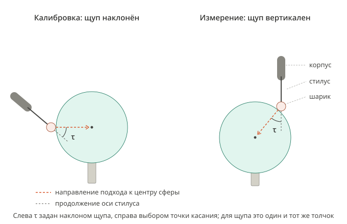
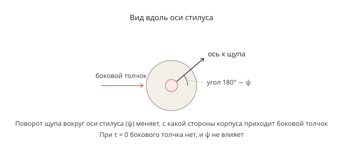

# Калибровка центра шарика контактного щупа на роботе по эталонной сфере: теория

## 1. Назначение документа и порядок исследования

Документ содержит теорию калибровки положения центра шарика контактного щупа относительно фланца промышленного робота по касаниям неподвижной эталонной сферы. Конкретное оборудование здесь не рассматривается: робот — шесть сочленений с номинальной моделью прямой задачи кинематики, щуп — шарик на стилусе с выходом срабатывания, сфера — шар известного номинального радиуса. Числа в документе взяты из публикаций с названием устройства, на котором они получены, или помечены «условно». Применение теории к конкретной установке — в документе `docs/ROBOT_PROBE_SPHERE_CALIBRATION_METHOD_RU.md` (далее «документ метода»); обозначения этого документа там сохраняются.

Сокращения и понятия исследования:

- КТК — критерий точности калибровки: величина, которой количественно оценивается точность калибровки.
- Фактор влияния — величина или свойство оборудования либо плана касаний, от которого зависит КТК.
- ММК — математическая модель калибровки: зависимость КТК от факторов влияния. Модель регистрации касания и оценивания параметров методом наименьших квадратов (разделы 4–10) — часть ММК.

Порядок исследования:

| Шаг | Содержание                                                                                       | Где                                                                                                 | Состояние                                                                                                              |
| --- | ------------------------------------------------------------------------------------------------ | --------------------------------------------------------------------------------------------------- | ---------------------------------------------------------------------------------------------------------------------- |
| 1   | анализ литературы                                                                                | раздел 3                                                                                            | выполнен: карточки L1–L32, сводка — раздел 3.7                                                 |
| 2   | определение КТК                                                                                  | раздел 11.1                                                                                         | выполнен: КТК $\chi_{95}$ (11.1.2)                                                                                    |
| 3   | классификация факторов на установке: способ количественного определения, форма количественного представления, возможность нейтрализации | раздел 11.3 — признаки; документ метода, раздел 5 — классификация ФВ1–ФВ23 | выполнен: документ метода, раздел 5 |
| 4   | факторы влияния на КТК: степень влияния, взаимосвязи, ранжирование по данным источников          | раздел 11.2                                                                                         | предварительный перечень — раздел 11.2; степень влияния не оценена                                                       |
| 5   | ММК                                                                                              | разделы 4–10 — модель регистрации касания и оценивания; зависимость КТК от факторов — новый раздел | модель регистрации касания и оценивание по МНК выведены; модель ошибок робота и хода до срабатывания — только линейная |
| 6   | процедуры количественного определения факторов на конкретной установке                           | документ метода                                                                                     | —                                                                                                                      |
| 7   | метод калибровки, при котором КТК наименьший                                                     | документ метода                                                                                     | —                                                                                                                      |

До выполнения шагов 2–5 выводы разделов 4–10 — следствия принятой модели, а не выбор способа калибровки.

## 2. Термины и обозначения

### 2.1. Системы координат

- {B} — базовая система робота.
- {F} — система фланца
- {P} — система щупа: начало в центре шарика, оси параллельны осям {F}, ось z направлена от фланца вдоль стилуса.
- {S} — система сферы: начало в центре сферы, оси параллельны осям {B}.

Калибровка находит только начала {P} и {S}: центр шарика и центр сферы; оси {P} и {S} заданы этими определениями.

Матрица преобразования из системы {i} в систему {j} — однородная матрица размером $4 \times 4$, которая переводит координаты, заданные в {i}, в координаты в {j}:

$$
{}^{j}A_i = \begin{bmatrix} {}^{j}R_i & {}^{j}\bar{p}_i \\ \bar{0}^T & 1 \end{bmatrix}
$$

где ${}^{j}R_i$ — матрица поворота размером $3 \times 3$;
&emsp;&emsp;${}^{j}\bar{p}_i$ — положение начала {i}, выраженное в {j}, мм;
&emsp;&emsp;$\bar{0}$ — нулевой вектор-столбец размером $3 \times 1$.

Положение точки $a$, выраженное в {j}, обозначается ${}^{j}\bar{p}_a$, мм.

Поза фланца при касании $i$ — результат номинальной прямой задачи кинематики по углам сочленений $\bar{q}_i$:

$$
{}^{B}A_F(\bar{q}_i) = \begin{bmatrix} {}^{B}R_F(\bar{q}_i) & {}^{B}\bar{p}_F(\bar{q}_i) \\ \bar{0}^T & 1 \end{bmatrix}
$$

где $\bar{q}_i$ — углы сочленений робота при касании $i$, градусы;
&emsp;&emsp;${}^{B}R_F(\bar{q}_i)$ — поворот {F} относительно {B};
&emsp;&emsp;${}^{B}\bar{p}_F(\bar{q}_i)$ — положение начала {F} в {B}, мм.

$R_x(\cdot)$, $R_y(\cdot)$, $R_z(\cdot)$ — матрицы поворота на указанный угол вокруг осей x, y, z.

### 2.2. Щуп и регистрация касания

- Шарик (ball) — шарик на конце стилуса щупа.
- Стилус (stylus) — стержень щупа, на конце которого закреплён шарик.
- Корпус щупа (probe body) — часть щупа между фланцем и стилусом.
- Кинематический щуп (kinematic touch-trigger probe) — щуп, в котором держатель стилуса лежит на трёх опорах; щуп срабатывает, когда сопротивление электрической цепи через опоры превышает пороговое значение (L1, рис. 1, 4).
- Срабатывание щупа (trigger) — момент, когда выход щупа переключается.
- Обнаружение касания (detection) — момент, когда система управления робота видит сигнал срабатывания.
- Период опроса входа (input sampling period) $T_{in}$ — период, с которым система управления читает вход сигнала срабатывания, с.
- TCP — точка, которую система управления считает центром шарика: вычисляется прямой задачей кинематики по углам сочленений и заданному положению центра шарика в {F}. После касания реальный шарик стоит на поверхности сферы, а TCP движется дальше вместе с корпусом щупа; стилус при этом изгибается.

### 2.3. Геометрия сферы и касаний

- $r_b$ — радиус шарика, мм.
- $r_s$ — радиус эталонной сферы, мм.
- $L$ — расстояние между центрами шарика и сферы в момент касания, мм: $L = r_b + r_s$; в условном примере 14 мм.
- Оболочка касания (contact shell) — сфера радиуса $L$ вокруг центра эталонной сферы; на ней лежит центр шарика в момент касания.
- Зазор подхода (approach gap) $g$ — расстояние от оболочки старта до оболочки касания, мм.
- Оболочка старта (start shell) — сфера радиуса $L + g$ вокруг центра эталонной сферы.
- $\lambda$ — широта точки касания на сфере, градусы.
- $\mu$ — долгота точки касания на сфере, градусы; $\mu = 0$ вдоль оси x системы {B}, $\mu = 90°$ вдоль оси y.
- $i$ — номер касания калибровки в порядке выполнения.
- $m$ — число касаний одной калибровки.

Орты (единичные векторы) обозначаются буквой $e$ с индексом оси или того вектора, чьим ортом они являются; система координат, в которой выражен орт, — левый верхний индекс.

Орт внешней нормали сферы в точке касания (индекс $n$ — нормаль), выраженный в {B}:

$$
{}^{B}\bar{e}_n(\lambda,\mu) = \begin{bmatrix} \cos\lambda\cos\mu \\ \cos\lambda\sin\mu \\ \sin\lambda \end{bmatrix}
\tag{2.3.1}
$$

где $\lambda$ — широта точки касания;
&emsp;&emsp;$\mu$ — долгота точки касания.

- Направление подхода (approach direction) — направление, в котором робот ведёт шарик к центру сферы. Его орт обозначается $\bar{e}_a$ (индекс $a$ — approach); в {B} он противоположен орту нормали:

$$
{}^{B}\bar{e}_a(\lambda,\mu) = -\,{}^{B}\bar{e}_n(\lambda,\mu)
\tag{2.3.2}
$$

где ${}^{B}\bar{e}_a(\lambda,\mu)$ — орт направления подхода в {B};
&emsp;&emsp;${}^{B}\bar{e}_n(\lambda,\mu)$ — орт внешней нормали (2.3.1).

- Наклон щупа (tilt) $\tau$ — угол между осью стилуса и направлением подхода, градусы (раздел 4).
- Поворот щупа вокруг оси стилуса (roll) $\psi$ — угол поворота щупа вокруг собственной оси стилуса, градусы (раздел 4).

### 2.4. Движение одного касания

- Точка старта (start point) — точка оболочки старта, лежащая на нормали касания.
- Переход (transfer) — движение от точки старта предыдущего касания к точке старта текущего.
- Подход (approach) — движение от точки старта по нормали касания к центру сферы до обнаружения касания.
- Точка ожидания (standoff point) — точка на прямой подхода вблизи поверхности, но гарантированно до касания.
- Предподход (pre-approach) — быстрый участок подхода от точки старта до точки ожидания.
- Поиск (search) — участок подхода от точки ожидания с постоянной скоростью поиска до обнаружения касания. Если на заданной длине поиска касание не обнаружено, оно считается неудачным.
- Отход (retract) — движение от точки обнаружения касания обратно к точке старта.

### 2.5. Величины модели касания

Все величины, кроме $t$, измеряются вдоль направления подхода.

- $t$ — время от начала поиска, с; $t = 0$ в точке ожидания.
- Скорость поиска (search speed) $v_s$ — постоянная скорость TCP на всём поиске, мм/с.
- $p_a(t)$ — координата TCP вдоль направления подхода в момент $t$, мм.
- $t_c$ — момент касания (contact) шарика со сферой, с.
- $p_a(t_c)$ — координата TCP в момент касания, мм. Задаётся положением поверхности и от $v_s$ не зависит.
- Отклонение стилуса (stylus deflection) $\delta(t)$ — насколько TCP прошёл дальше положения касания к моменту $t$, мм.
- Ход до срабатывания (pretravel) $\delta_p$ — отклонение стилуса, при котором щуп срабатывает, мм.
- $t_{trig}$ — момент срабатывания щупа, с.
- Задержка сигнала (latency) $t_{lat}$ — время от срабатывания щупа до обнаружения касания, с.
- $t_{det}(v_s)$ — момент обнаружения касания при скорости поиска $v_s$, с.
- Зарегистрированная координата (detected position) $p_{a.det}(v_s)$ — координата TCP в момент обнаружения касания, мм.
- Расстояние касания (contact distance) $\rho$ — расстояние от центра сферы до зарегистрированного центра шарика, мм.

### 2.6. Оценивание параметров

- Оценивание параметров методом наименьших квадратов (МНК; least-squares estimation) — нахождение значений искомых параметров, при которых сумма квадратов невязок наименьшая.
- Невязка (residual) уравнения касания $i$ — разность между расстоянием от рассчитанного центра шарика до центра сферы и требуемым расстоянием касания, мм.
- Идентифицируемость (identifiability) параметров — свойство набора касаний: наименьшую сумму квадратов невязок даёт только один набор значений параметров (раздел 6.2).
- Аппроксимация сферы (sphere fit) — оценивание центра и радиуса сферы по точкам по МНК (раздел 3.3.2).
- Шум (noise) — часть невязки, которая при повторении того же касания принимает другое значение и для отдельного касания непредсказуема (раздел 6.3).
- Систематическая часть (systematic component) невязки — часть, которая при повторении того же касания повторяется (раздел 6.3).
- СКО, среднеквадратическое отклонение (standard deviation) — корень из математического ожидания квадрата отклонения величины от её среднего; мера разброса (раздел 6.3).
- Число степеней свободы (degrees of freedom) — число касаний минус число искомых параметров (раздел 6.3).
- Выброс (outlier) — невязка отдельного касания, по модулю превышающая три СКО невязок (раздел 6.3).

### 2.7. Термины КИМ (раздел 3.3)

- КИМ (CMM, coordinate measuring machine) — координатно-измерительная машина.
- Квалификация щупа (probe qualification) — касания эталонной сферы на КИМ, по которым находят положение и эффективный радиус шарика.
- Эффективный радиус шарика (effective, «electronic» ball radius) $r_{eff}$ — радиус шарика за вычетом среднего хода до срабатывания, мм.
- Разброс хода до срабатывания по направлениям (pre-travel variation, PTV; lobing) — различие хода до срабатывания при касании с разных сторон относительно щупа.
- Расстояние предварительного подхода (prehit distance) — расстояние до поверхности, с которого КИМ переходит с быстрого движения на постоянную скорость касания; аналог точки ожидания.

## 3. Анализ литературы

Соберём из источников модели факторов влияния, методы их определения, их величины и критерии, которыми источники оценивают точность калибровки или измерения. Результат — сводка раздела 3.7, которую используют шаги 2–5 исследования (раздел 1).

### 3.1. Источники и карточки

Результаты каждого источника записываются в карточку — таблицу со следующими полями:

| Поле              | Содержание                                                                                                                                                     |
| ----------------- | -------------------------------------------------------------------------------------------------------------------------------------------------------------- |
| источник          | авторы, год, название, издание, том, страницы, DOI                                                                                                             |
| класс объектов    | оборудование, на котором получены результаты: машина (КИМ, станок, промышленный робот) и её модель, тип и модель щупа, длина стилуса, диаметр шарика, эталон |
| задача            | что авторы определяют или компенсируют                                                                                                                         |
| модель            | уравнения источника, переписанные в обозначениях этого документа, соответствие обозначений, допущения                                                                |
| метод             | что измеряют, чем, число касаний или поз, скорость касания, температура, ориентации щупа                                                                       |
| результаты        | значение величины, вид характеристики (среднее, СКО, размах, наибольшее значение, уровень доверия), условия, при которых значение получено, место в источнике |
| критерий точности | величина, которой авторы оценивают точность калибровки или измерения, и способ её вычисления                                                                   |
| факторы           | факторы влияния из раздела 3.2, о которых источник даёт величину, модель или метод                                                                             |
| перенос           | на какой класс объектов результат переносится и на каком основании                                                                                             |
| ограничения       | что авторы не рассматривают или называют ограничением                                                                                                          |
| для теории        | какие утверждения разделов 4–11 результат подтверждает, опровергает или дополняет                                                                              |

Место в источнике — раздел, номер формулы, таблицы или рисунка и страница. Значение, прочитанное с графика, помечается «оценка по графику»; толкование, которого нет в источнике, — «вывод автора». Результат источника относится только к классу объектов из его карточки.

Источники:

| №   | Источник                                                                                                                                                                                                           | Класс объектов                                                  | Карточка |
| --- | ------------------------------------------------------------------------------------------------------------------------------------------------------------------------------------------------------------------ | --------------------------------------------------------------- | -------- |
| L1  | Renishaw. TE411 «Innovations in touch-trigger probe sensor technology»; дата публикации не указана, знак авторского права — 2024; https://www.renishaw.com/media/pdf/en/d08800b735ec41c58c27a52990ea311a.pdf                                      | кинематические резистивные и тензометрические щупы Renishaw     | 3.3.1    |
| L2  | Renishaw, база знаний «PH20 ISO 10360-2 data compared to PH10»; https://www.renishaw.com/cmmsupport/knowledgebase/en/ph20-iso10360-2-data-compared-to-ph10--15620                                                  | проверка КИМ с поворотными головками PH10 и PH20 по ISO 10360-2 | 3.3.2    |
| L3  | A. Nubiola. «Calibration of a serial robot using a laser tracker», магистерская диссертация, École de technologie supérieure, Монреаль, 2011; https://espace.etsmtl.ca/909/2/NUBIOLA_Albert-web.pdf                | робот ABB IRB 1600-6/1.45                                       | 3.5.1    |
| L4  | J.R.R. Mayer, A. Ghazzar, O. Rossy. 3D characterisation, modelling and compensation of the pre-travel of a kinematic touch trigger probe. Measurement, 1996, 19(2), 83–94; DOI 10.1016/S0263-2241(96)00068-1     | один кинематический щуп Renishaw на КИМ LK G90c            | 3.3.3    |
| L5  | Y.-L. Shen, X. Zhang. Pretravel compensation for horizontally oriented touch trigger probes with straight styli. Journal of Manufacturing Systems, 1999, 18(3), 175–186; DOI 10.1016/S0278-6125(99)80030-2       | один щуп Renishaw TP2-5way, горизонтальный, на КИМ            | 3.3.4    |
| L6  | Y.-L. Shen, X. Zhang. Modelling of pretravel for touch trigger probes on indexable probe heads on coordinate measuring machines. Int. J. Adv. Manuf. Technol., 1997, 13(3), 206–213; DOI 10.1007/BF01305872     | один щуп «5-way» на КИМ, 13 ориентаций к силе тяжести | 3.3.5    |
| L7  | A. Woźniak, M. Dobosz. Metrological feasibilities of CMM touch trigger probes. Part I: 3D theoretical model of probe pretravel. Measurement, 2003, 34(4), 273–286; DOI 10.1016/j.measurement.2003.05.001          | теоретическая модель одно- и двухступенчатых щупов | 3.3.6    |
| L8  | M. Dobosz, A. Woźniak. Metrological feasibilities of CMM touch trigger probes. Part II: Experimental verification of the 3D theoretical model of probe pretravel. Measurement, 2003, 34(4), 287–299; DOI 10.1016/j.measurement.2003.05.002 | щупы Renishaw TP1(S), TP2-5W, TP6, TP200 на стенде | 3.3.7    |
| L9  | S. Li, P. Feng, L. Zeng, S. Wang, Y. Li, S. Zhang. A rigid-flexible coupling pretravel error model for a touch-trigger probe in an on-machine inspection system. Int. J. Adv. Manuf. Technol., 2021; DOI 10.1007/s00170-021-06912-y | один щуп Renishaw RMP60 на обрабатывающем центре | 3.3.8    |
| L10 | C. Butler. An investigation into the performance of probes on coordinate measuring machines. Industrial Metrology, 1991, 2(1), 59–70; DOI 10.1016/0921-5956(91)80025-B                                            | щупы касания КИМ: четыре кинематических и один пьезоэлектрический | 3.3.9   |
| L11 | W.T. Estler, S.D. Phillips, B. Borchardt et al. Error compensation for CMM touch trigger probes. Precision Engineering, 1996, 19(2–3), 85–97; DOI 10.1016/S0141-6359(96)00040-2                                    | один щуп Renishaw TP2 6-way на КИМ | 3.3.10   |
| L12 | A. Woźniak, M. Dobosz. Influence of measured objects parameters on CMM touch trigger probe accuracy of probing. Precision Engineering, 2005, 29(3), 290–297; DOI 10.1016/j.precisioneng.2004.11.009              | один щуп Renishaw TP6 на стенде, образцы разных материалов | 3.3.11   |
| L13 | S. Li, L. Zeng, P. Feng, Y. Li, C. Xu, Y. Ma. Accurate compensation method for probe pre-travel errors in on-machine inspections. Int. J. Adv. Manuf. Technol., 2019, 103, 2401–2410; DOI 10.1007/s00170-019-03729-8 | один тензометрический щуп Renishaw OMP400 на обрабатывающем центре | 3.3.12   |
| L14 | K. Ostrowska et al. Model of errors of touch-trigger probe installed on the industrial robot. Journal of Physics: Conference Series, 2018, 1065, 142018; DOI 10.1088/1742-6596/1065/14/142018                     | робот Kawasaki RS010N со щупом Heidenhain | 3.3.13   |
| L15 | Z. Roth, B. Mooring, B. Ravani. An overview of robot calibration. IEEE Journal of Robotics and Automation, 1987, 3(5), 377–385; DOI 10.1109/JRA.1987.1087124                                                       | последовательные роботы, обзор | 3.4.1    |
| L16 | J.H. Borm, C.H. Menq. Determination of optimal measurement configurations for robot calibration based on observability measure. Int. J. Robotics Research, 1991, 10(1), 51–63; DOI 10.1177/027836499101000106   | робот RM-501 и расчётные механизмы | 3.4.2    |
| L17 | Y. Sun, J.M. Hollerbach. Observability index selection for robot calibration. IEEE ICRA, 2008, 831–836; DOI 10.1109/ROBOT.2008.4543308                                                                             | теория плана измерений для калибровки роботов | 3.4.3    |
| L18 | A. Joubair et al. Comparison of the efficiency of five observability indices for robot calibration. Mechanism and Machine Theory, 2013, 70, 254–265; DOI 10.1016/j.mechmachtheory.2013.07.015                     | моделирование плоских роботов DexTAR, PreXYT и последовательного | 3.4.4    |
| L19 | A. Joubair, I.A. Bonev. Kinematic calibration of a six-axis serial robot using distance and sphere constraints. Int. J. Adv. Manuf. Technol., 2015, 77, 515–523; DOI 10.1007/s00170-014-6448-5                     | робот FANUC LR Mate 200iC со щупом Renishaw MP250, три эталонные сферы | 3.4.5    |
| L20 | A. Joubair, I.A. Bonev. Non-kinematic calibration of a six-axis serial robot using planar constraints. Precision Engineering, 2015; DOI 10.1016/j.precisioneng.2014.12.002                                         | робот и щуп из L19, гранитный куб | 3.4.6    |
| L21 | M. Gaudreault, A. Joubair, I. Bonev. Self-calibration of an industrial robot using a novel affordable 3D measuring device. Sensors, 2018, 18(10), 3380; DOI 10.3390/s18103380                                      | робот ABB IRB 120, устройство с тремя индикаторами, три шарика | 3.4.7    |
| L22 | A. Nubiola, M. Slamani, A. Joubair, I.A. Bonev. Comparison of two calibration methods for a small industrial robot based on an optical CMM and a laser tracker. Robotica, 2014, 32(3), 447–466; DOI 10.1017/S0263574713000714 | робот ABB IRB 120, лазерный трекер и оптическая КИМ | 3.4.8    |
| L23 | A. Nubiola, I.A. Bonev. Absolute calibration of an ABB IRB 1600 robot using a laser tracker. Robotics and Computer-Integrated Manufacturing, 2013, 29, 236–245; DOI 10.1016/j.rcim.2012.06.004                     | робот ABB IRB 1600 и лазерный трекер, журнальная версия L3 | 3.5.2    |
| L24 | M. Slamani, A. Nubiola, I. Bonev. Assessment of the positioning performance of an industrial robot. Industrial Robot, 2012, 39(1), 57–68; DOI 10.1108/01439911211192501                                            | робот ABB IRB 1600, трекер, интерферометр, датчик расстояния | 3.5.3    |
| L25 | C. Gong, J. Yuan, J. Ni. Nongeometric error identification and compensation for robotic system by inverse calibration. Int. J. Machine Tools and Manufacture, 2000, 40(14), 2119–2137; DOI 10.1016/S0890-6955(00)00023-7 | робот неназванной модели, лазерный трекер, термисторы | 3.5.4    |
| L26 | C. Dumas, S. Caro, S. Garnier, B. Furet. Joint stiffness identification of six-revolute industrial serial robots. Robotics and Computer-Integrated Manufacturing, 2011, 27(4), 881–888; DOI 10.1016/j.rcim.2011.02.003 | расчёт для робота KUKA KR240-2, опытов нет | 3.5.5    |
| L27 | ГОСТ Р 60.3.3.1-2016/ИСО 9283:1998. Роботы промышленные манипуляционные. Рабочие характеристики и соответствующие методы испытаний                                                                                | стандарт испытаний промышленных роботов | 3.6.1    |
| L28 | ГОСТ Р ИСО 10360-5-2017. Характеристики изделий геометрические. Приёмочные и перепроверочные испытания координатно-измерительных машин. Часть 5                                                                   | стандарт испытаний зондирующих систем КИМ | 3.6.2    |
| L29 | ГОСТ ISO 230-10-2017. Нормы и правила испытаний металлорежущих станков. Часть 10. Определение измерительных характеристик систем щупов                                                                          | стандарт испытаний систем щупов станков | 3.6.3    |
| L30 | ГОСТ 3722-2014. Подшипники качения. Шарики стальные. Технические условия                                                                                                                                         | стандарт на стальные шарики | 3.6.4    |
| L31 | JCGM 100:2008. Evaluation of measurement data — Guide to the expression of uncertainty in measurement (GUM); DOI 10.59161/JCGM100-2008E                                                                            | руководство по неопределённости измерений | 3.6.5    |
| L32 | JCGM 101:2008. Evaluation of measurement data — Supplement 1 to the GUM — Propagation of distributions using a Monte Carlo method; DOI 10.59161/JCGM101-2008                                                      | дополнение 1 к GUM, метод Монте-Карло | 3.6.6    |

### 3.2. Факторы влияния

Перечислим факторы влияния, которые карточки отмечают в поле «факторы». ФВ — фактор влияния; число после букв — номер фактора. Перечень составлен по разделу 11 и дополняется по источникам; номер фактора не меняется и повторно не используется.

| ФВ   | Фактор влияния                                                                                     |
| ---- | -------------------------------------------------------------------------------------------------- |
| ФВ1  | ошибки установки основания робота, звена до первого сочленения и нуля первого сочленения          |
| ФВ2  | ошибки нуля последнего сочленения, звена после него, фланца и крепления щупа                      |
| ФВ3  | средние геометрические ошибки робота: длины и углы звеньев, нули промежуточных сочленений         |
| ФВ4  | податливость робота: деформации от собственного веса и от силы касания                            |
| ФВ5  | тепловые деформации робота, щупа и сферы, дрейф во время калибровки                                |
| ФВ6  | люфт в передачах сочленений                                                                        |
| ФВ7  | повторяемость позиционирования робота                                                              |
| ФВ8  | разрешение и шум измеренных углов сочленений, включая разрешение передаваемых значений            |
| ФВ9  | средний ход до срабатывания щупа                                                                   |
| ФВ10 | зависимость хода до срабатывания от направления касания относительно щупа                         |
| ФВ11 | зависимость хода до срабатывания от ориентации щупа относительно силы тяжести                     |
| ФВ12 | зависимость хода до срабатывания от скорости касания                                               |
| ФВ13 | разброс срабатывания при повторении одного касания, гистерезис точки срабатывания                 |
| ФВ14 | длина, жёсткость и форма стилуса                                                                   |
| ФВ15 | средняя задержка сигнала срабатывания                                                              |
| ФВ16 | случайная часть задержки сигнала срабатывания: циклы опроса входов                                 |
| ФВ17 | отклонение радиусов шарика и сферы от номинальных                                                  |
| ФВ18 | отклонение формы эталонной сферы и шарика щупа, шероховатость и материал сферы                                      |
| ФВ19 | жёсткость крепления эталонной сферы                                                                |
| ФВ20 | план касаний: число касаний, распределение направлений подхода и ориентаций щупа                   |
| ФВ21 | отличие поз и ориентаций последующих измерений от поз и ориентаций калибровки                     |
| ФВ22 | свойства и состояние поверхности в точке касания — материал, шероховатость, кривизна, загрязнение: от них зависят трение шарика о поверхность и контактная деформация |
| ФВ23 | путь машины от обнаружения касания до момента регистрации положения, если положение регистрируется не в момент обнаружения, например после торможения |

### 3.3. Ход до срабатывания щупа

Карточки источников о ходе до срабатывания и его компенсации: L1, L2, L4–L14.

#### 3.3.1. L1: Renishaw TE411 — ход до срабатывания кинематических резистивных и тензометрических щупов

| Поле              | Содержание                                                                                                                                                                                                                                                                                                                                                                                                                                                                                                     |
| ----------------- | -------------------------------------------------------------------------------------------------------------------------------------------------------------------------------------------------------------------------------------------------------------------------------------------------------------------------------------------------------------------------------------------------------------------------------------------------------------------------------------------------------------- |
| источник          | Renishaw. TE411 «Innovations in touch-trigger probe sensor technology», номер документа H-5650-2014-02-A; дата публикации не указана, знак авторского права — 2024; https://www.renishaw.com/media/pdf/en/d08800b735ec41c58c27a52990ea311a.pdf                                                                                                                                                                                                                                                                 |
| класс объектов    | кинематические резистивные щупы Renishaw: держатель стилуса опирается тремя стержнями на шесть шаров, срабатывание регистрируется по росту сопротивления цепи через эти контакты (L1, рис. 1, 3, 4); пример — щуп КИМ TP6 со стилусом 50 мм. Тензометрические щупы Renishaw: держатель стилуса тоже на трёх опорах, но срабатывание — по силе, измеренной тензодатчиками; примеры — OMP400 и RMP600 для станков (L1, рис. 10, 11, 13, 14). Сведения изготовителя; условия испытаний, кроме длины стилуса, не указаны |
| задача            | сравнить характеристики кинематических резистивных и тензометрических щупов: ход до срабатывания, его разброс по направлениям, повторяемость, гистерезис (L1, реферат)                                                                                                                                                                                                                                                                                                                                      |
| модель            | кинематический резистивный щуп: ход до срабатывания при касании перпендикулярно оси стилуса — прогиб стилуса под силой касания; сила касания в момент срабатывания определяется равновесием моментов силы касания и силы пружины относительно оси поворота держателя на опорах (L1, рис. 5); запись в обозначениях этого документа — ниже таблицы. Плечо силы пружины зависит от направления касания: опоры образуют треугольник, в направлении наименьшей силы срабатывания плечо «approximately half as long», как в направлении наибольшей силы; отсюда три наибольших значения хода до срабатывания по направлениям (L1, рис. 6, 7). При касании вдоль оси стилуса сила касания равна силе пружины, но стилус сжимается, а не изгибается, поэтому ход до срабатывания «generally much smaller» (L1, рис. 9). Тензометрический щуп: срабатывание — через постоянную задержку после превышения порога силы; задержка добавляет к ходу до срабатывания путь машины за время задержки (L1, стр. PDF 6–7) |
| метод             | калибровка (L1, раздел «Probe calibration»): «A datum feature, of known size and position, is measured to establish the average pre-travel for the stylus concerned» — щупом измеряют эталон известного размера и положения, чтобы установить средний ход до срабатывания $\delta_{p0}$ для данного стилуса; здесь $\delta_{p0}$ — среднее значение хода до срабатывания $\delta_p$ по касаниям калибровки, мм. Если ошибка измерения от разброса хода до срабатывания по направлениям «unacceptably large», «it may be necessary to calibrate the probe for each direction in which it is to be used». Тензометрический щуп калибруется при той же запрограммированной скорости, что и измерение; машина не должна начинать торможение до касания (L1, стр. PDF 7) |
| результаты        | 1) TP6, стилус 50 мм: разброс хода до срабатывания по направлениям в плоскости, перпендикулярной оси стилуса, — 3,28 мкм («maximum variation», здесь трактуется как размах: наибольший ход до срабатывания минус наименьший — вывод автора); сила срабатывания 15 г (граммы-силы: $15\ \text{г} \cdot 9{,}81\ \text{м/с}^2 = 0{,}147$ Н); повторяемость 0,5 мкм ($2\sigma$) (L1, рис. 8). 2) Повторяемость кинематических резистивных щупов на испытательном стенде: щупы для станков — в пределах 1,0 мкм ($2\sigma$), многие щупы КИМ — в пределах 0,35 мкм ($2\sigma$); это не повторяемость измерительной системы (L1, раздел «Repeatability»). 3) OMP400, стилус 50 мм, 12 касаний через 30°: разброс по направлениям в плоскости, перпендикулярной оси, 0,34 мкм, по всем направлениям — менее 1 мкм (L1, рис. 13). 4) RMP600, стилусы 50 и 100 мм: повторяемость 0,25 и 0,35 мкм ($2\sigma$, наибольшая по 12 направлениям); отклонение по направлениям в плоскости, перпендикулярной оси, ±0,25 мкм для обоих; по всем направлениям ±1,00 и ±1,75 мкм (L1, табл. на рис. 14) |
| критерий точности | повторяемость — $2\sigma$ точки срабатывания при повторении касания; разброс хода до срабатывания по направлениям (PTV); гистерезис. Изготовитель ранжирует их по важности: 1) повторяемость, «the fundamental limit to system performance»; 2) разброс по направлениям — устраняется калибровкой, если все направления касания известны; 3) гистерезис — «a small factor for probes with kinematic mechanisms» (L1, раздел «Performance factors ranked in terms of importance»)                                                                                                     |
| факторы           | ФВ9: компенсируется калибровкой по эталону; ФВ10: три наибольших значения по азимуту, значение вдоль оси «generally much smaller», пример размаха; ФВ13: повторяемость 0,35–1,0 мкм ($2\sigma$), гистерезис растёт с длиной стилуса и силой касания; ФВ14: разброс по направлениям пропорционален кубу длины стилуса; ФВ16: разброс времени от срабатывания до фиксации положения машины увеличивает разброс измерений; некоторые системы ЧПУ опрашивают вход щупа раз в несколько миллисекунд (L1, раздел «Repeatability»)                                                       |
| перенос           | результаты 1–2 — только на кинематические резистивные щупы, 3–4 — только на тензометрические щупы Renishaw; на щупы другого устройства не переносятся                                                                                                                                                                                                                                                                                                                                                       |
| ограничения       | формул калибровки, ориентации щупа при калибровке и способа компенсации источник не приводит; чисел для направления вдоль оси стилуса у кинематических щупов не даёт; значения повторяемости — стендовые                                                                                                                                                                                                                                                                                                  |
| для теории        | постоянная часть хода до срабатывания и её компенсация — раздел 6.4; зависимость от направления — случай 3, раздел 6.5; калибровка для каждого направления — вариант 2 раздела 10; постоянная задержка тензометрического щупа при постоянной скорости входит в $\rho$ так же, как перебег за среднюю задержку сигнала (раздел 6.4); опрос входа раз в несколько миллисекунд — источник шума раздела 6.3.5                                                                                                     |

Модель L1 (L1, рис. 5) в обозначениях этого документа:

$$
\delta_p(\omega) = c_{st}\,Q_{trig}(\omega), \qquad Q_{trig}(\omega)\,l_{st} = Q_{spr}\,r_{piv}(\omega)
$$

где $\delta_p(\omega)$ — ход до срабатывания при касании перпендикулярно оси стилуса, мм;
&emsp;&emsp;$\omega$ — азимут направления подхода вокруг оси стилуса, градусы; начало отсчёта задаёт источник;
&emsp;&emsp;$c_{st}$ — податливость стилуса на изгиб у шарика: прогиб конца стилуса на единицу поперечной силы, мм/Н; по L1 равна кубу длины стилуса, делённому на утроенное произведение модуля упругости материала стилуса на момент инерции сечения;
&emsp;&emsp;$Q_{trig}(\omega)$ — сила срабатывания: сила, с которой поверхность давит на шарик в момент срабатывания, Н;
&emsp;&emsp;$l_{st}$ — длина стилуса, мм;
&emsp;&emsp;$Q_{spr}$ — сила пружины щупа, Н;
&emsp;&emsp;$r_{piv}(\omega)$ — плечо силы пружины относительно оси поворота держателя стилуса на опорах, мм.

#### 3.3.2. L2: Renishaw, база знаний — схема касаний эталонной сферы при проверке ошибки ощупывания

| Поле              | Содержание                                                                                                                                                                                                                                                                                                                                                                                   |
| ----------------- | -------------------------------------------------------------------------------------------------------------------------------------------------------------------------------------------------------------------------------------------------------------------------------------------------------------------------------------------------------------------------------------------- |
| источник          | Renishaw, база знаний «PH20 ISO 10360-2 data compared to PH10»; дата не указана; https://www.renishaw.com/cmmsupport/knowledgebase/en/ph20-iso10360-2-data-compared-to-ph10--15620                                                                                                                                                                                                         |
| класс объектов    | КИМ с поворотными головками PH10 и PH20; щуп со стандартным модулем силы и с модулем EM2; стилусы Ø$4 \times 12$ мм и Ø$6 \times 50$ мм (углепластиковый); проверка по ISO 10360-2:2001. Модель КИМ, диаметр сферы и скорость касания не указаны                                                                                                                                                       |
| задача            | сравнить результаты проверки ошибки ощупывания по ISO 10360-2 для головок PH20 и PH10                                                                                                                                                                                                                                                                                                       |
| модель            | не приводится                                                                                                                                                                                                                                                                                                                                                                                |
| метод             | 25 касаний эталонной сферы: полюс; 4 точки в 22,5° от полюса; 8 в 45°; 4 в 67,5°; 8 в 90°; каждое следующее кольцо повёрнуто на 22,5° относительно предыдущего. По 25 точкам находят сферу МНК; ошибка ощупывания — размах 25 расстояний от точек до центра этой сферы. Калибровка щупа — в режиме PH10; карта разброса хода до срабатывания по направлениям включена, где она применима (L2, «Procedure», «Derivation of results», «Requirements») |
| результаты        | Ошибка формы и ошибка диаметра, мм, в столбцах «PH10», «Head» (касания поворотом головки PH20) и «CMM» (касания движением КИМ с головкой PH20): стандартный модуль, Ø$4 \times 12$ мм — ошибка формы 0,0016; 0,0011; 0,0010, ошибка диаметра −0,0007; −0,0003; 0,0001; стандартный модуль, Ø$6 \times 50$ мм — ошибка формы 0,0053; 0,0020; 0,0012, ошибка диаметра −0,0013; 0,0000; −0,0002; модуль EM2, Ø$4 \times 12$ мм — ошибка формы 0,0094; 0,0010; 0,0018, ошибка диаметра −0,0014; −0,0003; −0,0001 (L2, таблицы, стр. PDF 2). Определение ошибки диаметра источник не даёт |
| критерий точности | ошибка ощупывания — размах 25 расстояний от точек касания до центра сферы, найденной МНК (аппроксимация сферы — раздел 2.6); ошибка диаметра                                                                                                                                                                                                                                               |
| факторы           | ФВ10: результаты получены с картой разброса хода до срабатывания по направлениям; ФВ14: при стилусе 50 мм ошибка формы с PH10 больше, чем при 12 мм (0,0053 и 0,0016 мм); ФВ17: ошибка диаметра; ФВ20: схема из 25 касаний                                                                                                                                                                 |
| перенос           | числа — только для КИМ с головками PH10 и PH20 и указанных модулей и стилусов; схема касаний — геометрия точек на сфере, от класса объектов не зависит (вывод автора)                                                                                                                                                                                                                       |
| ограничения       | ориентация щупа относительно полюса сферы, диаметр сферы, скорость касания и число повторов не указаны                                                                                                                                                                                                                                                                                      |
| для теории        | ошибка ощупывания — кандидат в КТК (шаг 2, раздел 1). Если ось щупа направлена к полюсу, углы колец от полюса равны наклону щупа $\tau$, и схема даёт наклоны 0°, 22,5°, 45°, 67,5° и 90° (вывод автора; L2 ориентацию щупа не указывает). Ошибка формы 1,0–9,4 мкм на КИМ с картой разброса хода до срабатывания — порядок величины размаха радиальных расстояний на сфере для щупов этого класса |

#### 3.3.3. L4: Mayer, 1996 — ход до срабатывания кинематического щупа по направлениям в пространстве

| Поле              | Содержание                                                                                                                                                                                                                                                                                                                                                                                                                                                                                                                                                                                       |
| ----------------- | ---------------------------------------------------------------------------------------------------------------------------------------------------------------------------------------------------------------------------------------------------------------------------------------------------------------------------------------------------------------------------------------------------------------------------------------------------------------------------------------------------------------------------------------------------------------------------------------------- |
| источник          | J.R.R. Mayer, A. Ghazzar, O. Rossy. 3D characterisation, modelling and compensation of the pre-travel of a kinematic touch trigger probe. Measurement, 1996, 19(2), 83–94; DOI 10.1016/S0263-2241(96)00068-1                                                                                                                                                                                                                                                                                                                                                                                  |
| класс объектов    | один кинематический щуп Renishaw (модель щупа не названа) на поворотной головке PH10M; КИМ LK Tool G90c 8.7.6 портального типа, рабочая зона $800 \times 700 \times 600$ мм; стилусы: 20 мм без удлинителя и с удлинителями 10–80 мм, рубиновый шарик Ø3 мм (Ø4 мм в опыте с силой тяжести); эталоны: сфера Ø20 мм и кольцо Ø0,7 дюйма; помещение с температурой ±1 °C (L4, разделы 2.1, 2.2, 3, рис. 4, 5, 15)                                                                                                                                                                                       |
| задача            | измерить ход до срабатывания по направлениям в пространстве независимо от ошибок КИМ, построить модель с малым числом параметров для его компенсации, найти параметры модели по касаниям эталонной сферы, изучить влияние длины стилуса и наклона щупа относительно силы тяжести (L4, реферат, разделы 2–5)                                                                                                                                                                                                                                                                                  |
| модель            | ход до срабатывания — путь поверхности вдоль направления подхода от касания до срабатывания; эта величина — $\delta_p$ раздела 2.5. Модель L4 записана ниже таблицы. Зависимость от азимута касания вокруг оси стилуса задаётся треугольником: три отрезка прямых в полярных координатах, каждая прямая — по центроиду точек своей области и направлению, найденному сингулярным разложением (L4, раздел 4, формула 3, рис. 8). Допущения: касание по нормали к поверхности; шарик при срабатывании смещается в основном перпендикулярно оси стилуса; контакт шарика с поверхностью — промежуточный между полным скольжением и полным сцеплением (L4, раздел 4) |
| метод             | 1) без КИМ: щуп неподвижен, к шарику подводят шпиндель микрометра по нормали; момент касания видят камерой по блику на шарике, ход до срабатывания читают по микрометру; шаг 7,5° по азимуту и 10° по углу к плоскости, перпендикулярной оси стилуса (L4, раздел 2.1, рис. 3). 2) На КИМ: касания сферы и кольца по нормали командой векторного касания (L4, раздел 2.2). 3) Нахождение треугольника по сфере: диаметр шарика — микрометром; щуп вертикально; квалификация щупа средствами КИМ; уточнение центра сферы по высоте касанием полюса с известным ходом до срабатывания 1 мкм; 3 прогона по 36 касаний экватора (L4, раздел 5.2). Скорость касания не указана                       |
| результаты        | 1) Касание перпендикулярно оси стилуса, стилус 20 мм с удлинителем 40 мм, шарик Ø3 мм: ход до срабатывания от 13 до 28 мкм (микрометр) и от 10 до 30 мкм (КИМ) — наименьшее и наибольшее по азимуту; зависимость — треугольник (L4, раздел 3, рис. 4, с. 87). 2) Все направления, те же условия: от 1 до 28 мкм; при касании вдоль оси стилуса 1 мкм во всех вертикальных сечениях, не зависит от длины удлинителя (L4, раздел 3, рис. 5, с. 87–88). 3) Случайный разброс хода до срабатывания: 10 мкм на КИМ и 3 мкм с микрометром; вид характеристики (СКО или размах) не указан (L4, раздел 3, с. 88). 4) Компенсация равносторонним треугольником, без удлинителя: экватор сферы — СКО хода до срабатывания по направлениям 4,7 мкм при среднем 30,5 мкм до компенсации и 1,2 мкм при среднем 36,8 мкм после (в 3,9 раза); вертикальное сечение — 3,7 мкм при среднем 30,0 мкм и 0,8 мкм при среднем 37,3 мкм (в 4,5 раза) (L4, раздел 5.1, рис. 9, 10, с. 90). 5) Треугольник общего вида, найденный по сфере, средние 10 прогонов: суммарная длина стилуса 100 мм — СКО 5,4 мкм при среднем 26,3 мкм, СКО невязок модели 1,5 мкм (в 3,6 раза); 30 мм — 2,1 мкм при среднем 7,4 мкм и 1,0 мкм (в 2 раза); наибольшие невязки — у вершин треугольника (L4, раздел 5.2, рис. 11, 12, с. 91–92). 6) Ход до срабатывания вдоль одного направления растёт с суммарной длиной стилуса от 0,0095 мм при 20 мм до 0,034 мм при 100 мм, быстрее при больших длинах (оценка по графику; L4, раздел 5.3, рис. 14, с. 92). 7) Наклон оси щупа относительно силы тяжести 0–90°, касания экватора, стилус 20 мм с удлинителем 40 мм, шарик Ø4 мм: если вершина треугольника направлена по силе тяжести, изменение «nearly no noticeable»; при повороте щупа вокруг оси на 30° треугольник искажается, при силе тяжести между двумя вершинами искажение явное; чисел нет, радиальная шкала рисунка до 0,025 мм (L4, раздел 5.3, рис. 15, с. 93) |
| критерий точности | СКО хода до срабатывания по направлениям относительно его среднего до и после компенсации и их отношение (L4, разделы 5.1, 5.2)                                                                                                                                                                                                                                                                                                                                                                                                                                                                 |
| факторы           | ФВ9: среднее до компенсации от 7,4 до 30,5 мкм в зависимости от длины стилуса; ФВ10: модель и величины по азимуту и по наклону к оси стилуса; ФВ11: качественная зависимость, чисел нет; ФВ12: трение и скорость касания названы причинами сцепления, чисел нет; ФВ13: случайный разброс 3 и 10 мкм; ФВ14: зависимость от длины стилуса; ФВ18: погрешность формы сферы и кольца «much smaller than the expected probing errors», числа нет; ФВ20: квалификация по эталонной сфере с систематическими ошибками щупа даёт эффективный радиус, зависящий от набора точек (L4, раздел 1, с. 84) |
| перенос           | числа — только для одного щупа Renishaw с указанными стилусами на КИМ. Вид зависимости (треугольник по азимуту, рост от касания вдоль оси к касанию поперёк оси) — для кинематических резистивных щупов с тремя опорами: у них тот же механизм, что в L1 (вывод автора); на щупы другого устройства не переносится                                                                                                                                                                                                                                       |
| ограничения       | модель — только для касания по нормали; коэффициент сцепления подобран по опыту, наибольшее расхождение модели с опытом около 45° от оси стилуса; авторы называют модель возможным упрощением; влияние силы тяжести в модель не входит и «may in some cases seriously change the shape» треугольника; поправка на длину стилуса не построена (L4, разделы 4, 5.3, 6)                                                                                                                                                                                                                       |
| для теории        | 1) Ход до срабатывания по наклону к оси стилуса меняется от 1 до 28 мкм, по азимуту — на 15–20 мкм: зависимость от наклона $\tau$ у этого щупа не меньше зависимости от азимута (вывод автора). 2) Слагаемое модели с $\cos\tau$ линейно по направлению подхода в {P}: по разделу 6.5 оно переходит в смещение центра шарика вдоль оси стилуса; слагаемое с $\sin\tau$ нелинейно и делится между $\rho$ и $\eta_i$ (вывод автора, расчётом не проверено). 3) Треугольник по азимуту не содержит слагаемого первого порядка по азимуту, поэтому при касаниях, равномерно распределённых по азимуту, он не смещает центр шарика поперёк оси стилуса и остаётся в $\eta_i$ (вывод автора). 4) Результат 7 опровергает для кинематических щупов допущение раздела 10 о независимости хода до срабатывания от направления силы тяжести (качественно). 5) Эффективный радиус шарика по сфере зависит от набора касаний — согласуется с разделом 6.5 |

Модель L4 (L4, формула 2) в обозначениях этого документа: угол источника между направлением подхода и плоскостью, перпендикулярной оси стилуса, равен $90° - \tau$, поэтому косинус этого угла заменён на $\sin\tau$, а синус — на $\cos\tau$:

$$
\delta_p(\omega,\tau) = \xi(\tau)\,\delta_{p.h}(\omega)\,\sin\tau + \delta_{p.v}\cos\tau
$$

где $\delta_p(\omega,\tau)$ — ход до срабатывания при касании по нормали к поверхности, мкм;
&emsp;&emsp;$\omega$ — азимут направления подхода вокруг оси стилуса, градусы (раздел 3.3.1); в L4 начало отсчёта задано поворотом головки, с осями {P} не связано;
&emsp;&emsp;$\tau$ — наклон щупа: угол между осью стилуса и направлением подхода, градусы;
&emsp;&emsp;$\delta_{p.h}(\omega)$ — ход до срабатывания при касании перпендикулярно оси стилуса ($\tau = 90°$), треугольник по $\omega$, мкм;
&emsp;&emsp;$\delta_{p.v}$ — ход до срабатывания при касании вдоль оси стилуса ($\tau = 0$), мкм;
&emsp;&emsp;$\xi(\tau)$ — коэффициент сцепления шарика с поверхностью: в L4 сравниваются $\xi = 1$ и $\xi = \exp(-\beta/4)$, где $\beta = 90° - \tau$; единицы угла в этой экспоненте источник не указывает (L4, рис. 7).

#### 3.3.4. L5: Shen, 1999 — ход до срабатывания горизонтального щупа с учётом силы тяжести

| Поле              | Содержание                                                                                                                                                                                                                                                                                                                                                                                                                                                                                                                                                                                       |
| ----------------- | ---------------------------------------------------------------------------------------------------------------------------------------------------------------------------------------------------------------------------------------------------------------------------------------------------------------------------------------------------------------------------------------------------------------------------------------------------------------------------------------------------------------------------------------------------------------------------------------------------------------- |
| источник          | Y.-L. Shen, X. Zhang. Pretravel compensation for horizontally oriented touch trigger probes with straight styli. Journal of Manufacturing Systems, 1999, 18(3), 175–186; DOI 10.1016/S0278-6125(99)80030-2                                                                                                                                                                                                                                                                                                                                                                                    |
| класс объектов    | один кинематический щуп Renishaw TP2-5way (держатель стилуса — треугольник из трёх стержней на шести цилиндрах), ось щупа горизонтальна; удлинитель стилуса 50 мм, длина от держателя до шарика 59 мм; шарик Ø6,0000 ± 0,0002 мм, отклонение от круглости менее 0,0005 мм; сила пружины 156,6 г; КИМ Sheffield RL-50 (основные опыты) и Brown & Sharpe PFx (опыты со скоростью); эталонная сфера Ø9,9992 мм, отклонение от круглости менее 0,0001 мм, в опытах со скоростью — Ø19,048 мм (L5, с. 179, 182) |
| задача            | построить модель хода до срабатывания горизонтального щупа с прямым стилусом из условий равновесия держателя стилуса и изгиба стилуса, найти её единственный параметр по касаниям эталонной сферы, проверить влияние скорости касания (L5, реферат)                                                                                                                                                                                                                                                                                                                                         |
| модель            | ход до срабатывания — путь щупа вдоль направления подхода от касания до срабатывания; эта величина — $\delta_p$ раздела 2.5 (L5, с. 176). Сила срабатывания — сила между шариком и поверхностью, при которой сила в одной из шести опор держателя достигает порога; она следует из шести уравнений равновесия держателя со стилусом под действием пружины, веса и силы касания (L5, формулы 1–18). Ход до срабатывания — прогиб стилуса как консольной балки (L5, формулы 19–22); запись в обозначениях этого документа — ниже таблицы. Допущения: трение в опорах равно нулю; касание по нормали к поверхности; сжатие стилуса вдоль оси много меньше изгиба и отброшено (L5, с. 177, 179) |
| метод             | 1561 направление подхода: полюс и 13 широт с полярными углами от 10° до 130° через 10°, по 120 касаний на широте; скорость касания 7,5 мм/с; 10 повторов; 8 поворотов щупа вокруг оси через 7,5°. Ход до срабатывания касания — сумма радиусов сферы и шарика минус расстояние от центра сферы до зарегистрированной точки (L5, формулы 23, 24); центр сферы — по 1080 касаниям с полярными углами 50–130°. Параметр модели — эффективный радиус сечения стилуса — находится МНК в замкнутом виде по всем 1561 касаниям или по 24 касаниям в плоскости, перпендикулярной оси стилуса (L5, с. 180–181). Опыты со скоростью: 3; 7,5 и 15 мм/с, 1321 направление, по 10 повторов (L5, с. 182) |
| результаты        | 1) Ход до срабатывания по направлениям, среднее 10 повторов: от 0 до 20 мкм (оценка по графику); три выступа по азимуту разной величины из-за веса стилуса (L5, рис. 3, 10, с. 176, 181). 2) Модель по 1561 касанию: эффективный радиус 1,302 мм; сумма квадратов ошибок модели 963,19 мкм²; среднеквадратическая ошибка модели (в L5 — SSD: корень из суммы квадратов разностей измеренного и рассчитанного хода до срабатывания по 1561 направлению, делённой на 1560) — 0,79 мкм (L5, формула 25, рис. 11, с. 181). 3) Модель по 24 касаниям, 400 вариантов (8 поворотов щупа, 50 наборов на поворот): средние эффективного радиуса от 1,295 до 1,305 мм, СКО от 0,005 до 0,010 мм; среднеквадратическая ошибка модели по 1561 направлению — средние от 0,86 до 1,11 мкм, наибольшая 1,39 мкм (L5, табл. 1, 2, рис. 12, 13, с. 182). 4) Скорость касания 3; 7,5; 15 мм/с: три выступа сохраняются; СКО хода до срабатывания по 10 повторам наибольшее при 3 мм/с и наименьшее при 7,5 мм/с; эффективный радиус 1,308; 1,308; 1,321 мм (L5, рис. 14–16, с. 182–183). 5) Сила тяжести смещает центр сферы, найденный МНК по касаниям с полярными углами 50–130°, на 1,1 мкм вниз и на 0,6 мкм вдоль оси стилуса; смещение вниз почти не зависит от поворота щупа (L5, с. 183–184) |
| критерий точности | среднеквадратическая ошибка модели по всем направлениям: корень из суммы квадратов разностей измеренного и рассчитанного хода до срабатывания, делённой на число направлений минус 1 (L5, формула 25) и разброс найденного эффективного радиуса между наборами касаний                                                                                                                                                                                                                                                                                                                                                                                                                             |
| факторы           | ФВ9: ход до срабатывания до 20 мкм; ФВ10: модель зависимости от наклона и азимута; ФВ11: модель через вес держателя со стилусом, смещение центра сферы 1,1 мкм; ФВ12: изменение эффективного радиуса и разброса хода до срабатывания со скоростью; ФВ13: СКО по 10 повторам на рис. 14–16, чисел в тексте нет; ФВ14: зависимость от куба длины стилуса и жёсткости сечения; ФВ18: среди причин ошибок модели названа сферичность сферы и шарика; ФВ20: параметр модели по 24 касаниям в одной плоскости отличается от найденного по 1561 касанию не более чем на 0,024 мм (наибольший 1,326 мм против 1,302 мм) |
| перенос           | числа — только для одного щупа TP2-5way с горизонтальным стилусом 59 мм. Вид модели — для кинематических щупов с держателем на шести опорах (L5, рис. 1); для вертикального щупа выводы «might be different» (L5, с. 185)                                                                                                                                                                                                                                                                                                                                                                   |
| ограничения       | трение не учитывается; ошибки модели авторы объясняют допущениями модели и сферичностью сферы и шарика; модель описывает только систематическую часть хода до срабатывания; параметр модели нужно находить при той же скорости касания, что при измерении (L5, с. 184–185)                                                                                                                                                                                                                                                                                                            |
| для теории        | 1) Результат 5 — пример систематической части невязок, которая сдвигает найденный центр сферы и не остаётся в невязках: тот же вид, что $J(\bar{x}^{*})\,\bar{\gamma}$ раздела 8.5; по данным одной калибровки его не обнаружить (вывод автора). 2) В модели ход до срабатывания пропорционален $\sin^2\tau$: при $\tau = 0$ он равен нулю, при $\tau = 90°$ наибольший; это согласуется с L4 (1 мкм вдоль оси против 10–30 мкм поперёк оси). $\sin^2\tau = 1 - \cos^2\tau$ нелинейно по направлению подхода и делится между $\rho$, смещением центра шарика вдоль оси стилуса и $\eta_i$ раздела 6.5 (вывод автора, расчётом не проверено). 3) Изменение эффективного радиуса от 1,308 до 1,321 мм при переходе от 7,5 к 15 мм/с меняет ход до срабатывания в $(1{,}308/1{,}321)^4 = 0{,}961$ раза (на 3,9 %) (вычислено: ход до срабатывания пропорционален податливости $c_{st}$ раздела 3.3.1, а она обратно пропорциональна моменту инерции сечения, пропорциональному четвёртой степени эффективного радиуса) — основание требования одинаковой скорости поиска при калибровке и измерении (разделы 6.4, 9). 4) Результат 1 опровергает для кинематических щупов допущение раздела 10 о независимости хода до срабатывания от направления силы тяжести |

Модель L5 (L5, формулы 19 и 22) в обозначениях этого документа; угол источника между силой касания и осью щупа равен наклону щупа $\tau$ или $180° - \tau$, квадрат синуса от этого не меняется:

$$
\delta_p(\tau,\omega) = c_{st}\,Q_{trig}(\tau,\omega)\,\sin^2\tau
$$

где $\delta_p(\tau,\omega)$ — ход до срабатывания при касании по нормали к поверхности, мм;
&emsp;&emsp;$\tau$ — наклон щупа, градусы;
&emsp;&emsp;$\omega$ — азимут направления подхода вокруг оси стилуса, градусы (раздел 3.3.1); в L5 отсчитывается в системе щупа источника, ориентация опор задана поворотом щупа вокруг оси;
&emsp;&emsp;$Q_{trig}(\tau,\omega)$ — сила срабатывания (раздел 3.3.1) при наклоне щупа $\tau$; в L5 следует из условий равновесия держателя стилуса (L5, формулы 13–18); зависит также от силы пружины, порога силы в опоре, веса держателя со стилусом и направления силы тяжести в системе щупа, Н;
&emsp;&emsp;$c_{st}$ — податливость стилуса на изгиб у шарика (раздел 3.3.1), мм/Н; в L5 (формула 19) момент инерции выражен через эффективный радиус сечения — единственный параметр, который L5 находит МНК.

#### 3.3.5. L6: Shen, 1997 — ход до срабатывания щупа при произвольной ориентации относительно силы тяжести

| Поле              | Содержание                                                                                                                                                                                                                                                                                                                                                                                                                                                                                                                                                                                                 |
| ----------------- | ---------------------------------------------------------------------------------------------------------------------------------------------------------------------------------------------------------------------------------------------------------------------------------------------------------------------------------------------------------------------------------------------------------------------------------------------------------------------------------------------------------------------------------------------------------------------------------------------------------- |
| источник          | Y.-L. Shen, X. Zhang. Modelling of pretravel for touch trigger probes on indexable probe heads on coordinate measuring machines. Int. J. Adv. Manuf. Technol., 1997, 13(3), 206–213; DOI 10.1007/BF01305872                                                                                                                                                                                                                                                                                                                                                                                              |
| класс объектов    | один кинематический щуп «5-way», модель не названа, на поворотной головке КИМ с ЧПУ, модель КИМ не названа; стальной удлинитель стилуса 50 мм (Ø3 мм на 20 мм, конус до Ø2 мм на 10 мм, Ø2 мм на 20 мм), длина от держателя до шарика 59 мм; шарик Ø6,0000 ± 0,0002 мм, отклонение от круглости менее 0,0005 мм; сила пружины 156,6 г; эталонная сфера Ø9,9992 мм, отклонение от круглости менее 0,0001 мм (L6, раздел 3)                                                                                                                                                                 |
| задача            | обобщить модель хода до срабатывания горизонтального щупа (L5) на любую ориентацию щупа относительно силы тяжести и проверить её на 13 ориентациях (L6, реферат, раздел 1)                                                                                                                                                                                                                                                                                                                                                                                                                                |
| модель            | вес держателя со стилусом раскладывается на составляющую вдоль оси стилуса — она добавляется к силе пружины — и составляющую поперёк оси — она входит в равновесие держателя как у горизонтального щупа и дополнительно изгибает стилус (L6, раздел 2, формулы 7–18, 21). Сила срабатывания — по наименьшей силе в шести опорах (L6, с. 209). Запись в обозначениях этого документа — ниже таблицы. Допущения: трение отсутствует; сжатие стилуса вдоль оси отброшено (L6, формулы 23, 24)                                                                                                                         |
| метод             | 13 ориентаций щупа: угол между осью стилуса и силой тяжести 0°; 15°; от 22,5° до 97,5° через 7,5°. В каждой — 311 направлений подхода: 60 касаний на каждой из широт с полярными углами 110°, 90°, 70°, 50°, 30°, 10 касаний на 10° и полюс; скорость 7,5 мм/с; 10 повторов. Центр сферы — МНК по касаниям с полярными углами 70–110°; ход до срабатывания — сумма радиусов сферы и шарика минус расстояние от центра сферы до точки касания; среднее 10 повторов. Параметр модели — эффективный радиус сечения стилуса — находится МНК отдельно для каждой ориентации (L6, раздел 3, шаги 1–5) |
| результаты        | 1) Ход до срабатывания по направлениям, среднее 10 повторов: от 0 до 18 мкм, наибольшие значения — на широтах около экватора, по 3 выступа на широте (оценка по рис. 4–6, с. 210–211). 2) Эффективный радиус сечения стилуса по 13 ориентациям — от 1,293 до 1,308 мм, среднее 1,300 мм, СКО 0,004 мм. 3) Среднеквадратическая ошибка модели (SSD: корень из суммы квадратов разностей измеренного и рассчитанного хода до срабатывания по 311 направлениям, делённой на 310) — от 0,515 до 0,706 мкм; среднее по таблице 0,629 мкм, в тексте 0,65 мкм (L6, табл. 1, формула 30, с. 211). 4) Средняя ошибка модели 0,07; 0,08; −0,002 мкм и её СКО 0,55; 0,57; 0,70 мкм при угле оси стилуса к силе тяжести 0°, 45°, 90° (L6, рис. 4–6) |
| критерий точности | среднеквадратическая ошибка модели по всем направлениям (L6, формула 30); разброс найденного параметра модели между ориентациями                                                                                                                                                                                                                                                                                                                                                                                                                                                                             |
| факторы           | ФВ10: модель зависимости от наклона и азимута; ФВ11: модель зависимости от угла оси стилуса к силе тяжести; ФВ12: скорость касания названа в числе величин, влияющих на параметр модели, проверена одна скорость; ФВ13: усреднение 10 повторов отделяет ход до срабатывания от повторяемости щупа и динамики машины, чисел нет; ФВ14: сложная форма стилуса учтена эффективным радиусом сечения; ФВ20: нужны планы касаний с меньшим числом точек (L6, раздел 4)                                                                                                                                              |
| перенос           | числа — только для одного щупа «5-way» с удлинителем 50 мм на КИМ; вид модели — для кинематических щупов с держателем на шести опорах                                                                                                                                                                                                                                                                                                                                                                                                                                                                      |
| ограничения       | параметр модели находится отдельно для каждой ориентации: модель с одним параметром для всех ориентаций не проверялась, авторы только «anticipated», что это возможно; порог силы в опоре в расчёте принят равным 0 г; трение и сжатие стилуса не учитываются; силу пружины «difficult to measure accurately» (L6, разделы 3–5)                                                                                                                                                                                                                                                                   |
| для теории        | 1) Ход до срабатывания зависит не только от наклона щупа $\tau$ и поворота вокруг оси стилуса $\psi$, но и от угла оси стилуса к силе тяжести, который задаёт ориентация фланца в {B}. Поэтому касания одной пары $(\tau, \psi)$ при разной ориентации фланца имеют разный ход до срабатывания: допущение раздела 6.5 и проверка 3, построенные на парах $(\tau, \psi)$, неполны для щупа, ось которого меняет направление относительно силы тяжести (вывод автора). 2) Слагаемое от прогиба стилуса под собственным весом не зависит от наклона $\tau$ при постоянном азимуте; при касаниях, равномерно распределённых по азимуту, его вклад в центр шарика поперёк оси стилуса не равен нулю, так как он пропорционален $\cos\omega_g \sin\tau$ (вывод автора, расчётом не проверено) |

Модель L6 (L6, формулы 19, 21, 24) в обозначениях этого документа:

$$
\delta_p(\tau,\omega,\kappa) = \left(c_{st}\,Q_{trig}(\tau,\omega,\kappa)\,\sin\tau + \delta_{p.g}(\kappa)\cos\omega_g\right)\sin\tau
$$

где $\delta_p(\tau,\omega,\kappa)$ — ход до срабатывания при касании по нормали к поверхности, мм;
&emsp;&emsp;$\kappa$ — угол между осью стилуса и направлением силы тяжести, градусы; $\kappa = 0$ — щуп вертикально, $\kappa = 90°$ — горизонтально;
&emsp;&emsp;$Q_{trig}(\tau,\omega,\kappa)$ — сила срабатывания (раздел 3.3.1); в L6 вычисляется по наименьшей из сил в шести опорах с учётом составляющих веса вдоль оси и поперёк оси стилуса (L6, формулы 13–18);
&emsp;&emsp;$\delta_{p.g}(\kappa)$ — прогиб конца стилуса под составляющей веса держателя со стилусом, перпендикулярной оси стилуса, мм; пропорционален $\sin\kappa$ (L6, формула 21);
&emsp;&emsp;$\omega_g$ — азимут направления подхода вокруг оси стилуса, отсчитанный от направления составляющей веса, перпендикулярной оси стилуса, градусы (вывод автора: L6 начало отсчёта азимута в этом слагаемом не поясняет).

#### 3.3.6. L7: Woźniak, 2003 — трёхмерная теоретическая модель хода до срабатывания и гистерезиса

| Поле              | Содержание                                                                                                                                                                                                                                                                                                                                                                                                                                                                                                                                                                              |
| ----------------- | ------------------------------------------------------------------------------------------------------------------------------------------------------------------------------------------------------------------------------------------------------------------------------------------------------------------------------------------------------------------------------------------------------------------------------------------------------------------------------------------------------------------------------------------------------------------------------------------------ |
| источник          | A. Woźniak, M. Dobosz. Metrological feasibilities of CMM touch trigger probes. Part I: 3D theoretical model of probe pretravel. Measurement, 2003, 34(4), 273–286; DOI 10.1016/j.measurement.2003.05.001                                                                                                                                                                                                                                                                                                                                                                                    |
| класс объектов    | теоретическая модель щупов КИМ двух типов: одноступенчатых — держатель стилуса на трёх опорах с электрическими контактами, и двухступенчатых — срабатывание по пьезодатчику, контакты только подтверждают касание (L7, раздел 1.1, рис. 1). Расчётные примеры: щуп TP2-5w, стилус длиной 20 мм и диаметром 2 мм, сила пружины 0,6 Н (L7, рис. 4, 5); TP2-5 со стальным наконечником 6 г при наименьшей силе (L7, рис. 7). Опытная проверка — в L8                                                                                                                                                 |
| задача            | построить трёхмерную модель хода до срабатывания с учётом длины и диаметра стилуса, силы пружины, направления касания, трения шарика о поверхность и наклона щупа; ввести характеристики гистерезиса (L7, реферат, раздел 1)                                                                                                                                                                                                                                                                                                                                                                  |
| модель            | ход до срабатывания — сумма трёх перемещений шарика: хода контакта выключателя, упругой деформации стилуса (изгиб поперёк оси и сжатие вдоль оси) и контактной деформации поверхности по Герцу (L7, формула 25); запись в обозначениях этого документа — ниже таблицы. Сила срабатывания одноступенчатого щупа вычисляется в трёх случаях: поворот держателя вокруг оси через две опоры, поворот вокруг оси, перпендикулярной силе, и подъём вдоль оси щупа; случай определяется направлением силы и коэффициентом трения шарика о поверхность. При коэффициенте трения 0,2 (сталь) границы случаев — 49° по азимуту от плеча держателя и 79° по углу силы к плоскости, перпендикулярной оси (L7, формулы 7–18). При наклоне щупа к силе тяжести в равновесие моментов входят составляющие веса вдоль и поперёк оси (L7, формулы 26–29). Двухступенчатый щуп срабатывает при постоянной силе или моменте на пьезодатчике, поэтому наклон щупа на его ход до срабатывания не влияет (L7, раздел 3.2). Допущения: статика, ускорения частей щупа при касании не учитываются; стилус постоянного диаметра; деформация рубинового шарика не учитывается (L7, раздел 3.1) |
| метод             | теоретический анализ и расчёт по модели; опытов нет                                                                                                                                                                                                                                                                                                                                                                                                                                                                                                                                       |
| результаты        | 1) TP2-5w, стилус 20 мм, Ø2 мм, сила пружины 0,6 Н: в плоскости, перпендикулярной оси стилуса, ход до срабатывания от 3,7 до 6,2 мкм с тремя пиками; в плоскости, проходящей через ось, — от 4,1 мкм поперёк оси до 0,2 мкм вдоль оси; ход контакта выключателя и контактная деформация — по 0,2 мкм, основная часть — упругая деформация стилуса (оценка по рис. 5, с. 281). 2) Наклон щупа к силе тяжести 0°, 25°, 65°, 90°: по расчёту «a very small influence» на зависимость хода до срабатывания от азимута (L7, рис. 7, раздел 4). 3) У одноступенчатого щупа гистерезис точки срабатывания теоретически близок к нулю, гистерезис хода до срабатывания равен гистерезису нейтрального положения; у двухступенчатого — наоборот, гистерезис хода до срабатывания близок к нулю, а гистерезис точки срабатывания не равен нулю (L7, раздел 3.3, рис. 10) |
| критерий точности | характеристики щупа (L7, табл. 1): средний ход до срабатывания — разность средних положений шарика при срабатывании и при касании; повторяемость при касании с одной стороны — удвоенный корень из суммы квадратов СКО этих положений; разброс хода до срабатывания — наибольший ход до срабатывания минус наименьший, по направлениям в плоскости или, как предлагают авторы, по всем направлениям; гистерезис точки срабатывания, нейтрального положения и хода до срабатывания — разности средних положений при касании с одной стороны и после смены направления на противоположное |
| факторы           | ФВ9, ФВ10: модель зависимости от направления; ФВ11: модель наклона щупа, по расчёту «a very small influence»; ФВ12: скорость касания названа в числе главных факторов, в модель не входит; ФВ13: определения повторяемости и гистерезиса, механизм гистерезиса — трение в опорах; ФВ14: модель зависимости от длины и диаметра стилуса; ФВ22: трение шарика о поверхность меняет силу срабатывания, контактная деформация зависит от материалов и кривизны поверхности                                                                                                                         |
| перенос           | вид модели — для щупов с держателем на трёх опорах (одноступенчатых) и для двухступенчатых с пьезодатчиком; расчётные числа — только для указанных параметров TP2-5w; опытная проверка — L8                                                                                                                                                                                                                                                                                                                                                                                            |
| ограничения       | статическая модель без динамики касания; стилус постоянного диаметра; расчёт наклона — только для плоскости, перпендикулярной оси стилуса; значения коэффициента трения и параметров опор приняты условно (L7, разделы 3.1, 3.1.2)                                                                                                                                                                                                                                                                                                                                                          |
| для теории        | 1) Упругая часть модели совпадает по виду с L1 и L5: поперёк оси — податливость $c_{st}$, вдоль оси — много меньшая податливость на сжатие; поэтому зависимость хода до срабатывания от наклона $\tau$ одинакова в L1, L4, L5, L7 (вывод автора). 2) Контактная деформация зависит от кривизны поверхности: на эталонной сфере и на плоскости детали она разная, а $\rho$ раздела 6.4 включает её значение на сфере (вывод автора; величина в расчёте L7 — около 0,2 мкм). 3) Расчёт L7 даёт «a very small influence» наклона щупа к силе тяжести, а опыты L4 и L5 — заметное; в L8 это противоречие не проверено (раздел 3.3.7). 4) Определение разброса хода до срабатывания по всем направлениям и гистерезиса — кандидаты в характеристики щупа для шага 4 |

Модель L7 (L7, формулы 23–25) в обозначениях этого документа; угол источника между силой срабатывания и плоскостью, перпендикулярной оси стилуса, равен $90° - \tau$:

$$
\delta_p(\tau,\omega) = \delta_{p.sw}(\tau,\omega) + Q_{trig}(\tau,\omega)\left(c_{st}\,\sin^2\tau + c_{ax}\,\cos^2\tau\right) + \delta_{p.hz}(\tau,\omega)
$$

где $\delta_p(\tau,\omega)$ — ход до срабатывания, мм;
&emsp;&emsp;$\omega$ — азимут направления подхода вокруг оси стилуса (раздел 3.3.1); в L7 отсчитывается от плеча держателя стилуса;
&emsp;&emsp;$\delta_{p.sw}(\tau,\omega)$ — ход контакта выключателя, пересчитанный к шарику через отношение плеч держателя, мм (L7, формулы 19, 20);
&emsp;&emsp;$Q_{trig}(\tau,\omega)$ — сила срабатывания (раздел 3.3.1); в L7 зависит также от силы пружины, трения в опорах и коэффициента трения шарика о поверхность (L7, формулы 13, 16, 18);
&emsp;&emsp;$c_{st}$ — податливость стилуса на изгиб у шарика (раздел 3.3.1), мм/Н;
&emsp;&emsp;$c_{ax}$ — податливость стилуса на сжатие вдоль оси: длина стилуса, делённая на произведение площади сечения на модуль упругости, мм/Н (L7, формула 22);
&emsp;&emsp;$\delta_{p.hz}(\tau,\omega)$ — контактная деформация поверхности по Герцу: пропорциональна кубическому корню из произведения квадрата силы срабатывания, квадрата суммы обратных модулей упругости шарика и поверхности и суммы удвоенной обратной величины диаметра шарика и обратной величины радиуса поверхности, мм (L7, формула 24).

#### 3.3.7. L8: Dobosz, 2003 — измерение хода до срабатывания по всем направлениям и гистерезиса щупов

| Поле              | Содержание                                                                                                                                                                                                                                                                                                                                                                                                                                                                                                                                                                                 |
| ----------------- | ----------------------------------------------------------------------------------------------------------------------------------------------------------------------------------------------------------------------------------------------------------------------------------------------------------------------------------------------------------------------------------------------------------------------------------------------------------------------------------------------------------------------------------------------------------------------------------------------------- |
| источник          | M. Dobosz, A. Woźniak. Metrological feasibilities of CMM touch trigger probes. Part II: Experimental verification of the 3D theoretical model of probe pretravel. Measurement, 2003, 34(4), 287–299; DOI 10.1016/j.measurement.2003.05.002                                                                                                                                                                                                                                                                                                                                                   |
| класс объектов    | одноступенчатые щупы Renishaw TP1(S), TP2-5W, TP6 и двухступенчатый TP200, по одному экземпляру; испытания вне КИМ на стенде. Стилусы: твердосплавные длиной 40 мм, Ø2 мм, сапфировый шарик Ø4 мм; в опытах с гистерезисом — стилусы 50 мм, твердосплавный 2,85 г и керамический 1,24 г (L8, разделы 3, 4.2, 4.3)                                                                                                                                                                                                                                                                       |
| задача            | опытно проверить модель L7: измерить ход до срабатывания по всем направлениям и гистерезис, оценить влияние скорости касания, силы пружины и массы стилуса (L8, реферат, раздел 1)                                                                                                                                                                                                                                                                                                                                                                                                          |
| модель            | модель L7 (раздел 3.3.6); параметры модели найдены МНК по опытным данным отдельно для плоскости, перпендикулярной оси стилуса, и для плоскости, проходящей через ось (L8, раздел 4.2)                                                                                                                                                                                                                                                                                                                                                                                                         |
| метод             | к шарику щупа подводят рычаг интерференционного датчика перемещения с силой около 5 мН — в десятки раз меньше силы срабатывания, не менее 100 мН; момент касания — по началу движения рычага, ход до срабатывания — показание датчика в момент срабатывания. Диапазон датчика 4 мм, дискретность около 0,015 мкм, повторяемость около 0,05 мкм. Направление касания меняется поворотом щупа вокруг оси (шаг 1,8°) и наклоном держателя щупа делительной головкой (шаг 1°). Скорость касания 8 мм/с; 5 касаний на направление, шаг направлений 9°, около 2000 точек на щуп. Гистерезис: пары касаний — с одной стороны и после касания с противоположной стороны; 3 уровня силы пружины, скорости 3,1; 5; 7,5; 9,6 мм/с; многофакторный дисперсионный анализ (L8, разделы 2, 4.2, 4.3, табл. 1) |
| результаты        | 1) Разброс показаний стенда без касания ±0,09 мкм; распределение хода до срабатывания при 100 повторах одного касания согласуется с нормальным (L8, раздел 2.2, 4.1, рис. 2, 3). 2) Одноступенчатые щупы: наибольший ход до срабатывания минус наименьший по всем направлениям — до 16 мкм (TP6); в плоскости, проходящей через ось, — 15 мкм (TP6), больше, чем в плоскости, перпендикулярной оси (L8, раздел 4.2, рис. 4). 3) Модель L7 для TP2-5W: в плоскости, перпендикулярной оси, коэффициент детерминации 0,85, «average error of estimation» 1,28 мкм, средняя ошибка 0,52 мкм; в плоскости через ось — 0,95; 1,07 мкм; не более 0,14 мкм (L8, раздел 4.2, рис. 6, 7). 4) Расчёт для TP2-5W, стальной стилус Ø2 мм, сила пружины 0,8 Н: при длине стилуса 10–30 мм основная часть хода до срабатывания — упругая деформация стилуса, она растёт с длиной; остальные составляющие почти не зависят от длины (L8, рис. 8). 5) TP200: разброс в плоскости, перпендикулярной оси, 0,78 мкм, в плоскости через ось 4,4 мкм, по всем направлениям 4,6 мкм; удвоенное СКО повторяемости не более 0,66 мкм, «four times lower» чем у одноступенчатых (L8, раздел 4.2, рис. 5). 6) Гистерезис TP6: гистерезис нейтрального положения зависит от силы пружины (линейно), скорости и массы стилуса; гистерезис точки срабатывания — менее 2 % ошибок от разброса хода до срабатывания и растёт со скоростью; гистерезис хода до срабатывания в худшем случае (керамический стилус, наибольшая сила) — 1,9 мкм, 6,7 % от разброса хода до срабатывания (L8, раздел 4.3.1, рис. 9, 10). 7) Гистерезис TP200: хода до срабатывания — 0,02 мкм; точки срабатывания — в среднем 1,4 мкм, наибольший 2,4 мкм, втрое больше разброса хода до срабатывания 0,78 мкм и почти в 8 раз больше наибольшего удвоенного СКО 0,284 мкм (L8, раздел 4.3.2, рис. 11) |
| критерий точности | характеристики L7 (раздел 3.3.6): средний ход до срабатывания, разброс хода до срабатывания по направлениям — в плоскости и по всем направлениям, удвоенное СКО повторяемости при касании с одной стороны, гистерезис точки срабатывания. Вывод авторов: разброса и повторяемости недостаточно для описания точности щупа, главный источник ошибок двухступенчатого щупа — гистерезис точки срабатывания; испытаний в двух взаимно перпендикулярных плоскостях «sufficient to get good evaluation» точности щупа (L8, разделы 4.2, 5) |
| факторы           | ФВ9, ФВ10: ход до срабатывания по всем направлениям, наибольшая зависимость — от наклона к оси; ФВ12: скорость влияет на гистерезис; ФВ13: повторяемость и гистерезис измерены; ФВ14: вклад упругой деформации растёт с длиной стилуса, масса стилуса влияет на гистерезис                                                                                                                                                                                                                                                                                                                         |
| перенос           | числа — только для испытанных экземпляров TP1(S), TP2-5W, TP6, TP200 с указанными стилусами на стенде; вид зависимостей — для одноступенчатых щупов с держателем на трёх опорах и двухступенчатых с пьезодатчиком                                                                                                                                                                                                                                                                                                                                                                               |
| ограничения       | испытано по одному экземпляру каждого типа; наклон держателя щупа меняет одновременно направление касания и угол оси щупа к силе тяжести, влияние силы тяжести отдельно не оценено (вывод автора по L8, раздел 2.1); погрешности от взаимодействия наконечников и вибраций «difficult» оценить (L8, раздел 2.2)                                                                                                                                                                                                                                                                                         |
| для теории        | 1) Разброс хода до срабатывания одноступенчатого щупа по направлениям в плоскости через ось стилуса больше, чем поперёк оси: подтверждает L4 и модели L1, L5, L7; для калибровки по сфере, где наклон щупа к направлению подхода меняется, главная часть разброса — зависимость от наклона $\tau$ (вывод автора). 2) Гистерезис зависит от направления предыдущего касания, поэтому порядок касаний в плане калибровки влияет на невязки: при одном порядке гистерезис систематичен для касания, при случайном — входит в шум (вывод автора). 3) Распределение хода до срабатывания при повторах близко к нормальному — основание допущения о нормальном шуме проверки 1 раздела 6.3.5 для этой составляющей шума |

#### 3.3.8. L9: Li, 2021 — ход до срабатывания и путь машины после срабатывания при разных скоростях

| Поле              | Содержание                                                                                                                                                                                                                                                                                                                                                                                                                                                                                                                                                                         |
| ----------------- | ------------------------------------------------------------------------------------------------------------------------------------------------------------------------------------------------------------------------------------------------------------------------------------------------------------------------------------------------------------------------------------------------------------------------------------------------------------------------------------------------------------------------------------------------------------------------------- |
| источник          | S. Li, P. Feng, L. Zeng, S. Wang, Y. Li, S. Zhang. A rigid-flexible coupling pretravel error model for a touch-trigger probe in an on-machine inspection system. Int. J. Adv. Manuf. Technol., 2021; DOI 10.1007/s00170-021-06912-y                                                                                                                                                                                                                                                                                                                                                 |
| класс объектов    | обрабатывающий центр с ЧПУ, рабочая зона $850 \times 500 \times 550$ мм, модель не названа; кинематический щуп Renishaw RMP60, стилус 100 мм, рубиновый шарик Ø6 мм; эталонная сфера Ø30 мм на трёхкомпонентном датчике силы Kistler 9119AA1 (L9, разделы 3.1, 3.3). Положение машины регистрируется после остановки, а не в момент приёма сигнала (L9, раздел 3.1)                                                                                                                                                                                                                         |
| задача            | построить модель хода до срабатывания с учётом подъёма держателя стилуса и изгиба стилуса; отделить от него путь машины после срабатывания — от задержки сигнала и торможения (L9, реферат, раздел 2)                                                                                                                                                                                                                                                                                                                                                                                  |
| модель            | измеренное смещение точки касания — сумма хода до срабатывания и пути машины после срабатывания (L9, раздел 2). Ход до срабатывания — динамическая модель: держатель стилуса — твёрдое тело на шести опорах, стилус — упругая балка; срабатывание — когда сопротивление цепи через шесть контактов возрастает на порог; сопротивление контакта — эмпирическая функция силы в опоре (L9, формулы 6–21). Путь машины после срабатывания — равномерное движение за время задержки сигнала плюс торможение до остановки (L9, формула 22); запись в обозначениях этого документа — ниже таблицы |
| метод             | касания вдоль оси щупа на 13 скоростях: по разности результатов при разных скоростях найдены задержка сигнала и замедление машины (L9, формулы 23, 24). Изгиб стилусов 50 и 100 мм под известной силой — модуль упругости. Сила срабатывания в 73 направлениях на верхней полусфере (полярные углы 0°, 45°, 90° на двух меридианах и экватор через 10°) при скоростях 50, 100, 150, 200 мм/мин — по датчику силы. Моделирование в ANSYS и Adams; сравнение с ходом до срабатывания, найденным по касаниям сферы (L9, разделы 3–5)                                                         |
| результаты        | 1) Задержка сигнала 0,028 с, замедление машины 324,227 мм/с² (L9, табл. 1). 2) Модуль упругости: стилус 100 мм — 190 ГПа, 50 мм — 112 ГПа (L9, раздел 3.2). 3) Сила срабатывания на широте 45° немного меньше, чем на экваторе; модель воспроизводит силу со средней разностью 0,003 Н и СКО 0,038 Н (L9, разделы 3.3, 4.2). 4) По модели ход до срабатывания при касании вдоль оси — 2,1 мкм: подъём держателя 0,9 мкм и изгиб стилуса 1,2 мкм (L9, раздел 4.2). 5) Ход до срабатывания вместе с путём машины после срабатывания растёт со скоростью: на полюсе от 0,025 мм при 50 мм/мин до 0,145 мм при 250 мм/мин, на экваторе — от 0,043 до 0,165 мм; с ростом скорости доля пути после срабатывания растёт, и зависимость от направления выравнивается (оценка по рис. 17, раздел 5.1). 6) Ход до срабатывания без пути после срабатывания со скоростью почти не меняется, но его разброс растёт (L9, рис. 18). 7) Разность модели и опыта по 73 направлениям: средняя 1,05 мкм, СКО 6,13 мкм; у статической модели — 2,65 и 7,19 мкм; точность компенсации улучшена на 39,6 % (L9, реферат, раздел 5.2) |
| критерий точности | средняя разность и СКО разности хода до срабатывания по модели и по опыту в 73 направлениях (L9, раздел 5.2)                                                                                                                                                                                                                                                                                                                                                                                                                                                                               |
| факторы           | ФВ10: модель зависимости от направления; ФВ12: путь после срабатывания растёт со скоростью, разброс хода до срабатывания тоже; ФВ14: модуль упругости стилуса найден опытом; ФВ15: задержка сигнала 0,028 с; ФВ22: авторы предполагают, что инерция при большей скорости меняет трение шарика о поверхность; ФВ23: путь торможения машины до регистрации положения                                                                                                                                                                                                                    |
| перенос           | числа — только для одного щупа RMP60 со стилусом 100 мм на одном обрабатывающем центре; вид модели пути после срабатывания — для любой машины, которая регистрирует положение после остановки                                                                                                                                                                                                                                                                                                                                                                                               |
| ограничения       | контакт в опорах упрощён до силы, упругость и трение в опорах не учтены; параметры зависимости сопротивления от силы приняты, а не измерены; направления — только на верхней полусфере (L9, разделы 2.2, 6)                                                                                                                                                                                                                                                                                                                                                                                       |
| для теории        | 1) Путь после срабатывания линейно и квадратично зависит от скорости поиска $v_s$: при регистрации положения после остановки к перебегу шарика $v_s\,t_{lat}$ формулы (5.1) добавляется путь торможения; оба входят в $\rho$ раздела 6.4, только если скорость поиска при калибровке и при измерении одинакова (вывод автора). 2) Модель с параметрами табл. 1 L9 даёт на полюсе 0,027 мм при 50 мм/мин и 0,146 мм при 250 мм/мин, что совпадает с рис. 17 (вычислено: $v_s\,t_{lat} + v_s^2/(2\,\dot{v}_{dec})$ плюс 2,1 мкм хода до срабатывания вдоль оси) — подтверждает способ 1 раздела 9 с двумя скоростями, но при торможении нужна квадратичная зависимость (вывод автора). 3) Ход до срабатывания вдоль оси щупа (2,1 мкм) много меньше, чем поперёк, — согласуется с L4, L8 |

Путь машины после срабатывания по L9 (L9, формула 22) в обозначениях этого документа, при торможении с постоянным замедлением от скорости поиска до остановки:

$$
p_{a.det}(v_s) = p_a(t_c) + \delta_p + v_s\,t_{lat} + \frac{v_s^2}{2\,\dot{v}_{dec}}
$$

где $p_{a.det}(v_s)$ — зарегистрированная координата при скорости поиска $v_s$ (раздел 2.5), мм; в L9 — после остановки машины;
&emsp;&emsp;$p_a(t_c)$, $\delta_p$, $v_s$, $t_{lat}$ — координата в момент касания, ход до срабатывания, скорость поиска и задержка сигнала (раздел 2.5);
&emsp;&emsp;$\dot{v}_{dec}$ — замедление машины при торможении после приёма сигнала, мм/с².

#### 3.3.9. L10: Butler, 1991 — наибольшие ошибки щупов на эталонной сфере и их составляющие

| Поле              | Содержание                                                                                                                                                                                                                                                                                                                                                                                                                                                                                                                                                                       |
| ----------------- | ------------------------------------------------------------------------------------------------------------------------------------------------------------------------------------------------------------------------------------------------------------------------------------------------------------------------------------------------------------------------------------------------------------------------------------------------------------------------------------------------------------------------------------------------------------------------------- |
| источник          | C. Butler. An investigation into the performance of probes on coordinate measuring machines. Industrial Metrology, 1991, 2(1), 59–70; DOI 10.1016/0921-5956(91)80025-B                                                                                                                                                                                                                                                                                                                                                                                                              |
| класс объектов    | пять щупов касания КИМ: четыре кинематических резистивных (держатель стилуса на шести шарах), один пьезоэлектрический; модели щупов и КИМ не названы; стилусы длиной 10–70 мм (в картах ошибок — 10 и 80 мм); сила пружины 7 и 15 г; эталонная сфера с отклонением формы «well below 1 $\mu$m» (L10, разделы 7, 8, рис. 1–5)                                                                                                                                                                                                                                                       |
| задача            | описать источники ошибок щупов, предложить способ проверки щупа по эталонной сфере и оценить наибольшие ошибки при разной длине стилуса и силе пружины (L10, реферат)                                                                                                                                                                                                                                                                                                                                                                                                                  |
| модель            | не приводится                                                                                                                                                                                                                                                                                                                                                                                                                                                                                                                                                                       |
| метод             | касания эталонной сферы по нормали с разных направлений на верхней полусфере; сфера МНК по всем касаниям; отклонение каждой точки от этой сферы; наибольшая ошибка по направлениям; опыт повторён 5 раз. Составляющие: разброс по направлениям (lobing), гистерезис и повторяемость — по смене порядка касаний и повторам, сферичность шарика — отдельным измерением. Число касаний и скорость не указаны; ошибки движения КИМ входят в результат (L10, раздел 7)                                                                                                                                 |
| результаты        | 1) Наибольшая ошибка растёт с длиной стилуса: у кинематических щупов — от нескольких микрометров при 10 мм до 16–17 мкм при 70 мм, у пьезоэлектрического — около 4,5 мкм при 70 мм; во всех случаях основная составляющая — разброс по направлениям (оценка по рис. 1, с. 65). 2) При силе пружины 15 г ошибка больше, чем при 7 г, при всех длинах стилуса, при 70 мм — около 14 мкм (оценка по рис. 3, с. 67). 3) Карты ошибок по верхней полусфере: сила пружины 15 г, стилус 10 мм — наибольшая ошибка «about 5 $\mu$m»; стилус 80 мм — более 10 мкм; наибольшие ошибки — у экватора (L10, рис. 4, 5, раздел 8.1). 4) Повторяемость «only just detectable» на КИМ авторов только при длинных стилусах; гистерезис, повторяемость и сферичность шарика — «progressively lesser effects» по сравнению с разбросом по направлениям (L10, раздел 7) |
| критерий точности | наибольшая ошибка — наибольшее по направлениям отклонение точки касания от сферы, найденной МНК, названное «maximum measurement uncertainty»; столбцы рисунков разделены на разброс по направлениям, гистерезис с повторяемостью и сферичность. Автор также приводит принцип выбора средства измерения: погрешность не более одной десятой поля допуска (L10, разделы 1, 7)                                                                                                                                                                                             |
| факторы           | ФВ9: квалификация щупа по сфере определяет эффективный диаметр шарика, обычно меньше фактического; ошибка квалификации «could be doubled» в крайних случаях (L10, раздел 9.1.1); ФВ10: разброс по направлениям — главная составляющая, систематичен, повторными измерениями не уменьшается (L10, раздел 8); ФВ12: скорость касания названа источником ошибок; ФВ13: повторяемость и гистерезис — «progressively lesser effects»; ФВ14: длина и сечение стилуса, сила пружины; ФВ18: сферичность шарика щупа; ФВ20: «unfortunate choice of points on a qualification sphere» даёт худший случай (L10, раздел 6); ФВ21: лучший случай — «a small component located close to the centre of the measuring volume», щуп квалифицирован на эталоне, похожем на деталь; ФВ22: загрязнение поверхности (L10, раздел 4) |
| перенос           | числа — только для испытанных щупов КИМ, результаты включают ошибки движения КИМ; вид зависимостей (рост с длиной стилуса и силой пружины, наибольшие ошибки у экватора) — для кинематических резистивных щупов                                                                                                                                                                                                                                                                                                                                                                    |
| ограничения       | модели щупов, КИМ, число касаний и скорость не указаны; составляющие оценены по виду столбцов, а не формулами; автор не рекомендует прямо использовать приведённые числа и советует пользователям испытывать свои щупы (L10, раздел 9.1.4)                                                                                                                                                                                                                                                                                                                                       |
| для теории        | 1) Наибольшее отклонение точки касания от сферы МНК — критерий, близкий к ошибке ощупывания L2; он включает разброс хода до срабатывания по направлениям, повторяемость и ошибки машины, но не смещение центра шарика вида $J(\bar{x}^{*})\,\bar{\gamma}$ (раздел 8.5), которое в отклонения от сферы не попадает (вывод автора). 2) Для карты ошибок по направлениям нужна таблица с интерполяцией и точная повторная установка щупа (L10, раздел 9.1.2) — соответствует варианту 2 раздела 10. 3) При измерении сравнением с эталонной деталью, измеренной по той же программе, главной остаётся повторяемость (L10, раздел 9.1.3) — основание для сопоставления поз калибровки и измерения (ФВ21) |

#### 3.3.10. L11: Estler, 1996 — модель хода до срабатывания с параметрами, находимыми вместе с центром сферы

| Поле              | Содержание                                                                                                                                                                                                                                                                                                                                                                                                                                                                                                                                                                             |
| ----------------- | ---------------------------------------------------------------------------------------------------------------------------------------------------------------------------------------------------------------------------------------------------------------------------------------------------------------------------------------------------------------------------------------------------------------------------------------------------------------------------------------------------------------------------------------------------------------------------------------------- |
| источник          | W.T. Estler, S.D. Phillips, B. Borchardt, T. Hopp, C. Witzgall, M. Levenson, K. Eberhardt, M. McClain, Y. Shen, X. Zhang. Error compensation for CMM touch trigger probes. Precision Engineering, 1996, 19(2–3), 85–97; DOI 10.1016/S0141-6359(96)00040-2                                                                                                                                                                                                                                                                                                                       |
| класс объектов    | один кинематический щуп Renishaw TP2 6-way, S/N E98858, на КИМ, модель КИМ не названа; стилус 50 мм из нержавеющей стали, хвостовик Ø3 мм, шарик Ø6 мм; калиброванная сфера Ø10 мм, отклонение от сферичности менее 0,15 мкм, сумма радиусов шарика и сферы 8,0000 мм с неопределённостью около ±0,3 мкм (калибровка NIST); проверка модели также на TP2 5-way «with comparable results» (L11, с. 86, 92, 95)                                                                                                                                                   |
| задача            | построить простую механическую модель хода до срабатывания кинематического щупа и компенсировать по ней ошибки, как компенсируют ошибки положения КИМ по модели (L11, реферат, введение)                                                                                                                                                                                                                                                                                                                                                                                                                   |
| модель            | при срабатывании держатель стилуса поворачивается вокруг оси через две опоры на постоянный угол, не зависящий от длины стилуса; перемещение шарика — сумма поворотного смещения и изгиба стилуса силой срабатывания; ход до срабатывания — проекция этого перемещения на направление подхода; сжатие стилуса отброшено, так как изгиб в 1500 раз больше (L11, формулы 2–14). При малом угле направления подхода к оси стилуса шарик не скользит по поверхности, и ход до срабатывания постоянен — «friction cap»: угол около 10° при коэффициенте трения 0,15–0,2 (L11, формулы 16–19, рис. 10). Сила тяжести у горизонтального стилуса добавляет к силе срабатывания постоянную составляющую и увеличивает амплитуду изгибного слагаемого в одной из трёх долей (L11, формулы 21–25). Запись в обозначениях этого документа — ниже таблицы |
| метод             | 1561 касание сферы: полюс и 12 широт с полярными углами 10°–130° через 10°, по 120 касаний на широте; 20 прогонов. МНК (Левенберг — Марквардт) одновременно находит координаты центра сферы, расстояние между центрами сферы и шарика и параметры модели хода до срабатывания по невязке «расстояние до центра плюс ход до срабатывания минус расстояние между центрами» (L11, формула 20). Сила срабатывания в плоскости, перпендикулярной оси, измерена динамометром, по 10 касаний на азимут (L11, рис. 7) |
| результаты        | 1) Вертикальный стилус, экватор сферы: разброс хода до срабатывания по азимуту «nearly 12 $\mu$m», три доли (L11, рис. 2). 2) По 1561 касанию, 20 прогонов: СКО хода до срабатывания по направлениям 7,29 мкм при среднем около 17,5 мкм; СКО невязок после компенсации по модели 1,21 мкм — меньше в 6,07 раза; для данных, усреднённых по 20 прогонам, 0,78 мкм. Найденное расстояние между центрами 8,0004 мм, СКО по прогонам 0,0004 мм, при калиброванном значении 8,0000 мм (L11, табл. 1, рис. 11). 3) Горизонтальный стилус: СКО 6,33 мкм до и 1,11 мкм после компенсации (в 5,72 раза), для усреднённых данных 0,74 мкм; одна доля хода до срабатывания заметно меньше двух других; параметр силы тяжести 0,24, расстояние между центрами 8,0001 мм (L11, табл. 2, рис. 13). 4) Наименьшая сила срабатывания 0,06 Н (6 г); вклад веса стилуса у горизонтального стилуса 0,015–0,025 Н (L11, рис. 7, формула 21). 5) Средний ход до срабатывания растёт квадратично с длиной удлинителя стилуса: около 1 мкм при 10 мм, 9 мкм при 40 мм, 20 мкм при 70 мм и 38 мкм при 100 мм, щуп 5-way (оценка по рис. 8, с. 90) |
| критерий точности | СКО хода до срабатывания по направлениям до компенсации и СКО невязок после компенсации, их отношение; совпадение найденного расстояния между центрами с калиброванным (L11, табл. 1, 2)                                                                                                                                                                                                                                                                                                                                                                                   |
| факторы           | ФВ9: средний ход до срабатывания около 17,5 мкм при стилусе 50 мм; ФВ10: модель с параметрами, находимыми по касаниям сферы; ФВ11: модель для горизонтального стилуса и предложенное обобщение на любой угол к силе тяжести (не проверено); ФВ13: шум устранён усреднением 20 прогонов; ФВ14: квадратичный рост среднего хода до срабатывания с длиной стилуса; ФВ17: сумма радиусов шарика и сферы калибрована; ФВ20: МНК-сфера по касаниям «do not, in general, yield the true center» из-за анизотропии хода до срабатывания (L11, с. 86); для практики нужны выборки из 30–50 точек, оптимальный план касаний не найден (L11, с. 96); ФВ22: коэффициент трения шарика о поверхность задаёт угол «friction cap» |
| перенос           | числа — только для одного щупа TP2 6-way со стилусом 50 мм на КИМ; вид модели — для кинематических щупов с держателем на трёх опорах и прямым стилусом; для стилусов с изгибом или нескольких наконечников модель нужно изменить (L11, с. 95)                                                                                                                                                                                                                                                                                                                      |
| ограничения       | модель описывает одну долю и обобщена на три по симметрии; асимметрия долей конкретного щупа не моделируется; при начальной фазе, далёкой от истинной, МНК сходится к локальному минимуму, смещённому на 60°; обобщение на произвольный угол к силе тяжести только предложено; результаты получены на очень больших выборках с усреднением (L11, с. 89, 91, 95, 96)                                                                                                                                                                                    |
| для теории        | 1) Прямое подтверждение раздела 6.5: МНК-центр сферы по касаниям смещён из-за анизотропии хода до срабатывания (L11, с. 86). 2) Совместное оценивание центра сферы, расстояния касания и параметров модели хода до срабатывания по касаниям одной сферы даёт расстояние касания, совпадающее с калиброванной суммой радиусов в пределах 0,4 мкм: это ещё один способ учёта различий хода до срабатывания, кроме вариантов 1–3 раздела 10, — параметрическая модель с несколькими параметрами (вывод автора). 3) При наклоне направления подхода к оси стилуса меньше 10° ход до срабатывания постоянен: касания с малым $\tau$ дают одинаковый ход до срабатывания (вывод автора по L11, рис. 10) |

Модель L11 для вертикального стилуса (L11, формулы 11, 14) в обозначениях этого документа; полярный угол источника равен наклону щупа $\tau$:

$$
\delta_p(\tau,\omega) = \delta_{p.r}\,\Gamma(\tau,\omega) + \frac{\delta_{p.b}\,\sin^2\tau}{\Gamma(\tau,\omega)}, \qquad \Gamma(\tau,\omega) = \sin\tau\,\cos(\omega - \omega_0) + \Lambda\cos\tau, \qquad \tau > 11°
$$

где $\delta_p(\tau,\omega)$ — ход до срабатывания, мкм; при $\tau \le 11°$ — постоянное значение «friction cap»;
&emsp;&emsp;$\omega$ — азимут направления подхода вокруг оси стилуса (раздел 3.3.1), градусы; формула описывает долю $\omega_0 - 60° \le \omega \le \omega_0 + 60°$, две другие получаются заменой $\omega_0$ на $\omega_0 \pm 120°$;
&emsp;&emsp;$\omega_0$ — азимут середины доли, задаётся положением опор щупа, градусы;
&emsp;&emsp;$\delta_{p.r}$ — амплитуда поворотного смещения: длина стилуса, умноженная на угол поворота держателя при срабатывании, мкм;
&emsp;&emsp;$\delta_{p.b}$ — амплитуда изгиба стилуса силой срабатывания, мкм; у горизонтального стилуса умножается на 1 плюс произведение параметра силы тяжести на $\cos\omega_0$;
&emsp;&emsp;$\Gamma(\tau,\omega)$ — безразмерный множитель, пропорциональный косинусу угла между силой касания и направлением поворотного смещения;
&emsp;&emsp;$\Lambda$ — отношение плеча опор держателя к длине стилуса, безразмерное; в табл. 1 L11 — 0,047.

#### 3.3.11. L12: Woźniak, 2005 — влияние кривизны, жёсткости и шероховатости поверхности на разброс хода до срабатывания

| Поле              | Содержание                                                                                                                                                                                                                                                                                                                                                                                                                                                                                                                                                       |
| ----------------- | ------------------------------------------------------------------------------------------------------------------------------------------------------------------------------------------------------------------------------------------------------------------------------------------------------------------------------------------------------------------------------------------------------------------------------------------------------------------------------------------------------------------------------------------------------------------------- |
| источник          | A. Woźniak, M. Dobosz. Influence of measured objects parameters on CMM touch trigger probe accuracy of probing. Precision Engineering, 2005, 29(3), 290–297; DOI 10.1016/j.precisioneng.2004.11.009                                                                                                                                                                                                                                                                                                                                                                           |
| класс объектов    | один щуп Renishaw TP6 на стенде вне КИМ (поворотный стол с опорной осью и пьезоэлектрическим датчиком перемещения), стилус 10 мм с шариком Ø2 мм; наибольшая сила срабатывания 0,02; 0,17; 0,30 Н. Образцы: алюминиевые цилиндры, выпуклые Ø32, 10, 6 мм и вогнутые Ø30, 8, 4 мм; плоские образцы из фторопласта (модуль упругости 0,5 ГПа, $Ra$ 0,5 мкм), алюминия (70 ГПа, 0,5 мкм), кремния (110 ГПа, 0,1 мкм), керамики (350 ГПа, 1,1 мкм) (L12, разделы 4.2–4.5, табл. 1) |
| задача            | оценить влияние кривизны, жёсткости материала и шероховатости поверхности детали на разброс хода до срабатывания по направлениям (L12, реферат)                                                                                                                                                                                                                                                                                                                                                                                                                                    |
| модель            | ход до срабатывания при постоянном направлении — сумма хода контакта выключателя, упругой деформации стилуса, пропорциональной силе срабатывания, и контактной деформации по Герцу (L12, формулы 1–5); вид совпадает с моделью L7 (раздел 3.3.6) при постоянном направлении. Разброс хода до срабатывания по направлениям в плоскости, перпендикулярной оси стилуса, — разность ходов до срабатывания в направлениях наибольшего и наименьшего значения, функция радиуса кривизны поверхности, модуля упругости и силы срабатывания с тремя постоянными параметрами (L12, формула 11) |
| метод             | 36 направлений в плоскости, перпендикулярной оси стилуса, через 10°; в каждом 10 касаний; серия повторена 5 раз; нелинейная регрессия и дисперсионный анализ; погрешность стенда около 0,2 мкм (L12, разделы 3, 4.2, 4.6)                                                                                                                                                                                                                                                                                                                                                      |
| результаты        | 1) Кривизна поверхности: влияние от случайных ошибок не отделяется; при силе 0,17 Н коэффициент детерминации модели от радиуса кривизны 32,49 %, при других силах ниже (L12, раздел 4.3, рис. 3, 4). 2) Сила срабатывания — главный фактор: разброс хода до срабатывания по направлениям на кремнии около 0,8–1,4 мкм при 0,02 Н, 3,7–4,1 мкм при 0,17 Н, 5,6–6,4 мкм при 0,30 Н; на керамике 2,5–3,1; 3,9–5,3; 6,7–7,4 мкм (L12, табл. 2, фрагмент данных). 3) Жёсткость материала значима во всех случаях, коэффициент детерминации 70 % при 0,17 Н, 38 % при 0,30 Н, около 2 % при 0,02 Н; «much stronger» влияние силы, чем жёсткости (L12, раздел 4.4, рис. 5, 6). 4) Шероховатость значима (дисперсионный анализ, $p = 0{,}0037$) независимо от силы, взаимодействие с силой незначимо, $p = 0{,}5548$ (L12, раздел 4.5, табл. 3). 5) Разброс найденного значения разброса хода до срабатывания при одинаковых условиях — около 1 мкм, иногда до 2 мкм; повторяемость TP6 при касании — до ±0,5 мкм ($2s$, уровень доверия 95 %) в зависимости от направления; по данным изготовителя ±0,35 мкм (L12, раздел 4.6) |
| критерий точности | разброс хода до срабатывания по направлениям в плоскости, перпендикулярной оси стилуса, — наибольший ход до срабатывания минус наименьший (L12, формула 6)                                                                                                                                                                                                                                                                                                                                                                                                                     |
| факторы           | ФВ10: разброс по направлениям; ФВ13: повторяемость ±0,5 мкм ($2s$); ФВ14: стилус 10 мм выбран, чтобы уменьшить упругую деформацию стилуса; ФВ22: жёсткость и шероховатость поверхности значимы, кривизна — не обнаружена                                                                                                                                                                                                                                                                                                                                                       |
| перенос           | числа — только для одного щупа TP6 со стилусом 10 мм на стенде; вывод о малом влиянии жёсткости по сравнению с силой срабатывания — для кинематических щупов с регулируемой силой пружины                                                                                                                                                                                                                                                                                                                                                                                    |
| ограничения       | испытания — только в плоскости, перпендикулярной оси стилуса; на плоских образцах жёсткость и шероховатость меняются вместе, их влияния частично смешаны (вывод автора по L12, табл. 1); смещение оси поворота стола и оси рычага датчика при искривлённых образцах не учтено, так как влияние кривизны не обнаружено (L12, раздел 4.3) |
| для теории        | 1) Различие кривизны эталонной сферы и детали на разброс хода до срабатывания не влияет в пределах шума: ФВ22 по кривизне можно считать малым для этого класса щупов (вывод автора, в пределах условий L12). 2) Разные материалы и шероховатость сферы и детали меняют разброс хода до срабатывания на 1–2 мкм при одной силе (сравнение кремния и керамики в табл. 2 L12; вывод автора): это различие не компенсируется калибровкой по сфере, так как $\rho$ раздела 6.4 относится к материалу сферы |

#### 3.3.12. L13: Li, 2019 — карта хода до срабатывания по направлениям и взвешенный МНК для центра сферы

| Поле              | Содержание                                                                                                                                                                                                                                                                                                                                                                                                                                                                                                                                                                  |
| ----------------- | -------------------------------------------------------------------------------------------------------------------------------------------------------------------------------------------------------------------------------------------------------------------------------------------------------------------------------------------------------------------------------------------------------------------------------------------------------------------------------------------------------------------------------------------------------------------------------- |
| источник          | S. Li, L. Zeng, P. Feng, Y. Li, C. Xu, Y. Ma. Accurate compensation method for probe pre-travel errors in on-machine inspections. Int. J. Adv. Manuf. Technol., 2019, 103, 2401–2410; DOI 10.1007/s00170-019-03729-8                                                                                                                                                                                                                                                                                                                                                          |
| класс объектов    | обрабатывающий центр с ЧПУ, рабочая зона $400 \times 300 \times 300$ мм, модель не названа; тензометрический щуп Renishaw OMP400, стилус 50 мм, рубиновый шарик Ø2,5 мм; эталонная сфера Ø25 мм; положение регистрируется после остановки машины (L13, разделы 2, 4.1)                                                                                                                                                                                                                                                                                                                       |
| задача            | построить карту хода до срабатывания по направлениям: найти ход до срабатывания в направлениях калибровки и интерполировать его на остальные направления (L13, реферат)                                                                                                                                                                                                                                                                                                                                                                                                              |
| модель            | ход до срабатывания направления калибровки — сумма радиусов сферы и шарика минус расстояние от найденного центра сферы до зарегистрированной точки (L13, формула 1). Центр сферы — взвешенным МНК: вес касания обратно пропорционален ходу до срабатывания по механической модели щупа — постоянная часть от задержки сигнала плюс часть от силы срабатывания, зависящая от угла силы к оси стилуса (L13, формулы 2–7). Между направлениями калибровки ход до срабатывания интерполируется бикубическими лоскутами Кунса по полярному и азимутальному углам (L13, формулы 8–13) |
| метод             | задержка сигнала — по разности результатов при 50 и 250 мм/мин, 20 групп касаний плоскости при разных направлениях; сила срабатывания в 7 направлениях — по многокомпонентному датчику силы. Калибровка: 541 касание верхней полусферы (60 касаний на широте, широты через 10°), 3 повтора, около 22 мин, скорость 150 мм/мин; карта строится по 121 касанию на полярных углах 10°, 30°, 50°, 70°, 90° по 30 на широте, проверяется по остальным (L13, разделы 3.1, 4.1) |
| результаты        | 1) Задержка сигнала 42 мс, СКО 2 мс по 20 группам; при 150 мм/мин путь за это время 0,105 мм, одинаковый во всех направлениях (L13, раздел 3.1). 2) Сила срабатывания растёт с углом силы к оси стилуса до 7 Н (оценка по рис. 6). 3) Центр сферы по взвешенному МНК (1; −4; −44) мкм, по обычному МНК (1; −3; −54) мкм — различие 10 мкм вдоль оси щупа; ход до срабатывания симметричен в плоскости, перпендикулярной оси, и несимметричен вдоль оси; СКО невязок сферы 1,60 мкм против 3,94 мкм (L13, табл. 1, раздел 4.2, рис. 10). 4) Ход до срабатывания до компенсации: среднее 55,51 мкм, СКО 18,76 мкм; после компенсации по карте (взвешенный МНК и лоскуты Кунса) — среднее модуля невязки 3,86 мкм, СКО 6,02 мкм; у обычного МНК с билинейной интерполяцией — 9,06 и 11,60 мкм (L13, раздел 4.2, рис. 13). Табл. 1 L13 с этими значениями текста не согласуется. 5) С ростом числа направлений калибровки невязки карты уменьшаются (L13, рис. 14) |
| критерий точности | среднее модуля и СКО разности хода до срабатывания по карте и измеренного в направлениях проверки; СКО невязок сферы (L13, раздел 4.2)                                                                                                                                                                                                                                                                                                                                                                                                                                                 |
| факторы           | ФВ9: средний ход до срабатывания 55,51 мкм включает путь за время задержки сигнала; ФВ10: карта по направлениям; ФВ15: задержка сигнала 42 мс; ФВ16: её СКО 2 мс; ФВ20: число направлений калибровки и их распределение влияют на точность карты; МНК-центр сферы смещается из-за анизотропии хода до срабатывания (L13, раздел 3.1); ФВ23: положение регистрируется после остановки (L13, раздел 2)                                                                                                                                                                       |
| перенос           | числа — только для одного тензометрического щупа OMP400 со стилусом 50 мм на одном станке; способ построения карты по авторам применим и к кинематическим щупам «with certain adaptation», это не проверено (L13, раздел 5)                                                                                                                                                                                                                                                                                                                                                        |
| ограничения       | веса взвешенного МНК зависят от механической модели щупа; в табл. 1 и тексте разные значения невязок; в разделе 4.2 указано улучшение точности на 99,62 %, в реферате — на 57,40 %; рост невязки с полярным углом не объяснён (L13, рис. 12, раздел 4.2)                                                                                                                                                                                                                                                                                                                               |
| для теории        | 1) Различие центров сферы по взвешенному и обычному МНК — 10 мкм вдоль оси щупа: величина смещения центра из-за асимметрии хода до срабатывания вдоль оси для этого класса щупов; по разделу 6.5 такое смещение при калибровке центра шарика переходит в его составляющую вдоль оси стилуса (вывод автора). 2) Карта по направлениям — вариант 2 раздела 10 с интерполяцией между направлениями; её точность растёт с числом направлений калибровки. 3) Путь за время задержки (0,105 мм) одинаков во всех направлениях и входит в $\rho$ раздела 6.4 при одинаковой скорости поиска |

#### 3.3.13. L14: Ostrowska, 2018 — ошибки щупа касания на промышленном роботе по направлениям

| Поле              | Содержание                                                                                                                                                                                                                                                                                                                                                                                                                                                                                                                                         |
| ----------------- | ---------------------------------------------------------------------------------------------------------------------------------------------------------------------------------------------------------------------------------------------------------------------------------------------------------------------------------------------------------------------------------------------------------------------------------------------------------------------------------------------------------------------------------------------------- |
| источник          | K. Ostrowska, M. Krawczyk, R. Kupiec, K. Gromczak, J. Sładek. Model of errors of touch-trigger probe installed on the industrial robot. Journal of Physics: Conference Series, 2018, 1065, 142018 (IMEKO XXII World Congress); DOI 10.1088/1742-6596/1065/14/142018                                                                                                                                                                                                                                                                                 |
| класс объектов    | один промышленный робот Kawasaki RS010N со щупом касания Heidenhain (модель не названа), рубиновый шарик Ø8 мм; сигнал щупа подаётся на вход системы управления робота, координаты точки вычисляются по датчикам углов сочленений в момент сигнала; эталонная сфера Ø25 мм; лазерный трекер Leica LTD 840 для испытаний робота (L14, разделы 2, 3)                                                                                                                                                                                          |
| задача            | построить модель ошибки щупа на роботе как функцию направления подхода и скорректировать по ней измеренные точки (L14, реферат)                                                                                                                                                                                                                                                                                                                                                                                                                          |
| модель            | ошибка — отклонение точки касания от сферы, функция орта направления подхода, выраженного в системе щупа через углы Эйлера ориентации; функция найдена нейронной сетью по 17 направлениям; поправка — сдвиг точки вдоль направления подхода на значение функции (L14, раздел 4.2, формула 3). Полиномиальная модель не применена, так как зависимость от направления в данных не видна (L14, раздел 4.1)                                                                                                                                                       |
| метод             | 1) Робот по ISO 9283: 5 точек в кубе наибольшего объёма, каждая с одного направления, выдержка 3 с, 30 циклов (L14, раздел 3.1). 2) Сфера: 17 касаний — полюс, 8 касаний в 45° от полюса и 8 на экваторе через 45° по долготе; 20 измерений сферы. Скорость касания и ориентации щупа не указаны (L14, раздел 4.1)                                                                                                                                                                                                                                                       |
| результаты        | 1) Робот: точность позиционирования с одного направления 0,012–0,024 мм по точкам, наибольшая 0,024 мм (в заключении 0,025 мм); повторяемость 0,019–0,036 мм, наибольшая 0,036 мм; СКО 0,003–0,007 мм (L14, табл. 1, раздел 5). 2) Отклонение формы сфер, найденных по 17 касаниям, — от 0,09 до 0,15 мм (L14, раздел 4.1). 3) Отклонения отдельных направлений — от −0,05 до +0,07 мм, наибольшее — на полюсе, наименьшее — у соседнего с ним касания; распределения асимметричны, много выбросов за пределы, содержащие 99 % значений (оценка по рис. 3, 4, раздел 4.1). 4) Поправка по нейронной сети уменьшила ошибки на 50 % (L14, рис. 5, раздел 5) |
| критерий точности | отклонения точек касания от сферы, найденной МНК, по направлениям; среднее и разброс по 20 измерениям; точность и повторяемость робота по ISO 9283 (L14, разделы 3.2, 4.1)                                                                                                                                                                                                                                                                                                                                                                              |
| факторы           | ФВ3, ФВ7: точность и повторяемость позиционирования робота измерены; ФВ10: отклонения по направлениям; поскольку каждое направление касания — своя поза робота, отклонения включают и ошибки робота (вывод автора); ФВ20: 17 направлений                                                                                                                                                                                                                                                                                                                       |
| перенос           | числа — только для одного робота Kawasaki RS010N с одним щупом Heidenhain; источник — единственный из анализируемых, где щуп касания работает на промышленном роботе и положение вычисляется по углам сочленений в момент сигнала; поэтому его класс объектов ближе всего к классу теории (вывод автора)                                                                                                                                                                                                                                                                          |
| ограничения       | ошибки щупа и робота не разделены; скорость касания, ориентации щупа и способ нахождения центра сферы не указаны; модель — нейронная сеть по 17 точкам без проверки на независимых данных (L14, разделы 4.1, 4.2)                                                                                                                                                                                                                                                                                                                                         |
| для теории        | 1) Отклонения точек касания от сферы на роботе (до 0,07 мм) на порядок больше разброса хода до срабатывания щупов на КИМ (единицы микрометров, L4–L13): у системы «робот и щуп» по сфере определяющими могут быть не свойства щупа, а ошибки робота и регистрации (вывод автора). 2) Ошибки, меняющиеся с позой робота, проявляются как зависимость невязок от направления касания и в данных одной калибровки неотличимы от зависимости хода до срабатывания от направления (вывод автора; разделы 7, 8.5). 3) Отклонение формы сферы 0,09–0,15 мм при повторяемости робота 0,036 мм означает систематическую часть невязок, а не только шум (вывод автора) |

### 3.4. Калибровка робота и выбор поз

Карточки источников о калибровке робота и выборе поз: L15–L22.

#### 3.4.1. L15: Roth, 1987 — уровни калибровки робота и оценивание параметров по измерениям

| Поле              | Содержание                                                                                                                                                                                                                                                                                                                                                                                                                                                                                                                                  |
| ----------------- | -------------------------------------------------------------------------------------------------------------------------------------------------------------------------------------------------------------------------------------------------------------------------------------------------------------------------------------------------------------------------------------------------------------------------------------------------------------------------------------------------------------------------------------------- |
| источник          | Z. Roth, B. Mooring, B. Ravani. An overview of robot calibration. IEEE Journal of Robotics and Automation, 1987, 3(5), 377–385; DOI 10.1109/JRA.1987.1087124                                                                                                                                                                                                                                                                                                                                                                                    |
| класс объектов    | последовательные промышленные роботы в целом; обзор без новых опытов и выводов (L15, введение)                                                                                                                                                                                                                                                                                                                                                                                                                                                        |
| задача            | классифицировать работы по калибровке роботов и назвать нерешённые вопросы (L15, реферат)                                                                                                                                                                                                                                                                                                                                                                                                                                                         |
| модель            | три уровня калибровки: 1 — связь показаний датчиков сочленений с углами сочленений; 2 — вся кинематическая модель робота; 3 — некинематические ошибки: податливость сочленений и звеньев, трение, люфт, динамика. Четыре шага: выбор модели, измерение, оценивание параметров, введение поправок в систему управления (L15, раздел «Robot calibration»). Линеаризованная связь отклонений измерений с отклонениями параметров через матрицу чувствительности; оценка МНК; оценка наименьшей дисперсии с априорной ковариацией параметров и ковариацией шума (L15, формулы 13–22); запись последней в обозначениях этого документа — ниже таблицы |
| метод             | не проводится; описаны способы измерения: касание щупом на роботе плоскости или сферы — одно условие на позу; шесть таких условий задают положение тела; на практике — куб или три сферы, по два касания каждой (L15, раздел «Level 2 calibration. Measurement»)                                                                                                                                                                                                                                       |
| результаты        | 1) Число измерений не меньше числа параметров — условие необходимое; кроме него нужна полная ранговость матрицы чувствительности (L15, формула 8, с. 381). 2) Модель без повторяемости робота даёт ошибку калибровки, стремящуюся к нулю с ростом числа измерений; на практике ошибка калибровки ограничена снизу повторяемостью робота и ошибкой измерений (L15, с. 382). 3) Нерешённые вопросы: связь ошибки калибровки с повторяемостью робота и с точностью средства измерения; число измерений для заданной точности; выбор алгоритма оценивания; польза вероятностных моделей (L15, с. 380) |
| критерий точности | требуемая точность в точках задания: расстояние между требуемым и фактическим положением инструмента в каждой точке задания не больше заданной величины (L15, формула 34)                                                                                                                                                                                                                                                                                                                                                                     |
| факторы           | ФВ3: модели уровня 2; ФВ4, ФВ6: податливость и люфт — уровень 3; ФВ7: повторяемость робота ограничивает точность калибровки снизу; ФВ8: шум квантования датчиков сочленений назван источником; ФВ20: число и ранг измерений; ФВ21: точность задаётся в точках задания                                                                                                                                                                                                                                                                                   |
| перенос           | общие положения о калибровке последовательных роботов; чисел нет                                                                                                                                                                                                                                                                                                                                                                                                                                                                       |
| ограничения       | обзор без новых результатов; вероятностная модель повторяемости только предложена (L15, формулы 24, 25)                                                                                                                                                                                                                                                                                                                                                                                                                               |
| для теории        | 1) МНК раздела 6 и ковариация (8.3.1) — частный случай оценки наименьшей дисперсии L15 без априорных сведений о параметрах (вывод автора). 2) Априорная ковариация позволяет учесть известное приближение центра шарика с его неопределённостью — возможность, которой нет в разделах 6–10 (вывод автора). 3) Нижняя граница ошибки калибровки от повторяемости робота совпадает с выводом раздела 8.4: повторение калибровки не устраняет систематическую часть. 4) Критерий точности в точках задания — кандидат в КТК, связанный с позами последующих измерений (ФВ21) |

Оценка наименьшей дисперсии L15 (L15, формулы 21, 22) в обозначениях этого документа, для линеаризованной задачи раздела 6.3:

$$
\operatorname{Cov}(\hat{\bar{x}}) = \left(\Sigma_x^{-1} + J^T\,\Sigma_w^{-1}\,J\right)^{-1}
$$

где $\operatorname{Cov}(\hat{\bar{x}})$ — ковариационная матрица найденных параметров, размер $n \times n$;
&emsp;&emsp;$\Sigma_x$ — априорная ковариационная матрица отклонений параметров от начального приближения, размер $n \times n$;
&emsp;&emsp;$\Sigma_w$ — ковариационная матрица шума невязок, размер $m \times m$;
&emsp;&emsp;$J$ — матрица Якоби невязок (6.2.1).

При $\Sigma_x^{-1} = 0$ (априорных сведений нет) и $\Sigma_w = \sigma^2 I$ формула переходит в (8.3.1).

#### 3.4.2. L16: Borm, 1991 — индекс наблюдаемости и выбор поз калибровки

| Поле              | Содержание                                                                                                                                                                                                                                                                                                                                                                                                                                                                                                       |
| ----------------- | ------------------------------------------------------------------------------------------------------------------------------------------------------------------------------------------------------------------------------------------------------------------------------------------------------------------------------------------------------------------------------------------------------------------------------------------------------------------------------------------------------------------- |
| источник          | J.H. Borm, C.H. Menq. Determination of optimal measurement configurations for robot calibration based on observability measure. Int. J. Robotics Research, 1991, 10(1), 51–63; DOI 10.1177/027836499101000106                                                                                                                                                                                                                                                                                                       |
| класс объектов    | опыт: робот RM-501 с пятью сочленениями (сочленения 4 и 5 заблокированы), повторяемость ±0,5 мм по паспорту; положение инструмента измерено на КИМ Sheffield RS-30 с погрешностью около 0,006 мм. Расчёты: плоские механизмы с двумя и тремя звеньями и робот типа PUMA без ограничений сочленений (L16, разделы 4, 5)                                                                                                                                                                                       |
| задача            | выбрать позы калибровки, при которых шум измерений и неучтённые ошибки меньше всего влияют на найденные параметры (L16, реферат)                                                                                                                                                                                                                                                                                                                                                                                       |
| модель            | линеаризованная связь отклонений положения инструмента с отклонениями параметров через матрицу чувствительности; наблюдаемость — через её сингулярные числа. Индекс наблюдаемости $O_1$ — среднее геометрическое ненулевых сингулярных чисел, делённое на корень из числа поз измерения (L16, формула 11); в обозначениях этого документа ниже таблицы                                                                                                                                                                      |
| метод             | 102 положения инструмента в рабочей зоне, каждое — по 4 точкам на плоскости и 4 на цилиндре; калибровка по всем 102 и по подмножествам из 6, 12, 18 поз (290, 347 и 340 наборов) с разным значением индекса; оптимальные позы — аналитически для плоских механизмов и численной оптимизацией для PUMA (L16, разделы 4.1, 4.2, 5)                                                                                                                                                                                               |
| результаты        | 1) Калибровка по 102 позам: среднеквадратическая остаточная ошибка положения уменьшилась с 27,55 до 0,608 мм; с параметрами податливости — 0,54 мм (L16, раздел 4.1, рис. 3). 2) Верхняя граница остаточной ошибки убывает с ростом индекса $O_1$ и при наибольшем индексе для 6, 12 и 18 поз сходится к близким значениям (L16, рис. 4–7). 3) Набор из 6 поз с большим индексом даёт меньшую ошибку, чем набор из 12 поз с малым (L16, с. 56). 4) Часть ошибки не устраняется из-за неучтённых ошибок модели и шума измерений (L16, с. 56). 5) Оптимальные позы разнесены и в пространстве сочленений, и в декартовом пространстве; для PUMA они чувствительны к отношению длин звеньев (L16, раздел 5) |
| критерий точности | среднеквадратическая остаточная ошибка положения инструмента после поправки по найденным параметрам; её верхняя граница по наборам поз (L16, разделы 4.1, 4.2)                                                                                                                                                                                                                                                                                                                                                                      |
| факторы           | ФВ3: модель геометрических ошибок; ФВ4: параметры податливости уменьшили ошибку с 0,608 до 0,54 мм; ФВ20: выбор поз важнее их числа                                                                                                                                                                                                                                                                                                                                                                                                  |
| перенос           | числа — только для робота RM-501 с повторяемостью ±0,5 мм; связь индекса с верхней границей остаточной ошибки — для калибровки по МНК с линеаризованной моделью (вывод автора)                                                                                                                                                                                                                                                                                                                                                        |
| ограничения       | опыт — на одном малом роботе с большой погрешностью повторяемости; индекс не учитывает разные единицы и масштабы параметров (раздел 3.4.3); оптимальные позы найдены без учёта ограничений сочленений (L16, раздел 5.2)                                                                                                                                                                                                                                                                                         |
| для теории        | 1) Индекс $O_1$ вычисляется по той же матрице $J$, что и ковариация (8.3.1): при $\Sigma_w = \sigma^2 I$ определитель ковариации обратно пропорционален $O_1^{2n} m^{n}$ (вычислено из определения $O_1$: L16, формула 11). 2) Вывод «выбор поз важнее их числа» — довод за расчёт плана касаний по $J$ до калибровки (ФВ20), как в разделе 8.3 (вывод автора) |

Индекс наблюдаемости L16 (L16, формула 11) в обозначениях этого документа; произведение сингулярных чисел матрицы $J$ равно корню из $\det(J^T J)$:

$$
O_1 = \frac{\left(\det\left(J^T J\right)\right)^{1/(2n)}}{\sqrt{m}}
$$

где $O_1$ — индекс наблюдаемости, единицы невязки на единицу параметра;
&emsp;&emsp;$J$ — матрица чувствительности измерений к параметрам; в L16 по три строки на позу измерения, в разделе 6 — одна строка на касание;
&emsp;&emsp;$n$ — число параметров;
&emsp;&emsp;$m$ — число измерений: в L16 — поз, в разделе 6 — касаний.

#### 3.4.3. L17: Sun, 2008 — какой индекс наблюдаемости соответствует какой цели калибровки

| Поле              | Содержание                                                                                                                                                                                                                                                                                                                                                                                                                                                                                                                       |
| ----------------- | ------------------------------------------------------------------------------------------------------------------------------------------------------------------------------------------------------------------------------------------------------------------------------------------------------------------------------------------------------------------------------------------------------------------------------------------------------------------------------------------------------------------------------- |
| источник          | Y. Sun, J.M. Hollerbach. Observability index selection for robot calibration. IEEE ICRA, 2008, 831–836; DOI 10.1109/ROBOT.2008.4543308                                                                                                                                                                                                                                                                                                                                                                                                 |
| класс объектов    | теоретическая работа для калибровки роботов по линеаризованной модели и МНК при одинаковом и независимом шуме измерений; опытов нет (L17, раздел II)                                                                                                                                                                                                                                                                                                                                                                                       |
| задача            | связать индексы наблюдаемости роботов с критериями оптимального плана эксперимента и указать, какой индекс выбирать для какой цели (L17, реферат)                                                                                                                                                                                                                                                                                                                                                                                         |
| модель            | ковариация найденных параметров пропорциональна обратной матрице $J^T J$ (L17, формулы 10–12). Индексы через сингулярные числа матрицы $J$: $O_1$ — среднее геометрическое, делённое на корень из числа измерений (L16, раздел 3.4.2); $O_2$ — наименьшее, делённое на наибольшее (обратное число обусловленности); $O_3$ — наименьшее; $O_4$ — квадрат наименьшего, делённый на наибольшее; $O_5$ — величина, обратная сумме обратных сингулярных чисел (L17, формулы 34–38). Соответствие критериям плана эксперимента: $O_1$ — D-оптимальность (наименьший определитель ковариации параметров), $O_3$ — E-оптимальность (наименьшее наибольшее собственное число ковариации), $O_5$ авторы относят к A-оптимальности (наименьший след ковариации) |
| метод             | доказательства неравенств и эквивалентностей (L17, разделы III, IV)                                                                                                                                                                                                                                                                                                                                                                                                                                                                       |
| результаты        | 1) Среднее сингулярных чисел, $O_1$, $O_5$, $O_3$ — каждый не меньше следующего (L17, формула 40). 2) Для наименьшей дисперсии параметров лучший — $O_1$; он не меняется при любом невырожденном линейном преобразовании параметров, в том числе при смене единиц (L17, раздел IV.B). 3) Для наименьшей наибольшей неопределённости положения инструмента лучший — $O_3$; G-оптимальность (наименьшая наибольшая дисперсия предсказания) при точном плане эквивалентна E-оптимальности (L17, теорема 1, раздел V). 4) После нормирования столбцов матрицы $J$ к единичной длине все пять индексов дают один и тот же оптимальный план (L17, раздел IV.C) |
| критерий точности | дисперсия найденных параметров (D-, A-, E-оптимальность) или наибольшая дисперсия предсказанного положения инструмента (G-оптимальность) (L17, раздел III)                                                                                                                                                                                                                                                                                                                                                                                       |
| факторы           | ФВ20: выбор плана измерений по цели калибровки                                                                                                                                                                                                                                                                                                                                                                                                                                                                                       |
| перенос           | математические результаты для линейной регрессии с одинаковым независимым шумом; к калибровке по касаниям сферы переносятся в той мере, в какой линеаризация раздела 6.2.4 справедлива (вывод автора)                                                                                                                                                                                                                                                                                                                                             |
| ограничения       | шум одинаковый и независимый; неучтённые ошибки модели не рассматриваются. В L17 дисперсия записана как $\sigma (X^T X)^{-1}$ вместо $\sigma^2 (X^T X)^{-1}$, а $O_5$ — через сумму обратных сингулярных чисел, тогда как след ковариации — сумма обратных квадратов (L17, формулы 11, 15, 38; вывод автора) |
| для теории        | 1) Выбор индекса зависит от КТК: если КТК — ошибка найденного центра шарика, нужен критерий на подматрицу ковариации (8.3.1) для координат центра шарика, а не индекс по всем параметрам, куда входят центр сферы и $\rho$ (вывод автора). 2) Если КТК — ошибка точки при последующих измерениях, соответствует G-оптимальность: наименьшая по плану наибольшая дисперсия предсказанной точки по позам измерения (вывод автора). 3) Число обусловленности матрицы $J$ с нормированными столбцами, которым документ метода сравнивает планы касаний, — обратная величина $O_2$; по L17 при нормировке столбцов оптимальные планы по всем индексам совпадают |

#### 3.4.4. L18: Joubair, 2013 — сравнение пяти индексов наблюдаемости моделированием калибровки

| Поле              | Содержание                                                                                                                                                                                                                                                                                                                                                                                                                                                                                                         |
| ----------------- | --------------------------------------------------------------------------------------------------------------------------------------------------------------------------------------------------------------------------------------------------------------------------------------------------------------------------------------------------------------------------------------------------------------------------------------------------------------------------------------------------------------------------------------------------------- |
| источник          | A. Joubair, I.A. Bonev. Comparison of the efficiency of five observability indices for robot calibration. Mechanism and Machine Theory, 2013, 70, 254–265; DOI 10.1016/j.mechmachtheory.2013.07.015                                                                                                                                                                                                                                                                                                                                                         |
| класс объектов    | моделирование плоских роботов: пятизвенного параллельного DexTAR и PreXYT (по 12 параметров), последовательного с двумя звеньями 600 и 400 мм (9 параметров); измеряется только положение инструмента в плоскости (L18, раздел 3)                                                                                                                                                                                                                                                                                                                     |
| задача            | сравнить пять индексов наблюдаемости по точности робота после калибровки при разном числе поз и разном шуме измерений (L18, реферат)                                                                                                                                                                                                                                                                                                                                                                                                              |
| модель            | индексы $O_1$–$O_5$ — как в L17 (раздел 3.4.3); позы калибровки выбираются алгоритмом обмена DETMAX: к набору добавляется поза, наиболее увеличивающая индекс, и удаляется поза, вклад которой в индекс наименьший, пока добавляемая и удаляемая позы не совпадут (L18, раздел 4)                                                                                                                                                                                                                                               |
| метод             | для каждого индекса — 7, 12, 18, 24 позы; шум измерений ±3, ±18, ±40, ±100 мкм (как у КИМ, измерительной руки, лазерного трекера, оптического трекера), нормальный; 100 вариантов истинных параметров (отклонения до ±0,5° и ±200 мкм); оценивание повторено 3 раза с разным шумом, параметры усреднены; точность — по всем позам рабочей зоны (L18, разделы 5.1, 5.2)                                                                                                                                                                                        |
| результаты        | 1) DexTAR, 24 позы: наибольшая ошибка положения после калибровки при шуме ±3; ±18; ±40; ±100 мкм — у $O_1$ 2; 13; 26; 59 мкм, у $O_2$ 5; 41; 71; 220 мкм, у $O_3$ 5; 31; 68; 158 мкм, у $O_4$ 7; 39; 72; 216 мкм, у $O_5$ 2; 13; 30; 97 мкм; среднеквадратическая ошибка у $O_1$ 0; 3; 6; 16 мкм (L18, табл. 1). 2) При шуме ±3 мкм все индексы дают близкие результаты; различие растёт с шумом; уровень шума не меняет порядок индексов (L18, раздел 6). 3) $O_1$ — лучший в большинстве случаев для всех трёх роботов, но не всегда: для DexTAR при 18 и 7 позах и шуме ±40 мкм он лучший у 55 % и 63 % вариантов параметров (L18, рис. 4, 5, раздел 6) |
| критерий точности | наибольшая и среднеквадратическая ошибки положения инструмента по всем позам рабочей зоны после калибровки, среднее по 100 вариантам параметров для среднеквадратической и наибольшая из наибольших (L18, раздел 5.2)                                                                                                                                                                                                                                                                                                                                       |
| факторы           | ФВ20: выбор поз по индексу; влияние числа поз и шума измерений                                                                                                                                                                                                                                                                                                                                                                                                                                                                                           |
| перенос           | числа — только для моделей плоских роботов с измерением положения в плоскости; неучтённые ошибки модели не рассматривались (L18, раздел 7)                                                                                                                                                                                                                                                                                                                                                                                                                  |
| ограничения       | только моделирование, только шум измерений без неучтённых ошибок; вывод для шестизвенных роботов авторы оставляют на будущее (L18, раздел 7)                                                                                                                                                                                                                                                                                                                                                                                                                |
| для теории        | 1) Опытный довод за $O_1$ для выбора плана касаний, если КТК — ошибка положения в рабочей зоне; согласуется с L17 при несопоставимых единицах параметров (вывод автора). 2) Алгоритм обмена DETMAX применим к выбору касаний на сфере из конечного набора достижимых поз (вывод автора) |

#### 3.4.5. L19: Joubair, 2015 — калибровка робота по расстояниям между центрами сфер, найденными касаниями щупа

| Поле              | Содержание |
| ----------------- | ---------- |
| источник          | A. Joubair, I.A. Bonev. Kinematic calibration of a six-axis serial robot using distance and sphere constraints. Int. J. Adv. Manuf. Technol., 2015, 77, 515–523; DOI 10.1007/s00170-014-6448-5 |
| класс объектов    | один робот FANUC LR Mate 200iC; тензометрический щуп Renishaw MP250: срабатывание при отклонении шарика около 1 мкм в любом направлении, повторяемость 0,25 мкм; эталон — наклоняемая платформа с тремя сферами Ø50,8 мм (2 дюйма): отклонение от сферичности меньше 127 нм, шероховатость меньше 17,78 нм, диаметр аттестован с точностью 254 нм; расстояния между центрами 299,316; 300,622; 299,843 мм измерены на КИМ с погрешностью ±2,7 мкм; эталон дешевле 1000 долларов, измерения занимают меньше 30 мин (L19, введение, раздел 5) |
| задача            | калибровать геометрию робота без внешнего средства измерения: щуп на роботе касается трёх сфер с известными расстояниями между центрами; точность нужна в заданной зоне (L19, реферат) |
| модель            | модифицированные параметры Денавита — Хартенберга, 24 параметра; центр шарика относительно фланца считается известным по размерам щупа и крепления и не находится. Неидентифицируемые параметры исключаются по рангу и числу обусловленности матрицы Якоби расстояний: удаляется столбец, удаление которого сильнее всего уменьшает число обусловленности без потери ранга. Часть параметров неидентифицируема из-за избыточности и потому, что расстояния — относительные измерения (L19, раздел 2.2) |
| метод             | 5 ориентаций платформы: 2 для калибровки, 3 для проверки; на каждой сфере 15 касаний; из 15 касаний составляются 30 наборов по 8 касаний, по каждому набору МНК находит центр сферы; параметры робота находятся итерационно по наименьшим ошибкам расстояний между центрами (L19, раздел 3). Касание: замедление, касание, остановка, отвод до размыкания щупа, повторный подход на наименьшей скорости, запись углов сочленений при касании — чтобы исключить влияние задержки и инерции (L19, раздел 5). Моделирование: отклонения параметров до ±1 мм и ±1°, нормальный шум касаний ±0,010 мм; проверка в 730 положениях в зоне калибровки и 2000 вне её (L19, раздел 4) |
| результаты        | 1) Моделирование с шумом касаний: средняя и наибольшая ошибки положения в зоне калибровки 0,019 и 0,033 мм, во всей рабочей зоне 0,032 и 0,053 мм; до калибровки 4,323 и 7,566 мм, 7,139 и 12,058 мм (L19, табл. 4). 2) Опыт, ошибка расстояния между центрами сфер на проверочных ориентациях: среднее 0,698 мм до калибровки и 0,086 мм после, наибольшее 1,321 и 0,127 мм, СКО 0,335 и 0,025 мм; на ориентациях калибровки после калибровки 0,003; 0,007; 0,003 мм (L19, табл. 6). 3) Ошибка радиуса сферы по 15 касаниям: среднее 0,086 мм до калибровки и 0,022 мм после, наибольшее 0,277 и 0,063 мм, СКО 0,083 и 0,020 мм (L19, табл. 7) |
| критерий точности | ошибка расстояния между центрами двух сфер, найденными МНК по 15 касаниям каждой, относительно расстояния, измеренного на КИМ, и ошибка радиуса сферы; среднее, наибольшее значение и СКО по 9 расстояниям трёх проверочных ориентаций; в моделировании — ошибка положения (L19, разделы 4.3, 5) |
| факторы           | ФВ2: центр шарика задан, а не найден; ФВ3: 24 геометрических параметра; ФВ13: повторяемость щупа 0,25 мкм; ФВ15, ФВ16, ФВ23: повторный подход на наименьшей скорости; ФВ17: диаметр сферы аттестован с точностью 254 нм; ФВ20: 15 касаний на сферу, 2 ориентации платформы; ФВ21: результаты 1 и 2 |
| перенос           | числа — только для одного робота FANUC LR Mate 200iC и эталона с расстояниями около 300 мм; точность после калибровки — только в зоне калибровки (L19, заключение) |
| ограничения       | модель без податливости; ход до срабатывания, ориентации щупа при касаниях и путь машины после срабатывания не указаны; проверка выполнена тем же эталоном, что калибровка. Ошибки расстояний до калибровки (0,698; 1,321; 0,335 мм) совпадают с L20 (раздел 3.4.6), а ошибки радиуса до калибровки различаются: среднее 0,086 мм в L19 и 0,066 мм в L20 при одинаковом наибольшем 0,277 мм (вывод автора) |
| для теории        | 1) Из L15–L22 только в L19 и L20 щуп на роботе касается эталонных сфер, как в этом документе; центр шарика в L19 задан, поэтому задача документа в L19 не решается. 2) Результат 3: после калибровки робота радиус сферы по 15 касаниям имеет ошибку до 0,063 мм, в среднем 0,022 мм; ошибки робота, меняющиеся между позами касаний одной сферы, — десятки микрометров даже после калибровки робота этого класса; это порядок величины систематической части невязок $\bar{\upsilon}$ (раздел 8.1) для калибровки центра шарика (вывод автора). 3) Результат 2: на ориентациях калибровки ошибка расстояния 0,003 мм, на проверочных 0,086 мм — в 29 раз больше; невязки на позах калибровки не оценивают ошибку на других позах: довод за перекрёстную проверку (раздел 8.5) и за вычисление КТК на позах, не участвовавших в калибровке (ФВ21). 4) Повторный подход на наименьшей скорости уменьшает путь машины за время задержки (раздел 9) пропорционально скорости (вывод автора) |

#### 3.4.6. L20: Joubair, 2015 — калибровка робота с податливостью по касаниям граней куба

| Поле              | Содержание |
| ----------------- | ---------- |
| источник          | A. Joubair, I.A. Bonev. Non-kinematic calibration of a six-axis serial robot using planar constraints. Precision Engineering, 2015; DOI 10.1016/j.precisioneng.2014.12.002 |
| класс объектов    | робот и щуп из L19 (раздел 3.4.5): FANUC LR Mate 200iC, Renishaw MP250, радиус шарика 3 мм; эталон калибровки — гранитный куб 229,247 $\times$ 229,186 $\times$ 229,113 мм, отклонение от плоскостности граней 0,002 мм, размеры измерены на КИМ с погрешностью ±2,7 мкм, стоимость около 1400 долларов; эталон проверки — три сферы из L19 (L20, разделы 4, 5) |
| задача            | калибровать геометрию и податливость робота по касаниям четырёх граней куба; проверить точность не только по расстояниям до плоскостей, но и по расстояниям между центрами сфер (L20, реферат, раздел 1) |
| модель            | 38 параметров: 24 модифицированных параметра Денавита — Хартенберга, 3 смещения центра шарика относительно фланца, 6 параметров положения основания относительно куба, 5 податливостей сочленений 2–6. Податливость — линейная крутильная пружина: поворот сочленения равен податливости, умноженной на момент силы тяжести звеньев 2–4 и инструмента массой 0,5 кг; сочленение 1 не учитывается, его ось параллельна силе тяжести (L20, раздел 2.3, табл. 2). Невязка — уравнение грани в нормированной форме для каждой точки касания; метод Гаусса — Ньютона с масштабированием столбцов матрицы Якоби; неидентифицируемые параметры исключаются, как в L19 (L20, разделы 3, 3.1) |
| метод             | моделирование: отклонения параметров до ±2 мм и ±1°, нормальный шум касаний ±0,010 мм, 66 касаний на грань, оценивание повторено 3 раза; проверка в 140 положениях около куба и 2000 в остальной рабочей зоне (L20, раздел 4). Опыт: 100 касаний на грань, 66 для калибровки, 34 для проверки; касание с отводом и повторным подходом на наименьшей скорости, потому что углы сочленений трудно получить в реальном времени (L20, раздел 5). Проверка по сферам: 5 ориентаций платформы, по 15 касаний на сферу (L20, раздел 5) |
| результаты        | 1) Моделирование с шумом касаний: средняя и наибольшая ошибки положения около куба 0,0029 и 0,0102 мм, в остальной зоне 0,0098 и 0,0291 мм; число обусловленности масштабированной матрицы Якоби 191 с шумом и 120 без шума (L20, раздел 4, табл. 6, 7). 2) Опыт, наибольшее расстояние от проверочной точки касания до грани: 3,740 мм до калибровки, 0,086 мм после калибровки без податливости, 0,083 мм с податливостью (L20, табл. 9). 3) Ошибка расстояния между центрами сфер, среднее; наибольшее; СКО: до калибровки 0,698; 1,321; 0,335 мм, без податливости 0,274; 0,599; 0,166 мм, с податливостью 0,153; 0,274; 0,067 мм (L20, табл. 10). 4) Ошибка радиуса сферы в той же форме: 0,066; 0,277; 0,070 мм, 0,020; 0,066; 0,018 мм, 0,013; 0,032; 0,010 мм (L20, табл. 11). 5) Смещение центра шарика вдоль оси фланца $z_t$ избыточно с параметром $d_6$: ошибка $d_6$ 0,013 мм перешла в $z_t$; на точность после калибровки избыточность не влияет (L20, раздел 4). 6) Неточно известные коэффициенты граней ухудшают калибровку; данные не приведены (L20, раздел 4) |
| критерий точности | расстояние от проверочной точки касания до грани; ошибка расстояния между центрами двух сфер и ошибка радиуса сферы — по 15 значений (5 ориентаций по 3); среднее, наибольшее значение, СКО (L20, раздел 5) |
| факторы           | ФВ2: результат 5; ФВ3; ФВ4: податливость уменьшает наибольшую ошибку расстояния между сферами с 0,599 до 0,274 мм; ФВ13: повторяемость щупа 0,25 мкм; ФВ15, ФВ16, ФВ23: повторный подход на наименьшей скорости; ФВ18: отклонение от плоскостности граней 0,002 мм, результат 6; ФВ21: в моделировании наибольшая ошибка около куба втрое меньше, чем в остальной зоне |
| перенос           | числа — только для одного робота FANUC LR Mate 200iC с инструментом массой 0,5 кг |
| ограничения       | ход до срабатывания и ориентации щупа не рассматриваются; податливости в табл. 5 и 8 записаны в единицах жёсткости Н$\cdot$м/рад с множителем $10^7$ (вывод автора); влияние коэффициентов граней не показано |
| для теории        | 1) Результаты 2 и 3: по расстоянию до граней, по которому выполнена калибровка, модели с податливостью и без неё не различаются (0,083 и 0,086 мм), а по расстоянию между сферами различаются в 2,2 раза (0,274 и 0,599 мм); КТК, вычисленный по той же величине, по которой выполнена калибровка, не показывает неучтённые ошибки модели (вывод автора). 2) Результат 5: найденный центр шарика включает ошибку длины последнего звена — согласуется с ФВ2. 3) Сравнение с L19 на тех же сферах: калибровка по самим сферам без податливости даёт наибольшую ошибку расстояния 0,127 мм, по граням куба с податливостью — 0,274 мм; калибровка по тому же эталону, на котором проверяют, даёт меньшую ошибку (ФВ21, вывод автора) |

#### 3.4.7. L21: Gaudreault, 2018 — калибровка робота совмещением точки инструмента с центрами трёх шариков

| Поле              | Содержание |
| ----------------- | ---------- |
| источник          | M. Gaudreault, A. Joubair, I. Bonev. Self-calibration of an industrial robot using a novel affordable 3D measuring device. Sensors, 2018, 18(10), 3380; DOI 10.3390/s18103380 |
| класс объектов    | один робот ABB IRB 120, повторяемость 0,010 мм; устройство TriCal на фланце — три взаимно перпендикулярных цифровых индикатора Mitutoyo ID-C112XB, погрешность 0,003 мм, диапазон 12,7 мм; эталон — три шарика Ø12,7 мм на пластине, расстояния около 300 мм измерены телескопическим датчиком расстояния Renishaw QC-20W (ballbar); проверка — лазерный трекер FARO ION, 32 мкм по паспорту; стоимость устройства около 5000 долларов (L21, разделы 2.1, 2.2, 3.1, 4) |
| задача            | калибровать робот без внешнего средства измерения: точка инструмента (TCP) устройства совмещается с центрами трёх неподвижных шариков при разных ориентациях инструмента (L21, реферат) |
| модель            | параметры Денавита — Хартенберга по Крейгу и дополнительный угол для параллельных осей 2 и 3; 31 параметр: 26 геометрических и 5 податливостей сочленений 2–6, моменты рассчитываются итерационным алгоритмом Ньютона — Эйлера; смещение TCP относительно фланца измерено на КИМ и не находится; МНК через псевдообратную матрицу Якоби (L21, раздел 2.3) |
| метод             | центрирование: робот смещает TCP на вектор показаний индикаторов, пока норма показаний не станет меньше $\varepsilon = 0{,}010$ мм — повторяемости робота; около 20 с на позу (L21, раздел 2.2, алгоритм 1). 360 случайных поз, по 120 на шарик; наборы от 20 до 100 поз выбираются по индексу $O_1$ (раздел 3.4.2) алгоритмом DETMAX; на каждый размер набора 30 калибровок; проверка — 506 случайных поз во всей рабочей зоне (L21, разделы 2.3, 3.1). Подготовка: TCP относительно запястья — по 4 позам на одном шарике, около 15 мин (L21, раздел 2.2) |
| результаты        | 1) Бюджет погрешности при сложении наибольших значений: устройство около 9 мкм, из них индикатор 3 мкм и допуск диаметра шариков 2,5 мкм; процедура 20,21 мкм, из них центрирование 10 мкм, датчик расстояния 3,7 мкм, КИМ 2,7 мкм, нагрев пластины с шариками на 0,2 °C 2,07 мкм, устройства 1,38 мкм, стоек шариков 0,36 мкм; итог авторы называют «less than 27 µm», хотя 9 + 20,21 = 29,21 мкм (L21, табл. 1, 2, раздел 2.2; вывод автора). 2) 75 поз: ошибка положения, среднее 2,628 мм до калибровки и 0,208 мм после, СКО 1,087 и 0,084 мм, наибольшее 6,282 и 0,482 мм (L21, рис. 13). 3) Средняя ошибка по 30 наборам с оптимизированным $O_1$: при 20 позах от 0,20 до 0,41 мм, при 75 позах от 0,20 до 0,24 мм, при 100 позах от 0,20 до 0,23 мм (L21, рис. 8; значения сняты с рисунка). При 75 позах СКО найденных параметров по 30 наборам не больше 0,017 мм для длин и 0,004° для углов (L21, табл. 7). 4) На том же роботе: трекер — среднее 0,146 мм, наибольшее 0,437 мм; оптическая КИМ — 0,176 и 0,492 мм; TriCal — 0,208 и 0,482 мм (L21, табл. 8; трекер и КИМ — из L22). 5) Наибольшие ошибки — на краях рабочей зоны; коэффициент корреляции ошибки с расстоянием от центра зоны калибровки 0,18 (L21, рис. 10, 12) |
| критерий точности | ошибка положения TCP, измеренная лазерным трекером в 506 случайных позах во всей рабочей зоне: среднее, СКО, наибольшее значение и их разброс по 30 наборам поз одного размера (L21, разделы 3.1, 3.2) |
| факторы           | ФВ2: TCP измерен на КИМ; ФВ4: 5 податливостей; ФВ5: нагрев на 0,2 °C даёт 2,07 мкм; ФВ6, ФВ13: гистерезис и трение при малых перемещениях не оценены (L21, раздел 2.2); ФВ7: повторяемость задаёт допуск центрирования; ФВ17: допуск диаметра шариков 2,5 мкм; ФВ20: результат 3; ФВ21: результат 5 |
| перенос           | числа — только для одного робота ABB IRB 120; устройство регистрирует совмещение точки с центром шарика, а не касание поверхности щупом |
| ограничения       | число и расположение шариков не оптимизированы (L21, разделы 2.1, 4); в табл. 8 столбец назван «Median», а значение 0,208 мм на рис. 13 названо средним; в табл. 6 для угла $\beta$ инструмента записано $\delta y$ — опечатка (вывод автора) |
| для теории        | 1) Результат 1 — бюджет погрешности по факторам с числом для каждого фактора; образец таблицы для шагов 4 и 5 (вывод автора). 2) Результат 3: при 20 позах средняя ошибка по наборам с оптимизированным индексом различается вдвое; оптимизация индекса не гарантирует результат при малом числе измерений; число измерений — отдельная составляющая ФВ20; уточняет вывод L16 «выбор поз важнее их числа» (раздел 3.4.2; вывод автора). 3) Многократная калибровка по подмножествам измерений, предложенная авторами для оценки вероятности успешной калибровки, — аналог перекрёстной проверки (раздел 8.5); квантиль ошибки по подмножествам — кандидат в КТК (вывод автора). 4) Совмещение точки с центром шарика ограничено повторяемостью робота ($\varepsilon$ = 0,010 мм) — тот же нижний предел, что в L15 (раздел 3.4.1) |

#### 3.4.8. L22: Nubiola, 2014 — калибровка робота ABB IRB 120 по лазерному трекеру и оптической КИМ

| Поле              | Содержание |
| ----------------- | ---------- |
| источник          | A. Nubiola, M. Slamani, A. Joubair, I.A. Bonev. Comparison of two calibration methods for a small industrial robot based on an optical CMM and a laser tracker. Robotica, 2014, 32(3), 447–466; DOI 10.1017/S0263574713000714 |
| класс объектов    | один робот ABB IRB 120 с волновыми передачами, грузоподъёмность 3 кг; лазерный трекер FARO ION с тремя отражателями на треугольном инструменте массой 2,7 кг; оптическая КИМ Creaform C-Track 780 с треугольным и пространственным инструментом массой 2,6 и 2,7 кг; проверка — датчик расстояния Renishaw QC20-W (ballbar), погрешность ±0,5 мкм, диапазон ±1 мм; температура 22,5–23,5 °C (L22, разделы 2, 4.2, 6.3) |
| задача            | сравнить калибровку робота по лазерному трекеру и по оптической КИМ с двумя инструментами (L22, реферат) |
| модель            | модифицированные параметры Денавита — Хартенберга: 6 параметров основания, 20 геометрических (по 4 на звенья 2–6), 5 податливостей сочленений 2–6 (модель L20); параметр $d_3$ линейно зависим от $d_2$ из-за параллельных осей 2 и 3 и исключён; линеаризованный МНК, решение не меняется после 4 итераций (L22, разделы 3, 4.2, 5.1) |
| метод             | позы калибровки выбраны по индексу $O_1$ (раздел 3.4.2) алгоритмом обмена из 5000 случайных поз, начальный набор — 11 поз: 38, 36 и 35 поз для трёх установок; проверка — 1000 случайных поз. Каждая поза достигается от углов сочленений, на 5° меньших, чтобы исключить люфт; $\theta_2 \ge 0°$ и $\theta_3 \ge -80°$, чтобы моменты в сочленениях 2 и 3 не меняли знак: без нагрузки передачи менее жёстки; прогрев робота 1 ч; скорость 500 мм/с и 20 °/с; выдержка 4 с перед измерением (L22, разделы 5, 6). Отдельно: поворот одного сочленения при остальных в 0° и ошибка положения отражателя вдоль окружности поворота (L22, раздел 4.1) |
| результаты        | 1) Средняя ошибка положения до и после калибровки: трекер 3,168 и 0,146 мм, наибольшая 5,316 и 0,437 мм; C-Track с треугольным инструментом 4,639 и 0,176 мм, наибольшая 7,851 и 0,492 мм; C-Track с пространственным инструментом 2,913 и 0,149 мм, наибольшая после калибровки 0,428 мм (L22, разделы 6.2.1–6.2.3, рис. 9–11). 2) Без пяти податливостей средняя и наибольшая ошибки около 0,4 и 1,0 мм, с ними около 0,15 и 0,5 мм (L22, раздел 7). 3) Люфт сочленений 1–6: 0,004°; 0,002°; 0,004°; 0,037°; 0,017°; 0,037°. Размах ошибки вдоль окружности от упругости передачи: сочленение 2 — 1,363 мм при повороте ±40°, 3 — 0,912 мм при ±40°, 5 — 0,606 мм при ±90°, 4 — 0,445 мм при ±155°, 6 — 0,156 мм при ±400°, 1 — 0,114 мм при ±60° (L22, табл. III). 4) Ошибка положения центров гнёзд относительно КИМ: трекер 0,010–0,038 мм, C-Track 0,061–0,177 мм (L22, табл. V). 5) Наибольшая ошибка длины по датчику расстояния без подхода с одной стороны: трекер 0,327 и 0,437 мм, C-Track 0,250 и 0,363 мм, пространственный инструмент 0,328 и 0,385 мм (L22, табл. XII, XIII). 6) Моделирование: шум измерений 0,070 мм и ошибка масс и центров масс 10 % дают среднюю и наибольшую ошибки 0,050–0,100 мм; без шума — 0,004 мм из-за избыточности параллельных осей 2 и 3 (L22, раздел 6). 7) Положение основания, найденное поворотами сочленений 1 и 2 при других углах кисти, сместилось на 2,403 мм; авторы связывают это с податливостью, зависящей от углов кисти (L22, раздел 6.2.2) |
| критерий точности | ошибка положения центров гнёзд инструмента в 1000 случайных позах: среднее, СКО, наибольшее значение; ошибка длины по датчику расстояния на сфере радиусом 300 мм (L22, разделы 6.2, 6.3) |
| факторы           | ФВ1: результат 7; ФВ2: инструмент найден поворотами сочленений 5 и 6; ФВ3; ФВ4: результаты 2, 3; ФВ5: прогрев 1 ч; ФВ6: результат 3, подход к позе с одной стороны; ФВ20: позы по $O_1$; ФВ21: результат 5 — проверка без подхода с одной стороны |
| перенос           | числа — только для одного робота ABB IRB 120 с волновыми передачами и грузом 2,6–2,7 кг; вывод авторов о большой доле податливости — для роботов с волновыми передачами (L22, раздел 4) |
| ограничения       | на рис. 11 значения до калибровки (4,639; 0,956; 7,851 мм) совпадают с рис. 10, а в тексте для этой установки 2,913 мм; число параметров названо 30 в реферате и 31 в разделе 5; установки проверены в разных позах; оценку погрешности средств измерения по табл. V авторы называют неокончательной (L22, раздел 6.1; вывод автора) |
| для теории        | 1) Результаты 1 и 4: погрешности средств измерения различаются в 3–5 раз, а средние ошибки после калибровки — 0,146 и 0,176 мм; остаточную ошибку определяют неучтённые ошибки робота, а не шум измерений (вывод автора). Для калибровки центра шарика это довод проверить на шаге 4, не преобладает ли вклад систематической части невязок $\bar{\upsilon}$ (раздел 8.2) над случайным (8.3.1). 2) Результат 3: люфт 0,037° при плече 100 мм (гипотетическое значение) смещает точку на 0,065 мм; подход к каждой позе с одной стороны — способ исключить ФВ6 (вывод автора). 3) Результат 7: ошибки робота зависят от ориентации инструмента; при калибровке центра шарика по нескольким ориентациям щупа это часть $\bar{\upsilon}$ (раздел 8.1), меняющаяся с ориентацией (раздел 7; вывод автора). 4) Ограничение углов, сохраняющее знак моментов в сочленениях 2 и 3, — способ сохранить линейность податливости (ФВ4) при выборе поз касаний (вывод автора) |

### 3.5. Ошибки робота

Карточки источников об ошибках промышленного робота: L3, L23–L26.

#### 3.5.1. L3: Nubiola, 2011 — ошибки и калибровка робота ABB IRB 1600-6/1.45 по лазерному трекеру

| Поле              | Содержание                                                                                                                                                                                                                                                                                                                                                                                                   |
| ----------------- | ------------------------------------------------------------------------------------------------------------------------------------------------------------------------------------------------------------------------------------------------------------------------------------------------------------------------------------------------------------------------------------------------------------- |
| источник          | A. Nubiola. «Calibration of a serial robot using a laser tracker», магистерская диссертация, École de technologie supérieure, Монреаль, 15 июля 2011; https://espace.etsmtl.ca/909/2/NUBIOLA_Albert-web.pdf                                                                                                                                                                                                 |
| класс объектов    | один робот ABB IRB 1600-6/1.45; лазерный трекер Faro ION; инструмент — алюминиевый корпус $200 \times 200 \times 100$ мм с девятью отражателями, груз 3 кг или 6 кг; точки измерения — в 110 мм от оси шестого сочленения и в 100 мм от плоскости фланца («approximately»); температура 22–23 °C (L3, разделы 3.4.1, 4, заключение)                                                                                              |
| задача            | найти модель ошибок и процедуру калибровки этого робота, при которых ошибка положения наименьшая во всей рабочей зоне; сравнить модели уровня 1 (нули сочленений), 2 (геометрия звеньев) и 3 (податливость, нелинейность шестого сочленения); построить итерационную обратную задачу для уточнённой модели (L3, раздел 2.1)                                                                                |
| модель            | модифицированные параметры Денавита — Хартенберга. Модели: номинальная (найдены только положение основания, 6 параметров, и положения точек инструмента); 11 параметров (плюс нули сочленений); 16 (плюс пять длин); 26 (вся геометрия, по поворотам сочленений по одному); 34 (26 геометрических плюс 4 параметра податливости сочленений 2 и 3 — поворот сочленения пропорционален моменту силы тяжести звеньев — и 4 коэффициента ряда Фурье второго порядка для ошибки угла шестого сочленения) (L3, разделы 5.3, 5.4). Параметры находятся методом Нелдера — Мида по наименьшему наибольшему расстоянию между измеренной и рассчитанной точкой; с МНК и с наименьшим средним расстоянием средняя ошибка немного меньше, а наибольшая «much worse» (L3, разделы 3.5, 7.3) |
| метод             | прогрев трекера 15 мин, робота 1 ч; основание — по трём точкам; калибровка инструмента — повороты сочленений 5 и 6 от −90° до 90° через 30°; выдержка 4 с перед измерением (робот успокаивается за 2 с); скорость 500 мм/с. Измерения для калибровки — не менее 120: 18 при поворотах сочленений по одному, 52 в «кубе ISO» с ребром 650 мм, 50 во всей рабочей зоне. Проверка — 1000 поз в кубе и 1000 во всей зоне, 8 точек инструмента, груз 3 и 6 кг; кроме того «ожидаемая ошибка» — по 8000 ранее измеренным позам без новых измерений (L3, разделы 7.1–7.7) |
| результаты        | 1) Номинальная модель, по 8000 позам: вся зона, 6 кг — средняя ошибка положения 0,979 мм, наибольшая 2,326 мм, СКО 0,222 мм; вся зона, 3 кг — 0,961 и 2,268 мм; куб, 3 кг — 1,004 и 1,890 мм (L3, табл. 7.1). 2) Модель из 34 параметров по 200 измерениям, проверка по 1000 позам: куб, 3 кг — 0,277 и 0,647 мм; вся зона, 3 кг — 0,329 и 0,703 мм; вся зона, 6 кг — 0,329 и 0,916 мм, среднее плюс три СКО 0,592 мм (L3, табл. 7.4, 7.14). 3) Модель из 11 параметров (только нули сочленений), вся зона, 3 кг: 0,794 и 1,727 мм — вторая по точности. Модель из 26 параметров по поворотам сочленений: средняя ошибка меньше номинальной, наибольшая больше (2,575–3,041 мм) (L3, табл. 7.2, 7.6, заключение). 4) Точность в шаре Ø400 мм относительно системы, найденной в этом шаре, модель из 34 параметров: средняя 0,179 мм, наибольшая 0,462 мм (L3, табл. 7.10). 5) Податливость: рука вытянута, угол третьего сочленения −90° или 90°, второе сочленение поворачивается от −90° до 90°: наибольшее отклонение точки инструмента 2,134 и 1,297 мм при грузе 1,8 кг, 2,426 и 1,607 мм при 4,8 кг; добавочные 3 кг дают около 0,3 мм (L3, раздел 4.3.1, табл. 4.3). 6) Люфт шестого сочленения около 0,05°; его ошибка угла периодична с периодом в оборот (L3, раздел 4.2, рис. 4.5). 7) Повторяемость по ISO 9283, 5 поз, 30 циклов, груз 2 кг: среднее плюс три СКО 0,022–0,035 мм; при случайном порядке поз без выдержки — до 0,162 мм (L3, приложение I). 8) Лазерный трекер: повторяемость 4–8 мкм (среднее плюс три СКО); за 26 ч средняя ошибка 12 мкм, наибольшая 38 мкм (L3, приложения III, IV). 9) Координаты точек инструмента, измеренные трекером, отличаются от чертежа на 0,465–0,690 мм (L3, табл. 3.1) |
| критерий точности | ошибка положения — расстояние между точкой инструмента, измеренной трекером, и точкой, рассчитанной по модели при тех же углах сочленений (L3, раздел 7.6); характеристики по позам проверки — среднее, СКО, наибольшее значение и среднее плюс три СКО, названное границей для 99,73 % наблюдений; ошибка ориентации, градусы; повторяемость по ISO 9283 — три СКО (L3, раздел 7.7, приложение I)                    |
| факторы           | ФВ1, ФВ2: положение основания и инструмента найдены в каждой модели; между фланцем и инструментом «a lot of play», поэтому размеры инструмента, измеренные на КИМ, не использованы (L3, заключение); ФВ3: результаты 1–3; ФВ4: результат 5; ФВ5: прогрев 1 ч; ФВ6: люфт 0,05°, повторяемость с разных направлений может быть вдвое хуже односторонней (L3, введение); ФВ7: результат 7; ФВ8: разрешение датчиков сочленений названо источником ошибок, числа нет; ФВ20: 80–200 измерений дают близкие результаты, случайный выбор поз меняет наибольшую ошибку на 0,2 мм; при числе итераций больше 300–500 ошибка на проверочных позах растёт, хотя целевая функция убывает (L3, разделы 7.5, 7.7.4, 7.7.5); ФВ21: результат 4; ошибка зависит от выбора точки инструмента «due to the lever effect» (L3, заключение) |
| перенос           | числа — только для одного робота ABB IRB 1600-6/1.45 с указанными грузом и инструментом; на другие роботы — только с основанием                                                                                                                                                                                                                                                                         |
| ограничения       | позы калибровки выбраны случайно, без анализа наблюдаемости; целевая функция учитывает только положение точек инструмента, поэтому средняя ошибка ориентации уменьшилась только с 0,108° до 0,082°; модели податливости упрощены, моменты в сочленениях не измерялись; проверка по пяти позам ISO 9283 показывает меньшие ошибки и недостаточна для оценки модели (L3, разделы 7.7.3.4, 7.7.5, заключение). Глава 6 (обратная задача) просмотрена, для анализа не нужна |
| для теории        | 1) Результат 1 — порядок средних ошибок робота (раздел 7) для этого робота после нахождения основания и инструмента: около 1 мм в среднем и 2,3 мм наибольшая. 2) Результат 4: в области Ø400 мм ошибка в 1,8 раза меньше, чем во всей зоне (0,179 против 0,329 мм) — основание учитывать отличие поз измерения от поз калибровки (ФВ21) при выборе КТК (вывод автора). 3) Люфт фланца с инструментом — довод за определение центра шарика на роботе, а не по измерению инструмента вне робота (вывод автора). 4) Различие целевых функций: МНК минимизирует среднее, а наибольшая ошибка при этом больше — КТК должен назвать, что оценивается: среднее, наибольшее значение или квантиль. 5) Рост ошибки на проверочных позах при убывающей целевой функции подтверждает нужность перекрёстной проверки (раздел 8.5). 6) Повторяемость робота 0,022–0,035 мм больше повторяемости щупов L1 (0,35–1,0 мкм, $2\sigma$) в десятки раз (вывод автора) |

#### 3.5.2. L23: Nubiola, 2013 — калибровка робота ABB IRB 1600 по лазерному трекеру: модель из 29 параметров и проверка в 1000 позах

| Поле              | Содержание |
| ----------------- | ---------- |
| источник          | A. Nubiola, I.A. Bonev. Absolute calibration of an ABB IRB 1600 robot using a laser tracker. Robotics and Computer-Integrated Manufacturing, 2013, 29, 236–245; DOI 10.1016/j.rcim.2012.06.004 |
| класс объектов    | один робот ABB IRB 1600-6/1.45, тот же тип, что в L3 (раздел 3.5.1); лазерный трекер Faro ION без интерферометра: по паспорту 22 мкм при длине 2,3 м на расстоянии 2 м, по опыту авторов наибольшая ошибка длины 1 м около 60 мкм, средняя 35 мкм; инструмент $200 \times 200 \times 100$ мм с 8 отражателями около 120 мм от оси шестого сочленения; груз 3 и 6 кг; температура 22–23 °C (L23, реферат, раздел 2) |
| задача            | та же, что в L3: модель ошибок и калибровка для точности во всей рабочей зоне; журнальная версия L3 с моделью из 29 параметров (L23, раздел 1) |
| модель            | модифицированные параметры Денавита — Хартенберга: 6 параметров основания, 20 геометрических без $d_3$, линейно зависимого от $d_2$, 4 податливости сочленений 2–5 — поворот сочленения равен податливости, умноженной на момент силы тяжести звеньев 2–4 и инструмента. Податливость сочленения 1 не учитывается — его ось параллельна силе тяжести, сочленения 6 — центр масс инструмента на его оси. Нелинейность угла сочленения 6, ряд Фурье второго порядка с 4 параметрами, ошибку не уменьшила и в модель не вошла (L23, разделы 4.1–4.3, 5, 6). Основание найдено поворотами сочленений 1 и 2, точки инструмента измерены трекером относительно фланца (L23, разделы 3.3–3.5). Линейный МНК, решение не меняется после 4 итераций; позы — по индексу $O_1$ (раздел 3.4.2) алгоритмом обмена из 1000 случайных поз, начиная с 11: 52 позы, индекс 91,4 (L23, разделы 5, 6) |
| метод             | поворот одного сочленения при остальных в 0° и ошибка вдоль окружности поворота; вытянутая рука, $\theta_3 = -90°$, поворот сочленения 2 от −90° до 90° и обратно через 10° с грузом 1,8 и 4,8 кг; поворот сочленения 6 от −400° до 400° в 5 позах остальных сочленений (L23, раздел 4). Проверка: 1000 случайных поз во всём пространстве сочленений, в каждой — один из 8 отражателей; 1000 поз с центром фланца в кубе 0,7 м из ISO 9283 при одной ориентации, в каждой — три отражателя (L23, разделы 6.1, 6.2) |
| результаты        | 1) Вся рабочая зона, груз 3 кг: средняя ошибка положения 0,968 мм до калибровки и 0,364 мм после, СКО 0,370 и 0,130 мм, наибольшая 2,158 и 0,696 мм; с грузом 6 кг после калибровки 0,354 и 0,730 мм (L23, рис. 12, раздел 6.1). 2) Куб: 0,981; 0,257; 1,634 мм до калибровки и 0,292; 0,107; 0,672 мм после (среднее; СКО; наибольшее), с грузом 6 кг 0,306 и 0,769 мм; ошибка ориентации фланца: среднее 0,112° и 0,070°, наибольшее 0,242° и 0,156°. Калибровка только по позам в кубе ошибку в кубе не уменьшает (L23, рис. 14, табл. 5, раздел 6.2). 3) Калибровка по одному отражателю: в нём наибольшая ошибка около 0,440 мм, в остальных — до 1,100 мм; по трём отражателям результат тот же, что по восьми (L23, раздел 6.1). 4) Размах ошибки вдоль окружности при повороте одного сочленения: 0,098; 0,884; 0,284; 0,172; 0,370; 0,415 мм для сочленений 1–6, размах ошибки угла 0,006°; 0,046°; 0,021°; 0,095°; 0,108°; 0,193° (L23, табл. 1). Люфт в отражателе: сочленения 1–3 меньше 0,055 мм, кисть до 0,084 мм; сочленение 2 — 0,004–0,009°, около 0,100 мм на инструменте, наибольший при $\theta_2 = 0°$, где момент около нуля; сочленение 6 — около 0,05° (L23, разделы 4, 4.2). 5) Вытянутая рука, груз 1,8 кг: наибольшее отклонение 2,134 мм при $\theta_2 = -90°$ и 1,297 мм при $\theta_2 = 90°$; добавочные 3 кг дают около 0,3 мм (L23, табл. 2). 6) После калибровки ошибка не связана с близостью позы к особым положениям и к позам калибровки; распределение ошибки близко к нормальному (L23, раздел 6.3). 7) Число проверочных поз: при СКО ошибки 0,130 мм, наибольшей разрешённой ошибке среднего 0,050 мм и доверии 99 % — $(2{,}58 \times 0{,}130 / 0{,}050)^2 = 45$; из 1000 поз ошибка больше 0,6 мм в 36, и 30 случайных поз не содержат ни одной из них с вероятностью около 30 %; проверка ISO 9283 по 5 позам дала 0,131–0,450 мм и занижает наибольшую ошибку больше чем на 0,2 мм (L23, раздел 6.3) |
| критерий точности | ошибка положения — расстояние между измеренным и рассчитанным положением отражателя: среднее, СКО, наибольшее значение по 1000 позам; ошибка ориентации — угол поворота вокруг эквивалентной оси от заданной ориентации к измеренной (L23, разделы 6.1, 6.2) |
| факторы           | ФВ1: основание поворотами сочленений 1 и 2; ФВ2: результат 3; ФВ3; ФВ4: результаты 4, 5, учёт груза; ФВ5: 22–23 °C; ФВ6: результат 4; ФВ7: двунаправленная повторяемость до 0,142 мм со ссылкой на L24 (L23, раздел 2); ФВ20: 52 позы по $O_1$; ФВ21: результаты 2, 6 |
| перенос           | числа — только для одного робота ABB IRB 1600-6/1.45 с грузом 3–6 кг |
| ограничения       | нелинейность сочленения 6 не входит в линеаризованную модель. Сверка с L3: в L3 табл. 4.3 значения 2,134 и 1,297 мм подписаны углом третьего сочленения −90° и 90°, в L23 табл. 2 — углом второго сочленения при $\theta_3 = -90°$; оба источника описывают поворот сочленения 2, поэтому верна подпись L23. После калибровки во всей зоне: L3, 34 параметра — 0,329 и 0,703 мм, L23, 29 параметров — 0,364 и 0,696 мм; наборы проверочных поз разные. Двунаправленная повторяемость 0,142 мм не совпадает с L24: там 88–142 мкм — однонаправленная повторяемость по 380 циклам за 30 ч с тепловым дрейфом (раздел 3.5.3; вывод автора) |
| для теории        | 1) Результат 3: калибровка по одной точке инструмента даёт ошибку около 0,440 мм в этой точке и до 1,100 мм в остальных; центр шарика, найденный в той же точке, в которой щуп регистрирует касания, включает ошибки робота, приведённые к этой точке (ФВ2; вывод автора). 2) Результат 7: КТК в виде наибольшего значения зависит от числа проверочных поз — при 30 позах наибольшая ошибка занижена с вероятностью около 30 %; для шага 2 — довод за КТК в виде квантиля, вычисляемого по среднему и СКО, и за расчёт числа проверок по формуле объёма выборки (вывод автора). 3) Результат 6 — основание считать распределение ошибки после калибровки нормальным при выборе квантиля. 4) Результат 4: люфт наибольший там, где момент в сочленении около нуля; позы касаний с моментом во втором сочленении около нуля нежелательны (ФВ6; вывод автора). 5) Результат 2: средняя ошибка ориентации фланца 0,070° после калибровки при смещении центра шарика от фланца на 100 мм (гипотетическое значение) смещает центр шарика на $100 \times 0{,}070 \times \pi / 180 = 0{,}122$ мм; смена ориентации щупа между касаниями меняет эту часть ошибки (раздел 7; вывод автора) |

#### 3.5.3. L24: Slamani, 2012 — повторяемость, точность и тепловой дрейф робота ABB IRB 1600

| Поле              | Содержание |
| ----------------- | ---------- |
| источник          | M. Slamani, A. Nubiola, I. Bonev. Assessment of the positioning performance of an industrial robot. Industrial Robot, 2012, 39(1), 57–68; DOI 10.1108/01439911211192501 |
| класс объектов    | один робот ABB IRB 1600-6/1.45 без калибровки; лазерный трекер Faro ION, повторяемость 5–8 мкм (три СКО) по проверке авторов; лазерный интерферометр Renishaw XL-80, ±0,5 мкм в пределах 1 м; датчик расстояния Renishaw QC20-W (ballbar), ±0,5 мкм, диапазон ±1 мм; инструмент 1,9–2,4 кг; температура около 21 °C (L24, разделы «Test methods», «Results and discussion») |
| задача            | оценить повторяемость и точность позиционирования робота тремя средствами измерения по ISO 9283 и показать ограничения этих средств и упрощённых испытаний (L24, реферат) |
| модель            | точность — разность среднего из $n$ измерений и заданной координаты, повторяемость — три СКО (L24, формулы 1, 2); для трекера — повторяемость положения по ISO 9283, раздел 7.2.2. Разрешение датчика угла двигателя 0,01° при передаточном отношении не меньше 100 даёт разрешение угла сочленения 0,0001° и разрешение TCP меньше 3 мкм; однонаправленную повторяемость определяют потерянное движение — гистерезис, люфт, крутильная упругость — и трение в передачах (L24, введение) |
| метод             | трекер: 5 поз наклонной плоскости ISO 9283, 30 циклов, скорость 100 мм/с и без ограничения, до 5000 мм/с, выдержка 4 с, прогрев 1 ч. Интерферометр: три прямые длиной 1000, 1000 и 800 мм по 5 поз, 30 циклов, подход к позам с одной стороны, выдержка 5 с, 100 мм/с, прогрев 1 ч. Тепловой опыт: вертикальная прямая, 380 циклов за 30 ч от холодного состояния. Датчик расстояния: окружности радиусом 100, 150 и 300 мм, скорость 20–700 мм/с (L24, разделы «Test methods», «Results and discussion») |
| результаты        | 1) Однонаправленная повторяемость (три СКО) по трекеру: 17–25 мкм в позах P1, P4, P5 и 30–37 мкм в позах P2, P3 с вытянутой рукой; одинакова при 100 мм/с и до 5000 мм/с. По интерферометру: 6–14 мкм на горизонтальных прямых, 23–27 мкм на вертикальной, до 40 мкм на других вертикальных прямых; повторяемость ориентации меньше 0,005° (87 мкрад). 2) Точность перемещения вдоль прямой лучше 650 мкм на 1 м; ошибка ориентации — до 0,16° (2,8 мрад) вокруг оси, которая зависит от сочленения 6. 3) Тепловой дрейф: повторяемость по 30 циклам — 12–22 мкм от холодного состояния, 55–70 мкм через 8 ч, 34–55 мкм через 16 ч, 20–35 мкм через 24 ч, 20–33 мкм через 28 ч; по всем 380 циклам — 88–142 мкм; дрейф заканчивается через 24 ч, нагрев двигателей добавляет к ошибке TCP около 100 мкм; в первые 2,5 ч повторяемость по 30 циклам наилучшая (L24, рис. 9, заключение). 4) Провисание TCP при наибольшем вылете и наибольшем грузе — до 0,3 мм; увеличение груза с 3 до 6 кг повторяемость почти не меняет (L24, раздел «Test methods»). 5) Некруглость окружности радиусом 300 мм при 20 мм/с — 791 мкм в одной плоскости и 305 мкм в другой; повторяемость некруглости и ошибки радиуса 9 и 6 мкм. 6) Трекер с повторяемостью около 8 мкм и индикатор с погрешностью 3 мкм не годятся для полной оценки повторяемости робота этого размера (L24, раздел «Results and discussion», заключение) |
| критерий точности | точность и повторяемость по ISO 9283: отклонение среднего от заданного значения и три СКО; некруглость и ошибка радиуса окружности (L24, формулы 1, 2) |
| факторы           | ФВ4: результат 4; ФВ5: результат 3; ФВ6: потерянное движение, повторяемость зависит от направления подхода; ФВ7: результат 1; ФВ8: разрешение TCP меньше 3 мкм; ФВ21: повторяемость и точность зависят от позы — хуже при вытянутой руке |
| перенос           | числа — только для одного робота ABB IRB 1600-6/1.45 без калибровки, для поз и путей источника |
| ограничения       | в разделе результатов повторяемость по трекеру 17–37 мкм, в заключении 22–37 мкм; тепловой дрейф изучен на одном пути; ISO 9283 требует наибольший груз, опыты выполнены с грузом около 2 кг (L24; вывод автора) |
| для теории        | 1) Результат 1: повторяемость робота 6–40 мкм зависит от позы и направления подхода; это порядок случайной части невязки $w_i$ (раздел 8.1), вносимой роботом, — в десятки раз больше разброса срабатывания щупа (раздел 3.3; вывод автора). 2) Результат 3: за время прогрева положение TCP меняется до 0,1 мм. Если калибровка и последующие измерения выполняются в разных тепловых состояниях, разность входит в ошибку найденного центра шарика; если калибровка длится, пока идёт дрейф, дрейф — систематическая часть невязок $\bar{\upsilon}$ (раздел 8.1), меняющаяся от касания к касанию (ФВ5; вывод автора). 3) Авторы предлагают проверять датчиком расстояния ошибку расстояния до неподвижной точки в позах на сфере — схема, близкая к касаниям сферы с разных направлений; кандидат в независимую величину для КТК (вывод автора) |

#### 3.5.4. L25: Gong, 2000 — податливость и тепловые ошибки параметров робота

| Поле              | Содержание |
| ----------------- | ---------- |
| источник          | C. Gong, J. Yuan, J. Ni. Nongeometric error identification and compensation for robotic system by inverse calibration. Int. J. Machine Tools and Manufacture, 2000, 40(14), 2119–2137; DOI 10.1016/S0890-6955(00)00023-7 |
| класс объектов    | один шестизвенный промышленный робот, модель не названа, параметры Денавита — Хартенберга в табл. 1 (длины 625, 925, 110 мм); лазерный трекер: ближе 3 м — 2 мкм вдоль луча и 12 мкм поперёк; 12 термисторов: 11 на руке, 1 в воздухе (L25, раздел 6.1, табл. 1, 2) |
| задача            | найти и компенсировать податливость и тепловые ошибки робота вместе с геометрическими (L25, реферат) |
| модель            | параметры Денавита — Хартенберга с добавочным поворотом вокруг оси $y$ для параллельных осей; отклонение положения и ориентации — линейная функция отклонений параметров, сумма геометрической части, части от податливости и тепловой части (L25, формулы 8–12). Податливость: сочленения — линейные крутильные пружины; поворот сочленения 2 от силы тяжести — сумма косинуса угла второго сочленения и синуса суммы углов второго и третьего сочленений с постоянными коэффициентами, поворот сочленения 3 — синус той же суммы с коэффициентом; три коэффициента находятся калибровкой без знания масс и центров масс (L25, формулы 18–20). Тепловые отклонения параметров — эмпирические модели от температур датчиков: метод главных компонент и ортогональная регрессия (L25, раздел 4) |
| метод             | геометрия и податливость — 30 положений во всей рабочей зоне при комнатной температуре. Тепловые отклонения: прогрев 5 ч движением всех сочленений на 50 % наибольшей скорости и остывание 7 ч, 15 положений каждые 20–30 мин, изменение температуры до 10 °C; проверка тепловой модели — повтор опыта на 65 % скорости (L25, разделы 6.2–6.4) |
| результаты        | 1) Средняя ошибка по 30 положениям: 1,059 мм до калибровки, 0,126 мм после геометрической калибровки (наибольшая 0,188 мм), 0,088 мм с податливостью (наибольшая 0,151 мм) (L25, разделы 6.2, 6.3). 2) Поворот от податливости: сочленение 2 — до 0,04° при $\theta_2$ от −45° до 45°, сочленение 3 — от −0,1° до 0,1° при $\theta_3$ от −90° до 90°; сочленение 2 имеет уравновешивающее устройство (L25, раздел 6.3, рис. 7). 3) Тепловые отклонения параметров за 5 ч прогрева, по рис. 9: длина основания $d_1$ до 0,13 мм, $a_2$ до 0,15 мм, $d_4$ до 0,11 мм, $d_6$ до 0,065 мм, угол между осями сочленений 2 и 3 до 0,010° — звено 2 изгибается от разности температур его сторон (L25, раздел 6.4.1, рис. 9). 4) Средняя ошибка после учёта геометрии и податливости растёт при прогреве с 0,08 до 0,27 мм за 5 ч и возвращается при остывании; с тепловой моделью — 0,08–0,11 мм; без поправок — 1,0–1,2 мм (L25, рис. 10, 11, раздел 6.4.2) |
| критерий точности | средняя по положениям длина разности измеренного и предсказанного положения TCP (L25, формула 25) |
| факторы           | ФВ2: тепловое удлинение последнего звена $d_6$; ФВ3; ФВ4: результат 2; ФВ5: результаты 3, 4 |
| перенос           | числа — только для одного робота неназванной модели; тепловые — для прогрева 5 ч на 50–65 % скорости |
| ограничения       | ошибки после геометрической калибровки и учёта податливости приведены на тех же 30 положениях, по которым найдены параметры, — проверки на других позах нет; модель робота не названа (вывод автора) |
| для теории        | 1) Результат 3: удлинение последнего звена при прогреве до 0,065 мм смещает центр шарика относительно фланца; центры шарика, найденные в разных тепловых состояниях робота, различаются на величину того же порядка (ФВ2, ФВ5; вывод автора). 2) Результаты 1 и 4: при прогреве ошибка меняется на 0,2 мм — больше остаточной ошибки после калибровки 0,088 мм; для этого робота ФВ5 сопоставим с ФВ3 и ФВ4 (вывод автора). 3) Коэффициенты податливости как множители известных функций углов находятся без знания масс — способ учесть ФВ4 в модели калибровки, если позы касаний различаются углами второго и третьего сочленений (вывод автора) |

#### 3.5.5. L26: Dumas, 2011 — нахождение жёсткости сочленений шестизвенного робота

| Поле              | Содержание |
| ----------------- | ---------- |
| источник          | C. Dumas, S. Caro, S. Garnier, B. Furet. Joint stiffness identification of six-revolute industrial serial robots. Robotics and Computer-Integrated Manufacturing, 2011, 27(4), 881–888; DOI 10.1016/j.rcim.2011.02.003 |
| класс объектов    | расчёт для робота KUKA KR240-2, опытов нет; жёсткости сочленений 1–3 взяты из работы Alici и Shirinzadeh 2005 для другого робота, сочленений 4–6 выбраны произвольно (L26, раздел 4.1, табл. 2) |
| задача            | способ нахождения жёсткости шести сочленений по смещению и повороту инструмента под известной силой и моментом (L26, реферат) |
| модель            | звенья абсолютно жёсткие, сочленения — линейные крутильные пружины. Смещение и поворот инструмента равны произведению матрицы Якоби робота, диагональной матрицы податливостей сочленений и транспонированной матрицы Якоби на вектор силы и момента; дополнительная матрица жёсткости от изменения матрицы Якоби под нагрузкой не учитывается. Податливости сочленений находятся МНК по нескольким опытам (L26, формулы 5–21) |
| метод             | численное моделирование: сила 2200 Н по двум осям, момент 200 Н$\cdot$м по двум осям; нормальные ошибки измерения положения 0,03 мм, ориентации 0,0003 рад, геометрии 0,03 мм, силы 0,25 Н, момента 0,0125 Н$\cdot$м, углов сочленений 0,0001 рад; позы — по обратному числу обусловленности нормированной матрицы Якоби, характерная длина 0,682 м (L26, разделы 2.3, 5, табл. 3, формула 22) |
| результаты        | 1) Дополнительная матрица жёсткости меняет смещение не больше чем на 1,6 % и поворот не больше чем на 0,025° при силах 2200 Н и моментах 400 Н$\cdot$м во всём пространстве сочленений (L26, раздел 4.1). 2) СКО найденных жёсткостей убывает с числом опытов; 5 опытов — компромисс точности и затрат (L26, раздел 5.2, рис. 7). 3) Жёсткость сочленения 6 находится с наибольшим разбросом; результат чувствителен к шуму измерения ориентации (L26, раздел 5.3). 4) Позы опытов — вдали от особых положений, по табл. 4 (L26, раздел 5.3). 5) Жёсткости в расчёте: 1 409 800; 400 760; 935 280 Н$\cdot$м/рад для сочленений 1–3, 360 000–380 000 Н$\cdot$м/рад для сочленений 4–6 (L26, табл. 2) |
| критерий точности | среднее и СКО найденных жёсткостей по повторам расчёта с шумом (L26, раздел 5.2) |
| факторы           | ФВ4: модель податливости сочленений под силой; ФВ20: выбор поз по числу обусловленности |
| перенос           | только моделирование для одного робота KR240-2 с частично произвольными жёсткостями; опытной проверки нет (L26, заключение) |
| ограничения       | жёсткости не измерены; звенья считаются жёсткими, хотя L23 показывает упругость звеньев (раздел 3.5.2) |
| для теории        | 1) Смещение от силы касания: сила, умноженная на квадрат плеча и делённая на жёсткость сочленения. При силе 1 Н и плече 1 м (гипотетические значения) и жёсткости 400 760 Н$\cdot$м/рад (L26, табл. 2) — 2,5 мкм; при жёсткости 360 000 Н$\cdot$м/рад и плече 0,1 м — 0,03 мкм. Для этих жёсткостей вклад силы касания в ФВ4 — единицы микрометров, а вклад собственного веса — миллиметры (L23, результат 5; вывод автора). 2) Величина и направление смещения от силы касания зависят от направления силы — направления подхода — и от позы робота; как ход до срабатывания, эта часть входит в систематическую часть невязок $\bar{\upsilon}$ (раздел 8.1) (вывод автора) |

### 3.6. Нормативные документы

Карточки нормативных документов: L27–L32.

#### 3.6.1. L27: ГОСТ Р 60.3.3.1-2016 / ИСО 9283:1998 — характеристики позиционирования робота и методы их испытаний

| Поле              | Содержание |
| ----------------- | ---------- |
| источник          | ГОСТ Р 60.3.3.1-2016/ИСО 9283:1998. Роботы промышленные манипуляционные. Рабочие характеристики и соответствующие методы тестирования. М.: Стандартинформ, 2016 |
| класс объектов    | промышленные манипуляционные роботы; стандарт методов испытаний, результатов испытаний не содержит (L27, раздел 1) |
| задача            | определить рабочие характеристики роботов и методы их испытаний для сравнения роботов изготовителями и пользователями (L27, введение) |
| модель            | точность позиционирования AP — расстояние от заданной позиции до центра тяжести $n$ фактических позиций, достигнутых с одного направления; повторяемость RP — средняя длина отклонений фактических позиций от их центра тяжести плюс три СКО этих длин (знаменатель $n - 1$), для ориентации — плюс-минус три СКО углов; разнонаправленное изменение точности vAP — наибольшее расстояние между центрами тяжести при подходе по трём направлениям, параллельным осям базовой системы координат; точность отработки расстояния AD — разность заданного и среднего фактического расстояния между двумя позициями; дрейф dAP и dRP — изменение AP и RP через время от холодного состояния; статическая податливость — наибольшее смещение механического интерфейса на единицу приложенной силы, мм/Н (L27, разделы 7.2, 7.3, 7.6, 10) |
| метод             | температура 20 °C ± 2 °C, робот и средства измерения в среде испытаний — желательно в течение ночи; прогрев по указанию изготовителя, кроме испытания дрейфа — с холодного состояния; погрешность измерения не больше 25 % испытуемой характеристики; груз 100 % номинального; наибольшая скорость; куб наибольшего объёма в наиболее используемой части рабочей зоны, рёбра параллельны базовой системе, по приложению A — с ребром 250, 400, 630 или 1000 мм; 5 позиций на диагоналях плоскости куба: P1 в центре, P2–P5 на расстоянии 10 % ± 2 % длины диагонали от её концов; движутся все сочленения; 30 циклов, подход с одного направления. Дрейф: 8 ч без питания, затем 8 ч циклов, измерение каждые 10 мин; измерение прекращается, когда скорость изменения dAP за 5 циклов меньше 10 % наибольшей за первый час. Податливость: силы в шести направлениях вдоль осей базовой системы, ступенями по 10 % номинальной нагрузки до 100 %, 3 повторения, в позиции P1, сервопривод включён (L27, разделы 6.2–6.9, 7.6, 10, приложение A) |
| результаты        | 1) Чисел стандарт не задаёт. 2) Причины ошибок позиционирования по стандарту: разрешение системы управления, ошибки преобразования координат, отличие размеров робота от модели в системе управления, зазоры, гистерезис, трение, температура (L27, раздел 7.1). 3) Связь систем координат робота и средства измерения устанавливается измерением по точкам куба, и проверяемые позиции для этого не используются (L27, раздел 6.4). 4) Положение точки измерения относительно механического интерфейса записывается в отчёт; испытательные грузы — по категориям табл. A.2 (L27, разделы 6.4, 6.6, приложение A) |
| критерий точности | AP, RP, vAP, AD, RD, dAP, dRP по каждой позиции; в отчёт — наибольшие значения (L27, раздел 7) |
| факторы           | ФВ4: статическая податливость; ФВ5: температура испытаний, дрейф; ФВ6: подход с одного направления, vAP; ФВ7: RP; ФВ8: разрешение системы управления; ФВ21: куб в наиболее используемой части рабочей зоны |
| перенос           | на любые промышленные роботы; характеристики относятся к точке измерения и испытательному грузу |
| ограничения       | 5 позиций в одной плоскости куба: по L23 проверка по 5 позициям занижает наибольшую ошибку больше чем на 0,2 мм (раздел 3.5.2), по L24 повторяемость хуже в позах с вытянутой рукой (раздел 3.5.3) |
| для теории        | 1) RP — образец КТК по повторениям: средняя длина отклонения от центра тяжести плюс три СКО; аналог для калибровки центра шарика — разброс найденного центра при повторении калибровки (раздел 8.4; вывод автора). 2) Погрешность средства проверки не больше 25 % проверяемой характеристики — правило соотношения при проверке КТК (вывод автора). 3) Позиции для связи систем координат не совпадают с проверяемыми — тот же принцип, что перекрёстная проверка раздела 8.5 (вывод автора). 4) Испытание дрейфа с холодного состояния и испытание статической податливости в мм/Н — способы количественно определить ФВ5 и ФВ4 на шаге 6 (вывод автора) |

#### 3.6.2. L28: ГОСТ Р ИСО 10360-5-2017 — испытания зондирующей системы КИМ на поверочной сфере

| Поле              | Содержание |
| ----------------- | ---------- |
| источник          | ГОСТ Р ИСО 10360-5-2017 (ISO 10360-5:2010). Характеристики изделий геометрические. Приёмочные и перепроверочные испытания координатно-измерительных машин. Часть 5. М.: Стандартинформ, 2019 (переиздание) |
| класс объектов    | КИМ с контактными зондирующими системами в режиме дискретного зондирования со сферическими наконечниками: однощуповые, многощуповые, многодатчиковые и шарнирные системы (L28, раздел 1) |
| задача            | приёмочные и перепроверочные испытания характеристик зондирования КИМ по поверочной сфере; характеристики щупа от характеристик КИМ не отделяются (L28, раздел 1, примечание) |
| модель            | однощуповая погрешность формы PFTU — размах расстояний 25 точек до центра сферы МНК; однощуповая погрешность размера PSTU — отклонение диаметра сферы МНК от аттестованного; многощуповые характеристики по 5 щупам или 5 угловым положениям шарнирной системы: параметр местоположения PLT — наибольший из размахов координат X, Y, Z центров пяти сфер МНК, погрешности размера PST и формы PFT — по сфере МНК всех 125 точек (L28, разделы 3.6–3.10, 6.2.5, 6.4.4) |
| метод             | поверочная сфера Ø10–50 мм, форма аттестована, для многощуповых испытаний — и размер; погрешность формы сферы — рекомендуется не больше 20 % максимальной допускаемой погрешности формы; образцовая сфера, по которой калибруют щуп, для испытаний не применяется; сфера жёстко закреплена. 25 точек на полусфере: 1 на полюсе (полюс задаёт направление штока щупа), 4 на окружности 22,5° ниже полюса, 8 — 45° с поворотом на 22,5°, 4 — 67,5° с поворотом на 22,5°, 8 — на экваторе с поворотом на 22,5°. Длина щупа — 20, 30, 50 или 100 мм. Шарнирная система: 5 угловых положений — одно вдоль оси датчика, четыре в перпендикулярной плоскости через 90°; эмпирическая калибровка — каждого положения отдельно, прогностическая — испытание в положениях, отличных от положений калибровки; после калибровки и перед каждым положением — хотя бы один поворот головки. Тепловое равновесие и очистка наконечника и сферы обязательны (L28, разделы 5.7, 6.2.3, 6.2.4, 6.4) |
| результаты        | 1) Чисел стандарт не задаёт — пределы MPE устанавливают изготовитель или пользователь. 2) Результаты зависят от длины щупа, смещения наконечника и ориентации щупа; эффективный диаметр одного наконечника в пяти угловых положениях может различаться и увеличивать PST и PFT (L28, разделы 6.2.2, 6.2.4.1, 6.4.1, 6.4.4.2). 3) Чем ближе поверочная сфера к образцовой, тем больше ошибок КИМ компенсирует калибровка щупа и тем больше результат определяется щупом; при удалении сфер друг от друга преобладают геометрические ошибки КИМ (L28, приложение C.2) |
| критерий точности | PFTU, PSTU, PFT, PST, PLT, мкм; соответствие пределам — с учётом неопределённости измерения по ИСО 14253-1 (L28, раздел 7) |
| факторы           | ФВ5, ФВ22: тепловое равновесие, очистка; ФВ10, ФВ13: PFTU включает разброс срабатывания и зависимость хода до срабатывания от направления; ФВ14: длина щупа; ФВ17: эффективный диаметр наконечника в разных положениях; ФВ18: форма сферы; ФВ19: жёсткое крепление сферы; ФВ20: схема 25 точек, 5 угловых положений; ФВ21: результат 3 |
| перенос           | пределы — только для КИМ; схема касаний и вычисления характеристик переносятся на робот как способ (вывод автора) |
| ограничения       | ошибки щупа и машины не разделяются |
| для теории        | 1) Испытание шарнирной системы в 5 угловых положениях с калибровкой каждого положения — аналог калибровки центра шарика при нескольких ориентациях щупа на роботе; PLT — размах центров сферы, найденных в разных ориентациях, — кандидат в КТК для согласованности ориентаций (вывод автора). 2) Прогностическая калибровка проверяется в положениях, отличных от положений калибровки, — тот же принцип, что ФВ21 и раздел 8.5. 3) Схема 25 точек — стандартный план касаний для сравнения с планами раздела 6.2.5 (ФВ20; вывод автора). 4) Различие эффективного диаметра наконечника по угловым положениям — величина, которую разделы 6.5 и 10 описывают как зависимость хода до срабатывания от $(\tau, \psi)$ (вывод автора). 5) Результат 3: на роботе, как на КИМ, калибровка щупа компенсирует ошибки машины только около места калибровки (ФВ21; вывод автора) |

#### 3.6.3. L29: ГОСТ ISO 230-10-2017 — измерительные характеристики систем щупов станков с ЧПУ

| Поле              | Содержание |
| ----------------- | ---------- |
| источник          | ГОСТ ISO 230-10-2017 (ISO 230-10:2011). Нормы и правила испытаний металлорежущих станков. Часть 10. Определение измерительных характеристик систем щупов металлорежущих станков с числовым программным управлением. М.: Стандартинформ, 2018 |
| класс объектов    | контактные измерительные системы точечных измерений, интегрированные с ЧПУ станка (L29, введение, раздел 1) |
| задача            | испытания, отражающие совместное влияние окружающей среды, станка, системы щупа и программного обеспечения; причины ошибок не разделяются (L29, введение) |
| модель            | стабильность — размах 10 повторных значений координаты; смещение наконечника от оси шпинделя — длина вектора средних по 10 измерениям координат центра кольца или сферы; погрешность трёхкоординатного сканирования PFTU,3D — размах расстояний 25 точек до центра сферы; погрешность стабильности задержки сигнала по оси — размах координаты точки касания плоскости, когда начало подхода в каждом из 10 повторений сдвигается на 0,010 мм; для сферы — размах координат центра и диаметра при сдвиге номинального положения сферы на 0,3 мм по 9 положениям (L29, разделы 6.2–6.6, 6.9) |
| метод             | датчики линейного смещения с точностью 0,001 мм; эталонная сфера и кольцо Ø25 мм; схема 25 точек — как в L28; эталонное изделие не ставится в положение, где настраивалась система; повторная настройка при каждой новой ориентации поворотной головки — для этого стандарт отсылает к ИСО 10360-5 (L28) (L29, разделы 4.4, 6.1, 6.6.2, 6.9) |
| результаты        | 1) Чисел стандарт не задаёт. 2) Постоянная задержка сигнала учитывается настройкой эффективного диаметра наконечника, а её нестабильность — нет; при скорости измерения, отличной от скорости настройки, постоянная задержка тоже даёт погрешность; задержка может зависеть от расстояния подхода (L29, раздел 6.9.1, примечания 1, 2). 3) Сила срабатывания — от 0,2 Н у тензометрических датчиков до нескольких ньютонов у обычных, вдоль оси щупа больше, чем поперёк (L29, раздел 6.1). 4) Перечень факторов: стабильность и геометрия станка, шероховатость поверхности, температура, скорость подачи, расстояние подхода и перебег, задержка между сигналом датчика и считыванием положения (L29, раздел 4.1) |
| критерий точности | размахи стабильности и погрешности формы, мм (L29, раздел 6) |
| факторы           | ФВ4: результат 3; ФВ5; ФВ12: скорость измерения; ФВ15: результат 2; ФВ16: испытание сдвигом начала подхода; ФВ22: шероховатость; ФВ23: перебег |
| перенос           | только станки; способ испытания задержки переносится на робот (вывод автора) |
| ограничения       | в примере раздела 6.9.1 (примечание 1) записано «0,008 мм/мкс» и «5 мкс»; при скорости 480 мм/мин = 0,008 мм/мс задержке 0,040 мм соответствует 5 мс (вывод автора) |
| для теории        | 1) Сдвиг начала подхода на 0,010 мм от повторения к повторению меняет момент касания относительно цикла опроса входов; размах результатов — оценка случайной части задержки ФВ16 (раздел 9); способ для шага 6 (вывод автора). 2) Результат 2: постоянную задержку при одной скорости поглощает эффективный диаметр наконечника, в модели раздела 6 — расстояние касания $\rho$; при разных скоростях касаний поглощения нет (ФВ12, ФВ15; вывод автора). 3) Результат 3 — данные для ФВ4 от силы касания и для ФВ10 |

#### 3.6.4. L30: ГОСТ 3722-2014 — допуски размера и формы стальных шариков

| Поле              | Содержание |
| ----------------- | ---------- |
| источник          | ГОСТ 3722-2014 (ISO 3290-1:2008, NEQ). Подшипники качения. Шарики стальные. Технические условия |
| класс объектов    | стальные шарики для подшипников качения и в виде отдельных деталей (L30, раздел 1) |
| задача            | размеры, степени точности, технические требования и методы контроля шариков |
| модель            | средний диаметр шарика — среднее наибольшего и наименьшего единичных диаметров; непостоянство диаметра — их разность; сферичность — радиальное расстояние между наименьшей описанной и наибольшей вписанной сферами с центром в центре сферы МНК (L30, раздел 3) |
| метод             | 11 степеней точности от G 3 до G 200; контроль при одинаковой температуре шарика и средств измерения; сферичность — на кругломере не менее чем в двух взаимно перпендикулярных плоскостях (L30, разделы 6.1, 10.1, 10.4.2) |
| результаты        | Табл. 2 (мкм): G 40, диаметр 0,25–50 мм — отклонение среднего диаметра ±16 (для шариков — отдельных деталей), разноразмерность в партии 2,00, непостоянство диаметра 1,00, сферичность 1,00, Ra 0,080, Rz 0,400; G 10, до 25 мм — ±9; 0,50; 0,25; 0,25; Ra 0,020; G 3, до 12 мм — сферичность 0,08; G 200, до 150 мм — ±60, сферичность 5,00. Твёрдость шариков 4,5–45 мм — 63–67 HRC (L30, табл. 2, раздел 7.2) |
| критерий точности | не применяется |
| факторы           | ФВ17: отклонение среднего диаметра; ФВ18: сферичность, шероховатость |
| перенос           | на шарики из подшипниковой стали как эталонные сферы |
| ограничения       | отклонения среднего диаметра шариков для подшипников даны в табл. 3, в извлечённом тексте она искажена; к какому столбцу табл. 2 относится сноска «для шариков диаметром не более 3 мм», по тексту не установлено |
| для теории        | 1) Шарик G 40 как эталонная сфера: отклонение диаметра до ±16 мкм, сферичность 1 мкм. Если расстояние касания $\rho$ находится вместе с центрами (раздел 6), отклонение диаметра на центр шарика не влияет, а форма сферы входит в невязки и в найденный центр (ФВ17, ФВ18; вывод автора). 2) Сферичность определена относительно центра сферы МНК — того же центра, который находит МНК раздела 6 |

#### 3.6.5. L31: JCGM 100:2008 (GUM) — оценивание и выражение неопределённости измерений

| Поле              | Содержание |
| ----------------- | ---------- |
| источник          | JCGM 100:2008. Evaluation of measurement data — Guide to the expression of uncertainty in measurement (GUM 1995 with minor corrections); DOI 10.59161/JCGM100-2008E |
| класс объектов    | измерения любых величин (L31, раздел 1) |
| задача            | общие правила оценивания и выражения неопределённости измерений (L31, раздел 1) |
| модель            | измеряемая величина — функция входных величин. Стандартная неопределённость: оценивание типа A — СКО среднего по повторным наблюдениям; типа B — по другой информации: при известных только границах ±a — равномерное распределение, неопределённость равна полуширине, делённой на корень из трёх; треугольное — на корень из шести; нормальное с границами 99,73 % — на три. Суммарная стандартная неопределённость — закон распространения неопределённости первого порядка: сумма квадратов коэффициентов чувствительности, умноженных на дисперсии входных величин, плюс удвоенные ковариационные члены для коррелированных величин. Расширенная неопределённость — суммарная, умноженная на коэффициент охвата: 2 — около 95 %, 3 — около 99 %, если распределение близко к нормальному и эффективное число степеней свободы велико (L31, разделы 4.2, 4.3.7, 4.3.9, 5.1.2, 5.2.2, 6.2.1, 6.3.3) |
| метод             | правила: известные систематические эффекты исправляются поправкой, неопределённость поправки входит в суммарную; увеличивать неопределённость вместо поправки нельзя (L31, разделы 3.2.3, 3.2.4, 6.3.1, примечание); компонент, уже входящий в наблюдаемый разброс, повторно по типу B не учитывается (L31, раздел 4.3.10); при сравнении наблюдаемого разброса с предсказанным учитываются только компоненты, которые могут давать разброс (L31, раздел 3.4.3); для векторной измеряемой величины указываются ковариационная матрица или коэффициенты корреляции (L31, разделы 3.1.7, 7.2.5) |
| результаты        | 1) При значительной нелинейности к закону распространения добавляются члены второго порядка (L31, раздел 5.1.2, примечание). 2) Равномерное, треугольное и нормальное распределения при одинаковых границах дают близкие дисперсии (L31, раздел 4.3.9, примечание 1). 3) Коэффициент охвата 1,732 при нормальном распределении даёт 91,7 % (L31, приложение G.5.2). 4) Перечень источников неопределённости: неполное определение измеряемой величины, неточные значения эталонов и констант, допущения метода, разброс повторных наблюдений и другие (L31, раздел 3.3.2) |
| критерий точности | суммарная стандартная и расширенная неопределённость |
| факторы           | способ сложения всех факторов в один показатель |
| перенос           | на любую измерительную задачу |
| ограничения       | измеряемая величина рассматривается как скалярная; векторная — только в примерах приложения H (L31, раздел 3.1.7) |
| для теории        | 1) Ковариация (8.3.1) — закон распространения неопределённости для векторной величины при линеаризации раздела 6; она содержит только случайную часть. Систематические части по L31 исправляются поправкой (разделы 8.6, 10), а неопределённость поправки входит в суммарную (вывод автора). 2) Факторы, известные только границами (допуски L30, паспортные пределы), переводятся в стандартные неопределённости делением полуширины на корень из трёх — способ для ММК на шаге 5 (вывод автора). 3) Правило L31, раздел 4.3.10: разброс невязок уже содержит повторяемость робота (ФВ7) и разброс срабатывания щупа (ФВ13), и повторно по паспорту они не учитываются (вывод автора). 4) Если КТК — квантиль, коэффициент охвата выбирается по уровню доверия (вывод автора) |

#### 3.6.6. L32: JCGM 101:2008 — распространение распределений методом Монте-Карло

| Поле              | Содержание |
| ----------------- | ---------- |
| источник          | JCGM 101:2008. Evaluation of measurement data — Supplement 1 to the GUM — Propagation of distributions using a Monte Carlo method; DOI 10.59161/JCGM101-2008 |
| класс объектов    | модели с одной выходной величиной и любыми распределениями входных величин (L32, раздел 1) |
| задача            | численно получить распределение выходной величины, её оценку, стандартную неопределённость и интервал охвата без неоценённых приближений (L32, раздел 1) |
| модель            | входные величины выбираются случайно из их распределений, модель вычисляется $M$ раз; оценка — среднее значений модели, стандартная неопределённость — их СКО, интервал охвата — по квантилям (L32, разделы 5.3, 5.9) |
| метод             | $M$ не меньше $10^4/(1 - p)$, где $p$ — вероятность охвата; $M = 10^6$ даёт длину 95-процентного интервала с одной-двумя верными значащими цифрами; адаптивный выбор $M$; при длительном вычислении модели — $M$ от 50 до 100 и нормальное распределение с полученными средним и СКО (L32, раздел 7.2). Проверка GUM: интервал по GUM и по методу Монте-Карло, разности концов не больше численного допуска, заданного числом значащих цифр стандартной неопределённости, — GUM подтверждён для этой вероятности охвата (L32, раздел 8.1) |
| результаты        | 1) Условия применимости GUM к линейной модели: формула Уэлча — Саттертуэйта применима, входные величины с конечным числом степеней свободы независимы, распределение выходной величины близко к нормальному или к t-распределению; GUM может быть неприменим, если преобладает вклад входной величины с ненормальным распределением (L32, раздел 5.7). 2) Для нелинейной модели дополнительно: дифференцируемость, независимость и нормальность величин, входящих в значимые члены высших порядков, пренебрежимость остальных членов (L32, раздел 5.8) |
| критерий точности | интервал охвата для заданной вероятности $p$; численный допуск (L32, разделы 5.3, 7.9) |
| факторы           | способ сложения факторов с ненормальными распределениями |
| перенос           | на любую модель с одной выходной величиной |
| ограничения       | одна выходная величина; для векторной, такой как три координаты центра шарика, есть JCGM 102:2011 (Supplement 2), его нет среди источников (вывод автора) |
| для теории        | 1) Оценивание центра шарика — нелинейный МНК (раздел 6.2.4); метод Монте-Карло даёт распределение найденного центра без линеаризации, если касания моделируются с распределениями факторов, и проверяет ковариацию (8.3.1) процедурой L32, раздел 8.1 (вывод автора). 2) Случайная часть задержки ФВ16 распределена равномерно в пределах цикла опроса; если её вклад преобладает, условие L32, раздел 5.7 нарушается, и квантиль ошибки надо получать методом Монте-Карло (вывод автора). 3) Если КТК — квантиль ошибки точки в позах последующих измерений, метод Монте-Карло даёт его непосредственно (вывод автора) |

### 3.7. Сводка

Сводка собирает данные карточек 3.3–3.6 для шагов 2–5 исследования: критерии точности (раздел 3.7.1), величины факторов влияния (раздел 3.7.2), модели факторов (раздел 3.7.3) и пробелы источников (раздел 3.7.4). Выбор КТК и ранжирование факторов здесь не делаются.

#### 3.7.1. Критерии точности в источниках

| Критерий | Как вычисляется | Источники | Класс объектов |
| --- | --- | --- | --- |
| погрешность формы (ошибка ощупывания) | размах расстояний точек касания до центра сферы МНК, обычно по 25 касаниям; у L10 и L14 — наибольшее отклонение точки от сферы МНК | L2, L10, L14, L28 (PFTU, PFT), L29 (PFTU,3D) | КИМ, станки, робот (L14) |
| погрешность размера | отклонение диаметра или радиуса сферы МНК от аттестованного | L2, L19, L20, L28 (PSTU, PST), L29 | КИМ, станки, робот как КИМ |
| размах центров сферы | наибольший из размахов координат центров сфер МНК по 5 щупам или 5 угловым положениям головки (PLT); размах центра по 10 повторениям | L28, L29 | КИМ, станки |
| расстояние между центрами | разность найденного и калиброванного расстояния между центрами двух сфер или суммы радиусов шарика и сферы | L11, L19, L20 | КИМ, робот |
| ошибка модели хода до срабатывания | СКО хода до срабатывания по направлениям до и после компенсации и их отношение; СКО невязок; средняя разность и СКО модели и опыта | L4, L5, L6, L9, L11, L13 | КИМ, станки |
| характеристики щупа | средний ход до срабатывания; повторяемость — удвоенное СКО при повторении касания; разброс по направлениям — наибольший ход до срабатывания минус наименьший; гистерезис — разность средних положений при смене направления | L1, L7, L8, L12 | щупы на стенде и на КИМ |
| ошибка положения точки инструмента | расстояние между измеренным и рассчитанным положением в проверочных позах: среднее, СКО, наибольшее значение, среднее плюс три СКО | L3, L16, L18, L21, L22, L23, L25 | роботы; L18 — моделирование |
| разброс результата калибровки | разброс средней ошибки по 30 наборам поз одного размера; СКО найденных параметров | L21, L26 | робот; L26 — расчёт |
| точность и повторяемость позиционирования | AP — расстояние от заданной позиции до центра тяжести фактических; RP — средняя длина отклонений от центра тяжести плюс три СКО | L14, L24, L27 | роботы |
| ошибка длины по датчику расстояния | отклонение измеренного датчиком расстояния до неподвижной точки от заданного | L22, L24 | роботы |
| ошибка ориентации | угол поворота вокруг эквивалентной оси от заданной ориентации к измеренной | L3, L23 | робот |
| требование в точках задания | расстояние между требуемым и фактическим положением инструмента в каждой точке задания не больше заданной величины | L15 | роботы, обзор |
| критерий плана измерений | D-оптимальность — определитель ковариации параметров, A — её след, E — её наибольшее собственное число, G — наибольшая дисперсия предсказанного положения; индексы $O_1$–$O_5$ | L16, L17, L18 | роботы, теория |
| неопределённость | суммарная стандартная неопределённость; расширенная — суммарная, умноженная на коэффициент охвата; интервал охвата для вероятности $p$ | L31, L32 | любые измерения |

Что источники показывают о самих критериях:

- Критерий, вычисленный на тех же позах или по той же величине, что калибровка, занижает ошибку: в L19 ошибка расстояния 0,003 мм на ориентациях калибровки и 0,086 мм на проверочных; в L20 модели с податливостью и без неё не различаются по расстоянию до граней (0,083 и 0,086 мм) и различаются в 2,2 раза по расстоянию между сферами; в L3 ошибка на проверочных позах растёт при убывающей целевой функции (разделы 3.4.5, 3.4.6, 3.5.1).
- Наибольшее значение по нескольким десяткам поз занижено: в L23 при 30 проверочных позах ошибки больше 0,6 мм не попадают в выборку с вероятностью около 30 %, а 5 позиций ISO 9283 занижают наибольшую ошибку больше чем на 0,2 мм; число проверочных поз по СКО 0,130 мм и ошибке среднего 0,050 мм при доверии 99 % — 45 (раздел 3.5.2).
- Погрешности формы, размера и размах центров сферы рассчитаны на машины, геометрия которых в зоне сферы постоянна; на роботе в них входят ошибки робота, различные в позах касаний: в L14 отклонения точек касания от сферы до 0,07 мм, в L19 ошибка радиуса сферы после калибровки робота до 0,063 мм (разделы 3.3.13, 3.4.5; вывод автора).
- Ни один источник не вводит критерий точности найденного центра шарика при неизменной геометрии робота.

#### 3.7.2. Величины факторов влияния

Значения — из карточек 3.3–3.6; место в источнике указано в карточке. Числа относятся только к названному оборудованию.

| ФВ | Значение | Вид характеристики и условия | Класс объектов | Источник |
| --- | --- | --- | --- | --- |
| ФВ1 | 2,403 мм | смещение положения основания, найденного поворотами сочленений 1 и 2, при других углах кисти | робот ABB IRB 120 | L22, раздел 3.4.8 |
| ФВ2 | 0,013 мм | ошибка длины последнего звена $d_6$, перешедшая в смещение центра шарика $z_t$, моделирование | робот FANUC LR Mate 200iC | L20, раздел 3.4.6 |
| ФВ2 | до 0,065 мм | тепловое удлинение последнего звена $d_6$ за 5 ч прогрева, изменение температуры до 10 °C | робот неназванной модели | L25, раздел 3.5.4 |
| ФВ2 | 0,465–0,690 мм | отличие координат точек инструмента, измеренных трекером, от чертежа; между фланцем и инструментом есть люфт | робот ABB IRB 1600 | L3, раздел 3.5.1 |
| ФВ2 | 0,440 и 1,100 мм | наибольшая ошибка в точке, по которой калиброван робот, и в остальных точках инструмента | робот ABB IRB 1600 | L23, раздел 3.5.2 |
| ФВ3 | 0,968–0,979 мм; 2,158–2,326 мм | средняя и наибольшая ошибка положения по номинальной модели после нахождения основания и инструмента, 1000–8000 поз | робот ABB IRB 1600 | L3, L23, разделы 3.5.1, 3.5.2 |
| ФВ3 | 3,168 мм; 5,316 мм | то же | робот ABB IRB 120 | L22, раздел 3.4.8 |
| ФВ3 | 0,146–0,364 мм; 0,437–0,696 мм | средняя и наибольшая ошибка после калибровки с податливостью во всей зоне | роботы ABB IRB 120 и IRB 1600 | L22, L23, разделы 3.4.8, 3.5.2 |
| ФВ3 | до 0,063 мм, среднее 0,022 мм | ошибка радиуса сферы Ø50,8 мм по 15 касаниям щупа после калибровки робота | робот FANUC LR Mate 200iC | L19, раздел 3.4.5 |
| ФВ3 | от −0,05 до +0,07 мм | отклонения точек касания от сферы МНК по 17 направлениям | робот Kawasaki RS010N | L14, раздел 3.3.13 |
| ФВ4 | 2,134 и 1,297 мм; +0,3 мм | наибольшее отклонение при вытянутой руке, $\theta_2 = -90°$ и $90°$, груз 1,8 кг; добавка от груза +3 кг | робот ABB IRB 1600 | L23, раздел 3.5.2 |
| ФВ4 | 0,4 и 1,0 мм против 0,15 и 0,5 мм | средняя и наибольшая ошибка после калибровки без податливости и с ней | робот ABB IRB 120 | L22, раздел 3.4.8 |
| ФВ4 | 0,599 и 0,274 мм | наибольшая ошибка расстояния между сферами без податливости и с ней | робот FANUC LR Mate 200iC | L20, раздел 3.4.6 |
| ФВ4 | до 0,04° и ±0,1° | поворот сочленений 2 и 3 от собственного веса при $\theta_2$ от −45° до 45°, $\theta_3$ от −90° до 90° | робот неназванной модели | L25, раздел 3.5.4 |
| ФВ4 | 2,5 мкм | смещение от силы 1 Н на плече 1 м при жёсткости сочленения 400 760 Н$\cdot$м/рад; сила и плечо — гипотетические значения | расчёт по жёсткостям L26 | раздел 3.5.5, вывод автора |
| ФВ4 | 0,147 Н; до 7 Н; от 0,2 Н до нескольких Н | сила срабатывания щупа: TP6; OMP400 при наибольшем угле силы к оси; диапазон по типам датчиков | щупы КИМ и станков | L1, L13, L29, разделы 3.3.1, 3.3.12, 3.6.3 |
| ФВ5 | около 0,1 мм; 24 ч | добавка к ошибке TCP от нагрева двигателей; время до конца дрейфа | робот ABB IRB 1600 | L24, раздел 3.5.3 |
| ФВ5 | 12–22 и 55–70 мкм | повторяемость по 30 циклам от холодного состояния и через 8 ч | робот ABB IRB 1600 | L24, раздел 3.5.3 |
| ФВ5 | 0,08 и 0,27 мм; 0,13; 0,15; 0,11 мм | средняя ошибка до прогрева и через 5 ч прогрева; тепловые отклонения $d_1$, $a_2$, $d_4$ | робот неназванной модели | L25, раздел 3.5.4 |
| ФВ5 | 2,07 мкм | нагрев пластины с шариками на 0,2 °C | робот ABB IRB 120 | L21, раздел 3.4.7 |
| ФВ6 | 0,002–0,004°; 0,017°; 0,037° | люфт сочленений 1–3; 5; 4 и 6 | робот ABB IRB 120 | L22, раздел 3.4.8 |
| ФВ6 | меньше 0,055 мм; до 0,084 мм; 0,004–0,009°; около 0,05° | люфт в отражателе: сочленения 1–3, кисть; сочленение 2, наибольший при моменте около нуля; сочленение 6 | робот ABB IRB 1600 | L3, L23, разделы 3.5.1, 3.5.2 |
| ФВ7 | 6–40 мкм | однонаправленная повторяемость, три СКО, по позе и направлению подхода | робот ABB IRB 1600 | L24, раздел 3.5.3 |
| ФВ7 | 0,022–0,035 мм; до 0,162 мм | повторяемость по ISO 9283, 5 поз; при случайном порядке поз без выдержки | робот ABB IRB 1600 | L3, раздел 3.5.1 |
| ФВ7 | 0,019–0,036 мм | повторяемость по ISO 9283 | робот Kawasaki RS010N | L14, раздел 3.3.13 |
| ФВ8 | меньше 3 мкм | разрешение TCP при разрешении датчика угла двигателя 0,01° и передаточном отношении не меньше 100 | робот среднего размера, оценка источника | L24, раздел 3.5.3 |
| ФВ9 | 7,4–30,5 мкм; 17,5 мкм; 55,51 мкм | средний ход до срабатывания: по длине стилуса; стилус 50 мм; вместе с путём за время задержки | щупы Renishaw на КИМ и станке | L4, L11, L13, разделы 3.3.3, 3.3.10, 3.3.12 |
| ФВ10 | 3,28 мкм; 0,34 мкм; ±1,00 и ±1,75 мкм | разброс по направлениям: TP6 в плоскости, перпендикулярной оси; OMP400; RMP600 по всем направлениям, стилусы 50 и 100 мм | щупы Renishaw | L1, раздел 3.3.1 |
| ФВ10 | 1–28 мкм; до 16 мкм; 16–17 мкм | ход до срабатывания по всем направлениям; размах TP6; наибольшая ошибка при стилусе 70 мм | кинематические щупы на КИМ и стенде | L4, L8, L10, разделы 3.3.3, 3.3.7, 3.3.9 |
| ФВ10 | 7,29 и 1,21 мкм; 18,76 и 6,02 мкм | СКО по направлениям до и после компенсации моделью | TP2 на КИМ; OMP400 на станке | L11, L13, разделы 3.3.10, 3.3.12 |
| ФВ11 | 1,1 и 0,6 мкм | смещение центра сферы МНК вниз и вдоль оси стилуса от силы тяжести, горизонтальный стилус | TP2-5way на КИМ | L5, раздел 3.3.4 |
| ФВ11 | 0,24 | параметр силы тяжести модели, горизонтальный стилус | TP2 на КИМ | L11, раздел 3.3.10 |
| ФВ12 | 0,025 и 0,145 мм | ход до срабатывания вместе с путём машины на полюсе при 50 и 250 мм/мин | RMP60 на станке | L9, раздел 3.3.8 |
| ФВ12 | 1,308; 1,308; 1,321 мм | эффективный радиус модели при 3; 7,5; 15 мм/с | TP2-5way на КИМ | L5, раздел 3.3.4 |
| ФВ13 | 0,25–1,0 мкм | повторяемость щупа, $2\sigma$ | щупы Renishaw | L1, L12, L19, разделы 3.3.1, 3.3.11, 3.4.5 |
| ФВ13 | 1,9 мкм; 1,4 и 2,4 мкм | гистерезис хода до срабатывания TP6, худший случай; гистерезис точки срабатывания TP200, средний и наибольший | щупы на стенде | L8, раздел 3.3.7 |
| ФВ14 | 9,5 и 34 мкм; 1 и 38 мкм | ход до срабатывания при длине стилуса от 20 до 100 мм; средний ход до срабатывания при удлинителе от 10 до 100 мм | щупы Renishaw на КИМ | L4, L11, разделы 3.3.3, 3.3.10 |
| ФВ14 | 1,6 и 5,3 мкм | погрешность формы со стилусом 12 и 50 мм, головка PH10 | КИМ | L2, раздел 3.3.2 |
| ФВ15 | 28 мс; 42 мс | задержка сигнала | станки | L9, L13, разделы 3.3.8, 3.3.12 |
| ФВ16 | 2 мс | СКО задержки по 20 группам | станок | L13, раздел 3.3.12 |
| ФВ17 | ±16 мкм; ±9 мкм | отклонение среднего диаметра шарика G 40 и G 10 | стальные шарики | L30, раздел 3.6.4 |
| ФВ17 | 0,254 мкм; 2,5 мкм; ±0,3 мкм | точность диаметра сферы Ø50,8 мм; допуск диаметра шариков Ø12,7 мм; неопределённость суммы радиусов | эталоны L19, L21, L11 | разделы 3.4.5, 3.4.7, 3.3.10 |
| ФВ18 | 1,00 мкм; 0,25 мкм | сферичность шарика G 40 и G 10 | стальные шарики | L30, раздел 3.6.4 |
| ФВ18 | меньше 0,127 мкм; меньше 0,15 мкм | отклонение от сферичности эталонных сфер | эталоны L19, L11 | разделы 3.4.5, 3.3.10 |
| ФВ19 | нет данных | L28 требует жёсткого крепления сферы, величин нет | — | раздел 3.6.2 |
| ФВ20 | 0,024 мм | отличие эффективного радиуса по 24 касаниям от найденного по 1561 касанию | TP2-5way на КИМ | L5, раздел 3.3.4 |
| ФВ20 | 0,20–0,41 мм; 0,20–0,24 мм | средняя ошибка по 30 наборам с оптимизированным $O_1$ при 20 и 75 позах | робот ABB IRB 120 | L21, раздел 3.4.7 |
| ФВ20 | 0,2 мм | изменение наибольшей ошибки при случайном выборе поз калибровки | робот ABB IRB 1600 | L3, раздел 3.5.1 |
| ФВ21 | 0,003 и 0,086 мм | ошибка расстояния на ориентациях калибровки и на проверочных | робот FANUC LR Mate 200iC | L19, раздел 3.4.5 |
| ФВ21 | 0,179 и 0,329 мм | средняя ошибка в шаре Ø400 мм и во всей зоне | робот ABB IRB 1600 | L3, раздел 3.5.1 |
| ФВ21 | 0,0102 и 0,0291 мм | наибольшая ошибка около эталона и в остальной зоне, моделирование | робот FANUC LR Mate 200iC | L20, раздел 3.4.6 |
| ФВ22 | $p = 0{,}0037$; 70 % | значимость шероховатости; коэффициент детерминации жёсткости материала при силе 0,17 Н | TP6 на стенде | L12, раздел 3.3.11 |
| ФВ23 | 324,227 мм/с² | замедление машины после срабатывания, положение регистрируется после остановки | станок | L9, раздел 3.3.8 |

#### 3.7.3. Модели факторов

Модели из карточек, которые записываются в виде систематической части невязок (8.6.1). Для фактора, который действует через ход до срабатывания, систематическая часть невязки касания $i$ равна ходу до срабатывания этого касания со знаком минус (разделы 6.5, 8.6), и столбец $D(\bar{x}^{*})$ для величины фактора — производная хода до срабатывания по ней со знаком минус. Для фактора, который действует через ошибку робота, столбец — проекция на орт внешней нормали сферы в касании $i$ (2.3.1) отклонения фактического центра шарика от рассчитанного при единичном значении величины фактора (вывод автора).

| Фактор | Модель и место | Величины $\bar{\phi}$, по которым модель линейна | Величины, заданные отдельно или входящие нелинейно |
| --- | --- | --- | --- |
| ФВ9, ФВ10, ФВ14 | L1: ход до срабатывания пропорционален силе срабатывания (раздел 3.3.1) | $c_{st}$ | сила срабатывания $Q_{trig}(\omega)$ — из геометрии опор и силы пружины |
| ФВ10 | L4: треугольник по азимуту и наклон к оси стилуса (раздел 3.3.3) | $\delta_{p.v}$, амплитуда треугольника $\delta_{p.h}$ | форма $\xi(\tau)$ и поворот треугольника |
| ФВ10, ФВ11 | L5, L6: сила срабатывания с весом держателя и стилуса (разделы 3.3.4, 3.3.5) | $c_{st}$, $\delta_{p.g}(\kappa)$ | эффективный радиус сечения стилуса, угол к силе тяжести |
| ФВ10, ФВ14, ФВ22 | L7: ход контакта, упругая деформация стилуса, контактная деформация (раздел 3.3.6) | $c_{st}$, $c_{ax}$ | $\delta_{p.sw}$, $\delta_{p.hz}$ — по расчёту |
| ФВ10, ФВ11 | L11: поворот держателя вокруг оси через две опоры (раздел 3.3.10) | $\delta_{p.r}$, $\delta_{p.b}$ | $\omega_0$, $\Lambda$; модель для $\tau > 11°$ |
| ФВ10 | L13: карта хода до срабатывания по направлениям (раздел 3.3.12) | значения карты в узлах | способ интерполяции между узлами |
| ФВ12, ФВ15, ФВ23 | L9: путь машины после срабатывания (раздел 3.3.8) | $t_{lat}$, $1/\dot{v}_{dec}$ | скорость $v_s$ — из плана касаний; при одной скорости всех касаний слагаемое постоянно и поглощается $\rho$ (раздел 6.4) |
| ФВ3 | модифицированные параметры Денавита — Хартенберга с отклонениями (L19, L20, L22, L23; разделы 3.4.5, 3.4.6, 3.4.8, 3.5.2) | отклонения длин и углов звеньев и нулей промежуточных сочленений | — |
| ФВ4 | поворот сочленения равен податливости, умноженной на момент силы тяжести (L20, L22, L23); коэффициенты при функциях углов (L25) (разделы 3.4.6, 3.4.8, 3.5.2, 3.5.4) | податливости сочленений или коэффициенты L25 | массы и центры масс звеньев и щупа — для L20, L22, L23 |
| ФВ4 | смещение под силой — матрица Якоби робота, податливости сочленений и транспонированная матрица Якоби, умноженные на силу (L26, раздел 3.5.5) | податливости сочленений | направление и величина силы касания |
| ФВ5 | тепловые отклонения параметров $d_1$, $a_2$, $d_4$, $d_6$ и угла между осями 2 и 3 (L25, раздел 3.5.4) | эти отклонения в момент касания | зависимость от времени и температуры — эмпирическая |
| ФВ6 | люфт — разность углов сочленения при подходе с разных сторон (L22, L23; разделы 3.4.8, 3.5.2) | половина люфта сочленения | знак — по направлению последнего движения сочленения (вывод автора) |

Остальные факторы в (8.6.1) не входят: ФВ1 и ФВ2 невязок не дают (раздел 7); ФВ7, ФВ8, ФВ13, ФВ16 — случайная часть невязок и ковариация (8.3.1); ФВ17 поглощается $\rho$ (раздел 6.4); для ФВ18 источники дают только пределы формы, моделей нет; ФВ20 задаёт позы касаний, по которым вычисляются $J(\bar{x}^{*})$ и $D(\bar{x}^{*})$; ФВ21 относится к позам последующих измерений, а не к невязкам калибровки.

#### 3.7.4. Чего нет в источниках

Факторы, которые документ метода должен определить измерением на установке:

| ФВ | Почему данных источников нет или их нельзя перенести |
| --- | --- |
| ФВ19 | чисел нет ни в одном источнике |
| ФВ3, ФВ4, ФВ6 | числа есть только для роботов ABB IRB 120, IRB 1600, FANUC LR Mate 200iC, Kawasaki RS010N и неназванных моделей; величины в позах касаний одной сферы на роботе другого класса не измерены |
| ФВ5 | дрейф за время калибровки длительностью в минуты не измерен; L24 и L25 дают дрейф за часы |
| ФВ8 | одна оценка разрешения (L24); разрешение передаваемых значений углов не рассмотрено |
| ФВ11 | источники противоречат друг другу (следующая таблица), и все данные — по КИМ |
| ФВ15, ФВ16 | числа — для станков с регистрацией после остановки (L9, L13); для системы управления робота, которая регистрирует углы по сигналу щупа, данных нет |
| ФВ9, ФВ10, ФВ13 для тензометрических щупов на роботе | данные по тензометрическим щупам — только L1 и L13 на станках и L19, L20 с повторяемостью 0,25 мкм |

Вопросы, по которым источники противоречат друг другу или содержат расхождения:

| Вопрос | Расхождение | Где |
| --- | --- | --- |
| влияние силы тяжести на ход до срабатывания | L4, L5, L6 показывают зависимость от угла к силе тяжести; L7 по расчёту называет влияние «a very small influence»; L8 отдельно его не проверяет | разделы 3.3.3–3.3.7 |
| числа L6 | среднеквадратическая ошибка модели 0,629 мкм по таблице и 0,65 мкм в тексте | раздел 3.3.5 |
| числа L13 | табл. 1 не согласуется с текстом раздела 4.2 | раздел 3.3.12 |
| подписи углов в L3 и L23 | 2,134 и 1,297 мм подписаны углом третьего сочленения в L3 и углом второго в L23 | разделы 3.5.1, 3.5.2 |
| повторяемость IRB 1600 | L23 называет 0,142 мм двунаправленной повторяемостью, в L24 это однонаправленная повторяемость за 30 ч с тепловым дрейфом; в L24 — 17–37 мкм в результатах и 22–37 мкм в заключении | разделы 3.5.2, 3.5.3 |
| ошибки L19 и L20 до калибровки | ошибки расстояний совпадают, средняя ошибка радиуса — 0,086 и 0,066 мм | разделы 3.4.5, 3.4.6 |
| бюджет L21 | итог «less than 27 µm», сумма слагаемых 29,21 мкм | раздел 3.4.7 |
| значения L22 | рис. 11 повторяет значения до калибровки рис. 10 | раздел 3.4.8 |
| единицы в L29 | «0,008 мм/мкс» и «5 мкс» вместо миллисекунд | раздел 3.6.3 |
| выбор и число поз | L16: набор из 6 поз с большим индексом лучше набора из 12 поз с меньшим индексом; L21: при 20 позах средняя ошибка наборов с оптимизированным индексом различается вдвое | разделы 3.4.2, 3.4.7 |

Источник, которого нет среди L1–L32: JCGM 102:2011 — распространение распределений для нескольких выходных величин, таких как три координаты центра шарика (раздел 3.6.6).

## 4. Наклон щупа $\tau$ и поворот щупа вокруг оси стилуса $\psi$

Наклон $\tau$ — угол между осью стилуса и направлением подхода. При $\tau = 0$ стилус смотрит прямо в центр сферы, и сфера толкает шарик вдоль оси стилуса. При $\tau > 0$ толчок приходится частично вбок.

Один и тот же наклон щупа получается двумя способами (рисунок 1). Слева калибровка: точка касания задана широтой и долготой, а щуп наклоняется на $\tau$; наклон щупа выполняется в плоскости меридиана, от направления на центр сферы в сторону «вниз». Справа ориентация щупа неизменна: он смотрит вертикально вниз, а наклон щупа относительно направления подхода получается выбором точки касания: точка лежит на угловом расстоянии $\tau$ от верхнего полюса сферы. Для самого щупа оба случая одинаковы: толчок приходит под тем же углом $\tau$ к оси стилуса.

Поворот щупа вокруг оси стилуса $\psi$ определяет, с какой стороны корпуса щупа приходится боковая часть толчка (рисунок 2). У кинематических резистивных щупов Renishaw ход до срабатывания зависит от того, с какой стороны приходится толчок (L1, раздел 3.3.1). При $\tau = 0$ бокового толчка нет, и поворот щупа вокруг оси стилуса роли не играет.

Поворот щупа при касании:

$$
{}^{B}R_P(\lambda,\mu,\tau,\psi) = R_z(\mu)\,R_y(90° - \lambda - \tau)\,R_x(180°)\,R_z(\psi)
\tag{4.1}
$$

где ${}^{B}R_P(\lambda,\mu,\tau,\psi)$ — матрица поворота системы {P} относительно {B} при касании;
&emsp;&emsp;$R_z,\ R_y,\ R_x$ — матрицы поворота вокруг осей z, y, x на указанный угол;
&emsp;&emsp;$\lambda,\ \mu$ — широта и долгота точки касания, градусы;
&emsp;&emsp;$\tau$ — наклон щупа: угол между осью стилуса и направлением подхода, градусы;
&emsp;&emsp;$\psi$ — поворот щупа вокруг оси стилуса, градусы; отсчитывается от ориентации, которую задают первые три множителя.

Орт направления подхода, выраженный в системе {P} (следует из (4.1); численная проверка — в документе метода):

$$
{}^{P}\bar{e}_a(\tau,\psi) = \begin{bmatrix} -\sin\tau\cos\psi \\ \sin\tau\sin\psi \\ \cos\tau \end{bmatrix}
\tag{4.2}
$$

где $\tau$ — наклон щупа;
&emsp;&emsp;$\psi$ — поворот щупа вокруг оси стилуса.

При $\tau = 0$ из (4.2): ${}^{P}\bar{e}_a(0,\psi) = {}^{P}\bar{e}_z$ — орт оси стилуса.

Направление подхода в системе щупа зависит только от наклона щупа и поворота щупа вокруг оси стилуса. Поэтому всё, что зависит от направления толчка относительно щупа, в частности ход до срабатывания, является функцией пары $(\tau, \psi)$.

## 5. Модель регистрации касания

Модель описывает только поиск: от точки ожидания ($t = 0$) до обнаружения касания. Предподход и торможение после обнаружения в модель не входят.

Движение TCP при поиске:

$$
p_a(t) = p_a(0) + v_s\,t
$$

где $p_a(t)$ — координата TCP вдоль направления подхода в момент $t$;
&emsp;&emsp;$p_a(0)$ — координата точки ожидания;
&emsp;&emsp;$v_s$ — скорость поиска;
&emsp;&emsp;$t$ — время от начала поиска.

Момент касания:

$$
t_c = \frac{p_a(t_c) - p_a(0)}{v_s}
$$

где $t_c$ — момент касания;
&emsp;&emsp;$p_a(t_c)$ — координата TCP в момент касания;
&emsp;&emsp;$p_a(0)$ — координата точки ожидания;
&emsp;&emsp;$v_s$ — скорость поиска.

До касания стилус не отклонён. После касания реальный шарик стоит на поверхности, а TCP продолжает движение, поэтому отклонение стилуса равно пути TCP после касания:

$$
\delta(t) = 0 \ \text{при } t < t_c, \qquad \delta(t) = p_a(t) - p_a(t_c) = v_s\,(t - t_c) \ \text{при } t \ge t_c
$$

где $\delta(t)$ — отклонение стилуса в момент $t$;
&emsp;&emsp;$p_a(t)$ — координата TCP в момент $t$;
&emsp;&emsp;$p_a(t_c)$ — координата TCP в момент касания;
&emsp;&emsp;$v_s$ — скорость поиска;
&emsp;&emsp;$t_c$ — момент касания.

Щуп срабатывает, когда отклонение стилуса достигает хода до срабатывания:

$$
t_{trig} = t_c + \frac{\delta_p}{v_s}
$$

где $t_{trig}$ — момент срабатывания щупа;
&emsp;&emsp;$t_c$ — момент касания;
&emsp;&emsp;$\delta_p$ — ход до срабатывания;
&emsp;&emsp;$v_s$ — скорость поиска.

Контроллер обнаруживает касание через задержку сигнала после срабатывания:

$$
t_{det}(v_s) = t_{trig} + t_{lat} = t_c + \frac{\delta_p}{v_s} + t_{lat}
$$

где $t_{det}(v_s)$ — момент обнаружения касания;
&emsp;&emsp;$t_{trig}$ — момент срабатывания щупа;
&emsp;&emsp;$t_{lat}$ — задержка сигнала;
&emsp;&emsp;$t_c$ — момент касания;
&emsp;&emsp;$\delta_p$ — ход до срабатывания;
&emsp;&emsp;$v_s$ — скорость поиска.

Зарегистрированная координата:

$$
p_{a.det}(v_s) = p_a(t_{det}(v_s)) = p_a(t_c) + \delta_p + v_s\,t_{lat}
$$

$$
\boxed{p_{a.det}(v_s) = p_a(t_c) + \delta_p + v_s\,t_{lat}}
\tag{5.1}
$$

где $p_{a.det}(v_s)$ — зарегистрированная координата при скорости поиска $v_s$;
&emsp;&emsp;$p_a(t_{det}(v_s))$ — координата TCP в момент обнаружения касания;
&emsp;&emsp;$p_a(t_c)$ — координата TCP в момент касания;
&emsp;&emsp;$\delta_p$ — ход до срабатывания;
&emsp;&emsp;$v_s$ — скорость поиска;
&emsp;&emsp;$t_{lat}$ — задержка сигнала.

Ход до срабатывания и перебег шарика $v_s\,t_{lat}$ проходятся последовательно, а не одновременно: $\delta_p$ — путь TCP от касания до срабатывания, $v_s\,t_{lat}$ — путь TCP от срабатывания до обнаружения. Стилус всё это время изгибается, и в момент обнаружения его отклонение равно их сумме.

Допущения модели:

- Скорость TCP постоянна и равна $v_s$ от касания до обнаружения, поэтому касание должно произойти на поиске, а не на предподходе.
- Всё, кроме стилуса, жёсткое: сфера, её держатель, крепление щупа и робот при малой силе срабатывания.
- Задержка сигнала меняется от касания к касанию случайно (раздел 9).

## 6. Оценивание параметров калибровки методом наименьших квадратов (МНК)

Модель калибровки рассматривается в трёх случаях; каждый следующий случай добавляет одно явление из раздела 5.

| Случай              | Что добавляется                                                                              | Расстояние от центра сферы до зарегистрированного центра шарика       |
| ------------------- | -------------------------------------------------------------------------------------------- | --------------------------------------------------------------------- |
| 1 (разделы 6.1–6.3) | ничего: шарик регистрируется в момент касания, отличие касаний друг от друга — только шум    | известно и одинаково у всех касаний: $L$                              |
| 2 (раздел 6.4)      | постоянный перебег шарика после касания: одна и та же величина при всех точках и ориентациях | неизвестно и одинаково у всех касаний: $\rho$ — один искомый параметр |
| 3 (раздел 6.5)      | ход до срабатывания зависит от направления толчка                                            | неизвестно и своё для каждой пары $(\tau, \psi)$: $\rho_i$            |

### 6.1. Случай 1: регистрация без перебега шарика

Допущение случая: в момент обнаружения касания центр шарика находится на расстоянии $L = r_b + r_s$ от центра сферы; отличие отдельного касания от этого значения — только шум (раздел 6.3).

Центр шарика в {B} при касании $i$ вычисляется по углам сочленений:

$$
{}^{B}\bar{p}_r(\bar{q}_i) = {}^{B}\bar{p}_F(\bar{q}_i) + {}^{B}R_F(\bar{q}_i)\,{}^{F}\bar{p}_r
$$

где $\bar{q}_i$ — углы сочленений A1…A6 в момент обнаружения касания $i$, градусы;
&emsp;&emsp;${}^{B}\bar{p}_r(\bar{q}_i)$ — рассчитанный центр шарика в {B} при касании $i$, мм;
&emsp;&emsp;${}^{B}\bar{p}_F(\bar{q}_i),\ {}^{B}R_F(\bar{q}_i)$ — положение начала {F} в {B} и поворот {F} относительно {B};
&emsp;&emsp;${}^{F}\bar{p}_r$ — центр шарика в {F}, мм; не зависит от $\bar{q}$;
&emsp;&emsp;${}^{B}\bar{p}_s$ — центр сферы в {B}, мм.

Уравнение касания $i$:

$$
\left\| {}^{B}\bar{p}_r(\bar{q}_i) - {}^{B}\bar{p}_s \right\| = L, \qquad i = 1 \ldots m
$$

где $m$ — число касаний одной калибровки.

| Величина                                                                     | Статус                                        | Откуда                                                                                                           |
| ---------------------------------------------------------------------------- | --------------------------------------------- | ---------------------------------------------------------------------------------------------------------------- |
| углы сочленений $\bar{q}_i$, 6 чисел на касание                              | измеряются                                    | система управления робота в момент обнаружения касания                                                           |
| положение и поворот фланца в {B} при касании $i$                             | вычисляются по $\bar{q}_i$                    | номинальная прямая задача кинематики; ошибки модели робота считаются нулевыми — допущение; его снятие — раздел 7 |
| $L$                                                                          | известно                                      | номинальные радиусы шарика и сферы                                                                               |
| центр шарика в {F}, 3 числа                                                  | искомый параметр; результат калибровки        | начальное приближение — по чертежу или измерению щупа вне робота                                                 |
| центр сферы в {B}, 3 числа                                                   | искомый параметр; нужен только для оценивания | начальное приближение — по грубым предварительным касаниям                                                       |
| широта и долгота точки касания, наклон щупа, поворот щупа вокруг оси стилуса | известны; в уравнение касания не входят       | план касаний; задают только то, куда робот ведёт шарик                                                           |

Вектор искомых параметров случая 1 — три составляющие центра шарика в {F} и три составляющие центра сферы в {B}, мм:

$$
\bar{x} = \begin{bmatrix} {}^{F}p_{r,x} & {}^{F}p_{r,y} & {}^{F}p_{r,z} & {}^{B}p_{s,x} & {}^{B}p_{s,y} & {}^{B}p_{s,z} \end{bmatrix}^{T}
\tag{6.1.1}
$$

Число искомых параметров случая 1: $n = 6$.

Невязка уравнения касания $i$ — на сколько миллиметров рассчитанный центр шарика не достаёт до оболочки радиуса $L$ вокруг центра сферы (минус) или выходит за неё (плюс):

$$
\varepsilon_i(\bar{x}) = \left\| {}^{B}\bar{p}_F(\bar{q}_i) + {}^{B}R_F(\bar{q}_i)\,{}^{F}\bar{p}_r - {}^{B}\bar{p}_s \right\| - L
\tag{6.1.2}
$$

Оценивание по МНК находит вектор параметров с наименьшей суммой квадратов невязок:

$$
\Phi(\bar{x}) = \sum_{i=1}^{m} \varepsilon_i(\bar{x})^2 = \bar{\varepsilon}(\bar{x})^T\,\bar{\varepsilon}(\bar{x}),
\qquad
\hat{\bar{x}} = \arg\min_{\bar{x} \in \mathbb{R}^n} \Phi(\bar{x})
\tag{6.1.3}
$$

где $\Phi:\ \mathbb{R}^n \to \mathbb{R}$ — целевая функция МНК, сумма квадратов невязок, мм²;
&emsp;&emsp;$\bar{\varepsilon}(\bar{x}) = \left(\varepsilon_1(\bar{x}), \ldots, \varepsilon_m(\bar{x})\right)^T$ — вектор-столбец невязок размером $m \times 1$, мм;
&emsp;&emsp;$\hat{\bar{x}}$ — вектор параметров, найденный МНК.

Невязки после оценивания — значения $\varepsilon_i(\hat{\bar{x}})$. Пример с условными значениями: при найденном $\bar{x}$ рассчитанный центр шарика касания 5 отстоит от найденного центра сферы на 13,990 мм; невязка $\varepsilon_5 = 13{,}990 - 14 = -0{,}010$ мм.

### 6.2. Идентифицируемость параметров случая 1

Параметры идентифицируемы, если наименьшую сумму квадратов невязок даёт только один вектор параметров. Если два разных вектора дают одинаковые невязки при всех касаниях, оценивание по МНК не может выбрать между ними: такие параметры неидентифицируемы. Проверяется это по матрице Якоби невязок: она входит в уравнение (6.2.2) — необходимое условие минимума.

#### 6.2.1. Условие минимума суммы квадратов невязок

Получим необходимое условие минимума суммы квадратов невязок (6.1.3), записанное через матрицу Якоби невязок.

Вектор $\hat{\bar{x}}$ из (6.1.3) — точка минимума $\Phi(\bar{x})$. В точке минимума частные производные $\Phi$ по всем параметрам равны нулю. Частная производная по параметру $j$:

$$
\frac{\partial \Phi(\bar{x})}{\partial x_j} = \frac{\partial}{\partial x_j}\sum_{i=1}^{m} \varepsilon_i(\bar{x})^2 = \sum_{i=1}^{m} \frac{\partial}{\partial x_j}\varepsilon_i(\bar{x})^2 = \sum_{i=1}^{m} 2\,\varepsilon_i(\bar{x})\,\frac{\partial \varepsilon_i(\bar{x})}{\partial x_j},
\qquad j = 1 \ldots n
$$

где $x_j$ — элемент $j$ вектора $\bar{x}$.

Частные производные невязок по параметрам образуют матрицу Якоби невязок:

$$
J_{ij}(\bar{x}) = \frac{\partial \varepsilon_i(\bar{x})}{\partial x_j}, \qquad i = 1 \ldots m, \quad j = 1 \ldots n
\tag{6.2.1}
$$

где $J(\bar{x})$ — матрица размером $m \times n$.

Подставим (6.2.1) в производную $\Phi$:

$$
\frac{\partial \Phi(\bar{x})}{\partial x_j} = 2\sum_{i=1}^{m} J_{ij}(\bar{x})\,\varepsilon_i(\bar{x}) = 2\left(J(\bar{x})^T\,\bar{\varepsilon}(\bar{x})\right)_j
$$

Поэтому необходимое условие минимума для всех $j = 1 \ldots n$ сразу:

$$
\boxed{J(\hat{\bar{x}})^T\,\bar{\varepsilon}(\hat{\bar{x}}) = \bar{0}}
\tag{6.2.2}
$$

где $\bar{0}$ — нулевой вектор-столбец размером $n \times 1$.

Система (6.2.2) — нормальные уравнения нелинейного МНК. Строка $J$ выводится в 6.2.2, явный вид системы для калибровки — в 6.2.3, её решение методом Гаусса — Ньютона и единственность решения — в 6.2.4, условия на набор касаний — в 6.2.5.

#### 6.2.2. Матрица Якоби невязок

Получим строку $i$ матрицы Якоби (6.2.1) в явном виде: через орты ${}^{B}\bar{e}_{sr}(\bar{q}_i,\bar{x})$, ${}^{F}\bar{e}_{sr}(\bar{q}_i,\bar{x})$ и вектор ${}^{B}\bar{r}_{sr}(\bar{q}_i,\bar{x})$ при касании $i$.

Вектор искомых параметров (6.1.1) состоит из двух блоков: элементы 1–3 — координаты центра шарика в {F}, элементы 4–6 — координаты центра сферы в {B}:

$$
\bar{x} = \begin{bmatrix} {}^{F}\bar{p}_r \\ {}^{B}\bar{p}_s \end{bmatrix}
$$

Строка $i$ матрицы Якоби (6.2.1) в блочной записи:

$$
\begin{bmatrix} J_{i1} & J_{i2} & J_{i3} \end{bmatrix} = \frac{\partial \varepsilon_i(\bar{x})}{\partial\,{}^{F}\bar{p}_r},
\qquad
\begin{bmatrix} J_{i4} & J_{i5} & J_{i6} \end{bmatrix} = \frac{\partial \varepsilon_i(\bar{x})}{\partial\,{}^{B}\bar{p}_s}
$$

где $\partial \varepsilon_i(\bar{x}) / \partial\,{}^{F}\bar{p}_r$, $\partial \varepsilon_i(\bar{x}) / \partial\,{}^{B}\bar{p}_s$ — строки частных производных $\varepsilon_i(\bar{x})$ по элементам ${}^{F}\bar{p}_r$ и ${}^{B}\bar{p}_s$.

Вектор, проведённый из центра сферы (точка $s$) в рассчитанный центр шарика (точка $r$) при касании $i$, выраженный в {B}, его орт и невязка (6.1.2) через этот вектор:

$$
\begin{gathered}
{}^{B}\bar{r}_{sr}(\bar{q}_i,\bar{x}) = {}^{B}\bar{p}_F(\bar{q}_i) + {}^{B}R_F(\bar{q}_i)\,{}^{F}\bar{p}_r - {}^{B}\bar{p}_s,
\qquad
{}^{B}\bar{e}_{sr}(\bar{q}_i,\bar{x}) = \frac{{}^{B}\bar{r}_{sr}(\bar{q}_i,\bar{x})}{\left\|{}^{B}\bar{r}_{sr}(\bar{q}_i,\bar{x})\right\|},
\qquad
\varepsilon_i(\bar{x}) = \left\|{}^{B}\bar{r}_{sr}(\bar{q}_i,\bar{x})\right\| - L
\end{gathered}
\tag{6.2.3}
$$

Длина вектора — расстояние между центрами, около $L$.

Ниже строка $i$ выводится в четыре шага. Углы сочленений $\bar{q}_i$ измерены и от $\bar{x}$ не зависят, поэтому положение и поворот фланца при касании $i$ при дифференцировании по $\bar{x}$ постоянны.

Шаг 1 — правило дифференцирования сложной функции. $L$ постоянна, и невязка зависит от параметров только через вектор:

$$
\frac{\partial \varepsilon_i(\bar{x})}{\partial\,{}^{F}\bar{p}_r} = \frac{\partial \left\|{}^{B}\bar{r}_{sr}(\bar{q}_i,\bar{x})\right\|}{\partial\,{}^{B}\bar{r}_{sr}}\,\frac{\partial\,{}^{B}\bar{r}_{sr}(\bar{q}_i,\bar{x})}{\partial\,{}^{F}\bar{p}_r},
\qquad
\frac{\partial \varepsilon_i(\bar{x})}{\partial\,{}^{B}\bar{p}_s} = \frac{\partial \left\|{}^{B}\bar{r}_{sr}(\bar{q}_i,\bar{x})\right\|}{\partial\,{}^{B}\bar{r}_{sr}}\,\frac{\partial\,{}^{B}\bar{r}_{sr}(\bar{q}_i,\bar{x})}{\partial\,{}^{B}\bar{p}_s}
\tag{6.2.4}
$$

Шаг 2 — производная длины вектора по его координатам. Координаты вектора в {B} обозначаются той же буквой $r$ с индексами $sr$ и номером координаты $k \in \{x, y, z\}$; длина — корень из суммы квадратов координат:

$$
{}^{B}\bar{r}_{sr}(\bar{q}_i,\bar{x}) = \left({}^{B}r_{sr,x}(\bar{q}_i,\bar{x}),\ {}^{B}r_{sr,y}(\bar{q}_i,\bar{x}),\ {}^{B}r_{sr,z}(\bar{q}_i,\bar{x})\right)^T,
\qquad
\left\|{}^{B}\bar{r}_{sr}(\bar{q}_i,\bar{x})\right\| = \sqrt{\sum_{k' \in \{x,y,z\}} {}^{B}r_{sr,k'}(\bar{q}_i,\bar{x})^2}
$$

где $k' \in \{x, y, z\}$ — индекс суммирования по координатам.

Производная длины по вектору — по определению строка частных производных длины по координатам вектора:

$$
\frac{\partial \left\|{}^{B}\bar{r}_{sr}(\bar{q}_i,\bar{x})\right\|}{\partial\,{}^{B}\bar{r}_{sr}}
=
\left(
\frac{\partial \left\|{}^{B}\bar{r}_{sr}(\bar{q}_i,\bar{x})\right\|}{\partial\,{}^{B}r_{sr,x}},\
\frac{\partial \left\|{}^{B}\bar{r}_{sr}(\bar{q}_i,\bar{x})\right\|}{\partial\,{}^{B}r_{sr,y}},\
\frac{\partial \left\|{}^{B}\bar{r}_{sr}(\bar{q}_i,\bar{x})\right\|}{\partial\,{}^{B}r_{sr,z}}
\right)
\tag{6.2.5}
$$

Частная производная по координате $k$ по правилу дифференцирования сложной функции:

$$
\begin{gathered}
\frac{\partial \left\|{}^{B}\bar{r}_{sr}(\bar{q}_i,\bar{x})\right\|}{\partial\,{}^{B}r_{sr,k}}
= \frac{\partial}{\partial\,{}^{B}r_{sr,k}}\sqrt{\sum_{k' \in \{x,y,z\}} {}^{B}r_{sr,k'}(\bar{q}_i,\bar{x})^2}
= \frac{1}{2\sqrt{\sum_{k' \in \{x,y,z\}} {}^{B}r_{sr,k'}(\bar{q}_i,\bar{x})^2}}\cdot\frac{\partial}{\partial\,{}^{B}r_{sr,k}}\sum_{k' \in \{x,y,z\}} {}^{B}r_{sr,k'}(\bar{q}_i,\bar{x})^2 =\\
= \frac{1}{2\left\|{}^{B}\bar{r}_{sr}(\bar{q}_i,\bar{x})\right\|}\cdot 2\,{}^{B}r_{sr,k}(\bar{q}_i,\bar{x})
= \frac{{}^{B}r_{sr,k}(\bar{q}_i,\bar{x})}{\left\|{}^{B}\bar{r}_{sr}(\bar{q}_i,\bar{x})\right\|}
\end{gathered}
\tag{6.2.6}
$$

Подстановка (6.2.6) для каждого $k \in \{x, y, z\}$ в (6.2.5):

$$
\frac{\partial \left\|{}^{B}\bar{r}_{sr}(\bar{q}_i,\bar{x})\right\|}{\partial\,{}^{B}\bar{r}_{sr}}
= \frac{\left({}^{B}r_{sr,x}(\bar{q}_i,\bar{x}),\ {}^{B}r_{sr,y}(\bar{q}_i,\bar{x}),\ {}^{B}r_{sr,z}(\bar{q}_i,\bar{x})\right)}{\left\|{}^{B}\bar{r}_{sr}(\bar{q}_i,\bar{x})\right\|}
= {}^{B}\bar{e}_{sr}(\bar{q}_i,\bar{x})^T
\tag{6.2.7}
$$

Шаг 3 — производные координат вектора по координатам центров. Координата $k \in \{x, y, z\}$ вектора (6.2.3):

$$
{}^{B}r_{sr,k}(\bar{q}_i,\bar{x}) = {}^{B}p_{F,k}(\bar{q}_i) + \sum_{k' \in \{x,y,z\}} R_{kk'}(\bar{q}_i)\;{}^{F}p_{r,k'} - {}^{B}p_{s,k}
$$

где ${}^{B}p_{F,k}(\bar{q}_i)$ — координата $k$ начала {F} в {B}, мм;
&emsp;&emsp;$R_{kk'}(\bar{q}_i)$ — элемент строки $k$ и столбца $k'$ матрицы ${}^{B}R_F(\bar{q}_i)$;
&emsp;&emsp;${}^{F}p_{r,k'}$ — координата $k'$ центра шарика в {F}, мм;
&emsp;&emsp;${}^{B}p_{s,k}$ — координата $k$ центра сферы в {B}, мм.

Частные производные:

$$
\frac{\partial\,{}^{B}r_{sr,k}(\bar{q}_i,\bar{x})}{\partial\,{}^{F}p_{r,k'}} = R_{kk'}(\bar{q}_i)
\;\Longrightarrow\;
\frac{\partial\,{}^{B}\bar{r}_{sr}(\bar{q}_i,\bar{x})}{\partial\,{}^{F}\bar{p}_r} = {}^{B}R_F(\bar{q}_i),
\qquad
\frac{\partial\,{}^{B}r_{sr,k}(\bar{q}_i,\bar{x})}{\partial\,{}^{B}p_{s,k'}} = \begin{cases} -1, & k = k'\\ 0, & k \ne k' \end{cases}
\;\Longrightarrow\;
\frac{\partial\,{}^{B}\bar{r}_{sr}(\bar{q}_i,\bar{x})}{\partial\,{}^{B}\bar{p}_s} = -I
\tag{6.2.8}
$$

где $I$ — единичная матрица $3 \times 3$.

Шаг 4 — подстановка (6.2.7) и (6.2.8) в (6.2.4):

$$
\frac{\partial \varepsilon_i(\bar{x})}{\partial\,{}^{F}\bar{p}_r} = {}^{B}\bar{e}_{sr}(\bar{q}_i,\bar{x})^T\,{}^{B}R_F(\bar{q}_i),
\qquad
\frac{\partial \varepsilon_i(\bar{x})}{\partial\,{}^{B}\bar{p}_s} = {}^{B}\bar{e}_{sr}(\bar{q}_i,\bar{x})^T\,(-I) = -\,{}^{B}\bar{e}_{sr}(\bar{q}_i,\bar{x})^T
\tag{6.2.9}
$$

Покажем, что ${}^{B}\bar{e}_{sr}(\bar{q}_i,\bar{x})^T\,{}^{B}R_F(\bar{q}_i)$ — транспонированный орт ${}^{F}\bar{e}_{sr}(\bar{q}_i,\bar{x})$; координаты из {B} в {F} переводит матрица ${}^{B}R_F(\bar{q}_i)^T$:

$$
{}^{B}\bar{e}_{sr}(\bar{q}_i,\bar{x})^T\,{}^{B}R_F(\bar{q}_i) = \left({}^{B}R_F(\bar{q}_i)^T\,{}^{B}\bar{e}_{sr}(\bar{q}_i,\bar{x})\right)^T = {}^{F}\bar{e}_{sr}(\bar{q}_i,\bar{x})^T
\tag{6.2.10}
$$

Итог — строка $i$ матрицы $J$:

$$
\begin{bmatrix} J_{i1} & J_{i2} & J_{i3} \end{bmatrix} = \frac{\partial \varepsilon_i(\bar{x})}{\partial\,{}^{F}\bar{p}_r} = {}^{F}\bar{e}_{sr}(\bar{q}_i,\bar{x})^T,
\qquad
\begin{bmatrix} J_{i4} & J_{i5} & J_{i6} \end{bmatrix} = \frac{\partial \varepsilon_i(\bar{x})}{\partial\,{}^{B}\bar{p}_s} = -\,{}^{B}\bar{e}_{sr}(\bar{q}_i,\bar{x})^T
$$

$$
\boxed{\begin{bmatrix} J_{i1} & J_{i2} & J_{i3} \end{bmatrix} = {}^{F}\bar{e}_{sr}(\bar{q}_i,\bar{x})^T, \qquad \begin{bmatrix} J_{i4} & J_{i5} & J_{i6} \end{bmatrix} = -\,{}^{B}\bar{e}_{sr}(\bar{q}_i,\bar{x})^T}
\tag{6.2.11}
$$

#### 6.2.3. Нормальные уравнения нелинейного МНК для калибровки

Получим систему нормальных уравнений нелинейного МНК (6.2.2) для калибровки в явном виде и покажем, что она нелинейна относительно $\hat{\bar{x}}$.

Произведение матриц в левой части уравнения (6.2.2):

$$
\begin{gathered}
J(\hat{\bar{x}})^T\,\bar{\varepsilon}(\hat{\bar{x}}) = \begin{bmatrix}
J_{11}(\hat{\bar{x}}) & J_{12}(\hat{\bar{x}}) & \cdots & J_{1n}(\hat{\bar{x}})\\
J_{21}(\hat{\bar{x}}) & J_{22}(\hat{\bar{x}}) & \cdots & J_{2n}(\hat{\bar{x}})\\
\vdots & \vdots & \ddots & \vdots\\
J_{m1}(\hat{\bar{x}}) & J_{m2}(\hat{\bar{x}}) & \cdots & J_{mn}(\hat{\bar{x}})
\end{bmatrix}^T
\begin{bmatrix} \varepsilon_1(\hat{\bar{x}}) \\ \varepsilon_2(\hat{\bar{x}}) \\ \vdots \\ \varepsilon_m(\hat{\bar{x}}) \end{bmatrix} =\\
= \begin{bmatrix}
J_{11}(\hat{\bar{x}}) & J_{21}(\hat{\bar{x}}) & \cdots & J_{m1}(\hat{\bar{x}})\\
J_{12}(\hat{\bar{x}}) & J_{22}(\hat{\bar{x}}) & \cdots & J_{m2}(\hat{\bar{x}})\\
\vdots & \vdots & \ddots & \vdots\\
J_{1n}(\hat{\bar{x}}) & J_{2n}(\hat{\bar{x}}) & \cdots & J_{mn}(\hat{\bar{x}})
\end{bmatrix}
\begin{bmatrix} \varepsilon_1(\hat{\bar{x}}) \\ \varepsilon_2(\hat{\bar{x}}) \\ \vdots \\ \varepsilon_m(\hat{\bar{x}}) \end{bmatrix} =\\
= \begin{bmatrix}
J_{11}(\hat{\bar{x}})\,\varepsilon_1(\hat{\bar{x}}) + J_{21}(\hat{\bar{x}})\,\varepsilon_2(\hat{\bar{x}}) + \cdots + J_{m1}(\hat{\bar{x}})\,\varepsilon_m(\hat{\bar{x}})\\
J_{12}(\hat{\bar{x}})\,\varepsilon_1(\hat{\bar{x}}) + J_{22}(\hat{\bar{x}})\,\varepsilon_2(\hat{\bar{x}}) + \cdots + J_{m2}(\hat{\bar{x}})\,\varepsilon_m(\hat{\bar{x}})\\
\vdots\\
J_{1n}(\hat{\bar{x}})\,\varepsilon_1(\hat{\bar{x}}) + J_{2n}(\hat{\bar{x}})\,\varepsilon_2(\hat{\bar{x}}) + \cdots + J_{mn}(\hat{\bar{x}})\,\varepsilon_m(\hat{\bar{x}})
\end{bmatrix} =\\
= \varepsilon_1(\hat{\bar{x}})\begin{bmatrix} J_{11}(\hat{\bar{x}}) \\ J_{12}(\hat{\bar{x}}) \\ \vdots \\ J_{1n}(\hat{\bar{x}}) \end{bmatrix} + \varepsilon_2(\hat{\bar{x}})\begin{bmatrix} J_{21}(\hat{\bar{x}}) \\ J_{22}(\hat{\bar{x}}) \\ \vdots \\ J_{2n}(\hat{\bar{x}}) \end{bmatrix} + \cdots + \varepsilon_m(\hat{\bar{x}})\begin{bmatrix} J_{m1}(\hat{\bar{x}}) \\ J_{m2}(\hat{\bar{x}}) \\ \vdots \\ J_{mn}(\hat{\bar{x}}) \end{bmatrix} =\\
= J_1(\hat{\bar{x}})^T\,\varepsilon_1(\hat{\bar{x}}) + J_2(\hat{\bar{x}})^T\,\varepsilon_2(\hat{\bar{x}}) + \cdots + J_m(\hat{\bar{x}})^T\,\varepsilon_m(\hat{\bar{x}}) = \sum_{i=1}^{m} J_i(\hat{\bar{x}})^T\,\varepsilon_i(\hat{\bar{x}})
\end{gathered}
$$

где $J_i(\hat{\bar{x}})$ — строка $i$ матрицы $J(\hat{\bar{x}})$, вектор-строка размером $1 \times n$.

Подставим (6.2.11) при $\bar{x} = \hat{\bar{x}}$ в строку $J_i(\hat{\bar{x}})$:

$$
J_i(\hat{\bar{x}}) = \begin{bmatrix} {}^{F}\bar{e}_{sr}(\bar{q}_i,\hat{\bar{x}})^T \quad & \quad -\,{}^{B}\bar{e}_{sr}(\bar{q}_i,\hat{\bar{x}})^T \end{bmatrix}
$$

Подставим (6.2.10) вместо ${}^{F}\bar{e}_{sr}(\bar{q}_i,\hat{\bar{x}})^T$:

$$
J_i(\hat{\bar{x}}) = \begin{bmatrix} {}^{B}\bar{e}_{sr}(\bar{q}_i,\hat{\bar{x}})^T\,{}^{B}R_F(\bar{q}_i) \quad & \quad -\,{}^{B}\bar{e}_{sr}(\bar{q}_i,\hat{\bar{x}})^T \end{bmatrix} = {}^{B}\bar{e}_{sr}(\bar{q}_i,\hat{\bar{x}})^T \begin{bmatrix} {}^{B}R_F(\bar{q}_i) \quad & \quad -I \end{bmatrix}
$$

где $I$ — единичная матрица $3 \times 3$;
&emsp;&emsp;$\begin{bmatrix} {}^{B}R_F(\bar{q}_i) \quad & \quad -I \end{bmatrix}$ — матрица размером $3 \times 6$.

Слагаемое $i$ суммы:

$$
J_i(\hat{\bar{x}})^T\,\varepsilon_i(\hat{\bar{x}}) = \left({}^{B}\bar{e}_{sr}(\bar{q}_i,\hat{\bar{x}})^T \begin{bmatrix} {}^{B}R_F(\bar{q}_i) \quad & \quad -I \end{bmatrix}\right)^T \varepsilon_i(\hat{\bar{x}}) = \begin{bmatrix} {}^{B}R_F(\bar{q}_i) \quad & \quad -I \end{bmatrix}^T {}^{B}\bar{e}_{sr}(\bar{q}_i,\hat{\bar{x}})\,\varepsilon_i(\hat{\bar{x}}) = \begin{bmatrix} {}^{B}R_F(\bar{q}_i)^T \\ -I \end{bmatrix} {}^{B}\bar{e}_{sr}(\bar{q}_i,\hat{\bar{x}})\,\varepsilon_i(\hat{\bar{x}})
$$

Подставим орт и невязку из (6.2.3) при $\bar{x} = \hat{\bar{x}}$:

$$
J_i(\hat{\bar{x}})^T\,\varepsilon_i(\hat{\bar{x}}) = \begin{bmatrix} {}^{B}R_F(\bar{q}_i)^T \\ -I \end{bmatrix} \frac{{}^{B}\bar{r}_{sr}(\bar{q}_i,\hat{\bar{x}})}{\left\|{}^{B}\bar{r}_{sr}(\bar{q}_i,\hat{\bar{x}})\right\|}\left(\left\|{}^{B}\bar{r}_{sr}(\bar{q}_i,\hat{\bar{x}})\right\| - L\right) = \begin{bmatrix} {}^{B}R_F(\bar{q}_i)^T \\ -I \end{bmatrix} {}^{B}\bar{r}_{sr}(\bar{q}_i,\hat{\bar{x}})\left(1 - \frac{L}{\left\|{}^{B}\bar{r}_{sr}(\bar{q}_i,\hat{\bar{x}})\right\|}\right)
$$

Подставим это слагаемое в последнюю строку разложения произведения и приравняем к $\bar{0}$ по (6.2.2):

$$
\boxed{\sum_{i=1}^{m} \begin{bmatrix} {}^{B}R_F(\bar{q}_i)^T \\ -I \end{bmatrix} {}^{B}\bar{r}_{sr}(\bar{q}_i,\hat{\bar{x}})\left(1 - \frac{L}{\left\|{}^{B}\bar{r}_{sr}(\bar{q}_i,\hat{\bar{x}})\right\|}\right) = \bar{0}}
\tag{6.2.12}
$$

Подставим $\bar{x} = \hat{\bar{x}}$ в вектор ${}^{B}\bar{r}_{sr}(\bar{q}_i,\bar{x})$ из (6.2.3):

$$
{}^{B}\bar{r}_{sr}(\bar{q}_i,\hat{\bar{x}}) = {}^{B}\bar{p}_F(\bar{q}_i) + {}^{B}R_F(\bar{q}_i)\,{}^{F}\hat{\bar{p}}_r - {}^{B}\hat{\bar{p}}_s = {}^{B}\bar{p}_F(\bar{q}_i) + \begin{bmatrix} {}^{B}R_F(\bar{q}_i) \quad & \quad -I \end{bmatrix} \begin{bmatrix} {}^{F}\hat{\bar{p}}_r \\ {}^{B}\hat{\bar{p}}_s \end{bmatrix} = {}^{B}\bar{p}_F(\bar{q}_i) + \begin{bmatrix} {}^{B}R_F(\bar{q}_i) \quad & \quad -I \end{bmatrix} \hat{\bar{x}}
\tag{6.2.13}
$$

где ${}^{F}\hat{\bar{p}}_r$, ${}^{B}\hat{\bar{p}}_s$ — элементы 1–3 и 4–6 вектора $\hat{\bar{x}}$ (6.1.1): найденные МНК координаты центра шарика в {F} и центра сферы в {B}, мм.

Подставим (6.2.13) в норму вектора ${}^{B}\bar{r}_{sr}(\bar{q}_i,\hat{\bar{x}})$:

$$
\begin{gathered}
\left\|{}^{B}\bar{r}_{sr}(\bar{q}_i,\hat{\bar{x}})\right\| = \sqrt{{}^{B}\bar{r}_{sr}(\bar{q}_i,\hat{\bar{x}})^T\,{}^{B}\bar{r}_{sr}(\bar{q}_i,\hat{\bar{x}})}
= \sqrt{\left({}^{B}\bar{p}_F(\bar{q}_i) + \begin{bmatrix} {}^{B}R_F(\bar{q}_i) \quad & \quad -I \end{bmatrix} \hat{\bar{x}}\right)^T\left({}^{B}\bar{p}_F(\bar{q}_i) + \begin{bmatrix} {}^{B}R_F(\bar{q}_i) \quad & \quad -I \end{bmatrix} \hat{\bar{x}}\right)}\\
= \sqrt{{}^{B}\bar{p}_F(\bar{q}_i)^T\,{}^{B}\bar{p}_F(\bar{q}_i) + {}^{B}\bar{p}_F(\bar{q}_i)^T \begin{bmatrix} {}^{B}R_F(\bar{q}_i) \quad & \quad -I \end{bmatrix} \hat{\bar{x}} + \hat{\bar{x}}^T \begin{bmatrix} {}^{B}R_F(\bar{q}_i) \quad & \quad -I \end{bmatrix}^T {}^{B}\bar{p}_F(\bar{q}_i) + \hat{\bar{x}}^T \begin{bmatrix} {}^{B}R_F(\bar{q}_i) \quad & \quad -I \end{bmatrix}^T \begin{bmatrix} {}^{B}R_F(\bar{q}_i) \quad & \quad -I \end{bmatrix} \hat{\bar{x}}}\\
= \sqrt{{}^{B}\bar{p}_F(\bar{q}_i)^T\,{}^{B}\bar{p}_F(\bar{q}_i) + 2\,{}^{B}\bar{p}_F(\bar{q}_i)^T \begin{bmatrix} {}^{B}R_F(\bar{q}_i) \quad & \quad -I \end{bmatrix} \hat{\bar{x}} + \hat{\bar{x}}^T \begin{bmatrix} {}^{B}R_F(\bar{q}_i) \quad & \quad -I \end{bmatrix}^T \begin{bmatrix} {}^{B}R_F(\bar{q}_i) \quad & \quad -I \end{bmatrix} \hat{\bar{x}}}
\end{gathered}
\tag{6.2.14}
$$

Посмотрим, каким станет уравнение (6.2.12) при $L = 0$. Подставим $L = 0$ в (6.2.12):

$$
\sum_{i=1}^{m} \begin{bmatrix} {}^{B}R_F(\bar{q}_i)^T \\ -I \end{bmatrix} {}^{B}\bar{r}_{sr}(\bar{q}_i,\hat{\bar{x}})\left(1 - \frac{0}{\left\|{}^{B}\bar{r}_{sr}(\bar{q}_i,\hat{\bar{x}})\right\|}\right) = \sum_{i=1}^{m} \begin{bmatrix} {}^{B}R_F(\bar{q}_i)^T \\ -I \end{bmatrix} {}^{B}\bar{r}_{sr}(\bar{q}_i,\hat{\bar{x}}) = \bar{0}
$$

Подставим в это уравнение вектор (6.2.13) и раскроем скобки:

$$
\begin{gathered}
\sum_{i=1}^{m} \begin{bmatrix} {}^{B}R_F(\bar{q}_i)^T \\ -I \end{bmatrix} \left({}^{B}\bar{p}_F(\bar{q}_i) + \begin{bmatrix} {}^{B}R_F(\bar{q}_i) \quad & \quad -I \end{bmatrix} \hat{\bar{x}}\right) =\\
= \sum_{i=1}^{m} \begin{bmatrix} {}^{B}R_F(\bar{q}_i)^T \\ -I \end{bmatrix} {}^{B}\bar{p}_F(\bar{q}_i) + \left(\sum_{i=1}^{m} \begin{bmatrix} {}^{B}R_F(\bar{q}_i)^T \\ -I \end{bmatrix} \begin{bmatrix} {}^{B}R_F(\bar{q}_i) \quad & \quad -I \end{bmatrix}\right) \hat{\bar{x}} = \bar{0}
\end{gathered}
$$

$$
\boxed{G\,\hat{\bar{x}} = \bar{b}},
\qquad
G = \sum_{i=1}^{m} \begin{bmatrix} {}^{B}R_F(\bar{q}_i)^T \\ -I \end{bmatrix} \begin{bmatrix} {}^{B}R_F(\bar{q}_i) \quad & \quad -I \end{bmatrix},
\qquad
\bar{b} = -\sum_{i=1}^{m} \begin{bmatrix} {}^{B}R_F(\bar{q}_i)^T \\ -I \end{bmatrix} {}^{B}\bar{p}_F(\bar{q}_i)
$$

где $G$ — матрица размером $6 \times 6$;
&emsp;&emsp;$\bar{b}$ — вектор-столбец размером $6 \times 1$, мм.

Величины $G$ и $\bar{b}$ зависят только от измеренных углов сочленений $\bar{q}_i$ и не зависят от $\hat{\bar{x}}$, поэтому $G\,\hat{\bar{x}} = \bar{b}$ — система $n = 6$ линейных уравнений относительно $n$ элементов $\hat{\bar{x}}$.

При $L \ne 0$ множитель в скобках (6.2.12) содержит норму вектора (6.2.14), и (6.2.12) не приводится к виду $G\,\hat{\bar{x}} = \bar{b}$. Поэтому (6.2.12) можно решить методом Гаусса — Ньютона.

#### 6.2.4. Решение нормальных уравнений методом Гаусса — Ньютона

Получим нормальные уравнения линеаризованной задачи для приращения вектора параметров на итерации метода Гаусса — Ньютона и докажем, что приращение единственно тогда и только тогда, когда столбцы матрицы Якоби линейно независимы.

На итерации $\nu$ вектор невязок вблизи текущего приближения $\bar{x}_\nu$ приближается многочленом Тейлора первой степени:

$$
\bar{\varepsilon}(\bar{x}_\nu + \Delta\bar{x}) \approx \bar{\varepsilon}(\bar{x}_\nu) + J(\bar{x}_\nu)\,\Delta\bar{x}
$$

где $\nu = 0, 1, 2, \ldots$ — номер итерации;
&emsp;&emsp;$\bar{x}_\nu$ — приближение на итерации $\nu$, $\bar{x}_0$ — начальное приближение;
&emsp;&emsp;$\Delta\bar{x} \in \mathbb{R}^n$ — приращение, вектор-столбец размером $n \times 1$;
&emsp;&emsp;$\Delta x_j$ — элемент $j$ вектора $\Delta\bar{x}$;
&emsp;&emsp;$J(\bar{x}_\nu)$ — матрица Якоби (6.2.1) при $\bar{x}_\nu$, размером $m \times n$.

Ниже для краткости $\bar{\varepsilon}_\nu = \bar{\varepsilon}(\bar{x}_\nu)$ и $J_\nu = J(\bar{x}_\nu)$.

Сумма квадратов невязок при $\bar{x}_\nu + \Delta\bar{x}$ в линейном приближении:

$$
\begin{gathered}
\Phi(\bar{x}_\nu + \Delta\bar{x}) \approx \Phi_\nu(\Delta\bar{x}) = \left(\bar{\varepsilon}_\nu + J_\nu\,\Delta\bar{x}\right)^T\left(\bar{\varepsilon}_\nu + J_\nu\,\Delta\bar{x}\right)
= \bar{\varepsilon}_\nu^T\bar{\varepsilon}_\nu + \bar{\varepsilon}_\nu^T J_\nu\,\Delta\bar{x} + \Delta\bar{x}^T J_\nu^T\,\bar{\varepsilon}_\nu + \Delta\bar{x}^T J_\nu^T J_\nu\,\Delta\bar{x} =\\
= \bar{\varepsilon}_\nu^T\bar{\varepsilon}_\nu + 2\,\Delta\bar{x}^T J_\nu^T\,\bar{\varepsilon}_\nu + \Delta\bar{x}^T J_\nu^T J_\nu\,\Delta\bar{x}
\end{gathered}
\tag{6.2.15}
$$

где $\Phi_\nu(\Delta\bar{x})$ — сумма квадратов линеаризованных невязок на итерации $\nu$, мм².

Приращение выбирается из необходимого условия минимума $\Phi_\nu(\Delta\bar{x})$: частные производные $\Phi_\nu$ по всем элементам $\Delta x_j$ равны нулю. Частная производная вектора $\Delta\bar{x}$ по его элементу $j$ — орт $\bar{e}_j$ оси $j$ пространства $\mathbb{R}^n$. Матрица $J_\nu^T J_\nu$ симметрична:

$$
\left(J_\nu^T J_\nu\right)^T = J_\nu^T\left(J_\nu^T\right)^T = J_\nu^T J_\nu
$$

Частные производные слагаемых (6.2.15) по правилу дифференцирования произведения:

$$
\begin{gathered}
\frac{\partial}{\partial \Delta x_j}\left(\bar{\varepsilon}_\nu^T\bar{\varepsilon}_\nu\right) = 0\\
\frac{\partial}{\partial \Delta x_j}\left(2\,\Delta\bar{x}^T J_\nu^T\,\bar{\varepsilon}_\nu\right) = 2\,\bar{e}_j^T J_\nu^T\,\bar{\varepsilon}_\nu = 2\left(J_\nu^T\,\bar{\varepsilon}_\nu\right)_j\\
\frac{\partial}{\partial \Delta x_j}\left(\Delta\bar{x}^T J_\nu^T J_\nu\,\Delta\bar{x}\right) = \bar{e}_j^T J_\nu^T J_\nu\,\Delta\bar{x} + \Delta\bar{x}^T J_\nu^T J_\nu\,\bar{e}_j = \bar{e}_j^T J_\nu^T J_\nu\,\Delta\bar{x} + \bar{e}_j^T \left(J_\nu^T J_\nu\right)^T \Delta\bar{x} =\\
= 2\,\bar{e}_j^T J_\nu^T J_\nu\,\Delta\bar{x} = 2\left(J_\nu^T J_\nu\,\Delta\bar{x}\right)_j
\end{gathered}
$$

где $j = 1 \ldots n$.

Равенство нулю всех $n$ частных производных и нормальные уравнения:

$$
2\left(J_\nu^T\,\bar{\varepsilon}_\nu\right)_j + 2\left(J_\nu^T J_\nu\,\Delta\bar{x}\right)_j = 0, \quad j = 1 \ldots n
\;\Longleftrightarrow\;
2\,J_\nu^T\,\bar{\varepsilon}_\nu + 2\,J_\nu^T J_\nu\,\Delta\bar{x} = \bar{0}
\;\Longleftrightarrow\;
\left(J_\nu^T J_\nu\right)\Delta\bar{x} = -J_\nu^T\,\bar{\varepsilon}_\nu
$$

$$
\boxed{\left(J_\nu^T J_\nu\right)\Delta\bar{x} = -J_\nu^T\,\bar{\varepsilon}_\nu}
\tag{6.2.16}
$$

Нормальные уравнения линеаризованной задачи — система из $n$ линейных уравнений относительно $n$ элементов $\Delta\bar{x}$ с матрицей $J_\nu^T J_\nu$ размером $n \times n$. Найденное приращение даёт следующее приближение:

$$
\bar{x}_{\nu+1} = \bar{x}_\nu + \Delta\bar{x}
$$

Если $\Delta\bar{x} = \bar{0}$ (итерации сошлись: $\bar{x}_{\nu+1} = \bar{x}_\nu$), нормальные уравнения (6.2.16) совпадают с уравнением (6.2.2) при $\hat{\bar{x}} = \bar{x}_\nu$.

Докажем, что при линейно независимых столбцах $J_\nu$ приращение единственно, а при линейно зависимых — нет.

Столбцы линейно независимы, $\operatorname{rank} J_\nu = n$. Пусть $J_\nu^T J_\nu\,\bar{\alpha} = \bar{0}$ для некоторого $\bar{\alpha} \in \mathbb{R}^n$. Тогда

$$
0 = \bar{\alpha}^T J_\nu^T J_\nu\,\bar{\alpha} = \left(J_\nu\,\bar{\alpha}\right)^T\left(J_\nu\,\bar{\alpha}\right) = \left\|J_\nu\,\bar{\alpha}\right\|^2
\;\Longrightarrow\; J_\nu\,\bar{\alpha} = \bar{0}
\;\Longrightarrow\; \bar{\alpha} = \bar{0}
$$

где $\bar{\alpha}$ — вектор-столбец размером $n \times 1$.

Квадратная матрица, для которой из $J_\nu^T J_\nu\,\bar{\alpha} = \bar{0}$ следует $\bar{\alpha} = \bar{0}$, обратима, поэтому приращение единственно:

$$
\boxed{\Delta\bar{x} = -\left(J_\nu^T J_\nu\right)^{-1} J_\nu^T\,\bar{\varepsilon}_\nu}
$$

Столбцы линейно зависимы:

$$
\exists\, \bar{\alpha} \in \mathbb{R}^n \setminus \{\bar{0}\}:\; J_\nu\,\bar{\alpha} = \sum_{j=1}^{n} \alpha_j\,\bar{c}_j = \bar{0}
\tag{6.2.17}
$$

где $\bar{c}_j$ — столбец $j$ матрицы $J_\nu$, вектор-столбец размером $m \times 1$;
&emsp;&emsp;$\alpha_j$ — элемент $j$ вектора $\bar{\alpha}$.

Тогда $J_\nu^T J_\nu$ вырождена, и вместе с любым решением $\Delta\bar{x}$ нормальных уравнений (6.2.16) решением является $\Delta\bar{x} + \theta\,\bar{\alpha}$ при любом $\theta \in \mathbb{R}$:

$$
J_\nu^T J_\nu\,\bar{\alpha} = J_\nu^T\left(J_\nu\,\bar{\alpha}\right) = J_\nu^T\,\bar{0} = \bar{0},
\qquad
\left(J_\nu^T J_\nu\right)\left(\Delta\bar{x} + \theta\,\bar{\alpha}\right) = \left(J_\nu^T J_\nu\right)\Delta\bar{x} + \theta\,J_\nu^T J_\nu\,\bar{\alpha} = -J_\nu^T\,\bar{\varepsilon}_\nu
$$

Все эти приращения дают одну и ту же сумму квадратов линеаризованных невязок, потому что $J_\nu\,\bar{\alpha} = \bar{0}$:

$$
\Phi_\nu(\Delta\bar{x} + \theta\,\bar{\alpha}) = \left\|\bar{\varepsilon}_\nu + J_\nu\,\Delta\bar{x} + \theta\,J_\nu\,\bar{\alpha}\right\|^2 = \left\|\bar{\varepsilon}_\nu + J_\nu\,\Delta\bar{x}\right\|^2 = \Phi_\nu(\Delta\bar{x})
\tag{6.2.18}
$$

Итог: при линейно зависимых столбцах решения нормальных уравнений на итерации $\nu$ образуют не одну точку, а прямую $\Delta\bar{x} + \theta\,\bar{\alpha}$, $\theta \in \mathbb{R}$, и $\Phi_\nu$ на ней одинакова. Комбинация параметров вдоль $\bar{\alpha}$ неидентифицируема в линейном приближении; что одинакова и сама $\Phi$, для нарушенных условий на набор касаний показано в разделе 6.2.5:

$$
\boxed{\operatorname{rank} J_\nu < n \;\Longrightarrow\; J_\nu^T J_\nu \text{ вырождена} \;\Longrightarrow\; \text{приращение } \Delta\bar{x} \text{ не единственно},
\qquad
\operatorname{rank} J_\nu = n \;\Longrightarrow\; J_\nu^T J_\nu \text{ обратима} \;\Longrightarrow\; \text{приращение единственно}}
\tag{6.2.19}
$$

#### 6.2.5. Условия на набор касаний и ранг матрицы Якоби

Докажем, что при нарушении любого из трёх условий на набор касаний ранг матрицы Якоби меньше 6, и найдём для каждого условия неидентифицируемую комбинацию параметров.

По (6.2.19) приращение метода Гаусса — Ньютона единственно при $\operatorname{rank} J = n = 6$. Если выполнено (6.2.17), то по (6.2.18) приращения, отличающиеся на $\theta\,\bar{\alpha}$, $\theta \in \mathbb{R}$, дают одну и ту же сумму квадратов линеаризованных невязок, и комбинация параметров вдоль $\bar{\alpha}$ неидентифицируема.

Условие 1: касаний не меньше, чем параметров, $m \ge n = 6$.

Докажем, что при $m < 6$ ранг $J$ меньше 6. Ранг матрицы равен числу её линейно независимых строк и числу её линейно независимых столбцов; у $J$ всего $m$ строк:

$$
\operatorname{rank} J \le m < 6 = n
$$

Число векторов в фундаментальной системе решений однородной системы из (6.2.17) равно $n - \operatorname{rank} J$:

$$
\boxed{n - \operatorname{rank} J \ge 6 - m}
$$

поэтому неидентифицируемы не меньше $6 - m$ линейно независимых комбинаций параметров.

Условие 2: ориентация фланца меняется между касаниями.

Докажем, что при одной ориентации у всех касаний ранг $J$ не больше 3. При одной ориентации поворот фланца одинаков у всех касаний:

$$
{}^{B}R_F(\bar{q}_i) = {}^{B}R_F, \qquad i = 1 \ldots m
$$

где ${}^{B}R_F$ — общая для всех касаний матрица поворота фланца.

Второе равенство (6.2.9), умноженное на $-1$:

$$
{}^{B}\bar{e}_{sr}(\bar{q}_i,\bar{x})^T = -\,\frac{\partial \varepsilon_i(\bar{x})}{\partial\,{}^{B}\bar{p}_s}
\tag{6.2.20}
$$

Подставим в первое равенство (6.2.9) сначала общую матрицу поворота, затем (6.2.20):

$$
\frac{\partial \varepsilon_i(\bar{x})}{\partial\,{}^{F}\bar{p}_r} = {}^{B}\bar{e}_{sr}(\bar{q}_i,\bar{x})^T\,{}^{B}R_F(\bar{q}_i) = {}^{B}\bar{e}_{sr}(\bar{q}_i,\bar{x})^T\,{}^{B}R_F = -\,\frac{\partial \varepsilon_i(\bar{x})}{\partial\,{}^{B}\bar{p}_s}\,{}^{B}R_F,
\qquad i = 1 \ldots m
$$

Поэлементно, для каждого $k' \in \{x, y, z\}$:

$$
\frac{\partial \varepsilon_i(\bar{x})}{\partial\,{}^{F}p_{r,k'}} = -\sum_{k \in \{x,y,z\}} \frac{\partial \varepsilon_i(\bar{x})}{\partial\,{}^{B}p_{s,k}}\,R_{kk'}
\;\Longrightarrow\;
\bar{c}_{k'} = -\sum_{k \in \{x,y,z\}} R_{kk'}\,\bar{c}_{3+k}
$$

где $R_{kk'}$ — элемент строки $k$ и столбца $k'$ матрицы поворота фланца, одинаковый у всех касаний;
&emsp;&emsp;$\bar{c}_j$ — столбец $j$ матрицы $J$, как в (6.2.17);
&emsp;&emsp;$\bar{c}_{k'}$, $\bar{c}_{3+k}$ — столбцы производных по координате $k'$ центра шарика и по координате $k$ центра сферы; в их индексах x, y, z заменены номерами 1, 2, 3, как номера параметров $j$ в (6.1.1).

Поэтому $\operatorname{rank} J \le 3$ при любом числе касаний, и условие 1 необходимо, но недостаточно.

Та же связь столбцов в виде однородной системы из (6.2.17):

$$
\bar{c}_{k'} + \sum_{k \in \{x,y,z\}} R_{kk'}\,\bar{c}_{3+k} = \bar{0}
\;\Longleftrightarrow\;
J\,\bar{\alpha}_{k'} = \bar{0},
\qquad
\bar{\alpha}_{k'} = \begin{bmatrix} {}^{F}\bar{e}_{k'} \\ {}^{B}R_F\,{}^{F}\bar{e}_{k'} \end{bmatrix} = \begin{bmatrix} {}^{F}\bar{e}_{k'} \\ {}^{B}\bar{e}_{k'} \end{bmatrix},
\qquad k' \in \{x, y, z\}
$$

$$
\boxed{J\,\bar{\alpha}_{k'} = \bar{0}, \qquad \bar{\alpha}_{k'} = \begin{bmatrix} {}^{F}\bar{e}_{k'} \\ {}^{B}\bar{e}_{k'} \end{bmatrix}, \qquad k' \in \{x, y, z\}}
\tag{6.2.21}
$$

где $\bar{\alpha}_{k'} \in \mathbb{R}^6$ — вектор-столбец;
&emsp;&emsp;${}^{F}\bar{e}_{k'}$ — орт оси $k'$ системы {F}, выраженный в {F};
&emsp;&emsp;${}^{B}\bar{e}_{k'}$ — тот же орт, выраженный в {B}.

Изменение параметров на $\theta\,\bar{\alpha}_{k'}$ не меняет вектор ${}^{B}\bar{r}_{sr}$ из (6.2.3) ни при одном касании и ни при каком $\theta$, не только в линейном приближении:

$$
\begin{gathered}
{}^{B}\bar{r}_{sr}(\bar{q}_i,\bar{x} + \theta\,\bar{\alpha}_{k'}) = {}^{B}\bar{p}_F(\bar{q}_i) + {}^{B}R_F\left({}^{F}\bar{p}_r + \theta\,{}^{F}\bar{e}_{k'}\right) - \left({}^{B}\bar{p}_s + \theta\,{}^{B}\bar{e}_{k'}\right) =\\
= {}^{B}\bar{r}_{sr}(\bar{q}_i,\bar{x}) + \theta\left({}^{B}R_F\,{}^{F}\bar{e}_{k'} - {}^{B}\bar{e}_{k'}\right) = {}^{B}\bar{r}_{sr}(\bar{q}_i,\bar{x}),
\qquad \theta \in \mathbb{R}, \quad i = 1 \ldots m
\end{gathered}
$$

Поэтому невязки при $\bar{x}$ и $\bar{x} + \theta\,\bar{\alpha}_{k'}$ одинаковы. Неидентифицируемы три комбинации: сдвиг центра шарика на $\theta$ вдоль оси $k'$ системы {F} вместе со сдвигом центра сферы на $\theta$ вдоль той же оси, выраженной в {B}.

Условие 3: орт оси стилуса в {B} меняет направление между касаниями, то есть повороты происходят не только вокруг оси стилуса.

Докажем, что при поворотах только вокруг оси стилуса ранг $J$ не больше 5. Орт оси стилуса, выраженный в {B} при касании $i$:

$$
{}^{B}\bar{e}_z(\bar{q}_i) = {}^{B}R_F(\bar{q}_i)\,{}^{F}\bar{e}_z
\tag{6.2.22}
$$

Если повороты происходят только вокруг оси стилуса, этот орт одинаков у всех касаний:

$$
{}^{B}\bar{e}_z(\bar{q}_i) = {}^{B}\bar{e}_z, \qquad i = 1 \ldots m
$$

Подставим в производную по координате z центра шарика по очереди первое равенство (6.2.9), (6.2.22), одинаковый у всех касаний орт ${}^{B}\bar{e}_z$ и (6.2.20):

$$
\frac{\partial \varepsilon_i(\bar{x})}{\partial\,{}^{F}p_{r,z}} = \frac{\partial \varepsilon_i(\bar{x})}{\partial\,{}^{F}\bar{p}_r}\,{}^{F}\bar{e}_z = {}^{B}\bar{e}_{sr}(\bar{q}_i,\bar{x})^T\,{}^{B}R_F(\bar{q}_i)\,{}^{F}\bar{e}_z = {}^{B}\bar{e}_{sr}(\bar{q}_i,\bar{x})^T\,{}^{B}\bar{e}_z(\bar{q}_i) = {}^{B}\bar{e}_{sr}(\bar{q}_i,\bar{x})^T\,{}^{B}\bar{e}_z = -\,\frac{\partial \varepsilon_i(\bar{x})}{\partial\,{}^{B}\bar{p}_s}\,{}^{B}\bar{e}_z
$$

Коэффициенты — координаты орта оси стилуса в {B} — одинаковы у всех касаний, поэтому столбец 3 — линейная комбинация столбцов 4–6, и ранг $J$ не больше 5. Для координат x и y так не получается: выраженные в {B} орты осей x и y при повороте вокруг оси стилуса меняются от касания к касанию,

$$
{}^{B}\bar{e}_x(\bar{q}_i) = {}^{B}R_F(\bar{q}_i)\,{}^{F}\bar{e}_x \ne \text{const},
$$

поэтому коэффициенты комбинации разные в разных строках, и столбцы 1 и 2 линейными комбинациями столбцов 4–6 не являются.

Связь столбца 3 со столбцами 4–6 в виде однородной системы из (6.2.17):

$$
\bar{c}_3 + \sum_{k \in \{x,y,z\}} {}^{B}e_{z,k}\,\bar{c}_{3+k} = \bar{0}
\;\Longleftrightarrow\;
J\,\bar{\alpha}_z = \bar{0}
$$

$$
\boxed{J\,\bar{\alpha}_z = \bar{0}}
$$

где $\bar{\alpha}_z$ — вектор (6.2.21) при $k' = z$;
&emsp;&emsp;${}^{B}e_{z,k}$ — координата $k$ орта ${}^{B}\bar{e}_z$;
&emsp;&emsp;$\bar{c}_3$ — столбец производных по координате z центра шарика.

Подставим $\bar{x} + \theta\,\bar{\alpha}_z$ в вектор ${}^{B}\bar{r}_{sr}$ из (6.2.3), затем (6.2.22) с одинаковым у всех касаний ${}^{B}\bar{e}_z$:

$$
\begin{gathered}
{}^{B}\bar{r}_{sr}(\bar{q}_i,\bar{x} + \theta\,\bar{\alpha}_z) = {}^{B}\bar{p}_F(\bar{q}_i) + {}^{B}R_F(\bar{q}_i)\left({}^{F}\bar{p}_r + \theta\,{}^{F}\bar{e}_z\right) - \left({}^{B}\bar{p}_s + \theta\,{}^{B}\bar{e}_z\right) =\\
= {}^{B}\bar{r}_{sr}(\bar{q}_i,\bar{x}) + \theta\left({}^{B}R_F(\bar{q}_i)\,{}^{F}\bar{e}_z - {}^{B}\bar{e}_z\right) = {}^{B}\bar{r}_{sr}(\bar{q}_i,\bar{x}),
\qquad \theta \in \mathbb{R}, \quad i = 1 \ldots m
\end{gathered}
$$

Неидентифицируема одна комбинация: сдвиг центра шарика на $\theta$ вдоль оси стилуса вместе со сдвигом центра сферы на $\theta$ вдоль оси стилуса, выраженной в {B}.

Пример: две ориентации фланца, в которых стилус направлен вертикально вниз и которые различаются поворотом на 180° вокруг оси стилуса:

$$
{}^{B}R_{F,1} = R_x(180°), \qquad {}^{B}R_{F,2} = R_z(180°)\,R_x(180°)
$$

где ${}^{B}R_{F,1}$, ${}^{B}R_{F,2}$ — повороты фланца в первой и второй ориентации.

Ось стилуса в осях {F} — вектор (0, 0, 1). Его образ в {B}:

| Множитель                                           | Вектор после множителя                                                     |
| --------------------------------------------------- | -------------------------------------------------------------------------- |
| поворот вокруг x на 180°                            | (0, 0, −1)                                                                 |
| поворот вокруг z на 180° (только вторая ориентация) | (0, 0, −1): поворот вокруг оси z системы {B} не меняет вертикальный вектор |

Итог: при нарушении любого из условий 1–3 выполнено (6.2.17) и $\operatorname{rank} J < 6$, поэтому условия 1–3 необходимы. Что их выполнение даёт $\operatorname{rank} J = 6$, здесь не доказано; для конкретного набора касаний это проверяется вычислением ранга $J(\hat{\bar{x}})$.

| №   | Условие                                                  | Нарушение                          | Ранг $J$              | Неидентифицируемая комбинация: вектор $\bar{\alpha}$ из (6.2.17)                                                                |
| --- | -------------------------------------------------------- | ---------------------------------- | --------------------- | ------------------------------------------------------------------------------------------------------------------------------- |
| 1   | касаний не меньше, чем параметров: $m \ge n = 6$         | $m < 6$                            | $\le m$               | не меньше $6 - m$ линейно независимых векторов $\bar{\alpha}$                                                                   |
| 2   | ориентация фланца меняется между касаниями               | одна ориентация у всех касаний     | $\le 3$ при любом $m$ | $\bar{\alpha}_{k'}$, $k' \in \{x, y, z\}$: сдвиг центра шарика вдоль оси $k'$ системы {F} и центра сферы вдоль той же оси в {B} |
| 3   | орт оси стилуса в {B} меняет направление между касаниями | повороты только вокруг оси стилуса | $\le 5$ при любом $m$ | $\bar{\alpha}_{k'}$ при $k' = z$: сдвиг центра шарика и центра сферы вдоль оси стилуса                                          |

### 6.3. Случай 1: невязки после оценивания и шум

Невязка — это просто разность рассчитанного и требуемого расстояния; сама по себе она не хороша и не плоха. Вопрос в другом: чем она вызвана. Одна невязка, например $\varepsilon_5 = -0{,}010$ мм из раздела 6.1, этого не говорит: −0,010 мм может быть шумом, а может быть следом того, что модель не учитывает (выброс отдельного касания, перебег шарика после касания из случая 2, зависимость хода до срабатывания от направления из случая 3). Чтобы отличить одно от другого, нужно знать, какие невязки даёт один только шум. Ниже это выводится последовательно.

Понятия:

| Понятие                               | Определение                                                                                                                                                                                                                                                                                                  |
| ------------------------------------- | ------------------------------------------------------------------------------------------------------------------------------------------------------------------------------------------------------------------------------------------------------------------------------------------------------------ |
| шум                                   | часть невязки, которая при повторении того же касания (та же точка сферы, та же ориентация, та же скорость поиска) принимает другое значение; для отдельного касания её предсказать нельзя                                                                                                                   |
| систематическая часть                 | часть невязки, которая при повторении того же касания повторяется                                                                                                                                                                                                                                            |
| математическое ожидание $E[\cdot]$    | среднее значение величины по бесконечному числу повторений той же калибровки                                                                                                                                                                                                                                 |
| СКО (среднеквадратическое отклонение) | мера разброса случайной величины: корень из математического ожидания квадрата её отклонения от среднего. Для равномерного распределения на отрезке длиной $a$ СКО равно $a / \sqrt{12}$. Для нормального распределения около 68 % значений лежат в пределах ±1 СКО от среднего и 99,73 % — в пределах ±3 СКО |

#### 6.3.1. Невязки при истинных параметрах равны шуму

Пример с одной величиной ($n = 1$): величина измеряется $m$ раз.

$$
y_i = y^{*} + w_i, \qquad \varepsilon_i(y) = y_i - y, \qquad i = 1 \ldots m
\tag{6.3.1}
$$

где $y_i$ — результат измерения $i$;
&emsp;&emsp;$y^{*}$ — истинное значение измеряемой величины;
&emsp;&emsp;$w_i$ — шум измерения $i$;
&emsp;&emsp;$\varepsilon_i(y)$ — невязка измерения $i$ при значении $y$.

Невязка при истинном значении:

$$
\varepsilon_i(y^{*}) = y_i - y^{*} = \left(y^{*} + w_i\right) - y^{*} = w_i
$$

Сумма квадратов невязок при истинном значении:

$$
\sum_{i=1}^{m}\varepsilon_i(y^{*})^2 = \sum_{i=1}^{m}(y_i - y^{*})^2 = \sum_{i=1}^{m} w_i^2
$$

$$
\boxed{\sum_{i=1}^{m}\varepsilon_i(y^{*})^2 = \sum_{i=1}^{m} w_i^2}
$$

#### 6.3.2. Невязки после оценивания

Продолжение примера раздела 6.3.1.

МНК-оценка $\hat{y}$ — значение $y$, при котором сумма квадратов невязок минимальна. Производная суммы квадратов невязок по $y$:

$$
\begin{gathered}
\frac{d}{dy}\sum_{i=1}^{m}\varepsilon_i(y)^2 = \frac{d}{dy}\sum_{i=1}^{m}(y_i - y)^2 = \sum_{i=1}^{m}\frac{d}{dy}(y_i - y)^2 = \sum_{i=1}^{m} 2\,(y_i - y)\cdot\frac{d}{dy}(y_i - y) = \sum_{i=1}^{m} 2\,(y_i - y)\cdot(-1) =\\
= -2\sum_{i=1}^{m}(y_i - y) = -2\left(\sum_{i=1}^{m} y_i - \sum_{i=1}^{m} y\right) = -2\left(\sum_{i=1}^{m} y_i - \underbrace{(y + y + \ldots + y)}_{m \text{ слагаемых}}\right) = -2\left(\sum_{i=1}^{m} y_i - m\,y\right)
\end{gathered}
$$

Приравнивание производной к нулю:

$$
-2\left(\sum_{i=1}^{m} y_i - m\,y\right) = 0
\;\Longrightarrow\; \sum_{i=1}^{m} y_i - m\,y = 0
\;\Longrightarrow\; m\,y = \sum_{i=1}^{m} y_i
\;\Longrightarrow\; y = \frac{1}{m}\sum_{i=1}^{m} y_i
$$

Вторая производная:

$$
\frac{d^2}{dy^2}\sum_{i=1}^{m}\varepsilon_i(y)^2 = \frac{d}{dy}\left[-2\left(\sum_{i=1}^{m} y_i - m\,y\right)\right] = \frac{d}{dy}\left(-2\sum_{i=1}^{m} y_i + 2m\,y\right) = 0 + 2m = 2m > 0
$$

Вторая производная положительна, поэтому найденное значение — минимум:

$$
\boxed{\hat{y} = \frac{1}{m}\sum_{i=1}^{m} y_i = \bar{y}}
$$

где $\bar{y}$ — среднее $m$ измерений $y_1 \ldots y_m$.

Докажем, что сумма квадратов невязок после оценивания меньше суммы квадратов шума ровно на $m\,(\bar{y} - y^{*})^2$.

$$
\begin{gathered}
\sum_{i=1}^{m}\varepsilon_i(\hat{y})^2 = \sum_{i=1}^{m}(y_i - \hat{y})^2 = \sum_{i=1}^{m}(y_i - \bar{y})^2 = \sum_{i=1}^{m}\Big((y_i - y^{*}) - (\bar{y} - y^{*})\Big)^2 =\\
= \sum_{i=1}^{m}\Big[(y_i - y^{*})^2 - 2\,(y_i - y^{*})(\bar{y} - y^{*}) + (\bar{y} - y^{*})^2\Big]
= \sum_{i=1}^{m}(y_i - y^{*})^2 - 2\,(\bar{y} - y^{*})\sum_{i=1}^{m}(y_i - y^{*}) + \sum_{i=1}^{m}(\bar{y} - y^{*})^2
\end{gathered}
\tag{6.3.2}
$$

Сумма $\sum_{i=1}^{m}(y_i - y^{*})$ из второго слагаемого:

$$
\bar{y} = \frac{1}{m}\sum_{i=1}^{m} y_i \;\Longrightarrow\; \sum_{i=1}^{m} y_i = m\,\bar{y},
\qquad
\sum_{i=1}^{m}(y_i - y^{*}) = \sum_{i=1}^{m} y_i - \underbrace{(y^{*} + \ldots + y^{*})}_{m \text{ слагаемых}} = m\,\bar{y} - m\,y^{*} = m\,(\bar{y} - y^{*})
\tag{6.3.3}
$$

Сумма $\sum_{i=1}^{m}(\bar{y} - y^{*})^2$ из третьего слагаемого:

$$
\sum_{i=1}^{m}(\bar{y} - y^{*})^2
= \underbrace{(\bar{y} - y^{*})^2 + (\bar{y} - y^{*})^2 + \ldots + (\bar{y} - y^{*})^2}_{m \text{ слагаемых}}
= m\,(\bar{y} - y^{*})^2
\tag{6.3.4}
$$

Подставим (6.3.3) и (6.3.4) в (6.3.2), затем (6.3.1):

$$
\begin{gathered}
\sum_{i=1}^{m}\varepsilon_i(\hat{y})^2 = \sum_{i=1}^{m}(y_i - y^{*})^2 - 2\,(\bar{y} - y^{*})\cdot m\,(\bar{y} - y^{*}) + m\,(\bar{y} - y^{*})^2 = \sum_{i=1}^{m}(y_i - y^{*})^2 - m\,(\bar{y} - y^{*})^2 =\\
= \sum_{i=1}^{m} w_i^2 - m\,(\bar{y} - y^{*})^2 \;\le\; \sum_{i=1}^{m} w_i^2
\end{gathered}
$$

$$
\boxed{\sum_{i=1}^{m}\varepsilon_i(\hat{y})^2 = \sum_{i=1}^{m} w_i^2 - m\,(\bar{y} - y^{*})^2}
\tag{6.3.5}
$$

Докажем, что $\bar{y} - y^{*}$ равно среднему шуму, а каждая невязка после оценивания — шуму измерения минус средний шум.

$$
\bar{y} - y^{*} = \frac{1}{m}\sum_{i=1}^{m} y_i - \frac{1}{m}\,m\,y^{*} = \frac{1}{m}\sum_{i=1}^{m} y_i - \frac{1}{m}\sum_{i=1}^{m} y^{*} = \frac{1}{m}\sum_{i=1}^{m} \left(y_i - y^{*}\right) = \frac{1}{m}\sum_{i=1}^{m} w_i = \langle w \rangle
$$

где $\langle w \rangle$ — средний шум $m$ измерений, мм.

Отсюда

$$
m\,(\bar{y} - y^{*})^2 = m\,\langle w \rangle^2,
\qquad
\varepsilon_i(\hat{y}) = y_i - \hat{y} = y_i - \bar{y} = \left(y^{*} + w_i\right) - \left(y^{*} + \langle w \rangle\right) = w_i - \langle w \rangle
\tag{6.3.6}
$$

Подставим второе равенство (6.3.6) в сумму квадратов невязок после оценивания:

$$
\begin{gathered}
\sum_{i=1}^{m} \varepsilon_i(\hat{y})^2 = \sum_{i=1}^{m} \left(w_i - \langle w \rangle\right)^2 = \sum_{i=1}^{m} \left[w_i^2 - 2\,w_i\,\langle w \rangle + \langle w \rangle^2\right]
= \sum_{i=1}^{m} w_i^2 - 2\,\langle w \rangle \sum_{i=1}^{m} w_i + m\,\langle w \rangle^2 =\\
= \sum_{i=1}^{m} w_i^2 - 2\,\langle w \rangle\cdot m\,\langle w \rangle + m\,\langle w \rangle^2
= \sum_{i=1}^{m} w_i^2 - m\,\langle w \rangle^2
\end{gathered}
$$

$$
\boxed{\sum_{i=1}^{m} \varepsilon_i(\hat{y})^2 = \sum_{i=1}^{m} w_i^2 - m\,\langle w \rangle^2}
$$

Результат совпадает с (6.3.5) по первому равенству (6.3.6).

Крайний случай: шум всех $m$ измерений одинаковый, $w_i = 0{,}003$ мм:

$$
\langle w \rangle = \frac{1}{m}\sum_{i=1}^{m} 0{,}003 = 0{,}003\ \text{мм},
\qquad
\bar{y} - y^{*} = \langle w \rangle = 0{,}003\ \text{мм},
\qquad
\varepsilon_i(\hat{y}) = w_i - \langle w \rangle = 0{,}003 - 0{,}003 = 0
$$

#### 6.3.3. Насколько меньше: делитель m - n

$$
\begin{aligned}
\bar{x}^{*} &\ \text{— истинные значения искомых параметров; неизвестны}\\
\hat{\bar{x}} &\ \text{— вектор параметров, найденный МНК}
\end{aligned}
$$

Докажем, что для калибровки невязка при истинных параметрах тоже равна шуму. По допущению случая 1:

$$
\left\|{}^{B}\bar{r}_{sr}(\bar{q}_i,\bar{x}^{*})\right\| = L + w_i
\quad\Longrightarrow\quad
\varepsilon_i(\bar{x}^{*}) = \left\|{}^{B}\bar{r}_{sr}(\bar{q}_i,\bar{x}^{*})\right\| - L = L + w_i - L = w_i
\tag{6.3.7}
$$

где $\left\|{}^{B}\bar{r}_{sr}(\bar{q}_i,\bar{x}^{*})\right\|$ — длина вектора (6.2.3) при истинных параметрах, мм;
&emsp;&emsp;$w_i$ — шум касания $i$, мм.

Допущения о шуме: среднее 0; у всех касаний одно и то же СКО $\sigma$ (истинное СКО шума одного касания, мм); шум разных касаний независим. Если бы $\bar{x}^{*}$ были известны, $\sigma$ оценивалось бы прямо по определению СКО (среднее шума 0):

$$
\sigma \approx \sqrt{\frac{1}{m}\sum_{i=1}^{m} w_i^2}
\tag{6.3.8}
$$

Ниже $\Phi(\bar{x})$ — сумма квадратов невязок (6.1.3).

Докажем, что сумма квадратов невязок при векторе параметров, найденном МНК, не больше суммы квадратов шума. Подставим (6.1.3), затем (6.3.7):

$$
\sum_{i=1}^{m} \varepsilon_i(\hat{\bar{x}})^2 = \Phi(\hat{\bar{x}}) = \min_{\bar{x}} \Phi(\bar{x}) \le \Phi(\bar{x}^{*}) = \sum_{i=1}^{m} \varepsilon_i(\bar{x}^{*})^2 = \sum_{i=1}^{m} w_i^2
$$

Разделим обе части на $m$ и извлечём корень, чтобы правая часть приняла вид (6.3.8):

$$
\boxed{\sqrt{\frac{1}{m}\sum_{i=1}^{m} \varepsilon_i(\hat{\bar{x}})^2} \le \sqrt{\frac{1}{m}\sum_{i=1}^{m} w_i^2}}
$$

Вывод в линейном приближении. Вблизи $\bar{x}^{*}$ невязки линейны по параметрам (шум много меньше $L$):

$$
\bar{\varepsilon}(\bar{x}) \approx \bar{w} + J\,(\bar{x} - \bar{x}^{*})
$$

где $\bar{\varepsilon}(\bar{x})$ — вектор из $m$ невязок;
&emsp;&emsp;$\bar{w}$ — вектор из $m$ значений шума;
&emsp;&emsp;$J$ — матрица Якоби (6.2.1).

Минимум суммы квадратов этого выражения:

$$
\boxed{\begin{aligned}
\hat{\bar{x}} - \bar{x}^{*} &= -(J^T J)^{-1} J^T \bar{w}\\
\bar{\varepsilon}(\hat{\bar{x}}) &= (I - H)\,\bar{w}, \qquad H = J\,(J^T J)^{-1} J^T
\end{aligned}}
\tag{6.3.9}
$$

где $I$ — единичная матрица $m \times m$;
&emsp;&emsp;$H$ — матрица $m \times m$.

$(J^T J)^{-1}$ существует при $\operatorname{rank} J = n$ (6.2.19).

В какой мере шум переходит в ошибку найденного центра шарика, зависит от набора ориентаций через матрицу $J$ в первом равенстве (6.3.9). Для конкретного набора касаний она вычисляется по матрице $J$ и СКО шума (раздел 8).

Три свойства, каждое проверяется подстановкой:

| Свойство                                                                                             | Почему                                                                                                                                                                                                                                                                      |
| ---------------------------------------------------------------------------------------------------- | --------------------------------------------------------------------------------------------------------------------------------------------------------------------------------------------------------------------------------------------------------------------------- |
| $(I - H)^T = I - H$ и $(I - H)^2 = I - H$                                                            | $H H = J (J^T J)^{-1} J^T J (J^T J)^{-1} J^T = H$                                                                                                                                                                                                                           |
| $\operatorname{tr} H = n$                                                                            | след $\operatorname{tr}$ (сумма диагональных элементов) не меняется при перестановке сомножителей: $\operatorname{tr}\left(J (J^T J)^{-1} J^T\right) = \operatorname{tr}\left((J^T J)^{-1} J^T J\right) = n$, так как $(J^T J)^{-1} J^T J$ — единичная матрица $n \times n$ |
| для любой матрицы $M$ размером $m \times m$: $E[\bar{w}^T M \bar{w}] = \sigma^2 \operatorname{tr} M$ | $\bar{w}^T M \bar{w} = \sum_{i} \sum_{i'} M_{ii'} w_i w_{i'}$, где $i, i' = 1 \ldots m$ — номера касаний; при независимом шуме со средним 0 $E[w_i w_{i'}] = \sigma^2$ при $i = i'$ и $0$ при $i \ne i'$                                                                    |

Отсюда математическое ожидание суммы квадратов невязок после оценивания:

$$
E\left[\sum_{i=1}^{m} \varepsilon_i(\hat{\bar{x}})^2\right]
= E\left[\bar{w}^T (I - H)^T (I - H)\,\bar{w}\right]
= E\left[\bar{w}^T (I - H)\,\bar{w}\right]
= \sigma^2\,(m - n)
$$

$$
\boxed{E\left[\sum_{i=1}^{m} \varepsilon_i(\hat{\bar{x}})^2\right] = \sigma^2\,(m - n)}
\tag{6.3.10}
$$

Оценивание в среднем убирает из суммы квадратов ровно $n\sigma^2$ — по $\sigma^2$ на каждый искомый параметр. Поэтому СКО невязок после оценивания

$$
\boxed{s = \sqrt{\frac{1}{m - n}\sum_{i=1}^{m} \varepsilon_i(\hat{\bar{x}})^2}}
\tag{6.3.11}
$$

удовлетворяет $E[s^2] = \sigma^2$: $s$ — оценка СКО шума одного касания по невязкам. Разность $m - n$ называется числом степеней свободы; в случае 1 при условных 37 касаниях она равна $37 - 6 = 31$.

Пример раздела 6.3.2 ($n = 1$). Подставим (6.3.1) в (6.2.1), затем в $H$ из (6.3.9):

$$
J = \frac{\partial}{\partial y}\begin{bmatrix} y_1 - y \\ \vdots \\ y_m - y \end{bmatrix} = \begin{bmatrix} -1 \\ \vdots \\ -1 \end{bmatrix},
\qquad
H = J\,(J^T J)^{-1} J^T = \frac{1}{m}\begin{bmatrix} 1 & \cdots & 1 \\ \vdots & \ddots & \vdots \\ 1 & \cdots & 1 \end{bmatrix},
\qquad
\operatorname{tr} H = m \cdot \frac{1}{m} = 1 = n
$$

где $\operatorname{tr} H$ — след матрицы $H$.

Формулы (6.3.10) и (6.3.11) при $n = 1$:

$$
E\left[\sum_{i=1}^{m}(y_i - \bar{y})^2\right] = \sigma^2\,(m - 1),
\qquad
s = \sqrt{\frac{1}{m - 1}\sum_{i=1}^{m}(y_i - \bar{y})^2}
$$

где $s$ — СКО невязок после оценивания, мм;
&emsp;&emsp;$\sigma$ — истинное СКО шума одного измерения, мм.

#### 6.3.4. Крайний случай m = n

При $m = n$ матрица $J$ квадратная и обратима, поэтому в (6.3.9) $H = J J^{-1} (J^T)^{-1} J^T = I$ и $\bar{\varepsilon}(\hat{\bar{x}}) = (I - I)\,\bar{w} = 0$ при любом шуме: $n$ параметров принимают такие значения, что все $n$ уравнений касания выполняются точно. Шум целиком уходит в ошибку параметров, а в невязках не остаётся ничего.

| Пример                                         | Что происходит                                                    | Делитель $m$                              | Делитель $m - n$                                                 |
| ---------------------------------------------- | ----------------------------------------------------------------- | ----------------------------------------- | ---------------------------------------------------------------- |
| 1 параметр, 1 касание ($m = n = 1$)            | $\hat{y} = y_1$, невязка $\varepsilon_1 = 0$ при любом шуме $w_1$ | $s = 0$: ложно показывает отсутствие шума | $0/0$: $s$ не определено — одно касание ничего не говорит о шуме |
| 6 параметров случая 1, 6 касаний ($m = n = 6$) | все 6 невязок равны 0 при любом шуме (в линейном приближении)     | $s = 0$, ложно                            | $0/0$, $s$ не определено                                         |

#### 6.3.5. Ожидаемый шум и проверки невязок

Ожидаемое СКО шума $\sigma_0$ — значение $\sigma$, которое следует из известных случайных источников шума:

| Источник шума                                                                                                    | Распределение                                    | СКО                       |
| ---------------------------------------------------------------------------------------------------------------- | ------------------------------------------------ | ------------------------- |
| момент опроса входа срабатывания (раздел 9): после срабатывания TCP движется до обнаружения ещё от 0 до $T_{in}$ | равномерное, перебег шарика от 0 до $v_s T_{in}$ | $v_s T_{in} / \sqrt{12}$  |
| циклы промежуточных устройств на пути сигнала срабатывания (раздел 9)                                            | зависит от устройств                             | оценивается для установки |
| разрешение и шум датчиков углов сочленений, разрешение передаваемых углов                                        | зависит от системы управления                    | оценивается для установки |

СКО независимых источников складываются как $\sigma_0 = \sqrt{\sigma_1^2 + \sigma_2^2 + \ldots}$, где $\sigma_1, \sigma_2, \ldots$ — СКО отдельных источников. Пример с условными значениями $T_{in}$ = 4 мс, $v_s$ = 1 мм/с: СКО от опроса входа $0{,}004 / \sqrt{12} = 0{,}0012$ мм; если другие источники не оценены, известна только нижняя граница $\sigma_0 \ge 0{,}0012$ мм.

Термины проверок:

| Термин                                             | Определение                                                                                                                             |
| -------------------------------------------------- | --------------------------------------------------------------------------------------------------------------------------------------- |
| нормальный шум                                     | шум с нормальным (гауссовым) распределением                                                                                             |
| распределение $\chi^2$ с $m - n$ степенями свободы | распределение суммы квадратов $m - n$ независимых нормально распределённых величин со средним 0 и СКО 1                                 |
| квантиль 0,99                                      | значение, которое случайная величина превышает с вероятностью 1 %; для $\chi^2$ — табличное: 52,19 при 31 степени свободы, 50,89 при 30 |

Две проверки невязок:

| Проверка                                  | Что сравнивается                    | Когда проверка не пройдена            | Откуда граница                                                                                                                                                                                                                                                                                                                                                                                                                                                                                                                                                                                                                                 | Что делать                                                                                                              |
| ----------------------------------------- | ----------------------------------- | ------------------------------------- | ---------------------------------------------------------------------------------------------------------------------------------------------------------------------------------------------------------------------------------------------------------------------------------------------------------------------------------------------------------------------------------------------------------------------------------------------------------------------------------------------------------------------------------------------------------------------------------------------------------------------------------------------- | ----------------------------------------------------------------------------------------------------------------------- |
| 1. Разброс невязок против известного шума | $s$ и $\sigma_0$                    | $s / \sigma_0 > 1{,}30$               | $s$ вычислено по случайным невязкам и само случайно: даже если $\sigma = \sigma_0$, $s \ne \sigma_0$. При нормальном шуме $(m - n)\, s^2 / \sigma^2 = \bar{w}^T (I - H)\, \bar{w} / \sigma^2$ распределено по закону $\chi^2$ с $m - n$ степенями свободы: матрица $I - H$ симметрична и $(I - H)^2 = I - H$, поэтому её собственные значения — только 0 и 1, а их сумма (след) равна $m - n$; после поворота осей к собственным векторам это сумма квадратов $m - n$ независимых нормальных величин со СКО 1; значение 52,19 оно превышает с вероятностью 1 % (квантиль 0,99 при 31 степени свободы). Граница: $\sqrt{52{,}19 / 31} = 1{,}30$ | искать неучтённый источник шума или неучтённое явление (случаи 2 и 3)                                                   |
| 2. Выброс                                 | $\lvert \varepsilon_i \rvert$ и $s$ | $\lvert \varepsilon_i \rvert / s > 3$ | при нормальном шуме $\lvert \varepsilon_i \rvert > 3$ СКО с вероятностью 0,27 %; на условных 37 касаниях это в среднем $37 \cdot 0{,}0027 = 0{,}1$ ложного выброса на калибровку                                                                                                                                                                                                                                                                                                                                                                                                                                                               | касание $i$ исключить и повторить; возможные причины — пыль на сфере, ложное срабатывание щупа, неверно записанные углы |

Ограничение проверки 1: шум опроса входа распределён равномерно, а не нормально, поэтому граница 1,30 приближённая.

Пример с условными значениями: $s = 0{,}004$ мм, $\varepsilon_5 = -0{,}010$ мм.

| Проверка | Вычисление                  | Вывод                                                                                                                        |
| -------- | --------------------------- | ---------------------------------------------------------------------------------------------------------------------------- |
| 1        | 0,004 / 0,0012 = 3,3 > 1,30 | модель случая 1 с известным шумом невязки не объясняет: либо неоценённые источники шума больше, либо есть неучтённое явление |
| 2        | 0,010 / 0,004 = 2,5 < 3     | касание 5 не выброс                                                                                                          |

Отличить шум от систематической части по невязкам одного касания нельзя. Это возможно, если у нескольких касаний есть общая причина систематической части; такая проверка вводится в случае 3 (раздел 6.5).

### 6.4. Случай 2: постоянный перебег шарика после касания

Согласно (5.1), к моменту обнаружения TCP проходит после касания путь $\delta_p + v_s\,t_{lat}$ вдоль направления подхода, то есть к центру сферы. Поэтому зарегистрированный центр шарика находится от центра сферы на расстоянии

$$
\boxed{\rho = L - \delta_p - v_s\,t_{lat}}
$$

Пример с условными значениями раздела 5: $\rho = 14 - 0{,}008 - 0{,}015 = 13{,}977$ мм.

Допущение случая: ход до срабатывания и средняя задержка сигнала одинаковы у всех касаний; скорость поиска задана одинаковой. Случайная часть задержки, как в случае 1, — шум.

Первые три элемента строки (6.2.11) через наклон щупа $\tau_i$ и поворот щупа вокруг оси стилуса $\psi_i$ при касании $i$:

$$
\begin{aligned}
{}^{F}\bar{e}_{sr}(\bar{q}_i,\bar{x}) &= {}^{B}R_F(\bar{q}_i)^T\,{}^{B}\bar{e}_{sr}(\bar{q}_i,\bar{x}) && \text{(6.2.10), точно}\\
{}^{B}R_F(\bar{q}_i) &\approx {}^{B}R_P(\lambda_i,\mu_i,\tau_i,\psi_i) && \text{допущение 1}\\
{}^{B}\bar{e}_{sr}(\bar{q}_i,\bar{x}) &\approx {}^{B}\bar{e}_n(\lambda_i,\mu_i) && \text{допущение 2}\\
{}^{F}\bar{e}_{sr}(\bar{q}_i,\bar{x}) &\approx {}^{B}R_P(\lambda_i,\mu_i,\tau_i,\psi_i)^T\,{}^{B}\bar{e}_n(\lambda_i,\mu_i) = -\,{}^{P}\bar{e}_a(\tau_i,\psi_i) && \text{(2.3.2), (4.2)}
\end{aligned}
\tag{6.4.1}
$$

где ${}^{F}\bar{e}_{sr}(\bar{q}_i,\bar{x}),\ {}^{B}\bar{e}_{sr}(\bar{q}_i,\bar{x})$ — орт вектора из центра сферы $s$ в рассчитанный центр шарика $r$ при касании $i$, выраженный в {F} и в {B};
&emsp;&emsp;${}^{B}R_F(\bar{q}_i)$ — поворот {F} относительно {B} по измеренным углам сочленений;
&emsp;&emsp;${}^{B}R_P(\lambda_i,\mu_i,\tau_i,\psi_i)$ — поворот {P} относительно {B} по плану касания $i$ (4.1);
&emsp;&emsp;$\lambda_i,\ \mu_i$ — широта и долгота запланированной точки касания $i$, градусы;
&emsp;&emsp;$\tau_i$ — наклон щупа при касании $i$: угол между осью стилуса и направлением подхода, градусы;
&emsp;&emsp;$\psi_i$ — поворот щупа вокруг оси стилуса при касании $i$, градусы;
&emsp;&emsp;${}^{B}\bar{e}_n(\lambda_i,\mu_i)$ — орт внешней нормали сферы в запланированной точке касания $i$, в {B};
&emsp;&emsp;${}^{P}\bar{e}_a(\tau_i,\psi_i)$ — орт направления подхода при касании $i$, в {P}.

| Строка цепочки | Основание                                                                                                                                                                                                          | Погрешность                                                                                                    |
| -------------- | ------------------------------------------------------------------------------------------------------------------------------------------------------------------------------------------------------------------ | -------------------------------------------------------------------------------------------------------------- |
| 1              | формула (6.2.10)                                                                                                                                                                                                   | нет                                                                                                            |
| 2, допущение 1 | фланец повёрнут так, как задано планом касания; оси {P} параллельны осям {F}, поэтому поворот {P} и поворот {F} относительно {B} — одна матрица                                                                    | определяется точностью ориентации робота; не оценена                                                           |
| 3, допущение 2 | касание произошло в запланированной точке, и параметры близки к истинным; у двух касающихся сфер центры и точка касания лежат на одной прямой, поэтому вектор от центра сферы к центру шарика направлен по нормали | смещение центра сферы на 0,1 мм поперёк нормали поворачивает орт примерно на $0{,}1 / 14$ рад $\approx 0{,}4°$ |
| 4              | подстановка строк 2 и 3 в строку 1; затем формулы (2.3.2) и (4.2)                                                                                                                                                  | наследует допущения 1 и 2; формула (4.2) численно не проверена                                                 |

Подставим строку 4 цепочки (6.4.1) в (6.2.11), затем третий элемент (4.2):

$$
\boxed{\frac{\partial \varepsilon_i(\bar{x})}{\partial\,{}^{F}p_{r,z}} = J_{i3} \approx -\cos\tau_i}
\tag{6.4.2}
$$

где $\tau_i$ — наклон щупа при касании $i$.

Этот результат наследует допущения 1 и 2.

Что будет, если оставить в уравнениях касания известное $L$? Подставим (6.4.2) в изменение невязки касания $i$ при сдвиге центра шарика вдоль оси стилуса:

$$
\Delta\varepsilon_i \approx \frac{\partial \varepsilon_i(\bar{x})}{\partial\,{}^{F}p_{r,z}}\,\Delta{}^{F}p_{r,z} \approx -\cos\tau_i\,\Delta{}^{F}p_{r,z}
$$

где $\Delta{}^{F}p_{r,z}$ — сдвиг центра шарика вдоль оси стилуса (от фланца), элемент 3 вектора (6.1.1), мм; $\left|\Delta{}^{F}p_{r,z}\right| \ll L$;
&emsp;&emsp;$\Delta\varepsilon_i$ — изменение невязки касания $i$, мм.

Отсюда:

| Наклоны щупа при касаниях                        | Результат оценивания с известным $L$                                                                                                        |
| ------------------------------------------------ | ------------------------------------------------------------------------------------------------------------------------------------------- |
| все $\tau = 0$                                   | сдвиг на 0,023 мм к фланцу делает все невязки нулевыми; центр шарика найден с ошибкой 0,023 мм вдоль стилуса, и невязки этого не показывают |
| $\tau = 0 \ldots 55°$ ($\cos\tau$ от 1 до 0,574) | один сдвиг не обнуляет все невязки; часть ошибки уходит в центр шарика, часть остаётся в невязках; величины не вычислялись                  |

Предложение: оценивать расстояние касания как седьмой искомый параметр $\rho$ вместо известного $L$:

$$
\bar{x} = \begin{bmatrix} {}^{F}p_{r,x} & {}^{F}p_{r,y} & {}^{F}p_{r,z} & {}^{B}p_{s,x} & {}^{B}p_{s,y} & {}^{B}p_{s,z} & \rho \end{bmatrix}^{T},
\qquad
\varepsilon_i(\bar{x}) = \left\| {}^{B}\bar{p}_F(\bar{q}_i) + {}^{B}R_F(\bar{q}_i)\,{}^{F}\bar{p}_r - {}^{B}\bar{p}_s \right\| - \rho
\tag{6.4.3}
$$

Оценивание по МНК находит одно число $\rho$, но не слагаемые, из которых оно состоит. Если любое из этих слагаемых отличается от предположенного, оценивание находит другое $\rho$, а центр шарика и центр сферы не меняются. Поэтому слагаемые по отдельности неидентифицируемы: идентифицируема только их комбинация $\rho$. Для калибровки знать их не нужно, но и найти их по отдельности она не позволяет. Пример: истинный радиус сферы 12,497 мм вместо 12,5 мм даёт $\rho$ = 13,974 мм вместо 13,977 мм при том же центре шарика.

| Величина                                         | Значение в условном примере                                         | Входит в $\rho$ и по отдельности неидентифицируема? |
| ------------------------------------------------ | ------------------------------------------------------------------- | --------------------------------------------------- |
| радиус шарика                                    | 1,5 мм                                                              | да                                                  |
| радиус сферы                                     | 12,5 мм                                                             | да                                                  |
| ход до срабатывания, одинаковый у всех касаний   | неизвестен; в примере 0,008 мм                                      | да                                                  |
| перебег шарика за время средней задержки сигнала | 0,015–0,020 мм при скорости поиска 1 мм/с (раздел 9)                | да, если скорость поиска одинакова у всех касаний   |
| случайная часть задержки сигнала                 | перебег шарика 0…0,004 мм, СКО 0,0012 мм при скорости поиска 1 мм/с | нет: это шум, он остаётся в невязках                |

Что меняется по сравнению со случаем 1:

| Что                                       | Случай 1                       | Случай 2                                                                                              |
| ----------------------------------------- | ------------------------------ | ----------------------------------------------------------------------------------------------------- |
| число искомых параметров $n$              | 6                              | 7                                                                                                     |
| число степеней свободы $m - n$            | 31                             | 30                                                                                                    |
| граница проверки 1 (раздел 6.3.5)         | $\sqrt{52{,}19 / 31} = 1{,}30$ | $\sqrt{50{,}89 / 30} = 1{,}30$ (50,89 — квантиль 0,99 распределения $\chi^2$ при 30 степенях свободы) |
| условие идентифицируемости 1 (раздел 6.2) | $m \ge 6$                      | $m \ge 7$                                                                                             |
| условие идентифицируемости 4              | —                              | наклон щупа $\tau \ne 0$ у части касаний                                                              |

Условие 4 в терминах матрицы Якоби (раздел 6.2). С седьмым параметром у $J$ появляется седьмой столбец — производные (6.4.3) по $\rho$. Третий столбец — производная по координате z центра шарика в {F} — не изменился по сравнению со случаем 1: его элементы даёт (6.4.2). Седьмой столбец:

$$
J_{i7} = \frac{\partial \varepsilon_i(\bar{x})}{\partial \rho} = -1
$$

| Наклоны щупа при касаниях | Столбцы 3 и 7                                            | $\Delta\bar{x}$ с $J\,\Delta\bar{x} = \bar{0}$                                                                                                                                 | Вывод                                                                                              |
| ------------------------- | -------------------------------------------------------- | ------------------------------------------------------------------------------------------------------------------------------------------------------------------------------ | -------------------------------------------------------------------------------------------------- |
| все $\tau = 0$            | оба столбца состоят из −1 и совпадают                    | $\Delta\bar{x} = (0, 0, 1, 0, 0, 0, -1)^T$: сдвиг центра шарика на 1 мм вдоль стилуса и уменьшение $\rho$ на 1 мм. Проверка: $J_{i3} \cdot 1 + J_{i7} \cdot (-1) = -1 + 1 = 0$ | составляющая центра шарика вдоль стилуса и $\rho$ неидентифицируемы: $\operatorname{rank} J \le 6$ |
| $\tau = 0 \ldots 55°$     | столбец 3 — от −1 до −0,574, не пропорционален столбцу 7 | эта зависимость исчезает                                                                                                                                                       | составляющая вдоль стилуса и $\rho$ разделяются; полная проверка — $\operatorname{rank} J = 7$     |

Эффективный радиус шарика $r_{eff}$ — радиус шарика за вычетом пути щупа от касания до обнаружения касания; он нужен, чтобы по зарегистрированному центру шарика вычислять точку касания детали, у которой нет эталонной сферы и расстояние касания оценить нельзя. Получим $r_{eff}$ из найденного расстояния касания и вектор ошибки точки касания, вычисленной с этим радиусом. Точка касания — точка поверхности детали, в которой её касается шарик.

Подставим в $\rho = L - \delta_p - v_s\,t_{lat}$ значение $L = r_b + r_s$ и вычтем радиус сферы:

$$
r_{eff} = \hat{\rho} - r_s = r_b - \delta_{p0} - v_s\,t_{lat}
\tag{6.4.4}
$$

где $r_{eff}$ — эффективный радиус шарика, мм;
&emsp;&emsp;$\hat{\rho}$ — расстояние касания, найденное МНК (6.4.3), мм;
&emsp;&emsp;$r_s$ — радиус эталонной сферы, мм;
&emsp;&emsp;$r_b$ — радиус шарика, мм;
&emsp;&emsp;$\delta_{p0}$ — ход до срабатывания, одинаковый у всех касаний калибровки (допущение случая 2), мм;
&emsp;&emsp;$v_s$ — скорость поиска, мм/с;
&emsp;&emsp;$t_{lat}$ — средняя задержка сигнала, с.

Центр шарика здесь оценивается вместе с $\hat{\rho}$, поэтому ориентация щупа при касаниях может меняться. Если вместо этого центр шарика считается известным и по зарегистрированным центрам шарика аппроксимируется только сфера, ориентация щупа должна быть одной и той же при всех касаниях: тогда ошибка принятого центра шарика сдвигает все зарегистрированные центры шарика на один и тот же вектор, этот сдвиг уходит в центр аппроксимирующей сферы и не меняет её радиус (условие 2 раздела 6.2.5); при меняющейся ориентации сдвиги разные и входят в радиус аппроксимирующей сферы.

При измерении детали точку касания вычисляют по зарегистрированному центру шарика, смещая его на $r_{eff}$ против внешней нормали поверхности детали:

$$
{}^{B}\bar{p}_{surf} = {}^{B}\bar{p}_{det} - r_{eff}\,{}^{B}\bar{e}_{n.surf}
\tag{6.4.5}
$$

где ${}^{B}\bar{p}_{surf}$ — вычисленная точка касания детали, мм;
&emsp;&emsp;${}^{B}\bar{p}_{det}$ — зарегистрированный центр шарика при касании детали: рассчитанный центр шарика (раздел 6.1) по углам сочленений в момент обнаружения касания, мм;
&emsp;&emsp;${}^{B}\bar{e}_{n.surf}$ — орт внешней нормали поверхности детали в точке касания;
&emsp;&emsp;$r_{eff}$ — эффективный радиус шарика (6.4.4), мм.

Центр шарика в момент касания отстоит от зарегистрированного центра шарика на путь щупа от касания до обнаружения касания (5.1) вдоль внешней нормали, а фактическая точка касания — от центра шарика в момент касания на $r_b$ против нормали:

$$
{}^{B}\bar{p}_{c} = {}^{B}\bar{p}_{det} + \left(\delta_p + v_s\,t_{lat}\right){}^{B}\bar{e}_{n.surf},
\qquad
{}^{B}\bar{p}_{act} = {}^{B}\bar{p}_{c} - r_b\,{}^{B}\bar{e}_{n.surf}
$$

где ${}^{B}\bar{p}_{c}$ — центр шарика в момент касания детали, мм;
&emsp;&emsp;${}^{B}\bar{p}_{act}$ — фактическая точка касания детали, мм;
&emsp;&emsp;$\delta_p$ — ход до срабатывания при касании детали, мм;
&emsp;&emsp;$v_s$ — скорость поиска, та же, что при калибровке, мм/с;
&emsp;&emsp;$t_{lat}$ — средняя задержка сигнала, с;
&emsp;&emsp;$r_b$ — радиус шарика, мм.

Вектор ошибки вычисленной точки касания — разность вычисленной и фактической точек касания при точных центре шарика и позе фланца (их ошибки — разделы 7, 8). Подставим (6.4.5) и выражения для ${}^{B}\bar{p}_{act}$ и ${}^{B}\bar{p}_{c}$:

$$
{}^{B}\bar{p}_{surf} - {}^{B}\bar{p}_{act} = {}^{B}\bar{p}_{det} - r_{eff}\,{}^{B}\bar{e}_{n.surf} - {}^{B}\bar{p}_{det} - \left(\delta_p + v_s\,t_{lat}\right){}^{B}\bar{e}_{n.surf} + r_b\,{}^{B}\bar{e}_{n.surf} = \left(r_b - r_{eff} - \delta_p - v_s\,t_{lat}\right){}^{B}\bar{e}_{n.surf}
$$

Подставим $r_b - r_{eff} = \delta_{p0} + v_s\,t_{lat}$ из (6.4.4):

$$
\boxed{{}^{B}\bar{p}_{surf} - {}^{B}\bar{p}_{act} = \left(\delta_{p0} - \delta_p\right){}^{B}\bar{e}_{n.surf}}
$$

где $\delta_{p0}$ — ход до срабатывания при касаниях калибровки, мм;
&emsp;&emsp;$\delta_p$ — ход до срабатывания при касании детали, мм.

Следовательно, при той же скорости поиска эффективный радиус шарика $r_{eff}$ компенсирует ход до срабатывания при калибровке $\delta_{p0}$ и перебег за среднюю задержку сигнала $v_s\,t_{lat}$; вектор ошибки вычисленной точки касания направлен по нормали к поверхности детали, и его проекция на внешнюю нормаль равна разности хода до срабатывания при калибровке $\delta_{p0}$ и хода до срабатывания при касании детали $\delta_p$, то есть $\delta_{p0} - \delta_p$.

### 6.5. Случай 3: ход до срабатывания зависит от направления толчка

Если ход до срабатывания зависит от направления толчка относительно корпуса щупа, как у кинематических резистивных щупов Renishaw (L1, раздел 3.3.1), то он зависит от наклона щупа и поворота щупа вокруг оси стилуса (раздел 4):

$$
\rho_i = L - \delta_p(\tau_i,\psi_i) - v_s\,t_{lat}
$$

где $\rho_i$ — расстояние касания $i$;
&emsp;&emsp;$\delta_p(\tau_i,\psi_i)$ — ход до срабатывания при касании $i$, у которого наклон щупа $\tau_i$ и поворот щупа вокруг оси стилуса $\psi_i$.

Оценивание по МНК по-прежнему находит одно $\rho$. Чтобы понять, что оно делает с различиями между касаниями, ход до срабатывания раскладывается на четыре слагаемых:

$$
\delta_p(\tau_i,\psi_i) = \delta_{p0} + \left({}^{P}\bar{u}\right)^{T}\,{}^{P}\bar{e}_a(\tau_i,\psi_i) + \left({}^{B}\bar{f}\right)^{T}\,{}^{B}\bar{e}_n(\lambda_i,\mu_i) + \eta_i
\tag{6.5.1}
$$

где $\delta_{p0}$ — постоянная часть, мм;
&emsp;&emsp;$\bar{u}$ — постоянный вектор, выраженный в {P}, мм;
&emsp;&emsp;${}^{P}\bar{e}_a(\tau_i,\psi_i)$ — орт направления подхода при касании $i$ (4.2);
&emsp;&emsp;$\bar{f}$ — постоянный вектор, выраженный в {B}, мм;
&emsp;&emsp;${}^{B}\bar{e}_n(\lambda_i,\mu_i)$ — орт внешней нормали сферы при касании $i$ (2.3.1);
&emsp;&emsp;$\eta_i$ — всё остальное, мм.

Значения $\delta_{p0}$, $\bar{u}$, $\bar{f}$ выбираются по методу наименьших квадратов по $m$ касаниям, поэтому $\eta_i$ — то, что эти три слагаемых описать не могут.

Почему выбраны именно эти слагаемые: так меняется расстояние касания при малом сдвиге параметра (приближение линейное, как в случае 2).

| Сдвиг параметра                                 | Изменение невязки касания $i$                                                                                      |
| ----------------------------------------------- | ------------------------------------------------------------------------------------------------------------------ |
| расстояние касания изменено на $\Delta\rho$ мм  | одинаково у всех касаний: $-\Delta\rho$ (невязка (6.4.3))                                                          |
| центр шарика сдвинут на постоянный вектор в {F} | минус скалярное произведение этого вектора на направление подхода в {P} касания $i$ (оси {P} параллельны осям {F}) |
| центр сферы сдвинут на постоянный вектор в {B}  | минус скалярное произведение этого вектора на нормаль касания $i$                                                  |

Каждое из первых трёх слагаемых хода до срабатывания совпадает по форме с одной строкой этой таблицы, поэтому оценивание по МНК воспроизводит его сдвигом соответствующего параметра:

| Слагаемое хода до срабатывания             | Чем оценивание его воспроизводит          | Последствие для калибровки                                                                                                                                             |
| ------------------------------------------ | ----------------------------------------- | ---------------------------------------------------------------------------------------------------------------------------------------------------------------------- |
| 1-е, постоянное                            | изменением расстояния касания             | центр шарика не меняется; постоянная часть $\delta_{p0}$ входит в эффективный радиус шарика вместо одинакового хода до срабатывания в (6.4.4)                          |
| 2-е, линейное по направлению подхода в {P} | сдвигом центра шарика на вектор $\bar{u}$ | найденный центр шарика смещён на $\bar{u}$ от истинного: это «эффективный» центр шарика                                                                                |
| 3-е, линейное по нормали в {B}             | сдвигом центра сферы на вектор $\bar{f}$  | центр сферы — вспомогательный параметр; на центр шарика не влияет                                                                                                      |
| 4-е, $\eta_i$                              | ничем                                     | остаётся в невязках как систематическая часть: повторное касание с той же парой $(\tau, \psi)$ даёт ту же $\eta_i$; найденные параметры в первом приближении не меняет |

Выводы:

- Ошибку найденного центра шарика даёт только 2-е слагаемое (вектор $\bar{u}$). Это слагаемое — наилучшее линейное приближение хода до срабатывания по использованным направлениям, поэтому другой набор касаний дал бы другое $\bar{u}$.
- Для последующих измерений поверхностей смещение на $\bar{u}$, по предварительному выводу, не ошибка (доказательство не приведено): «эффективный» центр шарика учитывает и линейную часть хода до срабатывания. Численно не проверено.
- 4-е слагаемое делает невязку касания $i$ равной $\eta_i$ плюс шум: рассчитанные центры шарика отстоят от найденной сферы на $\eta_i$.
- Величина $\eta_i$ зависит от щупа; у щупа Renishaw TP6 со стилусом 50 мм размах хода до срабатывания по направлениям — 3,28 мкм (L1, раздел 3.3.1).
- Таблица и выводы получены линеаризацией в этом документе; численно не проверены. Они уточняют прежнюю формулировку «отклонение от среднего искажает центр шарика»: искажает только его линейная по направлению подхода часть.

#### Проверка 3: систематическая зависимость невязок от пары $(\tau, \psi)$

У касаний одной пары $(\tau, \psi)$ (раздел 4) слагаемое $\eta_i$ одинаково, а шум разный. Поэтому среднее невязок пары оценивает $\eta_i$ этой пары:

$$
\langle \varepsilon \rangle_k = \frac{1}{m_k}\sum_{i \in k} \varepsilon_i
$$

где $k$ — номер пары;
&emsp;&emsp;$\langle \varepsilon \rangle_k$ — среднее невязок касаний пары $k$, мм;
&emsp;&emsp;$m_k$ — число касаний пары $k$;
&emsp;&emsp;$i \in k$ — касания пары $k$.

| Проверка                               | Когда проверка не пройдена                                       | Откуда граница                                                                                                                  | Вывод                                                                          |
| -------------------------------------- | ---------------------------------------------------------------- | ------------------------------------------------------------------------------------------------------------------------------- | ------------------------------------------------------------------------------ |
| 3. Систематическая зависимость от пары | $\lvert \langle \varepsilon \rangle_k \rvert > 3 s / \sqrt{m_k}$ | среднее $m_k$ значений шума со СКО $s$ имеет СКО $s / \sqrt{m_k}$ (стандартная ошибка среднего); множитель 3 — как в проверке 2 | у пары $k$ своё $\eta_i$: ход до срабатывания этой пары отличается от среднего |

Проверка 3 возможна только для пар с несколькими касаниями. У пары с одним касанием среднее равно единственной невязке, и отличить $\eta_i$ от шума нельзя.

Продолжение примера раздела 6.3.5 с условными значениями, теперь для модели случая 3: $s = 0{,}004$ мм, $\varepsilon_5 = -0{,}010$ мм; касание 5 входит в пару 1 ($m_1 = 14$), $\langle \varepsilon \rangle_1 = -0{,}006$ мм.

| Проверка                   | Вычисление                                                                                                                   | Вывод                                                                                  |
| -------------------------- | ---------------------------------------------------------------------------------------------------------------------------- | -------------------------------------------------------------------------------------- |
| 3, пара 1                  | $3 \cdot 0{,}004 / \sqrt{14} = 0{,}0032$ мм; $0{,}006 > 0{,}0032$                                                            | у касаний с $\tau = 0$ ход до срабатывания отличается от среднего по всем касаниям     |
| разложение $\varepsilon_5$ | $\varepsilon_5 = \langle \varepsilon \rangle_1 + (\varepsilon_5 - \langle \varepsilon \rangle_1) = -0{,}006 + (-0{,}004)$ мм | систематическая часть пары 1: −0,006 мм; шум касания 5: −0,004 мм, то есть $1 \cdot s$ |

### 6.6. Сводка случаев

| Величина                                             | Случай 1            | Случай 2                                          | Случай 3                                                            |
| ---------------------------------------------------- | ------------------- | ------------------------------------------------- | ------------------------------------------------------------------- |
| центр шарика в {F}                                   | искомый             | искомый                                           | искомый; найден со смещением на линейную часть хода до срабатывания |
| центр сферы в {B}                                    | искомый             | искомый                                           | искомый                                                             |
| расстояние касания                                   | $L$, известно       | $\rho$, искомый                                   | $\rho$, искомый                                                     |
| радиусы шарика и сферы                               | входят в $L$        | входят в $\rho$, по отдельности неидентифицируемы | входят в $\rho$, по отдельности неидентифицируемы                   |
| постоянная часть хода до срабатывания                | не учитывается      | входит в $\rho$                                   | входит в $\rho$                                                     |
| перебег шарика за время средней задержки сигнала     | не учитывается      | входит в $\rho$                                   | входит в $\rho$                                                     |
| случайная часть задержки сигнала                     | шум, в невязках     | шум, в невязках                                   | шум, в невязках                                                     |
| различия хода до срабатывания между касаниями        | не учитываются      | не учитываются                                    | линейные части — в центрах шарика и сферы, $\eta_i$ — в невязках    |
| число искомых параметров $n$                         | 6                   | 7                                                 | 7                                                                   |
| число степеней свободы $m - n$ при условных $m = 37$ | 31                  | 30                                                | 30                                                                  |
| условия идентифицируемости (разделы 6.2, 6.4)        | 1–3                 | 1–4                                               | 1–4                                                                 |
| проверки невязок                                     | 1, 2 (раздел 6.3.5) | 1, 2                                              | 1, 2, 3 (раздел 6.5)                                                |

## 7. Ошибки робота, которые искажают найденный центр шарика

Докажем, что постоянные ошибки со стороны основания робота уходят в центр сферы, постоянные ошибки со стороны фланца — в центр шарика, и ни те ни другие не дают невязок и не искажают последующие измерения тем же роботом.

Термины раздела:

- {B'} — система, в которой номинальная кинематическая цепь робота фактически начинается: основание с ошибками установки, ошибкой нуля первого сочленения и ошибками звена до него.
- {F'} — фактическая система фланца: с ошибками нуля последнего сочленения, звена после него, фланца и крепления щупа.
- Средние ошибки робота (middle errors) — ошибки, которые не входят ни в {B'}, ни в {F'}: ошибки звеньев между первым и последним сочленениями, нулей промежуточных сочленений, податливость, тепловые деформации.

Пусть фактическая поза фланца отличается от номинальной только постоянными множителями слева и справа:

$$
{}^{B}A_{F'}(\bar{q}) = {}^{B}A_{B'}\;{}^{B}A_F(\bar{q})\;{}^{F}A_{F'}
\tag{7.1}
$$

где ${}^{B}A_{F'}(\bar{q})$ — фактическая поза фланца при углах сочленений $\bar{q}$;
&emsp;&emsp;${}^{B}A_F(\bar{q})$ — поза фланца по номинальной прямой задаче кинематики (раздел 2.1);
&emsp;&emsp;${}^{B}A_{B'}$ — постоянная матрица преобразования из {B'} в {B};
&emsp;&emsp;${}^{F}A_{F'}$ — постоянная матрица преобразования из {F'} в {F}.

Фактический центр шарика в однородных координатах:

$$
\begin{bmatrix} {}^{B}\bar{p}_{r}^{\,act}(\bar{q}) \\ 1 \end{bmatrix} = {}^{B}A_{B'}\;{}^{B}A_F(\bar{q})\;{}^{F}A_{F'} \begin{bmatrix} {}^{F'}\bar{p}_r \\ 1 \end{bmatrix} = {}^{B}A_{B'} \begin{bmatrix} {}^{B}\bar{p}_r(\bar{q}) \\ 1 \end{bmatrix}
$$

где ${}^{B}\bar{p}_{r}^{\,act}(\bar{q})$ — фактический центр шарика в {B}, мм;
&emsp;&emsp;${}^{F'}\bar{p}_r$ — центр шарика в {F'}, мм;
&emsp;&emsp;${}^{B}\bar{p}_r(\bar{q}) = {}^{B}\bar{p}_F(\bar{q}) + {}^{B}R_F(\bar{q})\,{}^{F}\bar{p}_r$ — рассчитанный центр шарика, в котором ${}^{F}\bar{p}_r$ — образ центра шарика в {F}: $\begin{bmatrix} {}^{F}\bar{p}_r \\ 1 \end{bmatrix} = {}^{F}A_{F'} \begin{bmatrix} {}^{F'}\bar{p}_r \\ 1 \end{bmatrix}$.

Матрица ${}^{B}A_{B'}$ описывает движение твёрдого тела и сохраняет расстояния. Поэтому расстояние от фактического центра шарика до фактического центра сферы:

$$
\left\| {}^{B}\bar{p}_{r}^{\,act}(\bar{q}_i) - {}^{B}\bar{p}_s \right\| = \left\| {}^{B}\bar{p}_r(\bar{q}_i) - {}^{B}\bar{p}_{s}' \right\|, \qquad \begin{bmatrix} {}^{B}\bar{p}_{s}' \\ 1 \end{bmatrix} = \left({}^{B}A_{B'}\right)^{-1} \begin{bmatrix} {}^{B}\bar{p}_s \\ 1 \end{bmatrix}
$$

где ${}^{B}\bar{p}_s$ — фактический центр сферы, мм;
&emsp;&emsp;${}^{B}\bar{p}_{s}'$ — центр сферы, выраженный в {B'} и записанный в координатах {B}, мм.

Уравнения касания (6.4.3) выполняются точно при образе центра шарика в {F} и при ${}^{B}\bar{p}_{s}'$. При последующем измерении рассчитанный центр шарика отличается от фактического на одно и то же преобразование ${}^{B}A_{B'}$ во всех позах, как и центр сферы; значит, все рассчитанные точки согласованы между собой в системе {B'}. Итог для фактических поз вида (7.1):

$$
\boxed{\varepsilon_i = 0 \text{ при } \begin{bmatrix} {}^{F}\bar{p}_r \\ 1 \end{bmatrix} = {}^{F}A_{F'} \begin{bmatrix} {}^{F'}\bar{p}_r \\ 1 \end{bmatrix},\; \begin{bmatrix} {}^{B}\bar{p}_{s}' \\ 1 \end{bmatrix} = \left({}^{B}A_{B'}\right)^{-1} \begin{bmatrix} {}^{B}\bar{p}_s \\ 1 \end{bmatrix}}
$$

где $\varepsilon_i$ — невязка касания $i$ (6.4.3).

| Ошибка                                                                    | Куда входит                                    | Последствие                                                                         |
| ------------------------------------------------------------------------- | ---------------------------------------------- | ----------------------------------------------------------------------------------- |
| установка основания, звено до первого сочленения, нуль первого сочленения | ${}^{B}A_{B'}$                                 | центр сферы; невязок нет                                                            |
| нуль последнего сочленения, звено после него, фланец, крепление щупа      | ${}^{F}A_{F'}$                                 | центр шарика; найденный центр шарика правилен для номинальной модели; невязок нет   |
| средние ошибки робота                                                     | ни в одну матрицу: ошибка зависит от $\bar{q}$ | невязки и смещение найденных параметров, зависящие от набора поз касаний (раздел 8) |

Численная проверка этого вывода на модели шестизвенного робота — в документе метода. Следствие: точность калибровки центра шарика ограничивают только средние ошибки робота из всех ошибок модели робота.

## 8. Ошибка найденных параметров: случайная и систематическая части

Получим ошибку найденных параметров как сумму случайной и систематической частей и покажем, какую из них оценивает каждый способ проверки по данным калибровки.

### 8.1. Разложение невязки

Невязку касания $i$ при фактических значениях искомых параметров разложим на две части:

$$
\varepsilon_i(\bar{x}^{*}) = \upsilon_i + w_i, \qquad \upsilon_i = E\left[\varepsilon_i(\bar{x}^{*})\right]
\tag{8.1.1}
$$

где $\varepsilon_i$ — невязка касания $i$ (6.4.3), мм;
&emsp;&emsp;$\bar{x}^{*}$ — фактические значения искомых параметров (центр шарика, центр сферы, расстояние касания); неизвестны;
&emsp;&emsp;$w_i$ — случайная часть невязки (шум): при повторении того же касания принимает другое значение, математическое ожидание 0, мм;
&emsp;&emsp;$\upsilon_i$ — систематическая часть невязки: математическое ожидание невязки, повторяется при повторении того же касания, мм;
&emsp;&emsp;$E[\cdot]$ — математическое ожидание.

Модель касания верна, если $\upsilon_i = 0$ для всех касаний: при фактических параметрах невязка каждого касания состоит только из шума. Это условие нарушают средние ошибки робота (раздел 7), ход до срабатывания, зависящий от направления (раздел 6.5), погрешность формы сферы.

### 8.2. Ошибка параметров

Подставим (8.1.1) в первое равенство (6.3.9), в котором вектор шума заменён на сумму векторов систематической и случайной частей:

$$
\hat{\bar{x}} - \bar{x}^{*} \approx -\left(J(\bar{x}^{*})^T J(\bar{x}^{*})\right)^{-1} J(\bar{x}^{*})^T \bar{w} \;-\; \left(J(\bar{x}^{*})^T J(\bar{x}^{*})\right)^{-1} J(\bar{x}^{*})^T \bar{\upsilon}
\tag{8.2.1}
$$

где $\hat{\bar{x}}$ — вектор параметров, найденный МНК;
&emsp;&emsp;$J(\bar{x}^{*})$ — матрица Якоби невязок (6.2.1) при фактических параметрах, размер $m \times n$;
&emsp;&emsp;$\bar{w}$ — вектор-столбец случайных частей невязок $w_i$, размер $m \times 1$, мм;
&emsp;&emsp;$\bar{\upsilon}$ — вектор-столбец систематических частей невязок $\upsilon_i$, размер $m \times 1$, мм;
&emsp;&emsp;$m$ — число касаний, $n$ — число искомых параметров.

Первое слагаемое (8.2.1) — случайная ошибка параметров, второе — систематическая. Формула верна в линейном приближении: отклонение параметров от фактических мало по сравнению с $L$.

### 8.3. Ковариация найденных параметров

Пусть величины $w_i$ разных касаний независимы и у всех касаний одно и то же СКО $\sigma$. Тогда ковариационная матрица первого слагаемого (8.2.1):

$$
\boxed{\operatorname{Cov}\left(\hat{\bar{x}}\right) \approx \sigma^2 \left(J(\bar{x}^{*})^T J(\bar{x}^{*})\right)^{-1}}
\tag{8.3.1}
$$

где $\operatorname{Cov}(\hat{\bar{x}})$ — ковариационная матрица найденных параметров, размер $n \times n$;
&emsp;&emsp;$\sigma$ — СКО шума одного касания; оценивается по невязкам как $s$ (6.3.11).

Корни из диагональных элементов (8.3.1) — СКО случайной ошибки каждого параметра. Второе слагаемое (8.2.1) от $\bar{w}$ не зависит и в (8.3.1) не входит. Следовательно, по (8.3.1) о систематической ошибке судить нельзя. Отсюда два вопроса: верна ли сама оценка (8.3.1) и как обнаружить второе слагаемое (8.2.1). Разделы 8.4 и 8.5 отвечают на них по порядку.

### 8.4. Повторение калибровки

При повторении той же калибровки вектор $\bar{w}$ принимает новые значения, а вектор $\bar{\upsilon}$ остаётся прежним (8.1.1). Поэтому разброс найденных параметров между повторами — это разброс только первого слагаемого (8.2.1). Сравнение этого разброса с (8.3.1) проверяет допущения о шуме. Повторение показывает также дрейф между повторами, например тепловой. Постоянную систематическую ошибку повторение не обнаруживает.

### 8.5. Перекрёстная проверка

Касания делятся на две части, I и II, по правилу, выбранному до калибровки. Обозначения раздела:

- $m_{\mathrm{I}}$, $m_{\mathrm{II}}$ — число касаний в частях I и II;
- $J_{\mathrm{I}}(\bar{x}^{*})$, $J_{\mathrm{II}}(\bar{x}^{*})$ — строки матрицы Якоби $J(\bar{x}^{*})$, относящиеся к частям I и II, размеры $m_{\mathrm{I}} \times n$ и $m_{\mathrm{II}} \times n$;
- $\bar{w}_{\mathrm{I}}$, $\bar{w}_{\mathrm{II}}$, $\bar{\upsilon}_{\mathrm{I}}$, $\bar{\upsilon}_{\mathrm{II}}$ — случайные и систематические части невязок частей I и II, вектор-столбцы, мм;
- $\hat{\bar{x}}_{\mathrm{I}}$ — вектор параметров, найденный МНК только по касаниям части I;
- $\bar{\varepsilon}_{\mathrm{II}}(\hat{\bar{x}}_{\mathrm{I}})$ — вектор-столбец невязок касаний части II при параметрах $\hat{\bar{x}}_{\mathrm{I}}$, размер $m_{\mathrm{II}} \times 1$, мм.

Условие: часть I сама определяет все $n$ параметров, то есть $\operatorname{rank} J_{\mathrm{I}}(\bar{x}^{*}) = n$ (6.2.19). Обозначим:

$$
U_{\mathrm{I}} = \left(J_{\mathrm{I}}(\bar{x}^{*})^T J_{\mathrm{I}}(\bar{x}^{*})\right)^{-1}
$$

где $U_{\mathrm{I}}$ — матрица размером $n \times n$.

Применим (8.2.1) к одной части I:

$$
\hat{\bar{x}}_{\mathrm{I}} - \bar{x}^{*} \approx -U_{\mathrm{I}}\,J_{\mathrm{I}}(\bar{x}^{*})^T\left(\bar{w}_{\mathrm{I}} + \bar{\upsilon}_{\mathrm{I}}\right)
$$

Линеаризуем невязки части II около $\bar{x}^{*}$, затем подставим (8.1.1) и предыдущую формулу:

$$
\bar{\varepsilon}_{\mathrm{II}}(\hat{\bar{x}}_{\mathrm{I}}) \approx \bar{\varepsilon}_{\mathrm{II}}(\bar{x}^{*}) + J_{\mathrm{II}}(\bar{x}^{*})\left(\hat{\bar{x}}_{\mathrm{I}} - \bar{x}^{*}\right) = \bar{w}_{\mathrm{II}} + \bar{\upsilon}_{\mathrm{II}} - J_{\mathrm{II}}(\bar{x}^{*})\,U_{\mathrm{I}}\,J_{\mathrm{I}}(\bar{x}^{*})^T\left(\bar{w}_{\mathrm{I}} + \bar{\upsilon}_{\mathrm{I}}\right)
$$

Сгруппируем случайные и систематические слагаемые:

$$
\bar{\varepsilon}_{\mathrm{II}}(\hat{\bar{x}}_{\mathrm{I}}) \approx \underbrace{\bar{w}_{\mathrm{II}} - J_{\mathrm{II}}(\bar{x}^{*})\,U_{\mathrm{I}}\,J_{\mathrm{I}}(\bar{x}^{*})^T\,\bar{w}_{\mathrm{I}}}_{\text{случайная часть}} \;+\; \underbrace{\bar{\upsilon}_{\mathrm{II}} - J_{\mathrm{II}}(\bar{x}^{*})\,U_{\mathrm{I}}\,J_{\mathrm{I}}(\bar{x}^{*})^T\,\bar{\upsilon}_{\mathrm{I}}}_{\text{систематическая часть}}
\tag{8.5.1}
$$

Что даёт один только шум. Пусть $\bar{\upsilon}_{\mathrm{I}} = \bar{0}$ и $\bar{\upsilon}_{\mathrm{II}} = \bar{0}$. Векторы $\bar{w}_{\mathrm{I}}$ и $\bar{w}_{\mathrm{II}}$ независимы, их средние равны 0, СКО каждого касания $\sigma$. Поэтому математическое ожидание суммы квадратов невязок части II — сумма вклада шума части II, $\sigma^2 m_{\mathrm{II}}$, и вклада шума части I через найденные параметры:

$$
\sigma^2 \operatorname{tr}\left(J_{\mathrm{II}}(\bar{x}^{*})\,U_{\mathrm{I}}\,J_{\mathrm{I}}(\bar{x}^{*})^T J_{\mathrm{I}}(\bar{x}^{*})\,U_{\mathrm{I}}\,J_{\mathrm{II}}(\bar{x}^{*})^T\right) = \sigma^2 \operatorname{tr}\left(J_{\mathrm{II}}(\bar{x}^{*})\,U_{\mathrm{I}}\,J_{\mathrm{II}}(\bar{x}^{*})^T\right)
$$

где $\operatorname{tr}$ — след матрицы.

$$
\boxed{E\left[\left\lVert \bar{\varepsilon}_{\mathrm{II}}(\hat{\bar{x}}_{\mathrm{I}}) \right\rVert^2\right] = \sigma^2\left(m_{\mathrm{II}} + \operatorname{tr}\left(J_{\mathrm{II}}(\bar{x}^{*})\,U_{\mathrm{I}}\,J_{\mathrm{II}}(\bar{x}^{*})^T\right)\right)}
\tag{8.5.2}
$$

Сумма квадратов невязок части II, превышающая (8.5.2) больше, чем допускает её разброс при одном шуме, указывает на систематическую часть. Граница этого разброса с заданной вероятностью ложной тревоги не выведена.

Какую систематическую часть такая проверка обнаруживает. Пусть систематическая часть каждой части касаний записывается через свой постоянный вектор:

$$
\bar{\upsilon}_{\mathrm{I}} = J_{\mathrm{I}}(\bar{x}^{*})\,\bar{\gamma}_{\mathrm{I}}, \qquad \bar{\upsilon}_{\mathrm{II}} = J_{\mathrm{II}}(\bar{x}^{*})\,\bar{\gamma}_{\mathrm{II}}
$$

где $\bar{\gamma}_{\mathrm{I}}$, $\bar{\gamma}_{\mathrm{II}}$ — постоянные векторы-столбцы размером $n \times 1$, в единицах параметров.

Подставим их в систематическую часть (8.5.1); произведение $U_{\mathrm{I}}\,J_{\mathrm{I}}(\bar{x}^{*})^T J_{\mathrm{I}}(\bar{x}^{*})$ — единичная матрица:

$$
J_{\mathrm{II}}(\bar{x}^{*})\,\bar{\gamma}_{\mathrm{II}} - J_{\mathrm{II}}(\bar{x}^{*})\,U_{\mathrm{I}}\,J_{\mathrm{I}}(\bar{x}^{*})^T J_{\mathrm{I}}(\bar{x}^{*})\,\bar{\gamma}_{\mathrm{I}} = J_{\mathrm{II}}(\bar{x}^{*})\left(\bar{\gamma}_{\mathrm{II}} - \bar{\gamma}_{\mathrm{I}}\right)
$$

где $\bar{\gamma}_{\mathrm{I}}$, $\bar{\gamma}_{\mathrm{II}}$ — векторы предыдущей формулы.

- Если $J_{\mathrm{II}}(\bar{x}^{*})(\bar{\gamma}_{\mathrm{II}} - \bar{\gamma}_{\mathrm{I}}) \ne \bar{0}$, систематическая часть остаётся в невязках части II и обнаруживается, если превышает случайную часть.
- Если $\bar{\gamma}_{\mathrm{I}} = \bar{\gamma}_{\mathrm{II}} = \bar{\gamma}$, то есть на всех касаниях $\bar{\upsilon} = J(\bar{x}^{*})\,\bar{\gamma}$, систематическая часть невязок части II равна нулю при любом разбиении. По (8.2.1) такая систематическая часть сдвигает найденные параметры на $-\bar{\gamma}$ и не оставляет следа ни в каких невязках. Пример — постоянная и линейная по направлению подхода составляющие хода до срабатывания (раздел 6.5).
- Систематическая часть, которую нельзя записать в виде $J(\bar{x}^{*})\,\bar{\gamma}$, в непредставимой доле остаётся в невязках оценивания по всем касаниям — продолжение второго равенства (6.3.9). Её видно и без разбиения.

Вывод: перекрёстная проверка добавляет к анализу невязок по всем касаниям обнаружение систематической части, для которой разным частям касаний нужны разные векторы $\bar{\gamma}$. Систематическую часть вида $J(\bar{x}^{*})\,\bar{\gamma}$ с одним $\bar{\gamma}$ на всех касаниях по данным этой калибровки обнаружить нельзя; её величину определяют только независимым измерением или расчётом по модели вызывающего её фактора (раздел 8.6).

### 8.6. Расчёт систематической ошибки по модели фактора

Получим систематическую ошибку параметров, вызванную фактором влияния, через величину этого фактора. Пусть фактор описывается вектором величин $\bar{\phi}$, и систематическая часть невязок линейно зависит от него (отклонения малы по сравнению с $L$):

$$
\bar{\upsilon} = D(\bar{x}^{*})\,\bar{\phi}
\tag{8.6.1}
$$

где $\bar{\phi}$ — вектор-столбец величин фактора размером $n_{\phi} \times 1$; например, отклонения параметров модели робота от номинальных (длины звеньев, нули сочленений) или размах хода до срабатывания;
&emsp;&emsp;$D(\bar{x}^{*})$ — матрица чувствительности невязок касаний к величинам фактора, размер $m \times n_{\phi}$; вычисляется по номинальной модели в позах касаний;
&emsp;&emsp;$n_{\phi}$ — число величин фактора.

Подставим (8.6.1) во второе слагаемое (8.2.1):

$$
\boxed{\Delta\hat{\bar{x}} = -\left(J(\bar{x}^{*})^T J(\bar{x}^{*})\right)^{-1} J(\bar{x}^{*})^T D(\bar{x}^{*})\,\bar{\phi}}
\tag{8.6.2}
$$

где $\Delta\hat{\bar{x}}$ — систематическая ошибка найденных параметров, вызванная фактором.

Если известна только ковариационная матрица величин фактора $\Sigma_{\phi}$ размером $n_{\phi} \times n_{\phi}$, ковариационная матрица систематической ошибки равна произведению матрицы перед $\bar{\phi}$ в (8.6.2), матрицы $\Sigma_{\phi}$ и транспонированной матрицы перед $\bar{\phi}$. Обе формы вычисляются без случайных испытаний; Монте-Карло нужен только для проверки линеаризации полной нелинейной моделью.

Пример — ход до срабатывания, известный с точностью до размаха $\zeta$: $\delta_p(\tau_i, \psi_i) = \zeta\,g(\tau_i, \psi_i)$, где $g$ — известная безразмерная форма зависимости от направления. Касание с большим ходом до срабатывания регистрируется ближе к центру сферы, поэтому $\upsilon_i = -\zeta\,g(\tau_i, \psi_i)$, и по (8.6.2) систематическая ошибка параметров пропорциональна $\zeta$ с коэффициентом, который зависит только от плана касаний.

## 9. Задержка сигнала

Задача раздела — описать, из чего складывается задержка сигнала, нужна ли она для калибровки и как её измерить.

Задержка сигнала $t_{lat}$ складывается из задержек звеньев пути сигнала срабатывания от выхода щупа до системы управления робота: фильтры входов промежуточных устройств, циклы их программ, выходы, фильтр входа системы управления, передача по шине и опрос входа с периодом $T_{in}$. Величины звеньев конкретной установки — в документе метода.

| Свойство                                       | Значение                                                                                                                                          | Основание                                                                                                    |
| ---------------------------------------------- | ------------------------------------------------------------------------------------------------------------------------------------------------- | ------------------------------------------------------------------------------------------------------------ |
| средняя задержка зависит от ориентации касания | нет                                                                                                                                               | допущение: всё, что зависит от направления толчка, происходит до срабатывания и входит в ход до срабатывания |
| случайная часть                                | от опроса входа: равномерно от 0 до $T_{in}$, перебег шарика от 0 до $v_s T_{in}$, СКО $v_s T_{in}/\sqrt{12}$; плюс циклы промежуточных устройств | для отдельного касания не определяется                                                                       |
| нужна для калибровки центра шарика             | нет, если расстояние касания оценивается как искомый параметр и скорость поиска одинакова                                                         | перебег шарика за время задержки входит в $\rho$ (раздел 6.4)                                                |
| нужна для                                      | тормозного пути после касания; измерений поверхностей                                                                                             | при измерении поверхности оценить расстояние касания нельзя: эталонной сферы нет                             |

Способы измерить среднюю задержку сигнала:

| Способ                                                                     | Что охватывает               | Что нужно                                                                                                                                    |
| -------------------------------------------------------------------------- | ---------------------------- | -------------------------------------------------------------------------------------------------------------------------------------------- |
| 1. Две скорости поиска                                                     | всю цепь                     | серии касаний одной точки при одной ориентации щупа на скоростях $v_1$ и $v_2$; номер цикла системы управления, в котором обнаружено касание |
| 2. Осциллограф: фронт сигнала на выходе щупа и на входе системы управления | цепь без шины и опроса входа | осциллограф                                                                                                                                  |

Способ 1: для одной точки при одной ориентации координата касания $p_a(t_c)$ и ход до срабатывания $\delta_p$ одинаковы при обеих скоростях, поэтому при вычитании (5.1) при $v_1$ из (5.1) при $v_2$ они сокращаются:

$$
\begin{gathered}
p_{a.det}(v_1) = p_a(t_c) + \delta_p + v_1\,t_{lat},
\qquad
p_{a.det}(v_2) = p_a(t_c) + \delta_p + v_2\,t_{lat}
\end{gathered}
$$

$$
\boxed{t_{lat} = \frac{p_{a.det}(v_2) - p_{a.det}(v_1)}{v_2 - v_1}}
$$

где $p_{a.det}(v_1)$, $p_{a.det}(v_2)$ — средние зарегистрированные координаты при скоростях поиска $v_1$ и $v_2$, мм;
&emsp;&emsp;$p_a(t_c)$ — координата TCP в момент касания, мм;
&emsp;&emsp;$\delta_p$ — ход до срабатывания, мм;
&emsp;&emsp;$t_{lat}$ — средняя задержка сигнала, с.

## 10. Учёт различий хода до срабатывания между парами $(\tau, \psi)$

Задача раздела — устранить 2-е и 4-е слагаемые хода до срабатывания (6.5.1): смещение центра шарика на вектор $\bar{u}$ и систематические невязки $\eta_i$.

| Вариант     | Суть                                                                                   | Достоинство                   | Недостаток                                                                                                     |
| ----------- | -------------------------------------------------------------------------------------- | ----------------------------- | -------------------------------------------------------------------------------------------------------------- |
| 0. Проверка | калибровка с оцениваемым расстоянием касания, анализ невязок                           | без дополнительных измерений  | только решает, нужна ли поправка; 2-е слагаемое в невязках не видно (раздел 8.5)                               |
| 1           | одна пара $(\tau, \psi)$ на все касания                                                | ход до срабатывания одинаков  | часть точек сферы может оказаться недостижимой при одной паре                                                  |
| 2           | таблица расстояний касания $\rho(\tau, \psi)$ по всем парам плана, отдельное измерение | учитывает все различия        | дополнительное измерение; требования ниже                                                                      |
| 3           | классы касаний по $(\tau, \psi)$, своё расстояние касания у каждого класса             | без дополнительного измерения | на каждый класс нужно достаточно касаний; каждый новый искомый параметр ослабляет идентифицируемость остальных |

Вариант 2 соответствует калибровке по каждому используемому направлению; для кинематических резистивных щупов Renishaw источник L1 указывает, что она «может потребоваться», если ошибка измерения от разброса хода до срабатывания больше допустимой погрешности измерения (L1, раздел 3.3.1).

Критерий варианта 0: различиями можно пренебречь, если проверка 1 (раздел 6.3.5) даёт $s / \sigma_0 \le 1{,}30$ и проверку 3 (раздел 6.5) проходят все пары с несколькими касаниями. Пары с одним касанием этим критерием не проверяются.

В варианте 2 ход до срабатывания каждой пары измеряется так, чтобы ошибка центра шарика не влияла на результат: ориентация щупа не меняется, поэтому сдвиг центра шарика одинаков у всех касаний и уходит в центр сферы (условие 2 раздела 6.2.5).

| Шаг | Действие                                                                                                                                                                              |
| --- | ------------------------------------------------------------------------------------------------------------------------------------------------------------------------------------- |
| 1   | щуп в одной ориентации; ориентация не меняется до конца измерения                                                                                                                     |
| 2   | для каждой пары $k = 1 \ldots K$ шарик подводится к сфере так, чтобы направление подхода в {P} было таким же, как у пары $k$ при калибровке; оно отклонено от оси стилуса на $\tau_k$ |
| 3   | несколько повторов на пару, скорость поиска как при калибровке                                                                                                                        |
| 4   | оценивание по МНК центра сферы и расстояний касания $\rho_1 \ldots \rho_K$                                                                                                            |
| 5   | в уравнении касания $i$ при калибровке вместо $L$ или $\rho$ стоит табличное расстояние для его пары $(\tau_i, \psi_i)$                                                               |

Шаг 4:

$$
\min_{{}^{B}\bar{p}_s,\,\rho_1 \ldots \rho_K} \sum_{k=1}^{K}\sum_{h} \left( \left\|{}^{B}\bar{p}_r(\bar{q}_{kh}) - {}^{B}\bar{p}_s\right\| - \rho_k \right)^2,
\qquad
\sum_{k=1}^{K} \left(\rho_k - \rho_0\right) {}^{P}\bar{e}_a(\tau_k,\psi_k) = \bar{0}
$$

где ${}^{B}\bar{p}_s$, ${}^{B}\bar{p}_r(\bar{q}_{kh})$ — центр сферы и рассчитанный центр шарика, как в 6.1;
&emsp;&emsp;$K$ — число пар $(\tau, \psi)$ плана калибровки;
&emsp;&emsp;$\bar{q}_{kh}$ — углы сочленений в повторе $h$ пары $k$; центр шарика рассчитывается по ним с его начальным приближением;
&emsp;&emsp;$\rho_k$ — расстояние касания пары $k$, мм;
&emsp;&emsp;$\rho_0$ — среднее всех $\rho_k$, мм;
&emsp;&emsp;${}^{P}\bar{e}_a(\tau_k,\psi_k)$ — орт направления подхода пары $k$ в {P} (4.2);
&emsp;&emsp;$\bar{0}$ — нулевой вектор.

Второе условие нужно потому, что сдвиг центра сферы на вектор меняет каждое $\rho_k$ на проекцию этого вектора на направление подхода пары $k$: часть $\rho_k$, линейная по направлению подхода, неидентифицируема (то же, что 3-е слагаемое (6.5.1)), и её принимают равной нулю.

Шаг 5:

$$
\left\| {}^{B}\bar{p}_F(\bar{q}_i) + {}^{B}R_F(\bar{q}_i)\,{}^{F}\bar{p}_r - {}^{B}\bar{p}_s \right\| = \rho(\tau_i,\psi_i)
$$

где $\rho(\tau_i,\psi_i)$ — табличное расстояние касания для пары $(\tau_i, \psi_i)$, мм.

Ошибки робота варианту 2 не мешают в той мере, в какой ошибка положения фланца постоянна в области движения при постоянной ориентации: тогда неточность начального центра шарика и ошибка робота сдвигают все рассчитанные центры шарика одинаково и уходят в центр сферы, а не в расстояния касания.

| Условие варианта 2                                                                  | Статус                                                                                                                 |
| ----------------------------------------------------------------------------------- | ---------------------------------------------------------------------------------------------------------------------- |
| знать радиусы шарика и сферы, ход до срабатывания и задержку сигнала по отдельности | не нужно: всё входит в табличные расстояния касания                                                                    |
| та же сфера и та же скорость поиска при калибровке                                  | требуется                                                                                                              |
| малая погрешность формы сферы                                                       | требуется: отклонение формы в точке касания будет принято за различие хода до срабатывания                             |
| ход до срабатывания не зависит от направления силы тяжести относительно щупа        | допущение: при измерении таблицы щуп в одной ориентации, при калибровке — в разных; к анализу — L5 (раздел 3.1) |
| касания под другими $(\tau, \psi)$                                                  | таблица верна только для $K$ пар; нужна более густая таблица или касания только под измеренными парами                 |

## 11. Критерий точности калибровки и факторы влияния

### 11.1. Критерий точности калибровки

Найденный центр шарика нужен для того, чтобы при последующих измерениях рассчитанные центры шарика в точках касания поверхностей были верными. Поэтому КТК вычисляется по касаниям, выполненным в условиях последующих измерений, а не по найденным параметрам. Условия последующих измерений — ориентации щупа, область рабочей зоны и скорость поиска, в которых щуп будет измерять поверхности; их перечень задаёт документ метода, ориентаций в нём не меньше двух.

#### 11.1.1. Требования к КТК

| №   | Требование | Основание |
| --- | ---------- | --------- |
| 1   | КТК вычисляется по касаниям, которые в калибровке не участвовали | критерий на позах калибровки занижает ошибку: 0,003 мм против 0,086 мм в L19, модели не различаются по величине калибровки в L20 (раздел 3.7.1); связь систем координат в L27 и калибровка щупа в L28 выполняются не на проверяемых позициях и не на поверочной сфере (разделы 3.6.1, 3.6.2); перекрёстная проверка (раздел 8.5) |
| 2   | КТК вычисляется в условиях последующих измерений и включает смену ориентации щупа | ошибки робота зависят от позы (раздел 7, ФВ21 в разделе 3.7.2); L28 проверяет согласованность центров сферы по угловым положениям головки (раздел 3.6.2) |
| 3   | КТК не требует фактического центра шарика | при средних ошибках робота центр шарика, наилучший для номинальной модели, зависит от поз, в которых он используется (разделы 7, 8.6) |
| 4   | КТК не зависит от ошибок, которые на измерения тем же роботом не влияют | постоянные ошибки {B'} и {F'} сохраняют расстояния между рассчитанными точками (раздел 7) |
| 5   | КТК содержит ошибку расстояния касания | ошибка размера сферы — отдельная характеристика в L2 и L28 (разделы 3.3.2, 3.6.2); расстояние касания оценивается калибровкой (раздел 6.4) |
| 6   | КТК — квантиль с заданной вероятностью, а не размах или наибольшее значение выборки | размах и наибольшее значение растут с числом касаний; при 30 проверочных позах наибольшая ошибка пропускается с вероятностью около 30 % (L23, раздел 3.5.2); L3 требует назвать вид характеристики (раздел 3.5.1); уровень доверия задаёт коэффициент охвата (L31, раздел 3.6.5) |
| 7   | КТК рассчитывается по ММК до калибровки | на шаге 7 методы и планы касаний сравниваются по рассчитанному КТК; расчёт — через (8.3.1), (8.6.2) или методом Монте-Карло (L32, раздел 3.6.6) |

#### 11.1.2. Сравнение кандидатов

Кандидаты — критерии раздела 3.7.1, применимые к калибровке щупа. «Да» — требование раздела 11.1.1 выполнено.

| Кандидат | Источники | 1 | 2 | 3 | 4 | 5 | 6 | 7 | Почему не выбран |
| --- | --- | --- | --- | --- | --- | --- | --- | --- | --- |
| ошибка найденного центра шарика, её ковариация (8.3.1) | L15, L17 | нет | нет | нет | да | нет | да | да | фактический центр шарика не определён (требование 3); ковариация содержит только случайную часть (раздел 8.3) |
| погрешность формы по касаниям калибровки | L2, L10, L28 | нет | нет | да | да | нет | нет | да | вычисляется по тем же касаниям, что калибровка |
| ошибка положения точки инструмента по внешнему средству измерения | L3, L21–L23 | да | да | да | нет | нет | да | да | требует внешнего средства измерения; содержит ошибки {B'}; не содержит ошибок регистрации касания |
| ошибка расстояния между центрами двух сфер | L11, L19, L20 | да | частично | да | да | нет | нет | да | требует эталона с аттестованным расстоянием; несогласованность ориентаций в одной точке видна только через расстояние |
| PFT, PST, PLT по нескольким ориентациям | L28 | да | да | да | да | да | нет | да | три размаха, каждый зависит от числа касаний |
| расширенная неопределённость центра шарика | L31 | — | нет | нет | да | нет | да | да | требует определения измеряемой величины — фактического центра шарика (требование 3) |
| квантиль модуля невязок проверочных касаний (11.1.2) | L23, L28, L31 | да | да | да | да | да | да | да | выбран |

Выбранный критерий — обобщение испытания L28 по нескольким угловым положениям: три размаха заменены одним квантилем модуля невязок по всем проверочным касаниям.

#### 11.1.3. Определение КТК

Проверочные касания — $m_{\mathrm{ver}}$ касаний поверочной сферы с аттестованным радиусом $r_{\mathrm{ver}}$, выполненные после калибровки в условиях последующих измерений: в каждой ориентации щупа из этих условий, с направлениями подхода, распределёнными по доступной полусфере, со скоростью поиска последующих измерений. В калибровке они не участвуют. Поверочная сфера стоит в области последующих измерений; если это возможно, она отличается от эталонной сферы калибровки или стоит в другом месте (L28, L29, разделы 3.6.2, 3.6.3).

Невязка проверочного касания $i$:

$$
\varepsilon_{\mathrm{ver},i} = \left\| {}^{B}\bar{p}_F(\bar{q}_i) + {}^{B}R_F(\bar{q}_i)\,{}^{F}\hat{\bar{p}}_r - {}^{B}\hat{\bar{p}}_{\mathrm{ver}} \right\| - \left(\hat{\rho} - r_s + r_{\mathrm{ver}}\right)
\tag{11.1.1}
$$

где $\varepsilon_{\mathrm{ver},i}$ — невязка проверочного касания $i$, мм; $i = 1, \ldots, m_{\mathrm{ver}}$;
&emsp;&emsp;$\bar{q}_i$ — углы сочленений при проверочном касании $i$;
&emsp;&emsp;${}^{F}\hat{\bar{p}}_r$ — центр шарика, найденный калибровкой, выражен в {F}, мм;
&emsp;&emsp;$\hat{\rho}$ — расстояние касания, найденное калибровкой (раздел 6.4); если калибровка его не оценивает, $\hat{\rho} = L$, мм;
&emsp;&emsp;$r_s$ — радиус эталонной сферы калибровки, мм;
&emsp;&emsp;$r_{\mathrm{ver}}$ — аттестованный радиус поверочной сферы, мм;
&emsp;&emsp;${}^{B}\hat{\bar{p}}_{\mathrm{ver}}$ — центр поверочной сферы, найденный МНК по тем же $m_{\mathrm{ver}}$ касаниям при неизменных ${}^{F}\hat{\bar{p}}_r$ и $\hat{\rho}$, мм; это три параметра.

КТК:

$$
\Pr\left(\left|\varepsilon_{\mathrm{ver}}\right| \le \chi_{95}\right) = 0{,}95
\tag{11.1.2}
$$

где $\chi_{95}$ — КТК: 95-процентный квантиль распределения модуля невязки проверочного касания по условиям последующих измерений, мм;
&emsp;&emsp;$\Pr(\cdot)$ — вероятность;
&emsp;&emsp;$\varepsilon_{\mathrm{ver}}$ — невязка (11.1.1) проверочного касания, выбранного случайно из условий последующих измерений.

Оценка $\chi_{95}$ по выполненным касаниям — значение с номером $\lceil 0{,}95\,m_{\mathrm{ver}} \rceil$ среди модулей невязок, упорядоченных по возрастанию. Условный пример: 25 касаний в каждой из двух ориентаций, $m_{\mathrm{ver}} = 50$, оценка — 48-е значение. Рассчитанное значение до калибровки — квантиль распределения невязок (11.1.1), полученного по ММК из случайной части (8.3.1) и систематической части (8.6.2), или методом Монте-Карло (L32).

Вероятность 0,95 выбрана так: по L31 коэффициент охвата 2 соответствует уровню доверия около 95 %, если распределение близко к нормальному (раздел 3.6.5); по L23 распределение ошибки после калибровки близко к нормальному (раздел 3.5.2); квантиль 0,95 оценивается по десяткам касаний, а квантиль 0,9973 (среднее плюс три СКО, L3) требует сотен касаний — при 50 касаниях выше 0,98 лежит только одно значение.

КТК не задаёт предельного значения: на шаге 7 ищется метод калибровки, при котором $\chi_{95}$ наименьший.

#### 11.1.4. Что содержит КТК

Линеаризуем (11.1.1) около фактических значений, как в разделе 8.1. Фактический центр шарика в позе $\bar{q}_i$ отличается от рассчитанного по найденным параметрам на три слагаемых: ошибку найденного центра шарика, повёрнутую в {B}, ошибку робота в этой позе и ошибку найденного центра поверочной сферы:

$$
\varepsilon_{\mathrm{ver},i} \approx {}^{B}\bar{e}_{n,i}^{\,T}\left({}^{B}R_F(\bar{q}_i)\,\Delta{}^{F}\bar{p}_r + {}^{B}\bar{b}(\bar{q}_i) - \Delta{}^{B}\bar{p}_{\mathrm{ver}}\right) + \rho_{\mathrm{ver},i} - \left(\hat{\rho} - r_s + r_{\mathrm{ver}}\right)
\tag{11.1.3}
$$

где ${}^{B}\bar{e}_{n,i}$ — орт внешней нормали поверочной сферы в точке проверочного касания $i$, выражен в {B} (2.3.1);
&emsp;&emsp;$\Delta{}^{F}\bar{p}_r = {}^{F}\hat{\bar{p}}_r - {}^{F}\bar{p}_r$ — ошибка найденного центра шарика относительно его образа в {F} (раздел 7), мм;
&emsp;&emsp;${}^{B}\bar{b}(\bar{q}_i)$ — ошибка рассчитанного центра шарика от средних ошибок робота в позе $\bar{q}_i$: рассчитанный по номинальной модели минус фактический, выражена в {B}, мм;
&emsp;&emsp;$\Delta{}^{B}\bar{p}_{\mathrm{ver}}$ — ошибка найденного центра поверочной сферы; в неё входят и постоянные ошибки {B'} (раздел 7), мм;
&emsp;&emsp;$\rho_{\mathrm{ver},i}$ — фактическое расстояние касания проверочного касания $i$: сумма радиусов шарика и поверочной сферы минус ход до срабатывания и перебег за задержку этого касания (раздел 6.5), мм.

Следствия (11.1.3):

| Слагаемое | Что попадает в КТК |
| --- | --- |
| $\Delta{}^{F}\bar{p}_r$ | только через различие ${}^{B}R_F(\bar{q}_i)$ между ориентациями: при одной ориентации слагаемое постоянно и уходит в $\Delta{}^{B}\bar{p}_{\mathrm{ver}}$. При двух ориентациях не проявляется составляющая $\Delta{}^{F}\bar{p}_r$ вдоль оси поворота от одной ориентации к другой; она не искажает и измерения в этих двух ориентациях. Поэтому ориентации проверочных касаний — те же, что в последующих измерениях (требование 2) |
| ${}^{B}\bar{b}(\bar{q}_i)$ | средние ошибки робота в позах проверки — полностью, кроме части, общей для всех касаний. Метод, который находит только центр шарика, не делает $\chi_{95}$ меньше вклада этого слагаемого; метод, который учитывает и ошибки робота, может сделать |
| $\rho_{\mathrm{ver},i} - (\hat{\rho} - r_s + r_{\mathrm{ver}})$ | постоянная часть — ошибка размера (требование 5); часть, зависящая от направления и ориентации щупа, — разброс хода до срабатывания (ФВ10, ФВ11) и задержки (ФВ16) |
| шум касаний | случайная часть невязок проверочных касаний — повторяемость робота и щупа (ФВ7, ФВ13); она же входит и в последующие измерения |

Для анализа на шагах 4 и 5 вместе с $\chi_{95}$ вычисляются две составляющие: среднее $\varepsilon_{\mathrm{ver},i}$ — ошибка размера, и размах центров поверочной сферы, найденных МНК отдельно по касаниям каждой ориентации, — параметр местоположения PLT по L28 (раздел 3.6.2). КТК остаётся $\chi_{95}$.

### 11.2. Факторы влияния

Предварительный перечень факторов влияния, следующий из ММК разделов 5–10. Степень влияния ни одного фактора не оценена; способ оценки — (8.6.2) по модели фактора и проверки разделов 6.3, 6.5, 8.4, 8.5 по данным.

| ФВ   | Фактор | Где входит в ММК                      | Куда уходит при оценивании                                  | Данные источников |
| ---- | ------------------------------------------------------------ | ------------------------------------- | ----------------------------------------------------------- | ----------------------------------------------------------------------- |
| ФВ1  | ошибки основания робота и нуля первого сочленения            | ${}^{B}A_{B'}$ (7.1)                  | центр сферы; невязок нет                                    | раздел 3.7.2, ФВ1 |
| ФВ2  | ошибки фланца, крепления щупа и нуля последнего сочленения   | ${}^{F}A_{F'}$ (7.1)                  | центр шарика; невязок нет                                   | раздел 3.7.2, ФВ2 |
| ФВ3  | средние ошибки робота: звенья, нули промежуточных сочленений | систематическая часть невязок (8.6.1) | смещение параметров (8.6.2) и невязки                       | раздел 3.7.2, ФВ3 |
| ФВ4  | податливость робота                                          | зависит от позы                       | как средние ошибки                                          | раздел 3.7.2, ФВ4 |
| ФВ5  | тепловые деформации                                          | меняются во время калибровки          | как средние ошибки, плюс дрейф между повторами (раздел 8.4) | раздел 3.7.2, ФВ5 |
| ФВ7  | повторяемость робота при записи фактических углов            | случайная часть невязок               | ковариация (8.3.1)                                          | раздел 3.7.2, ФВ7 |
| ФВ13 | повторяемость щупа                                           | случайная часть невязок               | ковариация (8.3.1)                                          | раздел 3.7.2, ФВ13 |
| ФВ8  | разрешение передаваемых углов сочленений                     | случайная часть невязок               | ковариация (8.3.1)                                          | раздел 3.7.2, ФВ8 |
| ФВ9  | средний ход до срабатывания                                  | $\rho$ (раздел 6.4)                   | $\rho$                                                      | раздел 3.7.2, ФВ9 |
| ФВ10 | разброс хода до срабатывания по направлениям                 | (6.5.1)                               | линейная часть — центр шарика, остаток $\eta_i$ — невязки   | раздел 3.7.2, ФВ10 |
| ФВ11 | зависимость хода до срабатывания от силы тяжести             | меняется с ориентацией щупа           | как разброс по направлениям                                 | раздел 3.7.2, ФВ11 |
| ФВ15 | средний перебег шарика за задержку сигнала                   | $\rho$ (раздел 6.4)                   | $\rho$, если скорость поиска одинакова                      | раздел 3.7.2, ФВ15 |
| ФВ16 | случайная часть задержки, опрос входа                        | случайная часть невязок               | ковариация (8.3.1)                                          | раздел 3.7.2, ФВ16 |
| ФВ17 | радиусы шарика и сферы                                       | $\rho$                                | $\rho$                                                      | раздел 3.7.2, ФВ17 |
| ФВ18 | погрешность формы сферы                                      | систематическая часть невязок         | невязки                                                     | раздел 3.7.2, ФВ18 |

Факторы ФВ6, ФВ12, ФВ14, ФВ19–ФВ23 в таблицу не внесены: их место в ММК определяется на шаге 5; их величины — в разделе 3.7.2.

### 11.3. Классификация факторов по способу количественного определения

Шаг 3 классифицирует каждый фактор для конкретной установки по трём признакам. Метод калибровки выбирается на шаге 7, поэтому на шаге 3 устанавливается только возможность нейтрализации фактора, а не сама нейтрализация.

**Признак 1. Способ количественного определения.** Критерий: каким способом или какими способами количественное значение фактора получается для конкретной установки.

| Категория             | Как получается значение |
| --------------------- | ----------------------- |
| расчёт                | по физической зависимости фактора от величин, известных без измерений на установке |
| прямое измерение      | средством измерения этой величины |
| косвенное измерение   | измерением других величин и вычислением по известной зависимости |
| совместное измерение  | одновременно с другими величинами по одним и тем же касаниям, решением системы уравнений (раздел 6) |
| документация          | из паспорта, сертификата или стандарта, где указаны условия получения значения и вид характеристики: номинал, допуск или СКО с уровнем доверия |
| нет способа           | — |

Числа из источников раздела 3 способом для конкретной установки не являются: они получены на другом оборудовании (раздел 3.7.2) и служат только гипотезами о порядке величины. Модель фактора из источника даёт значение только после проверки по невязкам касаний на установке (разделы 6.3, 8.5).

**Признак 2. Форма количественного представления.** Критерий: что известно о значении фактора, полученном одним из способов. Если у фактора есть систематическая и случайная части, каждая классифицируется отдельно.

| Категория                            | Что известно | Характер фактора | Как входит в ММК |
| ------------------------------------ | ------------ | ---------------- | ---------------- |
| значение                             | число или модель с найденными параметрами | систематический: при повторении того же касания значение повторяется | через (8.6.2) |
| верхняя и/или нижняя оценка значения | только числа, между которыми или до которых лежит значение | систематический | через (8.6.2) с ковариацией, построенной по оценкам (раздел 8.6) |
| распределение                        | вид и параметры распределения | случайный: при повторении того же касания значение меняется | через (8.3.1) |
| верхняя оценка разброса              | только верхняя оценка СКО или размаха | случайный | через (8.3.1) с этой оценкой |

**Признак 3. Возможность нейтрализации.** Критерий: существует ли условие метода, при котором влияние фактора на КТК нулевое, или фактор поглощается параметром калибровки так, что в проверочных касаниях и при измерениях действует то же его значение.

| Категория | Что записывается |
| --------- | ---------------- |
| да        | условие нейтрализации |
| нет       | — |

**Сочетания признаков 1 и 3:**

| Способ | Нейтрализация | Шаг 3 | Шаг 5 — ММК | Шаг 7 — выбор метода |
| ------ | ------------- | ----- | ----------- | -------------------- |
| есть   | нет           | фактор определяется | входит по форме из признака 2 | — |
| есть   | да            | фактор определяется на случай, если метод не выполнит условие | входит с переключателем: условие выполнено — вклад нулевой; не выполнено — входит по форме | метод решает, выполнять ли условие |
| нет    | да            | записывается условие | входит только переключателем: условие выполнено — вклад нулевой; не выполнено — фактор неизвестен | условие обязательно, иначе фактор переходит в следующую строку |
| нет    | нет           | — | не входит | влияние видно только в измеренном $\chi_{95}$ (11.1.2) и при перекрёстной проверке (раздел 8.5); крупное влияние по источникам — гипотеза, требующая метода, нечувствительного к фактору, или средства его определения |

Фактор без способа количественного определения в ММК не входит, но его влияние содержится в измеренном $\chi_{95}$: проверочные касания содержат все факторы. Поэтому рассчитанный по ММК $\chi_{95}$ их вклада не содержит; превышение измеренного $\chi_{95}$ над рассчитанным указывает на этот вклад.

Классификация факторов конкретной установки — в документе метода, раздел 5.

## 12. Выводы

| №   | Вопрос                                             | Вывод                                                                                                                                                                                                                                                                                                                                                  | Раздел      |
| --- | -------------------------------------------------- | ------------------------------------------------------------------------------------------------------------------------------------------------------------------------------------------------------------------------------------------------------------------------------------------------------------------------------------------------------ | ----------- |
| 1   | модель регистрации касания                         | зарегистрированная координата TCP отличается от координаты касания на ход до срабатывания $\delta_p$ и перебег шарика за время задержки $v_s\,t_{lat}$, формула (5.1)                                                                                                                                                                                  | 4           |
| 2   | уравнения калибровки и однозначность центра шарика | нормальные уравнения нелинейного МНК (6.2.12) решаются методом Гаусса — Ньютона; приращение единственно при $\operatorname{rank} J = n$ (6.2.19); необходимые условия на набор касаний — 1–3 (раздел 6.2.5) и 4 (раздел 6.4)                                                                                                                           | 5.2, 5.4    |
| 3   | невязки и шум                                      | СКО шума одного касания оценивается по невязкам с делителем $m - n$ (6.3.11); проверки 1–3 отличают шум от выбросов и неучтённых явлений                                                                                                                                                                                                               | 5.3, 5.5    |
| 4   | что искажает центр шарика                          | при оцениваемом $\rho$ (6.4.3) радиусы шарика и сферы, средний ход до срабатывания и перебег за среднюю задержку центр шарика не искажают; разброс хода по направлениям смещает центр шарика своей линейной частью $\bar{u}$ (6.5.1); из ошибок робота искажают только средние ошибки                                                                  | 5.4, 5.5, 6 |
| 5   | что можно узнать по данным калибровки              | ковариация (8.3.1) — только случайная ошибка; повторение — проверка допущений о шуме и дрейф; перекрёстная проверка — систематическая часть, различная для частей касаний; систематическая часть вида $J(\bar{x}^{*})\,\bar{\gamma}$ по данным калибровки не обнаруживается и определяется только по модели фактора (8.6.2) или независимым измерением | 7           |
| 6   | задержка сигнала и различия хода до срабатывания   | при оцениваемом $\rho$ и одинаковой скорости поиска задержка для калибровки не нужна; различия хода до срабатывания учитываются вариантами раздела 10                                                                                                                                                                                                   | 8, 9        |
| 7   | КТК и факторы влияния                              | КТК $\chi_{95}$ — 95-процентный квантиль модуля невязок проверочных касаний в условиях последующих измерений (11.1.2); предварительный перечень факторов — раздел 11.2 | 11          |
| 8   | классификация факторов                             | на установке фактор классифицируется по способу количественного определения, форме количественного представления и возможности нейтрализации; нейтрализация выбирается вместе с методом на шаге 7; фактор без способа в ММК не входит, но его влияние остаётся в измеренном $\chi_{95}$ (раздел 11.3) | 11          |
