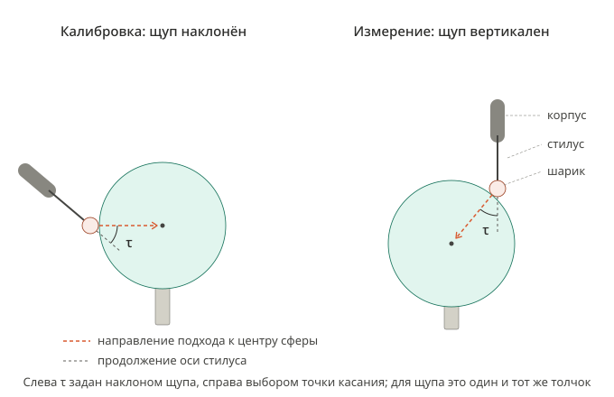
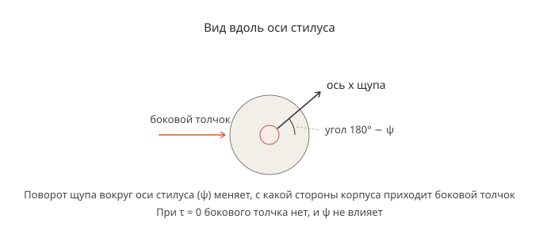
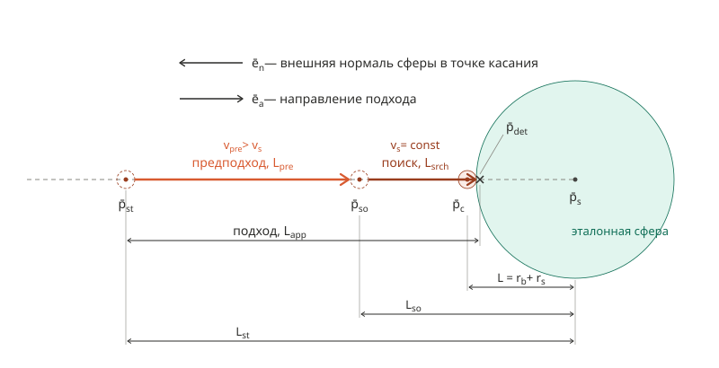

# Калибровка центра шарика контактного щупа на роботе по эталонной сфере: теория

## 1. Назначение документа и порядок исследования

Документ содержит теорию калибровки положения центра шарика контактного щупа относительно фланца промышленного робота по касаниям неподвижной эталонной сферы. Конкретное оборудование здесь не рассматривается: робот — шесть сочленений с номинальной моделью прямой задачи кинематики, щуп — шарик на стилусе с выходом срабатывания, сфера — шар известного номинального радиуса. Числа в документе взяты из публикаций с названием устройства, на котором они получены, или помечены «условно». Применение теории к конкретной установке — в документе `docs/calibration/ROBOT_PROBE_SPHERE_CALIBRATION_METHOD_RU.md` (далее «документ метода»); обозначения этого документа там сохраняются.

Для калибровочных и проверочных касаний используют одну и ту же эталонную сферу с известным номинальным радиусом. Место установки сферы не изменяют; сферу не переносят в зону касаний деталей. Наличие аттестованного значения радиуса не предполагается.

Сокращения и понятия исследования:

- КТК — критерий точности калибровки: величина, которой количественно оценивается точность калибровки.
- Фактор влияния (influence factor, IF) — величина или свойство оборудования либо плана касаний, от которого зависит КТК; факторы делятся на подфакторы (раздел 3.2).
- МНК — метод наименьших квадратов (least-squares estimation): нахождение значений искомых параметров, при которых сумма квадратов невязок — разностей наблюдаемых и расчётных значений отклика — наименьшая.
- ММК — математическая модель калибровки: зависимость КТК от факторов влияния. Математика, которая, вероятно, понадобится для ММК (модель регистрации касания, оценивание параметров по МНК, ошибки робота и найденных параметров), — в документе [`ROBOT_PROBE_SPHERE_CALIBRATION_MODELS_RU.md`](ROBOT_PROBE_SPHERE_CALIBRATION_MODELS_RU.md) (далее «модели»); как ММК она не принята. Номера формул моделей начинаются с буквы m, например (m.2.2.19).

Порядок исследования:

| <nobr>Шаг</nobr> | <nobr>Содержание</nobr>                                                                                                                                                               | <nobr>Где</nobr>                                                        | <nobr>Состояние</nobr>                                                                                                                              |
| ---------------- | ------------------------------------------------------------------------------------------------------------------------------------------------------------------------------------- | ----------------------------------------------------------------------- | --------------------------------------------------------------------------------------------------------------------------------------------------- |
| 1                | анализ литературы                                                                                                                                                                     | раздел 3                                                                | выполнен: карточки L1–L32, сводка — раздел 3.7                                                                                                      |
| 2                | определение КТК                                                                                                                                                                       | раздел 4                                                                | выполнен: КТК $\chi_{95}$ — 95-процентный квантиль модуля невязки проверочного касания (4.3.2)                                                      |
| 3                | классификация эффектов факторов на установке: способ количественного определения, вид и форма количественного представления, возможность нейтрализации, условие применимости значения | раздел 5 — признаки; документ метода, раздел 5 — классификация          | нет                                                                                                                                                 |
| 4                | эффекты факторов на КТК: величина эффектов, взаимодействия и совместные эффекты, ранжирование по данным источников                                                                    | —                                                                       | нет                                                                                                                                                 |
| 5                | ММК                                                                                                                                                                                   | модели — математика для ММК; зависимость КТК от факторов — не построена | ММК не определена; в моделях выведены модель регистрации касания и оценивание по МНК, модель ошибок робота и хода до срабатывания — только линейная |
| 6                | процедуры количественного определения эффектов факторов на конкретной установке                                                                                                       | документ метода                                                         | —                                                                                                                                                   |
| 7                | метод калибровки, при котором КТК наименьший                                                                                                                                          | документ метода                                                         | —                                                                                                                                                   |

Выводы моделей — следствия принятых в них допущений, а не выбор способа калибровки.

## 2. Термины и обозначения

### 2.1. Системы координат

- {B} — базовая система робота.
- {F} — система фланца
- {P} — система щупа: начало в центре шарика, оси параллельны осям {F}, ось z направлена от фланца вдоль стилуса.
- {S} — система сферы: начало в центре сферы, оси параллельны осям {B}.

Калибровка находит только начала {P} и {S}: центр шарика и центр сферы; оси {P} и {S} заданы этими определениями.

Матрица преобразования из системы {i} в систему {j} — однородная матрица размером $4 \times 4$, которая переводит координаты, заданные в {i}, в координаты в {j}:

$$
{}^{j}A_i = \begin{bmatrix} {}^{j}R_i & {}^{j}\bar{p}_i \\ \bar{0}^T & 1 \end{bmatrix}
$$

где ${}^{j}R_i$ — матрица поворота размером $3 \times 3$;
&emsp;&emsp;${}^{j}\bar{p}_i$ — положение начала {i}, выраженное в {j}, мм;
&emsp;&emsp;$\bar{0}$ — нулевой вектор-столбец размером $3 \times 1$.

Положение точки $a$, выраженное в {j}, обозначается ${}^{j}\bar{p}_a$, мм.

Поза фланца при касании $i$ — результат номинальной прямой задачи кинематики по углам сочленений $\bar{q}_i$:

$$
{}^{B}A_F(\bar{q}_i) = \begin{bmatrix} {}^{B}R_F(\bar{q}_i) & {}^{B}\bar{p}_F(\bar{q}_i) \\ \bar{0}^T & 1 \end{bmatrix}
$$

где $i$ — номер касания в порядке выполнения;
&emsp;&emsp;$\bar{q}_i$ — углы сочленений робота при касании $i$, °.

$R_x(\cdot)$, $R_y(\cdot)$, $R_z(\cdot)$ — матрицы поворота на указанный угол вокруг осей x, y, z.

### 2.2. Геометрия сферы и касаний

Зададим точку касания на сфере и ориентацию щупа при касании и получим направление подхода в системе {P}.

Пусть $r_b$ — радиус шарика, $r_s$ — радиус эталонной сферы, мм. Расстояние между центрами шарика и сферы в момент касания $L = r_b + r_s$, мм.

Орты обозначаются буквой $e$ с индексом оси или того вектора, чьим ортом они являются; система координат, в которой выражен орт, — левый верхний индекс.

Орт внешней нормали сферы в точке касания, выраженный в {B}:

$$
{}^{B}\bar{e}_n(\lambda,\mu) = \begin{bmatrix} \cos\lambda\cos\mu \\ \cos\lambda\sin\mu \\ \sin\lambda \end{bmatrix}
\tag{2.2.1}
$$

где $\lambda$ — широта точки касания на сфере, °;
&emsp;&emsp;$\mu$ — долгота точки касания на сфере, °; $\mu = 0$ вдоль оси x системы {B}, $\mu = 90°$ вдоль оси y.

Орт направления подхода, выраженный в {B}:

$$
{}^{B}\bar{e}_a(\lambda,\mu) = -\,{}^{B}\bar{e}_n(\lambda,\mu)
\tag{2.2.2}
$$

Пусть $\tau$ — наклон щупа (tilt), угол между осью стилуса и направлением подхода, °; $\psi$ — поворот щупа вокруг оси стилуса (roll), угол поворота системы {P} вокруг её оси z, °; начало отсчёта $\psi$ задано после (2.2.3).

У кинематических резистивных щупов Renishaw ход до срабатывания зависит от $\psi$ (L1, раздел 3.3.1).

Матрица поворота системы {P} относительно {B} при касании:

$$
{}^{B}R_P(\lambda,\mu,\tau,\psi) = R_z(\mu)\,R_y(90° - \lambda - \tau)\,R_x(180°)\,R_z(\psi)
\tag{2.2.3}
$$

Угол $\psi$ в (2.2.3) отсчитывается от ориентации, которую задают первые три множителя.

Получим орт направления подхода, выраженный в {P}. Координаты из {B} в {P} переводит матрица ${}^{B}R_P(\lambda,\mu,\tau,\psi)^T$. Подставим (2.2.2), (2.2.3) и (2.2.1), используя

$$
(M_1 M_2)^T = M_2^T M_1^T, \qquad R_x(\alpha)^T = R_x(-\alpha), \qquad R_y(\alpha)^T = R_y(-\alpha), \qquad R_z(\alpha)^T = R_z(-\alpha)
$$

где $M_1$, $M_2$ — матрицы размером $3 \times 3$;
&emsp;&emsp;$\alpha$ — угол поворота, °.

$$
\begin{gathered}
{}^{P}\bar{e}_a(\lambda,\mu,\tau,\psi) = {}^{B}R_P(\lambda,\mu,\tau,\psi)^T\,{}^{B}\bar{e}_a(\lambda,\mu) = -\,{}^{B}R_P(\lambda,\mu,\tau,\psi)^T\,{}^{B}\bar{e}_n(\lambda,\mu) =\\
= -\left(R_z(\mu)\,R_y(90° - \lambda - \tau)\,R_x(180°)\,R_z(\psi)\right)^T {}^{B}\bar{e}_n(\lambda,\mu) =\\
= -\,R_z(\psi)^T\,R_x(180°)^T\,R_y(90° - \lambda - \tau)^T\,R_z(\mu)^T\,{}^{B}\bar{e}_n(\lambda,\mu) =\\
= -\,R_z(-\psi)\,R_x(180°)\,R_y(\lambda + \tau - 90°)\,R_z(-\mu)\,{}^{B}\bar{e}_n(\lambda,\mu) =\\
= -\,R_z(-\psi)\,R_x(180°)\,R_y(\lambda + \tau - 90°) \begin{bmatrix} \cos\mu & \sin\mu & 0 \\ -\sin\mu & \cos\mu & 0 \\ 0 & 0 & 1 \end{bmatrix} \begin{bmatrix} \cos\lambda\cos\mu \\ \cos\lambda\sin\mu \\ \sin\lambda \end{bmatrix} =\\
= -\,R_z(-\psi)\,R_x(180°)\,R_y(\lambda + \tau - 90°) \begin{bmatrix} \cos\lambda\,(\cos^2\mu + \sin^2\mu) \\ \cos\lambda\,(-\sin\mu\cos\mu + \cos\mu\sin\mu) \\ \sin\lambda \end{bmatrix} = -\,R_z(-\psi)\,R_x(180°)\,R_y(\lambda + \tau - 90°) \begin{bmatrix} \cos\lambda \\ 0 \\ \sin\lambda \end{bmatrix} =\\
= -\,R_z(-\psi)\,R_x(180°) \begin{bmatrix} \cos(\lambda + \tau - 90°) & 0 & \sin(\lambda + \tau - 90°) \\ 0 & 1 & 0 \\ -\sin(\lambda + \tau - 90°) & 0 & \cos(\lambda + \tau - 90°) \end{bmatrix} \begin{bmatrix} \cos\lambda \\ 0 \\ \sin\lambda \end{bmatrix} =\\
= -\,R_z(-\psi)\,R_x(180°) \begin{bmatrix} \cos(\lambda + \tau - 90°)\cos\lambda + \sin(\lambda + \tau - 90°)\sin\lambda \\ 0 \\ -\sin(\lambda + \tau - 90°)\cos\lambda + \cos(\lambda + \tau - 90°)\sin\lambda \end{bmatrix} = -\,R_z(-\psi)\,R_x(180°) \begin{bmatrix} \cos(\tau - 90°) \\ 0 \\ \sin(90° - \tau) \end{bmatrix} =\\
= -\,R_z(-\psi)\,R_x(180°) \begin{bmatrix} \sin\tau \\ 0 \\ \cos\tau \end{bmatrix} = -\,R_z(-\psi) \begin{bmatrix} 1 & 0 & 0 \\ 0 & -1 & 0 \\ 0 & 0 & -1 \end{bmatrix} \begin{bmatrix} \sin\tau \\ 0 \\ \cos\tau \end{bmatrix} = -\,R_z(-\psi) \begin{bmatrix} \sin\tau \\ 0 \\ -\cos\tau \end{bmatrix} =\\
= -\begin{bmatrix} \cos\psi & \sin\psi & 0 \\ -\sin\psi & \cos\psi & 0 \\ 0 & 0 & 1 \end{bmatrix} \begin{bmatrix} \sin\tau \\ 0 \\ -\cos\tau \end{bmatrix} = -\begin{bmatrix} \sin\tau\cos\psi \\ -\sin\tau\sin\psi \\ -\cos\tau \end{bmatrix}
\end{gathered}
$$

Полученное выражение не содержит $\lambda$ и $\mu$:

$$
\boxed{{}^{P}\bar{e}_a(\tau,\psi) = \begin{bmatrix} -\sin\tau\cos\psi \\ \sin\tau\sin\psi \\ \cos\tau \end{bmatrix}}
\tag{2.2.4}
$$

Из (2.2.4) при $\tau = 0$ получаем ${}^{P}\bar{e}_a(0,\psi) = {}^{P}\bar{e}_z$: направление подхода совпадает с осью стилуса.

Нормальная сила в точке касания направлена противоположно направлению подхода (2.2.2), поэтому по (2.2.4) всё, что зависит от направления этой силы относительно щупа, в частности ход до срабатывания, является функцией пары $(\tau, \psi)$.

### 2.3. Движение и регистрация касания

Назовём участки движения робота при одном касании, положения TCP и центра шарика на них и величины, от которых зависит положение TCP при обнаружении касания.

- TCP (tool center point) — точка, жёстко связанная с фланцем и совпадающая с центром шарика, пока стилус не отклонён.
- Срабатывание щупа (triggering) — переключение выходного сигнала щупа.
- Обнаружение касания (touch detection) — регистрация сигнала срабатывания щупа системой управления робота.
- Центр шарика при касании, ${}^{B}\bar{p}_c$ — положение центра шарика в момент, когда шарик впервые соприкасается с эталонной сферой, мм.
- TCP при обнаружении касания, ${}^{B}\bar{p}_{det}$ — положение TCP в момент обнаружения касания, мм.
- Отклонение стилуса (stylus deflection) — путь TCP вдоль направления подхода от ${}^{B}\bar{p}_c$, мм.
- Ход до срабатывания (pretravel) — отклонение стилуса в момент срабатывания щупа, мм.
- Задержка сигнала (latency) — время от срабатывания щупа до обнаружения касания, с.
- Подход (approach), $L_{app}$ — участок пути TCP от точки старта до ${}^{B}\bar{p}_{det}$ в направлении ${}^{B}\bar{e}_a$ (2.2.2); $L_{app}$ — длина этого участка, мм.
- Предподход (pre-approach), $L_{pre}$ — участок подхода от точки старта до точки ожидания, пройденный со скоростью $v_{pre}$, мм/с, большей скорости поиска; $L_{pre}$ — длина этого участка, мм.
- Поиск (search), $L_{srch}$ — участок подхода от точки ожидания до ${}^{B}\bar{p}_{det}$, пройденный с постоянной скоростью — скоростью поиска $v_s$, мм/с; $L_{srch}$ — длина этого участка, мм.

Подход состоит из предподхода и поиска.

Точку старта и точку ожидания задают на продолжении внешней нормали сферы в точке касания:

$$
{}^{B}\bar{p}_{st} = {}^{B}\bar{p}_s + L_{st}\,{}^{B}\bar{e}_n(\lambda,\mu), \qquad {}^{B}\bar{p}_{so} = {}^{B}\bar{p}_s + L_{so}\,{}^{B}\bar{e}_n(\lambda,\mu), \qquad L < L_{so} < L_{st}
$$

где ${}^{B}\bar{p}_{st}$ — точка старта: положение TCP в начале подхода, мм;
&emsp;&emsp;${}^{B}\bar{p}_{so}$ — точка ожидания: положение TCP вблизи поверхности сферы, в котором предподход сменяется поиском, мм;
&emsp;&emsp;${}^{B}\bar{p}_s$ — центр эталонной сферы, мм;
&emsp;&emsp;$L_{st}$ — расстояние от центра эталонной сферы до точки старта, мм;
&emsp;&emsp;$L_{so}$ — расстояние от центра эталонной сферы до точки ожидания, мм.

Расстояние касания:

$$
\rho = \left\| {}^{B}\bar{p}_{det} - {}^{B}\bar{p}_s \right\|
$$

где $\rho$ — расстояние касания (contact distance), мм.

## 3. Анализ литературы

Анализ литературы — источники L1–L32 и их карточки (разделы 3.1, 3.3–3.6), перечень факторов влияния ФВ1–ФВ23 (раздел 3.2) и сводка данных источников (раздел 3.7) — вынесен в документ [`ROBOT_PROBE_SPHERE_CALIBRATION_LITERATURE_RU.md`](ROBOT_PROBE_SPHERE_CALIBRATION_LITERATURE_RU.md) (далее «анализ литературы») с той же нумерацией разделов. Ссылки этого документа на разделы 3.1–3.7 указывают на разделы анализа литературы.

## 4. Критерий точности калибровки

### 4.1. Требования к КТК

Сформулируем требования, по которым в разделе 4.2 оцениваются кандидаты в КТК (раздел 1). Основания — данные анализа литературы.

Касания различаются назначением. Для одной калибровки они выполняются в таком порядке:

1. **Калибровочные касания** — касания эталонной сферы; по ним находят центр шарика в {F}.
2. **Проверочные касания** — касания той же эталонной сферы после калибровочных. По ним оценивают результат калибровки; найденные при калибровке координаты центра шарика в {F} при этом не изменяют.
3. **Касания детали** — касания поверхности измеряемой детали после проверочных; по ним и найденному центру шарика вычисляют точки этой поверхности.

| №   | <nobr>Требование</nobr>                                                                                                                                                                                   | <nobr>Основание</nobr>                                                                                                                                                                                                                                                                                                                                                                                                                                                                                                                                                                                                                                                                                                                                                                                                       |
| --- | --------------------------------------------------------------------------------------------------------------------------------------------------------------------------------------------------------- | ---------------------------------------------------------------------------------------------------------------------------------------------------------------------------------------------------------------------------------------------------------------------------------------------------------------------------------------------------------------------------------------------------------------------------------------------------------------------------------------------------------------------------------------------------------------------------------------------------------------------------------------------------------------------------------------------------------------------------------------------------------------------------------------------------------------------------- |
| 1   | КТК вычисляется по измерениям, которые не участвуют в нахождении параметров калибровки                                                                                                                    | в L19 средняя ошибка расстояния между центрами сфер после калибровки — 0,003 мм на ориентациях эталона, по которым выполнена калибровка, и 0,086 мм на проверочных ориентациях (раздел 3.4.5); в L3 при числе итераций больше 300–500 ошибка на проверочных позах растёт, хотя целевая функция убывает (раздел 3.5.1); в L27 позиции, по которым связывают системы координат робота и средства измерения, не используются как проверяемые (раздел 3.6.1); в L28 образцовую сферу, по которой калибруют щуп, для испытаний не применяют (раздел 3.6.2); в L20 проверочные точки граней куба, по которому выполнена калибровка, не различают модели без податливости и с ней (наибольшее расстояние до грани 0,086 и 0,083 мм), а расстояния между центрами сфер различают (наибольшая ошибка 0,599 и 0,274 мм) (раздел 3.4.6) |
| 2   | КТК вычисляется по измерениям, выполненным в тех же позах робота и ориентациях щупа, что и касания деталей                                                                                                | ошибка положения точки инструмента зависит от позы: в L3 средняя ошибка в шаре Ø400 мм — 0,179 мм, во всей рабочей зоне — 0,329 мм (раздел 3.5.1); в L24 однонаправленная повторяемость (три СКО) — 30–37 мкм в позах с вытянутой рукой и 17–25 мкм в остальных (раздел 3.5.3). Ошибки зависят от ориентации инструмента: в L22 положение основания, найденное при других углах кисти, сместилось на 2,403 мм (раздел 3.4.8); в L28 систему испытывают в пяти угловых положениях головки, и эффективный диаметр наконечника в этих положениях различается (раздел 3.6.2). Фактор — $\mathrm{IF_{16}}$ (отличие поз робота при последующих измерениях от поз при калибровке)                                                                                                                                                  |
| 3   | КТК вычисляется без фактического центра шарика в {F}                                                                                                                                                      | фактический центр шарика не известен: в L3 из-за люфта между фланцем и инструментом размеры инструмента, измеренные на КИМ, не использованы, а координаты точек инструмента, найденные трекером, отличаются от чертежа на 0,465–0,690 мм (раздел 3.5.1); центр, найденный по касаниям, содержит ошибки робота: в L20 ошибка длины последнего звена 0,013 мм перешла в смещение центра шарика вдоль оси фланца (раздел 3.4.6); ни один источник не вводит критерий точности найденного центра шарика при неизменной геометрии робота (раздел 3.7.1)                                                                                                                                                                                                                                                                           |
| 4   | Если координаты точек деталей используются только в системе {B} этого робота, в КТК не входит погрешность, вызванная $\mathrm{IF_1}$ (отклонение начала кинематической цепи робота от номинальной модели) | $\mathrm{IF_1}$ смещает систему {B} целиком относительно её номинального положения; координаты точек деталей в {B} робот вычисляет и использует по одной и той же номинальной модели, поэтому смещение {B} на них не сказывается; в L19 часть параметров робота по расстояниям между центрами сфер неидентифицируема, потому что расстояния — относительные измерения (раздел 3.4.5)                                                                                                                                                                                                                                                                                                                                                                                                                                         |
| 5   | Ошибка расстояния касания входит в КТК.  Ошибка расстояния касания — разность между расстоянием касания, которое предсказывает калибровка, и фактическим расстоянием касания, мм                      | ошибка размера сферы — отдельная характеристика испытаний: ошибка диаметра в L2 (раздел 3.3.2), PSTU и PST в L28 (раздел 3.6.2), ошибка радиуса в L19 и L20 (разделы 3.4.5, 3.4.6); эффективный диаметр шарика, найденный по сфере, обычно меньше фактического (L10, раздел 3.3.9) и зависит от набора касаний (L4, раздел 3.3.3); постоянную задержку сигнала эффективный диаметр учитывает только при той же скорости, что при настройке (L29, раздел 3.6.3)                                                                                                                                                                                                                                                                                                                                                               |
| 6   | КТК — граница, которую модуль погрешности измерения положения точки детали не превышает с заданной вероятностью                                                                                           | наибольшее значение выборки зависит от её объёма: в L23 из 1000 поз ошибка больше 0,6 мм встретилась в 36, и 30 случайных поз не содержат ни одной из них с вероятностью около 30 % (раздел 3.5.2); в L3 граница по проверочным позам — среднее плюс три СКО, отнесённое к 99,73 % значений (раздел 3.5.1); вероятность границы задаётся уровнем доверия: коэффициент охвата 2 соответствует около 95 %, если распределение близко к нормальному (L31, раздел 3.6.5)                                                                                                                                                                                                                                                                                                                                                         |
| 7   | КТК рассчитывается по ММК до калибровки                                                                                                                                                                   | планы измерений сравнивают до измерений по модели: в L16 набор из 6 поз с большим индексом наблюдаемости даёт меньшую ошибку, чем набор из 12 поз с меньшим индексом (раздел 3.4.2); в L18 индексы сравнивают моделированием калибровки (раздел 3.4.4); метод Монте-Карло даёт квантиль выходной величины по распределениям входных величин (L32, раздел 3.6.6)                                                                                                                                                                                                                                                                                                                                                                                                                                                              |

### 4.2. Сравнение кандидатов

Сравним критерии источников с требованиями 1–6 раздела 4.1 и определим, какой критерий принимается за КТК.

Кандидаты — критерии раздела 3.7.1, которыми оценивают погрешность найденного центра шарика или погрешность измерения положения точек деталей.

Требование 7 выполняют все кандидаты: каждый можно рассчитать по модели до калибровки; в таблицу оно не включено.

В столбцах 1–6: «да» — кандидат выполняет требование с этим номером, «нет» — не выполняет.

| <nobr>Кандидат</nobr>                                                       | <nobr>Источники</nobr> | 1   | 2   | 3   | 4   | 5   | 6   | <nobr>Невыполненные</nobr> <nobr>требования</nobr>                                                                                                                               |
| --------------------------------------------------------------------------- | ---------------------- | --- | --- | --- | --- | --- | --- | -------------------------------------------------------------------------------------------------------------------------------------------------------------------------------- |
| СКО найденного центра шарика по ковариационной матрице найденных параметров | L15, L17, L21, L26     | нет | нет | да  | да  | нет | нет | 1, 2: вычисляется по калибровочным касаниям; 5: расстояние касания не входит; 6: СКО параметра не задаёт границы погрешности измерения положения точки детали                    |
| погрешность формы по калибровочным касаниям                                 | L2, L10, L14, L28      | нет | нет | да  | да  | нет | нет | 1, 2: вычисляется по калибровочным касаниям; 5: размах расстояний до центра сферы МНК не содержит ошибки размера; 6: размах зависит от числа касаний                             |
| ошибка положения точки инструмента по внешнему средству измерения           | L3, L21–L23            | да  | да  | да  | нет | нет | да  | 4: внешнее средство связано с цехом, в ошибку входит погрешность, вызванная $\mathrm{IF_1}$ (отклонение начала кинематической цепи робота от номинальной модели); 5: касаний нет |
| ошибка расстояния между центрами двух сфер                                  | L11, L19, L20          | да  | да  | да  | да  | нет | нет | 5: расстояние между центрами от расстояния касания не зависит; 6: среднее, наибольшее значение и СКО по нескольким расстояниям не задают границы с вероятностью                  |
| PFT, PST, PLT по нескольким ориентациям                                     | L28                    | да  | да  | да  | да  | да  | нет | 6: PFT и PLT — размахи, PST — отклонение диаметра; ни одна характеристика не задаёт границы с вероятностью                                                                       |
| расширенная неопределённость центра шарика                                  | L31                    | нет | нет | нет | да  | нет | да  | 3: измеряемая величина — фактический центр шарика; 1, 2: оценивается по калибровочным касаниям; 5: расстояние касания не входит                                                  |

Ни один критерий источников не выполняет все требования 1–6. Поэтому вводится новый критерий — 95-процентный квантиль модуля невязки проверочного касания. Невязка проверочного касания — разность между наблюдаемым и расчётным значениями отклика (в Р 50.1.040-2002, п. 1.21, — остаток). Отклик — расстояние от рассчитанного центра шарика до центра эталонной сферы, найденного по проверочным касаниям; расчётное значение — расстояние касания, найденное калибровкой. Невязка равна отклонению точки, вычисленной по проверочному касанию, от поверхности эталонной сферы вдоль нормали, мм. Этот критерий принимается за КТК; вероятность 0,95 обоснована в разделе 4.3, там же дано полное определение. Требования он выполняет так:

1. Проверочные касания в нахождении параметров калибровки не участвуют.
2. Проверочные касания выполняют в тех же ориентациях щупа, что и касания деталей, поэтому невязка проверочного касания оценивает погрешность измерения положения точки детали в этих ориентациях. Позы робота совпадают с позами касаний деталей, только если детали измеряют в зоне эталонной сферы: сферу не переносят (раздел 1).
3. Центр эталонной сферы находят МНК по проверочным касаниям; фактический центр шарика не нужен.
4. Центр эталонной сферы находят в системе {B}, поэтому смещение {B}, вызванное $\mathrm{IF}_1$ (отклонение начала кинематической цепи робота от номинальной модели), в невязку не входит.
5. Отклонение фактического расстояния касания от найденного калибровкой входит в невязку. Отклонение радиуса эталонной сферы от номинального в невязку не входит: калибровочные и проверочные касания выполняют на одной сфере (раздел 1).
6. Квантиль — граница, которую модуль невязки не превышает с вероятностью 0,95.

Из испытания L28 взята проверка в нескольких угловых положениях щупа. Вместо характеристик PFT, PLT и PST новый критерий даёт одну границу с вероятностью 0,95.

### 4.3. Определение КТК

Зададим проверочные касания, невязку проверочного касания и КТК.

Проверочные касания выполняют в тех же ориентациях щупа и с той же скоростью поиска, что и касания деталей. Направления подхода распределяют по всей части эталонной сферы, до которой достаёт щуп. Пусть $m_{\mathrm{ver}}$ — число проверочных касаний.

Рассчитанный центр шарика при проверочном касании $i$:

$$
{}^{B}\hat{\bar{p}}_r(\bar{q}_i) = {}^{B}\bar{p}_F(\bar{q}_i) + {}^{B}R_F(\bar{q}_i)\,{}^{F}\hat{\bar{p}}_r
$$

где $i = 1, \ldots, m_{\mathrm{ver}}$ — номер проверочного касания;
&emsp;&emsp;${}^{F}\hat{\bar{p}}_r$ — центр шарика в {F}, найденный калибровкой, мм;
&emsp;&emsp;${}^{B}\hat{\bar{p}}_r(\bar{q}_i)$ — рассчитанный центр шарика при проверочном касании $i$, мм.

Точку поверхности сферы вычисляют, сдвигая рассчитанный центр шарика к центру сферы на эффективный радиус шарика:

$$
r_{eff} = \hat{\rho} - r_s
$$

где $r_{eff}$ — эффективный радиус шарика, мм;
&emsp;&emsp;$\hat{\rho}$ — расстояние касания эталонной сферы, найденное калибровкой; если метод калибровки его не находит, $\hat{\rho} = L$ (раздел 2.2), мм;
&emsp;&emsp;$r_s$ — радиус эталонной сферы (раздел 2.2), мм.

Невязка проверочного касания (раздел 4.2) равна расстоянию от вычисленной точки до центра эталонной сферы минус $r_s$. Вычисленная точка лежит на отрезке между рассчитанным центром шарика и центром сферы, на расстоянии $r_{eff}$ от центра шарика. Подставим $r_{eff}$:

$$
\begin{gathered}
\varepsilon_{\mathrm{ver},i} = \left\| {}^{B}\hat{\bar{p}}_r(\bar{q}_i) - {}^{B}\hat{\bar{p}}_{\mathrm{ver}} \right\| - r_{eff} - r_s =\\
= \left\| {}^{B}\hat{\bar{p}}_r(\bar{q}_i) - {}^{B}\hat{\bar{p}}_{\mathrm{ver}} \right\| - \left(\hat{\rho} - r_s\right) - r_s =\\
= \left\| {}^{B}\hat{\bar{p}}_r(\bar{q}_i) - {}^{B}\hat{\bar{p}}_{\mathrm{ver}} \right\| - \hat{\rho} + r_s - r_s =\\
= \left\| {}^{B}\hat{\bar{p}}_r(\bar{q}_i) - {}^{B}\hat{\bar{p}}_{\mathrm{ver}} \right\| - \hat{\rho}
\end{gathered}
$$

$$
\boxed{\varepsilon_{\mathrm{ver},i} = \left\| {}^{B}\hat{\bar{p}}_r(\bar{q}_i) - {}^{B}\hat{\bar{p}}_{\mathrm{ver}} \right\| - \hat{\rho}}
\tag{4.3.1}
$$

где $\varepsilon_{\mathrm{ver},i}$ — невязка проверочного касания $i$, мм;
&emsp;&emsp;${}^{B}\hat{\bar{p}}_{\mathrm{ver}}$ — центр эталонной сферы, найденный МНК по проверочным касаниям при неизменных ${}^{F}\hat{\bar{p}}_r$ и $\hat{\rho}$, мм.

Центр сферы находят заново по проверочным касаниям, а не берут из калибровки: так в невязку не входит смещение {B}, вызванное $\mathrm{IF}_1$ (отклонение начала кинематической цепи робота от номинальной модели).

КТК:

$$
\Pr\left(\left|\varepsilon_{\mathrm{ver}}\right| \le \chi_{95}\right) = 0{,}95
\tag{4.3.2}
$$

где $\chi_{95}$ — КТК, мм: 95-процентный квантиль распределения $\left|\varepsilon_{\mathrm{ver}}\right|$;
&emsp;&emsp;$\Pr(\cdot)$ — вероятность;
&emsp;&emsp;$\varepsilon_{\mathrm{ver}}$ — невязка (4.3.1) случайно выбранного проверочного касания.

По выполненным проверочным касаниям $\chi_{95}$ оценивают так: значения $\left|\varepsilon_{\mathrm{ver},i}\right|$ упорядочивают по возрастанию и берут значение с номером $\lceil 0{,}95\,m_{\mathrm{ver}} \rceil$. Пример с условными значениями: по 25 касаний в двух ориентациях, $m_{\mathrm{ver}} = 50$, $\lceil 47{,}5 \rceil = 48$ — берут 48-е значение. До калибровки $\chi_{95}$ рассчитывают по ММК (раздел 1, шаг 5): находят распределение невязки (4.3.1), например методом Монте-Карло (L32, раздел 3.6.6), и берут его 95-процентный квантиль.

Вероятность 0,95 выбрана по трём основаниям:

1. Коэффициент охвата 2 соответствует уровню доверия около 95 %, если распределение близко к нормальному (L31, раздел 3.6.5).
2. У робота ABB IRB 1600 распределение ошибки положения после калибровки близко к нормальному (L23, раздел 3.5.2).
3. Квантиль 0,95 оценивается уже по 50 касаниям: это 48-е значение из 50. Квантиль 0,9973 — граница «среднее плюс три СКО» в L3 (раздел 3.5.1); СКО — среднее квадратическое отклонение (РМГ 29-2013, п. 5.18). Оценка квантиля 0,9973 совпадает с наибольшим значением выборки при $m_{\mathrm{ver}} \le 370$: номер $\lceil 0{,}9973\,m_{\mathrm{ver}} \rceil$ меньше $m_{\mathrm{ver}}$ только при $0{,}0027\,m_{\mathrm{ver}} \ge 1$. Наибольшее значение выборки зависит от её объёма, поэтому по требованию 6 оно не подходит.

Предельного значения КТК не задаёт: на шаге 7 выбирают метод калибровки с наименьшим $\chi_{95}$.

## 5. Классификация факторов влияния и их эффектов

Определим отклик, эффекты факторов влияния на отклик, совместные эффекты и признаки, по которым на шаге 3 каждый эффект классифицируют для конкретной установки. В классификации записывают условия нейтрализации и применимости; выполнять ли их, решают на шаге 7 вместе с выбором метода калибровки.

Основные термины раздела:

| №    | <nobr>Термин</nobr>                                         | <nobr>Определение</nobr>                                                                                          | <nobr>Источник</nobr>                   |
| ---- | ----------------------------------------------------------- | ----------------------------------------------------------------------------------------------------------------- | --------------------------------------- |
| т.1  | <nobr>отклик</nobr>                                         | переменная, представляющая результат эксперимента                                                                 | Р 50.1.040-2002, п. 1.2                 |
| т.2  | <nobr>предсказывающая</nobr> <nobr>переменная</nobr>        | переменная, которая может помочь объяснить результат эксперимента                                                 | Р 50.1.040-2002, п. 1.3                 |
| т.3  | <nobr>фактор</nobr>                                         | предсказывающая переменная, варьируемая с целью определения её влияния на отклик                                  | Р 50.1.040-2002, п. 1.5                 |
| т.4  | <nobr>уровень</nobr> <nobr>фактора</nobr>                   | потенциальная установка, значение или назначение фактора                                                          | Р 50.1.040-2002, п. 1.6                 |
| т.5  | <nobr>главный</nobr> <nobr>эффект</nobr>                    | влияние отдельного фактора на среднее значение отклика                                                            | Р 50.1.040-2002, п. 1.13                |
| т.6  | <nobr>эффект</nobr> <nobr>рассеивания</nobr>                | влияние отдельного фактора на дисперсию отклика                                                                   | Р 50.1.040-2002, п. 1.14                |
| т.7  | <nobr>взаимодействие</nobr> <nobr>факторов</nobr>           | ситуация, когда проявленное влияние одного фактора на отклик зависит от других факторов                           | Р 50.1.040-2002, п. 1.17                |
| т.8  | <nobr>смешивание</nobr> <nobr>эффектов</nobr>               | намеренное объединение двух и более эффектов так, чтобы они были неразличимы                                      | Р 50.1.040-2002, п. 1.18                |
| т.9  | <nobr>совместный</nobr> <nobr>эффект</nobr>                 | эффект, который полностью смешивается с другим эффектом из-за природы эксперимента                                | Р 50.1.040-2002, п. 1.19                |
| т.10 | <nobr>невязка</nobr>                                        | разница между наблюдаемым и предсказанным или расчётным значениями отклика; в стандарте — остаток                 | Р 50.1.040-2002, п. 1.21                |
| т.11 | <nobr>повторение</nobr>                                     | выполнение эксперимента более чем один раз для данного набора предсказывающих переменных                          | Р 50.1.040-2002, п. 1.27                |
| т.12 | <nobr>номинальный</nobr> <nobr>уровень</nobr>               | уровень, при котором фактор не изменяет отклик; есть у $\mathrm{IF}_1$–$\mathrm{IF}_{15}$                         | раздел 5.1                              |
| т.13 | <nobr>эффект</nobr> <nobr>фактора</nobr>                    | разность невязок при двух уровнях фактора; для $\mathrm{IF}_1$–$\mathrm{IF}_{15}$ — при фактическом и номинальном | формулы (5.1.1), (5.1.2)                |
| т.14 | <nobr>смешанный</nobr> <nobr>эффект</nobr>                  | эффект фактора, у которого есть совместные эффекты                                                                | раздел 5.3                              |
| т.15 | <nobr>условия</nobr> <nobr>касания</nobr>                   | величины, которые задают касание при его выполнении и от которых зависит невязка касания                          | раздел 5                                |

Термины планирования эксперимента — по Р 50.1.040-2002. Факторы влияния и их подфакторы (раздел 3.2 анализа литературы) — предсказывающие переменные (т.2). Допущение: каждый из них считается фактором в смысле т.3, потому что его уровень в принципе можно изменить, хотя на установке варьируют только подфакторы $\mathrm{IF}_{16}$.

В разделе 5 рассматривается влияние факторов на КТК. Отклик в этой задаче — невязка проверочного касания $\varepsilon_{\mathrm{ver},i}$ (4.3.1): по ней вычисляют КТК (4.3.2).

### 5.1. Отклик и эффект фактора

Дадим теоретическое определение эффекта фактора — изменения отклика, которое вызывает один фактор.

Факторы влияния $\mathrm{IF}_k$ и их подфакторы $\mathrm{IF}_k^{j}$ — по разделу 3.2 анализа литературы. Пусть $c$ — один выделенный фактор: подфактор $\mathrm{IF}_k^{j}$ или фактор $\mathrm{IF}_k$ без подфакторов.

Эффект фактора — изменение отклика при переходе фактора с одного уровня (т.4) на другой (Р 50.1.040-2002, пояснение к п. 1.13):

$$
\Delta_{c,i}(a,b) = \varepsilon_{\mathrm{ver},i}\big|_{c=a} - \varepsilon_{\mathrm{ver},i}\big|_{c=b}
\tag{5.1.1}
$$

где $\Delta_{c,i}(a,b)$ — эффект фактора $c$ на невязку проверочного касания $i$ при переходе с уровня $b$ на уровень $a$, мм;
&emsp;&emsp;$a$, $b$ — уровни фактора $c$, при каждом из которых выполняется проверочное касание $i$;
&emsp;&emsp;$\varepsilon_{\mathrm{ver},i}\big|_{c=a}$ — невязка (4.3.1) касания $i$, если калибровку и проверочные касания выполнили при уровне $a$ фактора $c$ и фактических уровнях остальных факторов, мм.

У факторов $\mathrm{IF}_1$–$\mathrm{IF}_{15}$ есть номинальный уровень — уровень, при котором фактор не изменяет отклик: отклонения от номинальной модели робота и от номинальных размеров равны нулю, ход до срабатывания и задержка сигнала равны нулю, рассеяния нет. Номинальный уровень не обязательно число: например, у $\mathrm{IF}_{13}^{5}$ (загрязнение шарика) это отсутствие загрязнения. Эффект такого фактора берут при переходе с номинального уровня на фактический. Подставим в (5.1.1) $a = c_{\mathrm{act}}$, $b = c_{\mathrm{nom}}$; при фактических уровнях всех факторов невязка — (4.3.1):

$$
\begin{gathered}
\Delta_{c,i}(c_{\mathrm{act}}, c_{\mathrm{nom}}) = \varepsilon_{\mathrm{ver},i}\big|_{c=c_{\mathrm{act}}} - \varepsilon_{\mathrm{ver},i}\big|_{c=c_{\mathrm{nom}}} =\\
= \varepsilon_{\mathrm{ver},i} - \varepsilon_{\mathrm{ver},i}\big|_{c=c_{\mathrm{nom}}}
\end{gathered}
$$

$$
\boxed{\Delta_{c,i} = \varepsilon_{\mathrm{ver},i} - \varepsilon_{\mathrm{ver},i}\big|_{c=c_{\mathrm{nom}}}}
\tag{5.1.2}
$$

где $\Delta_{c,i} = \Delta_{c,i}(c_{\mathrm{act}}, c_{\mathrm{nom}})$ — эффект фактора $c$ на невязку проверочного касания $i$, мм;
&emsp;&emsp;$c_{\mathrm{act}}$ — фактический уровень фактора $c$;
&emsp;&emsp;$c_{\mathrm{nom}}$ — номинальный уровень фактора $c$.

Большинство факторов на номинальный уровень поставить нельзя, поэтому (5.1.2) — определение эффекта, а не способ его измерения. Способы получить значение эффекта — признак 1 (раздел 5.4).

У подфакторов $\mathrm{IF}_{16}$ (состав, последовательность и условия выполнения касаний) номинального уровня нет. Их уровни вместе образуют план эксперимента (Р 50.1.040-2002, п. 1.30): назначение каждому калибровочному и проверочному касанию точки на сфере, направления подхода, ориентации щупа, скорости поиска и движения перед касанием, а также порядка касаний и числа их повторений. Эффект подфактора $\mathrm{IF}_{16}$ — (5.1.1), где $a$ и $b$ — два плана. Если $\mathrm{IF}_1$–$\mathrm{IF}_{15}$ на номинальных уровнях, касания точные; если по касаниям плана параметры калибровки определяются однозначно, калибровка находит их фактические значения и $\varepsilon_{\mathrm{ver},i} = 0$. Поэтому эффект подфактора $\mathrm{IF}_{16}$ отличен от нуля, только если $\mathrm{IF}_1$–$\mathrm{IF}_{15}$ не на номинальных уровнях (взаимодействие, т.7) или если по касаниям одного из двух планов параметры калибровки определяются неоднозначно.

### 5.2. Главный эффект и эффект рассеивания

Разделим эффект (5.1.2) на изменение среднего значения отклика и изменение его дисперсии.

Повторение $u$ касания $i$ — повторное выполнение калибровки и проверочного касания $i$ при тех же уровнях всех факторов (т.11). Уровень $\mathrm{IF}_5$ (тепловые деформации) меняется со временем от включения робота, поэтому повторения выполняют при том же тепловом состоянии.

$$
\boxed{\theta_{c,i} = \lim_{m_{\mathrm{rep}} \to \infty} \frac{1}{m_{\mathrm{rep}}} \sum_{u=1}^{m_{\mathrm{rep}}} \Delta_{c,i,u},
\qquad
\xi_{c,i,u} = \Delta_{c,i,u} - \theta_{c,i},
\qquad
\sigma_{c,i}^2 = \lim_{m_{\mathrm{rep}} \to \infty} \frac{1}{m_{\mathrm{rep}}} \sum_{u=1}^{m_{\mathrm{rep}}} \xi_{c,i,u}^2}
\tag{5.2.1}
$$

где $\theta_{c,i}$ — среднее значение эффекта фактора $c$ на невязку касания $i$, мм;
&emsp;&emsp;$\xi_{c,i,u}$ — случайное отклонение эффекта в повторении $u$ от его среднего значения, мм;
&emsp;&emsp;$\sigma_{c,i}^2$ — дисперсия эффекта, мм²;
&emsp;&emsp;$\Delta_{c,i,u}$ — эффект (5.1.2) в повторении $u$ касания $i$, мм;
&emsp;&emsp;$u$ — номер повторения касания $i$;
&emsp;&emsp;$m_{\mathrm{rep}}$ — число повторений касания $i$.

Из (5.2.1) среднее $\xi_{c,i,u}$ по неограниченному числу повторений равно нулю.

Покажем, что $\theta_{c,i}$ — главный эффект фактора $c$ (т.5: влияние на среднее значение отклика). Из (5.1.2) $\varepsilon_{\mathrm{ver},i,u} = \varepsilon_{\mathrm{ver},i,u}\big|_{c=c_{\mathrm{nom}}} + \Delta_{c,i,u}$. Подставим $\Delta_{c,i,u}$ из второго равенства (5.2.1) и усредним по повторениям; $\mathrm{E}[\cdot]$ — среднее по неограниченному числу повторений, $\mathrm{E}[\xi_{c,i,u}] = 0$:

$$
\mathrm{E}\left[\varepsilon_{\mathrm{ver},i,u}\right] = \mathrm{E}\left[\varepsilon_{\mathrm{ver},i,u}\big|_{c=c_{\mathrm{nom}}} + \theta_{c,i} + \xi_{c,i,u}\right] = \mathrm{E}\left[\varepsilon_{\mathrm{ver},i,u}\big|_{c=c_{\mathrm{nom}}}\right] + \theta_{c,i} + \mathrm{E}\left[\xi_{c,i,u}\right] = \mathrm{E}\left[\varepsilon_{\mathrm{ver},i,u}\big|_{c=c_{\mathrm{nom}}}\right] + \theta_{c,i}
$$

Покажем, что $\sigma_{c,i}^2$ — эффект рассеивания фактора $c$ (т.6: влияние на дисперсию отклика), если $\xi_{c,i,u}$ не коррелирует с $\varepsilon_{\mathrm{ver},i,u}\big|_{c=c_{\mathrm{nom}}}$. Обозначим $\mathrm{D}[\cdot]$ дисперсию по повторениям. Постоянное слагаемое $\theta_{c,i}$ дисперсию не меняет; ковариация некоррелированных величин равна нулю:

$$
\begin{gathered}
\mathrm{D}\left[\varepsilon_{\mathrm{ver},i,u}\right] = \mathrm{D}\left[\varepsilon_{\mathrm{ver},i,u}\big|_{c=c_{\mathrm{nom}}} + \theta_{c,i} + \xi_{c,i,u}\right] = \mathrm{D}\left[\varepsilon_{\mathrm{ver},i,u}\big|_{c=c_{\mathrm{nom}}} + \xi_{c,i,u}\right] =\\
= \mathrm{D}\left[\varepsilon_{\mathrm{ver},i,u}\big|_{c=c_{\mathrm{nom}}}\right] + \mathrm{D}\left[\xi_{c,i,u}\right] + 2\operatorname{cov}\left(\varepsilon_{\mathrm{ver},i,u}\big|_{c=c_{\mathrm{nom}}}, \xi_{c,i,u}\right) = \mathrm{D}\left[\varepsilon_{\mathrm{ver},i,u}\big|_{c=c_{\mathrm{nom}}}\right] + \sigma_{c,i}^2
\end{gathered}
$$

Какие из двух эффектов фактора отличны от нуля, заранее не известно; это устанавливают для конкретной установки по признаку 2 (раздел 5.4).

Для подфакторов $\mathrm{IF}_{16}$ формулы (5.2.1) и оба вывода этого раздела сохраняются, если заменить $\Delta_{c,i,u}$ на $\Delta_{c,i,u}(a,b)$ (5.1.1), $\varepsilon_{\mathrm{ver},i,u}$ — на $\varepsilon_{\mathrm{ver},i,u}\big|_{c=a}$, а $\varepsilon_{\mathrm{ver},i,u}\big|_{c=c_{\mathrm{nom}}}$ — на $\varepsilon_{\mathrm{ver},i,u}\big|_{c=b}$; тогда $\theta_{c,i}$, $\xi_{c,i,u}$ и $\sigma_{c,i}^2$ зависят от пары планов $(a, b)$.

### 5.3. Совместные эффекты

Определим совместные эффекты и эффект группы факторов с совместными эффектами.

Эффекты факторов $c$ и $c'$ совместные (т.9), если существуют два набора уровней этих факторов, в которых различаются уровни и $c$, и $c'$, а результаты всех измерений, доступных на установке, совпадают. Тогда эффект каждого из двух факторов отдельно получить нельзя.

$$
J_c \subseteq \mathcal{C} \setminus \{c\}, \qquad c \in G_c \subseteq \mathcal{C}
$$

где $\mathcal{C}$ — множество всех факторов в смысле раздела 5;
&emsp;&emsp;$J_c$ — множество факторов, эффекты которых совместны с эффектом фактора $c$;
&emsp;&emsp;$G_c$ — группа факторов с совместными эффектами: наименьшее множество факторов, которое содержит $c$ и вместе с каждым своим фактором содержит все факторы, эффекты которых совместны с его эффектом.

- Несмешанный эффект фактора $c$ — эффект, у которого нет совместных: $J_c = \varnothing$, $G_c = \{c\}$.
- Смешанный эффект фактора $c$ — эффект, у которого есть совместные: $J_c \ne \varnothing$.

Пример применения определения: если разброс повторений одного касания — единственное измерение на установке, в котором проявляются $\mathrm{IF}_7$ (повторяемость позиционирования робота), $\mathrm{IF}_9$ (ход до срабатывания щупа) и $\mathrm{IF}_{15}^{1}$ (задержка обнаружения касания), то их эффекты рассеивания совместны: одинаковый разброс дают разные сочетания уровней этих факторов.

Для смешанного эффекта из измерений на установке можно получить только эффект всей группы $G_c$:

$$
\Delta_{G_c,i} = \varepsilon_{\mathrm{ver},i} - \varepsilon_{\mathrm{ver},i}\big|_{G_c=G_{c,\mathrm{nom}}}
\tag{5.3.1}
$$

где $\Delta_{G_c,i}$ — эффект факторов группы $G_c$ на невязку проверочного касания $i$, мм;
&emsp;&emsp;$G_{c,\mathrm{nom}}$ — номинальные уровни всех факторов группы $G_c$;
&emsp;&emsp;$\varepsilon_{\mathrm{ver},i}\big|_{G_c=G_{c,\mathrm{nom}}}$ — невязка (4.3.1) того же касания, если бы калибровку и проверочное касание выполнили при уровнях $G_{c,\mathrm{nom}}$ и фактических уровнях остальных факторов, мм.

Подставим $\Delta_{G_c,i,u}$ из (5.3.1) в (5.2.1) вместо $\Delta_{c,i,u}$:

$$
\boxed{\theta_{G_c,i} = \lim_{m_{\mathrm{rep}} \to \infty} \frac{1}{m_{\mathrm{rep}}} \sum_{u=1}^{m_{\mathrm{rep}}} \Delta_{G_c,i,u},
\qquad
\xi_{G_c,i,u} = \Delta_{G_c,i,u} - \theta_{G_c,i},
\qquad
\sigma_{G_c,i}^2 = \lim_{m_{\mathrm{rep}} \to \infty} \frac{1}{m_{\mathrm{rep}}} \sum_{u=1}^{m_{\mathrm{rep}}} \xi_{G_c,i,u}^2}
\tag{5.3.2}
$$

где $\theta_{G_c,i}$ — главный эффект группы $G_c$ на невязку касания $i$, мм;
&emsp;&emsp;$\xi_{G_c,i,u}$ — случайное отклонение эффекта группы $G_c$ в повторении $u$ от его среднего значения, мм;
&emsp;&emsp;$\sigma_{G_c,i}^2$ — эффект рассеивания группы $G_c$, мм²;
&emsp;&emsp;$\Delta_{G_c,i,u}$ — эффект (5.3.1) в повторении $u$ касания $i$, мм.

Для несмешанного эффекта $G_c = \{c\}$, поэтому (5.3.1) совпадает с (5.1.2), а (5.3.2) — с (5.2.1). Эффект группы $\Delta_{G_c,i}$ равен сумме эффектов (5.1.2) её факторов, если между ними нет взаимодействия (т.7).

### 5.4. Признаки классификации эффектов

Зададим признаки, по которым для конкретной установки классифицируют каждый эффект факторов $\mathrm{IF}_1$–$\mathrm{IF}_{15}$: несмешанного фактора (5.2.1) или группы факторов с совместными эффектами (5.3.2).

Подфакторы $\mathrm{IF}_{16}$ не классифицируют: их уровни образуют план эксперимента (раздел 5.1), а план — условие метода калибровки, которое выбирают на шаге 7. План, при котором $\chi_{95}$ (4.3.2) наименьший, — оптимальный план (Р 50.1.040-2002, п. 2.7) с критерием $\chi_{95}$. Условия нейтрализации (признак 3) и применимости (признак 4) эффектов $\mathrm{IF}_1$–$\mathrm{IF}_{15}$ выбирают вместе с планом.

**Признак 1. Способ количественного определения.** Критерий: каким способом или способами получают значение эффекта на конкретной установке.

Модель измерений эффекта — уравнения связи результатов прямых измерений (углов сочленений в моменты обнаружения касаний, показаний средств измерений) с эффектом и другими неизвестными (РМГ 29-2013, п. 5.28).

| <nobr>Категория</nobr>                                          | <nobr>Как</nobr> <nobr>получают</nobr> <nobr>значение</nobr> <nobr>эффекта</nobr> | <nobr>Эффект</nobr> <nobr>относится</nobr> к <nobr>категории,</nobr> <nobr>если</nobr>                                          |
| --------------------------------------------------------------- | --------------------------------------------------------------------------------- | ------------------------------------------------------------------------------------------------------------------------------- |
| документация                                                    | берут из паспорта, сертификата или стандарта на применяемое оборудование          | документ указывает значение, условия, при которых оно получено, и вид характеристики: номинал, допуск или СКО с уровнем доверия |
| расчёт                                                          | вычисляют по физической зависимости                                               | все аргументы зависимости известны без измерений на установке                                                                   |
| прямое измерение (РМГ 29-2013, п. 4.19)                         | получают непосредственно от средства измерений                                    | показание средства измерений есть значение эффекта                                                                              |
| косвенное измерение (РМГ 29-2013, п. 4.20) несмешанного эффекта | вычисляют по модели измерений                                                     | модель измерений есть, $J_c = \varnothing$                                                                                      |
| косвенное измерение смешанного эффекта                          | вычисляют по модели измерений только эффект группы $G_c$ (5.3.1)                  | модель измерений есть, $J_c \ne \varnothing$                                                                                    |
| нет способа                                                     | значение не получают                                                              | эффект не относится ни к одной категории выше                                                                                   |

Числа из источников раздела 3 получены на другом оборудовании (раздел 3.7.2): для конкретной установки они служат только гипотезами о порядке величины и способом количественного определения не являются. Модель эффекта из источника даёт значение только после проверки по проверочным касаниям на установке.

**Признак 2. Вид и форма количественного представления.** Критерий: какие из эффектов (5.2.1) или (5.3.2) отличны от нуля и в каком виде записано значение каждого из них. Вид эффекта устанавливают тем же способом, что и его значение (признак 1), например по повторениям касаний; у эффекта без способа количественного определения вид не устанавливают.

| <nobr>Вид</nobr> <nobr>эффекта</nobr>                        | <nobr>Что</nobr> <nobr>записывается</nobr>                                                                                    |
| ------------------------------------------------------------ | ----------------------------------------------------------------------------------------------------------------------------- |
| <nobr>главный</nobr>                                         | значение главного эффекта: число; функция условий касания с числовыми коэффициентами; нижняя граница, верхняя граница или обе |
| <nobr>рассеивания</nobr>                                     | закон распределения случайного отклонения с параметрами; верхняя граница СКО или размаха                                      |
| <nobr>главный</nobr> <nobr>и</nobr> <nobr>рассеивания</nobr> | обе записи                                                                                                                    |

**Признак 3. Возможность нейтрализации.** Критерий: существует ли условие метода калибровки, при котором эффект (5.1.2) или (5.3.1) равен нулю во всех проверочных касаниях и поэтому не входит в КТК. Так бывает, если фактор не действует или действует одинаково в калибровочных касаниях, проверочных касаниях и касаниях деталей и его действие целиком учитывается параметрами, найденными калибровкой.

| <nobr>Категория</nobr> | <nobr>Что</nobr> <nobr>записывается</nobr> |
| ---------------------- | ------------------------------------------ |
| да                     | условие нейтрализации                      |
| нет                    | ничего                                     |

**Признак 4. Условие применимости значения.** Критерий: при каких условиях касания значение эффекта, полученное способом из признака 1, верно в калибровочных касаниях, проверочных касаниях и касаниях деталей.

| <nobr>Категория</nobr>                | <nobr>Что</nobr> <nobr>записывается</nobr>                                                                             |
| ------------------------------------- | ---------------------------------------------------------------------------------------------------------------------- |
| <nobr>без</nobr> <nobr>условия</nobr> | ничего: значение не зависит от условий касания                                                                         |
| <nobr>с</nobr> <nobr>условием</nobr>  | условия касания, при которых получено значение; в касаниях, где значение используют, эти условия должны быть такими же |

**Сочетания признаков 1, 3 и 4.**

| №   | <nobr>Способ</nobr> <nobr>(признак</nobr> 1)                                 | <nobr>Нейтрализация</nobr> <nobr>(признак</nobr> 3) | <nobr>Шаг</nobr> 5 — <nobr>ММК</nobr>                                                            | <nobr>Шаг</nobr> 6 — <nobr>определение</nobr> <nobr>значения</nobr>         | <nobr>Шаг</nobr> 7 — <nobr>выбор</nobr> <nobr>метода</nobr>                                                                                                                                                     |
| --- | ---------------------------------------------------------------------------- | --------------------------------------------------- | ------------------------------------------------------------------------------------------------ | --------------------------------------------------------------------------- | --------------------------------------------------------------------------------------------------------------------------------------------------------------------------------------------------------------- |
| 1   | есть                                                                         | нет                                                 | входит в виде записи из признака 2                                                               | значение определяют способом из признака 1                                  | метод выполняет условие применимости (признак 4); если не выполняет, значение не используется, и эффект переходит в строку 4                                                                                    |
| 2   | есть                                                                         | да                                                  | входит в виде записи из признака 2; при выполненном условии нейтрализации эффект в КТК не входит | значение определяют на случай, если метод не выполнит условие нейтрализации | метод решает, выполнять ли условие нейтрализации; если не выполняет — как в строке 1                                                                                                                            |
| 3   | нет                                                                          | да                                                  | входит только условием нейтрализации: при выполненном условии эффект в КТК не входит             | значение не определяют                                                      | условие нейтрализации обязательно; если оно не выполнено, эффект переходит в строку 4                                                                                                                           |
| 4   | нет                                                                          | нет                                                 | не входит                                                                                        | значение не определяют                                                      | от эффекта зависит только измеренный $\chi_{95}$ (4.3.2); числа источников о нём (раздел 3.7.2) — гипотеза; для её проверки нужно средство определения эффекта или метод, результат которого от него не зависит |
| 5   | эффект фактора $c' \in J_c$, совместный с эффектом $c$: отдельно способа нет | по своему признаку 3                                | отдельно не входит: входит в эффект группы $G_c$                                                 | отдельно не определяют                                                      | если значение эффекта группы не используется, эффект $c'$ переходит в строку 3 или 4 по своему признаку 3                                                                                                       |

Эффект без способа количественного определения в ММК не входит, но содержится в измеренном $\chi_{95}$: в проверочных касаниях действуют все факторы. Поэтому рассчитанный по ММК $\chi_{95}$ его не содержит; превышение измеренного $\chi_{95}$ над рассчитанным указывает на его вклад.

Классификация эффектов конкретной установки — в документе метода, раздел 5.
