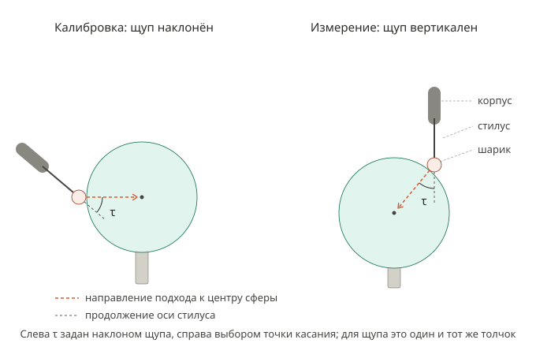
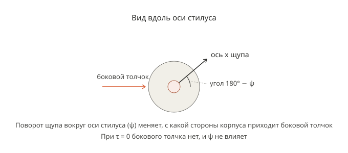

# Калибровка щупа WP-500 по сфере: погрешности регистрации касания

Сводка обсуждения от 2026-10-30. Документ объясняет, какую задачу решает пользователь, какие погрешности возникают при регистрации касания, что из этого следует для калибровки и какие решения ещё не приняты. Это не ExecPlan; ничего из того, что помечено как предложение, не реализовано.

Связанные файлы:

- `docs/ROBOT_PROBE_SPHERE_CALIBRATION.md` — постановка калибровки: неизвестные, условие касания, метод наименьших квадратов, якобиан. Сейчас там 6 неизвестных и фиксированное расстояние между центрами шарика и сферы 14 мм.
- `plans/PROBE_SPHERE_CALIBRATION_EXECPLAN.md`, раздел «The touch geometry» — 37 касаний, их углы, порядок, переходы по дуге, зазоры до стола и стойки.
- `src/trajectories/probe/probetouchplan.cpp` — таблица касаний `Touches` и функция поворота щупа `touchRotation`.
- `resources/files/rsi/RSI_Probe_Lin_CONTRACT.md` — тестовое RSI-движение LIN с остановкой по `$IN[11]` (пользователь проверил: работает).
- `docs/ARCHITECTURE.md`, раздел «Additional hardware and Delta I/O wiring» — путь сигнала щупа.
- `plans/figures/probe_tilt_tau.svg`, `plans/figures/probe_roll_psi.svg` — рисунки к разделу 3.

## 1. Какая задача решается

Конечная цель — измерять поверхности деталей щупом WP-500, установленным на фланце робота KUKA KR 10 R1420 с контроллером KR C4. Для этого нужно точно знать положение центра рубинового шарика щупа относительно фланца робота. Сейчас известно только приближённое значение из TOOL_DATA[5]: X −0.048, Y −0.097, Z 127 мм (измерено на КИМ для щупа с адаптером).

Способ: шарик касается неподвижной эталонной сферы Ø25 мм много раз при разных ориентациях фланца. В каждом касании записываются углы сочленений робота. Затем методом наименьших квадратов подбираются центр шарика относительно фланца и центр сферы так, чтобы при всех касаниях рассчитанный центр шарика отстоял от центра сферы на одно и то же расстояние.

Проблема, ради которой написан документ: робот узнаёт о касании не в момент касания, а позже, и к этому моменту успевает проехать дальше к центру сферы. Этот проезд состоит из двух частей. Одна из них зависит от того, с какой стороны щупа толкает сфера, и поэтому различается между касаниями. Нужно понять, какие из этих погрешностей искажают найденный центр шарика, какие нет, и что с ними делать.

## 2. Термины и обозначения

Каждый термин вводится в виде «русский термин (английский термин) — определение»; дальше в тексте используется только русский термин. Обозначения вне таблиц записаны в LaTeX. Векторы обозначаются строчными буквами с чертой, например $\bar{q}$. Символы с левым верхним индексом (система координат, в которой выражен вектор) записываются только в отдельных формулах.

### 2.1. Системы координат

Как в `docs/ROBOT_PROBE_SPHERE_CALIBRATION.md`:

- {B} — базовая система робота; совпадает с WORLD KUKA, потому что `$BASE` и `$ROBROOT` нулевые.
- {F} — система фланца.
- {P} — система щупа: начало в центре шарика, оси параллельны осям {F}, ось z направлена от фланца вдоль стилуса.
- {S} — система сферы: начало в центре сферы, оси параллельны осям {B}.

### 2.2. Оборудование и сигналы

- Шарик (ruby ball) — рубиновый шарик Ø3 мм на конце стилуса.
- Стилус (stylus) — стержень щупа, на конце которого закреплён шарик.
- Корпус щупа (probe body) — часть щупа между фланцем и стилусом.
- Кинематический щуп (kinematic touch-trigger probe) — щуп, в котором держатель стилуса лежит на трёх опорах и срабатывает, когда сдвигается с них. WP-500, по-видимому, такой; паспорта в `manuals` нет, не проверено.
- Срабатывание щупа (trigger) — момент, когда выход WP-500 (NPN) переключается.
- `$IN[11]` — вход KR C4, на который приходит срабатывание. Путь сигнала: выход WP-500 → вход X2.0 ПЛК Delta → программа ПЛК копирует его на выход Y1.5 → вход 11 модуля EL1809 → `$IN[11]`.
- RSI (RobotSensorInterface) — интерфейс KUKA, через который контроллер раз в цикл 4 мс обменивается данными с ПК и опрашивает входы. Объект STOP в контексте RSI останавливает движение по переднему фронту `$IN[11]` прямо на контроллере, без участия ПК.
- TCP — точка, которую робот считает центром шарика: вычисляется прямой задачей кинематики по углам сочленений с TOOL_DATA[5]. После касания реальный шарик стоит на поверхности сферы, а TCP движется дальше вместе с корпусом щупа; стилус при этом изгибается.
- Обнаружение касания (detection) — момент, когда контроллер видит `$IN[11]` = TRUE.

### 2.3. Геометрия сферы и касаний

- $r_b$ — радиус шарика, номинал 1,5 мм (в `docs/ROBOT_PROBE_SPHERE_CALIBRATION.md` обозначен $r_r$).
- $r_s$ — радиус эталонной сферы, номинал 12,5 мм.
- $d$ — расстояние между центрами шарика и сферы в момент касания, мм: $d = r_b + r_s = 14$ мм.
- Оболочка касания (contact shell) — сфера радиуса $d$ вокруг центра эталонной сферы; на ней лежит центр шарика в момент касания.
- Зазор подхода (approach gap) $g$ — расстояние от оболочки старта до оболочки касания, 3 мм.
- Оболочка старта (start shell) — сфера радиуса $d + g = 17$ мм вокруг центра эталонной сферы.
- $\lambda$ — широта точки касания на сфере, градусы.
- $\mu$ — долгота точки касания на сфере, градусы; $\mu = 0$ вдоль оси x системы {B}, $\mu = 90°$ вдоль оси y.
- $i$ — номер касания калибровки, 1…37, в порядке выполнения (порядок строк таблицы `Touches`).

Внешняя нормаль сферы в точке касания, как в коде (`sphereNormal`):

$$
\bar{n}(\lambda,\mu) = \begin{bmatrix} \cos\lambda\cos\mu \\ \cos\lambda\sin\mu \\ \sin\lambda \end{bmatrix}
$$

где $\bar{n}(\lambda,\mu)$ — единичный вектор в {B}, направленный от центра сферы наружу через точку касания; $\lambda$ — широта точки касания; $\mu$ — долгота точки касания.

- Направление подхода (approach direction) — направление, в котором робот ведёт шарик к центру сферы; в {B} это $-\bar{n}(\lambda,\mu)$.
- Наклон (tilt) $\tau$ — угол между осью стилуса и направлением подхода, градусы. Подробно в разделе 3.
- Поворот вокруг стилуса (roll) $\psi$ — поворот щупа вокруг оси стилуса, градусы. Подробно в разделе 3.

### 2.4. Движение одного касания

- Точка старта (start point) — точка на оболочке старта на нормали касания; в коде `p_start`.
- Переход (transfer) — движение по дуге CIRC по оболочке старта от точки старта предыдущего касания к точке старта этого касания; в коде `ProbeSegment::Transfer`.
- Подход (approach) — движение от точки старта к сфере вдоль направления подхода до обнаружения касания. В коде это `ProbeSegment::Approach`; в анимации он имеет длину 3 мм и постоянную скорость 1 мм/с. Предложено разбить подход на предподход и поиск.
- Отход (retract) — движение от точки обнаружения касания обратно к точке старта; в коде `ProbeSegment::Retract`.
- Точка ожидания (standoff point) — предлагаемая точка на направлении подхода близко к поверхности, но гарантированно до касания.
- Предподход (pre-approach) — предлагаемый быстрый участок подхода от точки старта до точки ожидания.
- Поиск (search) — предлагаемый участок подхода от точки ожидания с постоянной скоростью поиска до обнаружения касания. Если касание не обнаружено на заданной длине поиска, касание считается неудачным: робот возвращается в точку старта, и сообщается ошибка.

### 2.5. Величины модели касания

Все величины, кроме $t$, измеряются вдоль направления подхода.

- $t$ — время от начала поиска, с; $t = 0$ в точке ожидания.
- Скорость поиска (search speed) $v_s$ — постоянная скорость TCP на всём поиске, мм/с.
- $x(t)$ — координата TCP вдоль направления подхода в момент $t$, мм.
- $t_c$ — момент касания (contact) шарика со сферой, с.
- $x(t_c)$ — координата TCP в момент касания, мм. Задаётся положением поверхности и от $v_s$ не зависит.
- Отклонение стилуса (stylus deflection) $\delta(t)$ — насколько TCP прошёл дальше положения касания к моменту $t$, мм.
- Ход до срабатывания (pretravel) $\delta_p$ — отклонение стилуса, при котором щуп срабатывает, мм.
- $t_{trig}$ — момент срабатывания щупа, с.
- Задержка сигнала (latency) $t_{lat}$ — время от срабатывания щупа до обнаружения касания, с.
- $t_{det}(v_s)$ — момент обнаружения касания при скорости поиска $v_s$, с.
- Зарегистрированная координата (detected position) $p(v_s)$ — координата TCP в момент обнаружения касания, мм.
- Расстояние касания (contact distance) $\rho$ — расстояние от центра сферы до зарегистрированного центра шарика, мм.

### 2.6. Подгонка

- Подгонка (fit) — подбор неизвестных методом наименьших квадратов.
- Остаток подгонки (residual) касания $i$ — разность между расстоянием от рассчитанного центра шарика до найденного центра сферы и требуемым расстоянием касания, мм.

### 2.7. Термины КИМ (раздел 8)

- КИМ (CMM, coordinate measuring machine) — координатно-измерительная машина.
- Квалификация щупа (probe qualification) — касания эталонной сферы на КИМ, по которым находят положение шарика и эффективный радиус шарика.
- Эффективный радиус шарика (effective, «electronic» ball radius) $r_{eff}$ — радиус шарика за вычетом среднего хода до срабатывания, мм.
- Разброс хода до срабатывания по направлениям (pre-travel variation, PTV; lobing) — различие хода до срабатывания при касании с разных сторон относительно щупа.
- Расстояние предварительного подхода (prehit distance) — расстояние до поверхности, с которого КИМ переходит с быстрого движения на постоянную скорость касания; аналог точки ожидания.

## 3. Наклон τ и поворот вокруг стилуса ψ

Наклон $\tau$ — угол между осью стилуса и направлением подхода. При $\tau = 0$ стилус смотрит прямо в центр сферы, и сфера толкает шарик вдоль оси стилуса. При $\tau > 0$ толчок приходится частично вбок.

Один и тот же наклон получается двумя способами (рисунок 1). Слева калибровка: точка касания задана широтой и долготой, а щуп наклоняется на $\tau$; в коде наклон выполняется в плоскости меридиана, от направления на центр сферы в сторону «вниз». Справа щуп неподвижен по ориентации и смотрит вертикально вниз, а наклон получается выбором точки касания: точка лежит на угловом расстоянии $\tau$ от верхнего полюса сферы. Для самого щупа оба случая одинаковы: толчок приходит под тем же углом $\tau$ к оси стилуса.

Поворот вокруг стилуса $\psi$ определяет, с какой стороны корпуса щупа приходится боковая часть толчка (рисунок 2). Кинематический щуп с тремя опорами реагирует на толчки с разных сторон по-разному. При $\tau = 0$ бокового толчка нет, и поворот вокруг стилуса не влияет.

Поворот щупа при касании в коде (`touchRotation`):

$$
R_P(\lambda,\mu,\tau,\psi) = R_z(\mu)\,R_y(90° - \lambda - \tau)\,R_x(180°)\,R_z(\psi)
$$

где $R_P(\lambda,\mu,\tau,\psi)$ — матрица поворота системы {P} относительно {B} при касании; $R_z$, $R_y$, $R_x$ — матрицы поворота вокруг осей z, y, x на указанный угол; $\lambda$ — широта точки касания; $\mu$ — долгота точки касания; $\tau$ — наклон; $\psi$ — поворот вокруг стилуса.

Направление подхода, выраженное в системе {P} (выведено в обсуждении из формулы выше, численно не проверено):

$$
\bar{k}_P(\tau,\psi) = \begin{bmatrix} -\sin\tau\cos\psi \\ \sin\tau\sin\psi \\ \cos\tau \end{bmatrix}
$$

где $\bar{k}_P(\tau,\psi)$ — единичный вектор направления подхода в системе {P}; $\tau$ — наклон; $\psi$ — поворот вокруг стилуса. При $\tau = 0$ вектор совпадает с осью z системы {P}, то есть с осью стилуса.

Направление подхода в системе щупа зависит только от наклона и поворота вокруг стилуса. Поэтому всё, что зависит от направления толчка относительно щупа, в частности ход до срабатывания, есть функция пары $(\tau, \psi)$.

37 касаний используют 19 разных пар (τ, ψ); все касания с τ = 0 считаются одной парой. Углы в градусах, номера касаний — по порядку строк таблицы `Touches`.

| Пара | τ | ψ | Касания |
| --- | --- | --- | --- |
| 1 | 0 | любой | 1, 4, 5, 8, 13, 14, 18, 19, 21, 22, 23, 26, 27, 37 |
| 2 | 15 | 30 | 20 |
| 3 | 15 | 90 | 12, 34, 35 |
| 4 | 15 | 120 | 31 |
| 5 | 15 | −150 | 24 |
| 6 | 30 | 0 | 3, 6 |
| 7 | 30 | 30 | 2 |
| 8 | 30 | 60 | 11, 36 |
| 9 | 30 | 120 | 29 |
| 10 | 30 | −90 | 25 |
| 11 | 40 | 30 | 9 |
| 12 | 45 | 60 | 10 |
| 13 | 45 | 90 | 28, 33 |
| 14 | 45 | 120 | 32 |
| 15 | 50 | 0 | 7 |
| 16 | 50 | −90 | 17 |
| 17 | 50 | −120 | 16 |
| 18 | 50 | −150 | 15 |
| 19 | 55 | 120 | 30 |

Почему наклон и поворот вокруг стилуса у касаний разные, а не одни на все: при $\tau = 0$ у нижних касаний ($\lambda = -30°$) корпуса сочленений A4 и A5 опускались к поверхности стола или ниже её; наклон 30–45° поднимает их, минимальный зазор около 65 мм. Поворот вокруг стилуса подобран для каждого касания так, чтобы A6 не выходил за ±350°, а A4 и A5 (не более 115°) оставались в своих пределах. Одна фиксированная пара не позволила бы выполнить все 37 касаний; какие касания тогда остались бы, не вычислялось.

## 4. Модель регистрации касания

Модель описывает только поиск: от точки ожидания ($t = 0$) до обнаружения касания. Предподход и торможение после обнаружения в модель не входят.

Движение TCP при поиске:

$$
x(t) = x(0) + v_s\,t
$$

где $x(t)$ — координата TCP вдоль направления подхода в момент $t$; $x(0)$ — координата точки ожидания; $v_s$ — скорость поиска; $t$ — время от начала поиска.

Момент касания:

$$
t_c = \frac{x(t_c) - x(0)}{v_s}
$$

где $t_c$ — момент касания; $x(t_c)$ — координата TCP в момент касания; $x(0)$ — координата точки ожидания; $v_s$ — скорость поиска.

До касания стилус не отклонён. После касания реальный шарик стоит на поверхности, а TCP продолжает движение, поэтому отклонение стилуса равно пути TCP после касания:

$$
\delta(t) = 0 \ \text{при } t < t_c, \qquad \delta(t) = x(t) - x(t_c) = v_s\,(t - t_c) \ \text{при } t \ge t_c
$$

где $\delta(t)$ — отклонение стилуса в момент $t$; $x(t)$ — координата TCP в момент $t$; $x(t_c)$ — координата TCP в момент касания; $v_s$ — скорость поиска; $t_c$ — момент касания.

Щуп срабатывает, когда отклонение стилуса достигает хода до срабатывания:

$$
t_{trig} = t_c + \frac{\delta_p}{v_s}
$$

где $t_{trig}$ — момент срабатывания щупа; $t_c$ — момент касания; $\delta_p$ — ход до срабатывания; $v_s$ — скорость поиска.

Контроллер обнаруживает касание через задержку сигнала после срабатывания:

$$
t_{det}(v_s) = t_{trig} + t_{lat} = t_c + \frac{\delta_p}{v_s} + t_{lat}
$$

где $t_{det}(v_s)$ — момент обнаружения касания; $t_{trig}$ — момент срабатывания щупа; $t_{lat}$ — задержка сигнала; $t_c$ — момент касания; $\delta_p$ — ход до срабатывания; $v_s$ — скорость поиска.

Зарегистрированная координата:

$$
p(v_s) = x(t_{det}(v_s)) = x(t_c) + \delta_p + v_s\,t_{lat}
$$

где $p(v_s)$ — зарегистрированная координата при скорости поиска $v_s$; $x(t_{det}(v_s))$ — координата TCP в момент обнаружения касания; $x(t_c)$ — координата TCP в момент касания; $\delta_p$ — ход до срабатывания; $v_s$ — скорость поиска; $t_{lat}$ — задержка сигнала.

Ход до срабатывания и проезд $v_s\,t_{lat}$ проходятся последовательно, а не одновременно: $\delta_p$ — путь TCP от касания до срабатывания, $v_s\,t_{lat}$ — путь TCP от срабатывания до обнаружения. Стилус всё это время изгибается, и в момент обнаружения его отклонение равно их сумме.

Пример с условными значениями: поиск начинается на 1027 мм, скорость поиска 1 мм/с, касание на 1030 мм, ход до срабатывания 0,008 мм, задержка сигнала 15 мс.

| Событие | Время, с | Координата TCP, мм | Отклонение стилуса, мм |
| --- | --- | --- | --- |
| начало поиска | 0,000 | 1027,000 | 0 |
| касание | 3,000 | 1030,000 | 0 |
| срабатывание щупа | 3,008 | 1030,008 | 0,008 |
| обнаружение касания | 3,023 | 1030,023 | 0,023 |

Допущения модели:

- Скорость TCP постоянна и равна $v_s$ от касания до обнаружения, поэтому касание должно произойти на поиске, а не на предподходе.
- Всё, кроме стилуса, жёсткое: сфера, стойка, крепление щупа и робот при малой силе срабатывания.
- Задержка сигнала меняется от касания к касанию случайно (раздел 6).

## 5. Что из этого следует для калибровки

### 5.1. Одинаковый у всех касаний сдвиг не искажает центр шарика

В момент обнаружения фланец прошёл после касания $\delta_p + v_s\,t_{lat}$ вдоль направления подхода, то есть к центру сферы. Поэтому центр шарика, рассчитанный с истинным положением шарика относительно фланца, лежит на расстоянии

$$
\rho = d - \delta_p - v_s\,t_{lat}
$$

от центра сферы, где $\rho$ — расстояние касания; $d$ — расстояние между центрами шарика и сферы в момент касания; $\delta_p$ — ход до срабатывания; $v_s$ — скорость поиска; $t_{lat}$ — задержка сигнала.

Если этот сдвиг одинаков у всех касаний, все зарегистрированные центры шарика лежат на сфере с тем же центром, только меньшего радиуса $\rho$.

Сейчас в `docs/ROBOT_PROBE_SPHERE_CALIBRATION.md` для каждого касания $i$ требуется:

$$
\left\| {}^{B}\bar{p}_F(\bar{q}_i) + {}^{B}R_F(\bar{q}_i)\,{}^{F}\bar{p}_r - {}^{B}\bar{p}_s \right\| = d
$$

где $\bar{q}_i$ — углы сочленений в момент обнаружения касания $i$; $d$ — расстояние между центрами шарика и сферы в момент касания;

$$
{}^{B}\bar{p}_F(\bar{q}_i)
$$

— положение начала системы {F} в {B}, рассчитанное по углам $\bar{q}_i$;

$$
{}^{B}R_F(\bar{q}_i)
$$

— матрица поворота системы {F} относительно {B}, рассчитанная по углам $\bar{q}_i$;

$$
{}^{F}\bar{p}_r
$$

— искомое положение центра шарика в {F};

$$
{}^{B}\bar{p}_s
$$

— неизвестное положение центра сферы в {B}.

Предложение «расстояние касания как седьмое неизвестное»: заменить известное $d$ неизвестным $\rho$, которое подбирается вместе с остальными шестью неизвестными. Тогда средний ход до срабатывания, средний проезд $v_s\,t_{lat}$ и неточность номинальных радиусов шарика и сферы уходят в $\rho$, и знать их не нужно.

### 5.2. Ориентация фланца обязана меняться

При одной ориентации фланца смещение центра шарика относительно фланца сдвигает все рассчитанные центры шарика одинаково, и подгонка не может отличить его от сдвига сферы. Центр шарика проявляется только тогда, когда фланец поворачивается между касаниями. Точность определяется размахом поворотов: большие повороты вокруг разных осей. Повороты только вокруг оси стилуса определяют две поперечные составляющие центра шарика, но не составляющую вдоль стилуса; пример — ручные касания в двух ориентациях, повёрнутых на 180° вокруг стилуса (раздел 9).

### 5.3. Наклоны нужны, если расстояние касания подбирается

Если у всех касаний $\tau = 0$, ошибка центра шарика вдоль стилуса сдвигает каждый рассчитанный центр шарика прямо к центру сферы или от него, так же как изменение расстояния касания. Тогда эту составляющую нельзя отделить от $\rho$. При $\tau \ne 0$ такая ошибка сдвигает точки вбок относительно сферы и становится различимой. В таблице касаний наклон от 0 до 55°.

### 5.4. Переменная часть хода до срабатывания искажает центр шарика

Постоянство хода до срабатывания при всех касаниях — допущение, и оно неверно. У кинематического щупа ход до срабатывания зависит от направления толчка относительно щупа, то есть от наклона и поворота вокруг стилуса:

$$
\rho_i = d - \delta_p(\tau_i,\psi_i) - v_s\,t_{lat}
$$

где $\rho_i$ — расстояние касания при касании $i$; $d$ — расстояние между центрами шарика и сферы в момент касания; $\delta_p(\tau_i,\psi_i)$ — ход до срабатывания при наклоне $\tau_i$ и повороте вокруг стилуса $\psi_i$ касания $i$; $v_s$ — скорость поиска; $t_{lat}$ — задержка сигнала.

Ход до срабатывания раскладывается на две части:

- Среднее по всем касаниям. Оно поглощается подбираемым расстоянием касания (раздел 5.1).
- Отклонение от среднего у каждого касания. Оно не поглощается: рассчитанные центры шарика лежат не на сфере, а на слегка «помятой» поверхности, и это сдвигает найденный центр шарика.

Величина этого отклонения для WP-500 неизвестна. У щупов Renishaw разброс хода до срабатывания по направлениям порядка ±0,6…±2 мкм (раздел 8).

Составляющую отклонения, линейную по направлению подхода в {P}, нельзя отличить от сдвига центра шарика: она войдёт в найденное положение шарика. По выводу обсуждения, для последующих измерений поверхностей это не ошибка: найденный «эффективный» центр шарика её и учитывает. Численно это не проверено.

## 6. Задержка сигнала

Состав задержки сигнала (оценка по паспортам и настройкам, не измерено):

| Звено | Задержка |
| --- | --- |
| программный фильтр входа ПЛК (X2.0, модуль AS16AP11T-A) | 10 мс по скриншоту пользователя; диапазон 0–25 мс, одно значение на весь модуль |
| цикл ПЛК | 1–2 цикла, длительность цикла неизвестна |
| выход Y1.5 | не более 0,5 мс |
| фильтр EL1809 | 3 мс, фиксированный |
| EtherCAT | неизвестно |
| опрос `$IN[11]` в RSI | 0–4 мс |

Итого порядка 15–20 мс; при скорости поиска 1 мм/с это 0,015–0,020 мм проезда.

Свойства задержки сигнала:

- Средняя задержка сигнала не зависит от ориентации касания: всё, что зависит от направления толчка, происходит до срабатывания и входит в ход до срабатывания. Это допущение, основанное на устройстве цепи сигнала.
- Задержка сигнала случайно меняется от касания к касанию на величину до 4 мс (опрос RSI) плюс фаза цикла ПЛК. При скорости поиска 1 мм/с это шум до 0,004 мм. Для отдельного касания её определить нельзя.
- Для калибровки центра шарика знать задержку сигнала не нужно, если расстояние касания подбирается (раздел 5.1) и скорость поиска одинакова у всех касаний: средний проезд $v_s\,t_{lat}$ уходит в $\rho$.
- Знать задержку сигнала нужно для тормозного пути после касания и для последующих измерений поверхностей, где подбирать расстояние касания нечем.

Способы определить среднюю задержку сигнала:

1. Две скорости поиска (рекомендовано в обсуждении). Касаться одной точки при одной ориентации около 10 раз при скорости $v_1$ (например 0,5 мм/с) и около 10 раз при скорости $v_2$ (например 5 мм/с), усреднить зарегистрированные координаты для каждой скорости. Для одной точки и одной ориентации координата касания и ход до срабатывания одинаковы:

$$
p(v_1) = x(t_c) + \delta_p + v_1\,t_{lat}, \qquad p(v_2) = x(t_c) + \delta_p + v_2\,t_{lat}
$$

где $p(v_1)$, $p(v_2)$ — средние зарегистрированные координаты при скоростях поиска $v_1$ и $v_2$; $x(t_c)$ — координата TCP в момент касания; $\delta_p$ — ход до срабатывания; $t_{lat}$ — средняя задержка сигнала. Вычитание первого равенства из второго даёт

$$
t_{lat} = \frac{p(v_2) - p(v_1)}{v_2 - v_1}
$$

где $t_{lat}$ — средняя задержка сигнала; $p(v_1)$, $p(v_2)$ — средние зарегистрированные координаты при скоростях поиска $v_1$ и $v_2$.

Для этого ПК должен знать, в каком цикле RSI контроллер увидел `$IN[11]`: контекст RSI должен передавать состояние `$IN[11]` на ПК каждый цикл (объект DIGIN1 дополнительно соединить со входом ETHERNET1). Не сделано.

2. Осциллограф: время между фронтом выхода щупа на X2.0 и фронтом на входе 11 EL1809. Не покрывает EtherCAT и опрос RSI.
3. Оценка по паспортам: 15–20 мс, только для проверки способов 1 и 2.

Способы уменьшить задержку сигнала (предложения, решение не принято):

- Фильтр модуля с X2.0 поставить 0 мс; это действует на все входы этого модуля.
- Постоянный цикл ПЛК 1 мс или команды немедленного ввода-вывода Delta (REF и подобные).
- Внешние прерывания ПЛК доступны только на X0.0–X0.15; X2.0 к ним не относится.
- Преобразователь NPN→PNP, чтобы подать выход WP-500 прямо на EL1809 в обход ПЛК, — только если это действительно необходимо.
- Замена модулей EL (например, на EL1819 с фильтром 10 мкс) не рассматривается: ограничение пользователя.

## 7. Как учитывать зависимость хода до срабатывания от наклона и поворота вокруг стилуса

Варианты:

0. Сначала проверить, есть ли зависимость. Выполнить калибровку с подбираемым расстоянием касания и посмотреть остатки подгонки. Если все остатки на уровне шума опроса RSI (около 0,004 мм при скорости поиска 1 мм/с) и касания с одинаковой парой (τ, ψ) не имеют систематически похожих остатков, зависимостью можно пренебречь.
1. Одна пара (τ, ψ) на все касания. Тогда ход до срабатывания одинаков, но многие касания станут недостижимыми или опасными (раздел 3). Противоречит охвату сферы.
2. Таблица расстояний касания по парам (τ, ψ), измеренная отдельно; подробно ниже.
3. Группы касаний: объединить касания в несколько классов по (τ, ψ) и подбирать свой сдвиг для каждого класса. Каждому классу нужно достаточно касаний.

Порядок варианта 2:

1. Фланец ориентирован так, что щуп смотрит вертикально вниз (A 180, B 0, C 180), и эта ориентация не меняется до конца измерения.
2. Для каждой из 19 пар $(\tau_k, \psi_k)$, $k = 1 \ldots 19$, робот подходит к сфере вдоль направления $R\,\bar{k}_P(\tau_k,\psi_k)$, где $R$ — неизменная матрица поворота системы {P} относительно {B}, $\bar{k}_P(\tau_k,\psi_k)$ — направление подхода в {P} для пары $k$. Точка касания лежит на широте $90° - \tau_k$, то есть в верхней части сферы, вдали от стойки и стола.
3. Каждое направление повторяется около 5 раз (условное число) с той же скоростью поиска, что и при калибровке.
4. Подгонка: центр сферы и для каждой пары своё расстояние касания:

$$
\min_{\bar{c},\,\rho_1 \ldots \rho_{19}} \sum_{k=1}^{19}\sum_{j} \left( \|\bar{p}_{kj} - \bar{c}\| - \rho_k \right)^2
$$

где $\bar{c}$ — подбираемый центр сферы в {B}; $\rho_k$ — подбираемое расстояние касания для пары $k$; $\bar{p}_{kj}$ — рассчитанный по углам сочленений и номинальному TOOL_DATA[5] центр шарика в повторе $j$ пары $k$, в {B}; $k$ — номер пары; $j$ — номер повтора.

Сдвиг $\bar{c}$ меняет каждое $\rho_k$ на проекцию этого сдвига на направление подхода, поэтому линейная по направлению часть расстояний касания неопределима. Её принимают равной нулю условием

$$
\sum_{k=1}^{19} \left(\rho_k - \bar{\rho}\right) \bar{k}_P(\tau_k,\psi_k) = 0
$$

где $\rho_k$ — расстояние касания для пары $k$; $\bar{\rho}$ — среднее всех $\rho_k$; $\bar{k}_P(\tau_k,\psi_k)$ — направление подхода в {P} для пары $k$.

5. В калибровке касание $i$ требует расстояния касания из таблицы для своей пары вместо $d$:

$$
\left\| {}^{B}\bar{p}_F(\bar{q}_i) + {}^{B}R_F(\bar{q}_i)\,{}^{F}\bar{p}_r - {}^{B}\bar{p}_s \right\| = \rho(\tau_i,\psi_i)
$$

где $\bar{q}_i$ — углы сочленений в момент обнаружения касания $i$; $\rho(\tau_i,\psi_i)$ — расстояние касания из таблицы для наклона $\tau_i$ и поворота вокруг стилуса $\psi_i$ касания $i$;

$$
{}^{B}\bar{p}_F(\bar{q}_i)
$$

— положение начала системы {F} в {B};

$$
{}^{B}R_F(\bar{q}_i)
$$

— матрица поворота системы {F} относительно {B};

$$
{}^{F}\bar{p}_r
$$

— искомое положение центра шарика в {F};

$$
{}^{B}\bar{p}_s
$$

— неизвестное положение центра сферы в {B}.

Почему ошибки робота не мешают варианту 2: ориентация щупа не меняется, а робот перемещается в области около 30 мм. Неточность TOOL_DATA[5] сдвигает все рассчитанные центры шарика одинаково; погрешность позиционирования робота в этой области почти одинакова (допущение). Оба сдвига уходят в центр сферы, а не в расстояния касания.

Что вариант 2 требует и чего не требует:

- Не требует знать радиусы шарика и сферы, ход до срабатывания и задержку сигнала по отдельности: всё это входит в расстояния касания из таблицы.
- Требует, чтобы калибровка шла на той же сфере и с той же скоростью поиска.
- Требует малой погрешности формы сферы: отклонение формы в точке касания будет принято за отклонение хода до срабатывания. Класс точности сферы неизвестен.
- Допущение: ход до срабатывания зависит только от наклона и поворота вокруг стилуса, но не от направления силы тяжести относительно щупа. Здесь щуп всегда смотрит вниз, а при калибровке ориентирован по-разному. Проверка: повторить измерение с горизонтальным щупом и сравнить таблицы.
- Таблица верна только для этих 19 пар. Для измерений поверхностей под другими углами нужна более густая таблица или касания только под измеренными парами.

## 8. Как это делается на КИМ (для сравнения)

Источники: Renishaw white paper «Innovations in touch-trigger probe sensor technology», паспорт TP20, руководство Renishaw по калибровке станочных щупов, описание Inspection Plus (ссылки приведены в чате 2026-10-30). Пункты с пометкой «общая практика» по документации не проверены.

1. Во время квалификации одного щупа его ориентация постоянна: у КИМ только линейные оси. Меняется направление касания (разные точки сферы), как в варианте 2.
2. КИМ касается эталонной сферы обычно в 5–25 точках, на полюсе и по кольцам (общая практика), с той же скоростью касания, что и при измерениях. Машина быстро подводит щуп на расстояние предварительного подхода, дальше движется с постоянной скоростью касания.
3. Зарегистрированные центры шарика лежат на расстоянии $r_s + r_b - \delta_p$ от центра сферы, где $r_s$ — радиус сферы, $r_b$ — радиус шарика, $\delta_p$ — ход до срабатывания при данном касании. Подгонка сферы даёт центр и радиус

$$
R_{fit} = r_s + r_b - \bar{\delta}_p
$$

где $R_{fit}$ — радиус подогнанной сферы; $r_s$ — радиус эталонной сферы по сертификату; $r_b$ — физический радиус шарика; $\bar{\delta}_p$ — средний ход до срабатывания по касаниям квалификации.

4. Эффективный радиус шарика:

$$
r_{eff} = R_{fit} - r_s = r_b - \bar{\delta}_p
$$

где $r_{eff}$ — эффективный радиус шарика; $R_{fit}$ — радиус подогнанной сферы; $r_s$ — радиус эталонной сферы по сертификату; $r_b$ — физический радиус шарика; $\bar{\delta}_p$ — средний ход до срабатывания.

5. При измерении детали точка поверхности вычисляется сдвигом на эффективный радиус:

$$
\bar{s} = \bar{m} - r_{eff}\,\bar{n}_s
$$

где $\bar{s}$ — вычисленная точка поверхности детали; $\bar{m}$ — зарегистрированный центр шарика; $r_{eff}$ — эффективный радиус шарика; $\bar{n}_s$ — единичная внешняя нормаль поверхности детали в точке касания. Средний ход до срабатывания компенсируется; ошибка касания равна $\delta_p - \bar{\delta}_p$.

6. Разброс хода до срабатывания по направлениям не компенсируется. Он виден как разброс расстояний до подогнанной сферы (например StdDev в PC-DMIS) и указывается в паспорте щупа: TP20 ±0,6…±2 мкм, TP2-5W ±0,8 мкм, TP8 ±1 мкм в плоскости XY. Для большей точности Renishaw применяет тензометрический щуп TP200, а не компенсацию.
7. На станках (Inspection Plus) кроме обычной калибровки есть «векторная»: по сообщению на форуме, она записывает радиус ещё в 8 направлениях по окружности. Не проверено.
8. С поворотной головкой (например PH10) каждое её положение квалифицируется отдельно; разные ориентации в одной подгонке не смешиваются (общая практика).
9. Показания линеек КИМ защёлкиваются аппаратно в момент срабатывания, задержка порядка микросекунд (общая практика). У нас задержка сигнала около 15 мс.

Главное отличие нашего случая: КИМ знает своё положение точно и квалифицирует каждую ориентацию отдельно при известном центре сферы. Мы ищем центр шарика именно за счёт смены ориентации фланца при неизвестном центре сферы, поэтому в одной подгонке смешиваются касания с разными парами (τ, ψ), а значит и с разным ходом до срабатывания. Аналог стандартной практики КИМ у нас — подбор расстояния касания (раздел 5.1); таблица расстояний касания по парам — уровень векторной калибровки.

## 9. Известные данные

- Ручные касания (режим T1, инструмент TOOL_DATA[5], база World), 10 точек в `resources/calibration_sphere_jog_points.txt`: 5 при A 180, B 0, C 180 (щуп вниз) и 5 при A 0, B 0, C 180 (повёрнут на 180° вокруг стилуса). Подгонка всех 10 точек: центр (1054.1403, −331.9692, 454.2727) мм, радиус 13,8342 мм, СКО 0,0694 мм. Половины по отдельности дают радиусы 13,8147 и 13,8512 мм; их центры различаются на (0.115, −0.146, 0.061) мм, что указывает на поперечную ошибку TOOL_DATA[5] около половины горизонтальной разницы. Радиус на 0,17 мм меньше 14 мм: проезд после срабатывания при ручном перемещении шагами (0–0,1 мм) плюс ход до срабатывания. Эти касания не определяют составляющую центра шарика вдоль стилуса, потому что ориентации отличаются только поворотом вокруг стилуса (раздел 5.2).
- Тестовое RSI-движение `RSI_Probe_Lin` (LIN 100 мм вдоль X WORLD со скоростью 1 мм/с после PTP в TestStart с A5 = 35°) работает и останавливается по `$IN[11]` (сообщение пользователя). Первый запуск прямо из HOME (A5 = 0, особое положение кисти) дал ошибку превышения тока двигателя.
- Касаться сферы можно только выше 10,5 мм под её центром: стойка Ø17,8 мм, сфера утоплена в неё на 2 мм.

## 10. Состояние реализации

Сделано:

- 37 касаний, их порядок, переходы по дуге CIRC, проверки зазоров; Generate и анимация Dry Run в режиме Calibration (`plans/PROBE_SPHERE_CALIBRATION_EXECPLAN.md`).
- Модели стола и стойки в сцене для визуальной проверки столкновений.
- Тестовое RSI-движение LIN с остановкой по `$IN[11]` и кнопка «RSI test LIN».

Не сделано:

- RSI-движение калибровочных касаний: поиск, остановка, запись углов сочленений в момент обнаружения касания, отход, ошибка при неудачном касании.
- Передача состояния `$IN[11]` на ПК в контексте RSI.
- Решение задачи наименьших квадратов для центра шарика (ни с $d$, ни с подбираемым $\rho$).
- Измерение задержки сигнала, таблица расстояний касания по парам (τ, ψ), изменение настроек ПЛК.

## 11. Открытые вопросы и решения пользователя

1. Подбирать ли расстояние касания седьмым неизвестным вместо фиксированного $d = 14$ мм (раздел 5.1). Это требует изменить `docs/ROBOT_PROBE_SPHERE_CALIBRATION.md`: 7 неизвестных и новый столбец якобиана.
2. Какой вариант учёта зависимости хода до срабатывания от наклона и поворота вокруг стилуса выбрать (раздел 7). Предложенный порядок: сначала вариант 0, вариант 2 — только если остатки подгонки покажут зависимость.
3. Скорость поиска и длина поиска; разбиение подхода на предподход и поиск.
4. Нужно ли знать задержку сигнала сейчас (только для тормозного пути и будущих измерений поверхностей) и каким способом её измерять.
5. Какие меры уменьшения задержки сигнала применить: фильтр X2.0, цикл ПЛК, обход ПЛК.
6. Класс точности (погрешность формы) эталонной сферы неизвестен.
7. Паспортных данных WP-500 (ход до срабатывания, повторяемость, разброс по направлениям) нет.
